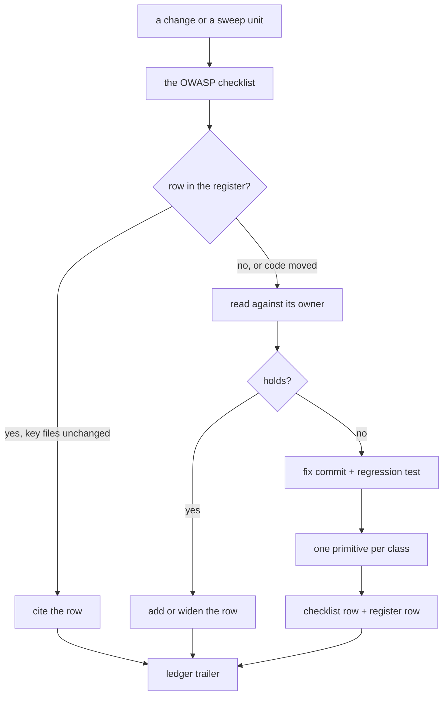

# Security Review

A security read asks what an attacker could do with a change. It is run on every change that crosses a trust boundary and, tree-wide, by the security sweep. The checklist of questions is the `security` skill's (`references/owasp-top-10.md`); this page is the process around it and the record of what has already been answered.

Sub-pages: [server authority](server-authority/design.md) · [cross-owner references](cross-owner-references/design.md). The app's runtime headers are the [security posture](../security-posture/design.md), and the Azure estate's are the [cost and security posture](../../infra/cost-and-security-posture/design.md).

## How it works

**A verified boundary is written down once, here, and cited after.** Re-deriving why a flow is safe costs a pass the same reading every time and finds nothing new; the register is what lets a later pass skip it. A row names the defence, the primitive that holds it and the page that explains it. A pass that finds the row's primitive or owner page changed since reads it again rather than trusting the row.

**A finding is fixed with the defence the class needs, not the instance.** The second place a hole of the same shape could appear is served by the same primitive, so a fix that hand-rolls a check for its one caller is a finding waiting to recur. Each class the checklist had no question for becomes a question there, and its defence goes to the skill or page that owns the subsystem (the [enforcement ladder](../enforcement-ladder/design.md)).

**A risk the owning page accepts is a decision, not a finding.** It is re-read only when the page's own revisit trigger fires.

## Register of verified boundaries

| Boundary                                          | The defence that holds it                                                                                                                                                                        | Primitive                                                                                 | Owner                                                                                                |
| :------------------------------------------------ | :----------------------------------------------------------------------------------------------------------------------------------------------------------------------------------------------- | :---------------------------------------------------------------------------------------- | :--------------------------------------------------------------------------------------------------- |
| Who may call a procedure                          | every procedure starts from a builder naming who may reach it; public is a builder of its own                                                                                                    | `standardAuthedProcedure`, the room builders, `standardRateLimitedProcedure`              | the `trpc` skill                                                                                     |
| A call through an API key                         | the key reaches only the tools of the scopes its permissions parse to, none by default, checked where the bridge lists and calls them                                                            | `getApiKeyScopes`, `createMcpServer`                                                      | [agent access](../agent-access/design.md)                                                            |
| A row describing another user                     | only public columns leave the server — never an email or a storage account                                                                                                                       | `PublicUserColumns`, `getPublicUserColumns`                                               | the `drizzle` skill, `references/queries.md`                                                         |
| A room action on another member                   | the permission bit and the role hierarchy, and nobody moderates themselves                                                                                                                       | the room permission builders, `assertIsManageable`                                        | [RBAC](../../esbabbler/rbac/design.md), [moderation](../../esbabbler/moderation/design.md)           |
| A moderation action on a call                     | the server evicts or revokes at the SFU, and every connection re-asks the room's door                                                                                                            | `evictRoomCallParticipants`, `updateLiveKitTrackSources`, `checkIsCallConnectionAdmitted` | [moderation](../../esbabbler/moderation/design.md), [server authority](server-authority/design.md)   |
| A message a member posts                          | a member posts only a message or a poll; every line in the room's voice is the server's                                                                                                          | `userMessageTypeSchema`                                                                   | [messaging](../../esbabbler/messaging/design.md)                                                     |
| A reaction a member adds                          | one emoji grapheme or a custom emoji's id, every other tag refused at the Zod boundary; a custom id resolves only in the room's own emoji map, so a foreign id shows as deleted                  | `messageEmojiMetadataEntitySchema`, `customEmojiMap`                                      | [emoji](../../esbabbler/emoji/design.md)                                                             |
| Rich text rendered as markup                      | sanitized once at the Zod boundary, a table keeping only the sanitizer's own layout and a class only what the editor writes; `v-html` only on a body that passed it, server-written text as text | `sanitizedMessageSchema`, `sanitizeTextHtml`                                              | the `string-utils` skill, `references/html-sanitization.md`                                          |
| Data rendered by a chart                          | every legend entry is escaped in the one chart component, whatever options a caller passes                                                                                                       | `getStyledApexOptions`                                                                    | [charts](../charts/design.md)                                                                        |
| Data a published dashboard carries                | each bound visual's snapshot keeps only the columns its query reads, so a chart of one column never publishes the rest of its source                                                             | `projectDatasetToQuery`                                                                   | [dashboard data binding](../../resource/dashboard-data-binding/design.md)                            |
| An author's HTML on a public page                 | a webpage or email renders in a sandboxed iframe with an opaque origin; a survey's html questions pass the sanitizer                                                                             | `SrcdocIframe`, `sanitizeHtml`                                                            | [publishing](../publishing/design.md)                                                                |
| An author's html question in the designer         | every survey instance the creator builds (the design surface, the preview and the property grid) passes an html question's markup through the sanitizer the respondent page applies              | `onSurveyInstanceSetupHandlers`, `sanitizeHtml`                                           | [survey resource](../../resource/survey-resource/design.md)                                          |
| A node id in the published stylesheet             | the id is bounded and limited to a CSS class name's characters, so it cannot close the `<style>` element its class sits in                                                                       | `nodeIdSchema`, `NODE_ID_REGEX`                                                           | [page builder document model](../../resource/page-builder/document-model/design.md)                  |
| A spreadsheet export                              | every CSV the app writes neutralizes each formula trigger, so an import's cells and a participant's key value alike open as text; a number is written as it is                                   | `escapeCsvCell`                                                                           | [program resource](../../resource/program-resource/design.md)                                        |
| Content naming another resource by id             | read only when the caller, or the content's owner, owns what it names                                                                                                                            | `readOwnedResource`, `checkIsResourceAssetReadable`                                       | [cross-owner references](cross-owner-references/design.md)                                           |
| An anonymous caller's identity                    | the rightmost `X-Forwarded-For` entry, which the front end appended, with its port dropped                                                                                                       | `getIpAddress`                                                                            | [rate limiting](../rate-limiting/design.md)                                                          |
| A bearer token or a guessable id                  | drawn from a cryptographic source, compared in constant time, and kept out of every log line                                                                                                     | `createId`, `checkIsUploadFileTokenValid`                                                 | [file uploads](../file-uploads/design.md)                                                            |
| A log line                                        | an event is logged by its id and subject, never its data, and a token is redacted from an error before it is logged                                                                              | the Functions event handlers, the webhook proxy route                                     | the `error-handling` skill, `references/logging-sinks.md`                                            |
| A blob name built from input                      | every client-supplied segment is one separator-free, non-dot segment, so no write or delete leaves its authorized prefix                                                                         | `BLOB_SEGMENT_REGEX`                                                                      | [file uploads](../file-uploads/design.md)                                                            |
| A scheduled send                                  | delivery re-runs the same creation rules the composer does, membership included, inside the job's claim                                                                                          | `getMessageCreationRejection`                                                             | [messaging](../../esbabbler/messaging/design.md)                                                     |
| A body larger than it claims                      | measured before it is downloaded and capped while it inflates; quota reserved under a row lock                                                                                                   | `readStagedResourceContent`, `readResourceContentDelta`, `reserveStorageBytes`            | [file uploads](../file-uploads/design.md), [storage quotas](../../resource/storage-quotas/design.md) |
| A patch that expands what it saves                | the patched document and its inverses are measured against the content cap by a walk that stops at the cap, before anything serializes them                                                      | `checkIsJsonSizeWithin`                                                                   | [agent content tools](../agent-content-tools/design.md)                                              |
| An anonymous write                                | a write that adds rows spends the slow budget, and its payload is capped at the property it is stored in                                                                                         | `slowRateLimitedProcedure`, `surveyResponseModelSchema`                                   | [survey resource](../../resource/survey-resource/design.md)                                          |
| A stale save                                      | the version check is part of the one UPDATE that writes the row                                                                                                                                  | `saveResourceContent`                                                                     | [resource save state](../../resource/resource-save-state/design.md)                                  |
| A query or filter built from input                | SQL through Drizzle's builder or the `sql` tag, Table filters through clause serialization                                                                                                       | `serializeClauses`, `escapeLike`                                                          | the `drizzle` skill, the `azure-table` skill                                                         |
| A public read that spends a third party's quota   | answered once per process, so no caller can exhaust the server's allowance for everyone                                                                                                          | `getCommitCount`                                                                          | [server authority](server-authority/design.md)                                                       |
| A link that configures the page                   | it asks the reader to Connect, warns when it points at another computer, and never acts on its own                                                                                               | the agent console's `linkedHost`, `getRemoteHostname`                                     | [agent console host](../../infra/claude-interface/agent-console/host/design.md)                      |
| A link that starts a program                      | the program takes the link as its one argument and refuses a launch carrying anything more, so a crafted link cannot pass flags                                                                  | `checkIsSchemeLaunchTampered`                                                             | [host installer](../../infra/claude-interface/agent-console/host-installer/design.md)                |
| An automation fed by public GitHub events         | a branch is matched with its repository, and the session's environment is stripped of secrets                                                                                                    | the review workflow                                                                       | [review](../../infra/review/design.md)                                                               |
| A link or media address a page holds              | the document schema refuses a scheme that can run a script, behind a leading space or another case, so no edit or render can hold one                                                            | `webpageUrlSchema`, `checkIsAllowedUrl`                                                   | [page document model](../../resource/page-builder/document-model/design.md)                          |
| A style value a page writes into its stylesheet   | a value holds no brace, angle bracket or comment delimiter, so it cannot close its rule or the stylesheet, and the document schema refuses one before a render writes it                         | `styleValueSchema`                                                                        | [page builder canvas](../../resource/page-builder/canvas/design.md)                                  |
| A raw HTML block in an email                      | the schema refuses a raw block the sanitiser would change, so an email carries the markup its author wrote and never a script                                                                    | `createMjmlRawContentSchema`                                                              | [mjml blocks](../../mjml-blocks/README.md)                                                           |
| A dataset value written into a personalized email | HTML-escaped for the text position it lands in, and every token replaced in one pass, so a value is never scanned for tokens again                                                               | `substituteMergeFields`                                                                   | [email personalization](../../resource/email-personalization/design.md)                              |
| Text pasted into a page from the clipboard        | the text must carry the editor's marker and every node in it must parse against the kind's own node schema, so text from elsewhere, or a node the kind does not take, is refused                 | `parseClipboardNodes`                                                                     | [page builder keyboard](../../resource/page-builder/keyboard/design.md)                              |

## Key files

Paths relative to the repo root.

| File                                                 | Role                                        |
| ---------------------------------------------------- | ------------------------------------------- |
| `.agents/skills/security/SKILL.md`                   | the rules a security read follows           |
| `.agents/skills/security/references/owasp-top-10.md` | the checklist, one section per category     |
| `.agents/ledgers/security/README.md`                 | the tree-wide sweep's areas and find recipe |
