# Serialization

How class instances (e.g. `StandardMessageEntity`) are serialized and deserialized across all three paths in the app: Azure Table read, SSR payload hydration, and tRPC transport. Each path, and each topic with decisions of its own, has a page below; this page holds what they share.

## The three paths

Each path is independent. They do not compose or run in sequence.

```mermaid
flowchart TB
  subgraph at [Azure Table read — server-side only]
    ROW["Azure SDK row<br/>date columns → Date · JSON columns → string"]
    DE["deserializeEntity.ts<br/>jsonDateParse(String(value)) per JSON column"]
    INST1["class instance<br/>createdAt: Date ✓"]
    ROW --> DE --> INST1
  end

  subgraph ssr [SSR / Nuxt payload — page load]
    PINIA["Pinia state (Date objects)"]
    RED["customPayloads.ts reducer<br/>JSON.stringify(entity)"]
    HTML["HTML payload<br/>createdAt: string"]
    REV["customPayloads.ts reviver<br/>new cls(jsonDateParse(data))"]
    INST2["class instance ✓<br/>instanceof cls"]
    PINIA --> RED --> HTML --> REV --> INST2
  end

  subgraph trpc [tRPC transport — query / mutation / subscription]
    SRV["server class instance (Date objects)"]
    SER["transformer.ts (SuperJSON)<br/>registerCustom serialize → JSON.stringify"]
    WIRE["HTTP or WebSocket"]
    DES["registerCustom deserialize<br/>new cls(jsonDateParse(data))"]
    INST3["class instance ✓<br/>instanceof cls"]
    SRV --> SER --> WIRE --> DES --> INST3
  end
```



`jsonDateParse` is the default parse repo-wide: plain `JSON.parse` is banned by oxlint's `no-restricted-properties`, so each of the deliberate exceptions below carries an `oxlint-disable-next-line no-restricted-properties` with its reason.

## Why `jsonDateParse` is needed on the transport paths

`StandardMessageEntity` (and all classes in `JSONClassMap`) extend `Serializable`, which defines:

```ts
toJSON(): this {
  return structuredClone(toRawDeep(this));
}
```

`JSON.stringify(entity)` calls `toJSON()` first, producing a plain-object clone. `JSON.stringify` then converts any `Date` fields in that clone to ISO strings. By the time the transport layer sees the bytes, the type metadata is gone.

Both the SSR and tRPC paths fix this by passing the raw JSON string through `jsonDateParse` during revival, which re-applies ISO date → `Date` conversion via its JSON reviver. The reviver also reconstructs the class instance (`new cls(...)`) so the result is a proper typed instance — preserving `instanceof` checks and class methods — not a plain object.

## Pages

| Page                                                       | What it decides                                                                                   |
| ---------------------------------------------------------- | ------------------------------------------------------------------------------------------------- |
| [Azure Table read](azure-table-path/design.md)             | Which columns are dates and which are JSON strings, and how an entity is rebuilt as its class     |
| [SSR payload](ssr-payload/design.md)                       | How Nuxt's payload reducer and reviver carry an instance into the HTML and back                   |
| [tRPC transport](trpc-transport/design.md)                 | The SuperJSON custom transformer over HTTP and WebSocket links                                    |
| [Class registry](class-registry/design.md)                 | Which classes serialize, and why the registry keys are an on-disk format                          |
| [Unregistered instances](unregistered-instances/design.md) | What a procedure may return: a registered class or a plain object, never an unregistered instance |
| [Resource content](resource-content/design.md)             | Why resource content is read with plain `JSON.parse` and its dates coerced by the schema          |
| [Content key order](content-key-order/design.md)           | Why a content blob's key order is load-bearing, and why it needs no canonicalization              |
| [The Genshin save](genshin-save/design.md)                 | Why the save's instants are read as ISO strings, never revived                                    |
| [Machine JSON](machine-json/design.md)                     | Why machine-written JSON whose string fields are paths parses plainly                             |

## What does not apply here

- **Plain objects / tRPC primitives**: SuperJSON handles these natively without class registration.
