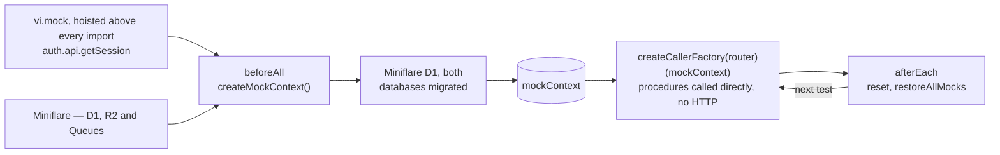

# Server-Side Testing

How tRPC router tests wire up an in-memory database, mocked Azure services, and a controlled auth session so procedures can be called directly without HTTP or real cloud resources.

## Overview



## Components

### 1. `@esposter/db-mock` — in-memory PostgreSQL

`createMockDb()` in `packages/db-mock/src/createMockDb.ts` returns one `MockDatabase` per test file, backed by one Miniflare instance:

1. Starts Miniflare with a `CORE` and a `STREAMS` D1 database, one R2 bucket per container and one Queue per job.
2. Applies each database's migration folder through drizzle's D1 migrator, the same SQL production runs.
3. Copies the instance's bindings into `env`, the `cloudflare:workers` stand-in that app code reads.
4. Returns `db` (the core database as `Database`), `streamsDb` (the streams D1 binding), `getBucket`, `getQueue`, `reset` and `dispose`.

**Why Miniflare instead of an in-process database?** It is the runtime's own D1, R2 and Queues, so a test exercises the SQL and bindings production runs, and nothing outlives the test file that started it.

**Environment cost.** Server tests — including almost every tRPC router test — run in the default `node` environment. They get **no DOM** — happy-dom is built by the nuxt environment only, so there is no manual happy-dom registration and node-env tests run without a `window`. A server test pays only the Miniflare boot + the auth `vi.mock` (plus the cheap global `fake-indexeddb/auto` polyfill). The one exception is a router that calls a Nuxt composable neither `context.test.ts` nor `shared/test/setup.ts` mocks, and such a router declares `// @vitest-environment nuxt` and pays the Nuxt environment build.

### 2. Bindings in place of Azure mocks

The Azure mock classes are deleted. A service takes the binding it uses as a parameter, so a test passes `getBucket(...)`, `getQueue(...)` or `streamsDb` from `createMockDb` and no in-memory store stands in for a client. `reset()` empties the databases and buckets after every test.

### 3. `context.test.ts` — wiring hub

`apps/web/server/trpc/context.test.ts` is the central test utility file. It exports the session helpers and the mock context consumed by every tRPC router test. The auth mock itself is registered once, by the shared test setup file.

**The auth session is mocked once, in `shared/test/setup.ts`, not here.** A registration written in a helper module reaches the router path but not a suite's own direct import of the module, while one in the setup file covers both — the hoisting rule behind that is `.agents/skills/testing/references/colocated-mocks.md`.

**`createMockContext()`** builds a full `Context`: the Miniflare database + mocked auth. The default user (base user) is inserted into the database and always available via `getMockSession()` — this user becomes the owner for all rooms/resources created in tests.

**Session helpers:**

| Helper                       | What it does                                                                                                                                                                 |
| ---------------------------- | ---------------------------------------------------------------------------------------------------------------------------------------------------------------------------- |
| `getMockSession()`           | Returns the default identity the test acts as: one user and one session for the whole run. A queued session does not change it, and reading it consumes nothing.             |
| `mockSessionOnce(db, user?)` | Inserts a new test user into the database (if no `user` given) and queues their session for the **next** API call only. After that call the default (owner) session resumes. |
| `replayMockSession(payload)` | Re-queues an existing session payload without inserting a new user. Use when the same non-owner user must make multiple sequential calls.                                    |

### 4. tRPC caller

Tests call procedures directly without HTTP:

```ts
const caller = createCallerFactory(userRouter)(mockContext);
await caller.readStatuses([userId]);
```

`createCallerFactory` (from `#server/trpc`) returns a factory that binds a `Context` to a router, producing a callable object that matches the router's procedure signatures.

## Test lifecycle

```text
beforeAll
  └─ createMockContext()     ← one DB + auth for the whole suite
  └─ createCallerFactory()   ← bind router to context

beforeEach
  └─ per-test setup only     ← vi.useFakeTimers(), fixture rows (e.g. a fresh room)

[ test body ]
  └─ mockSessionOnce(db)     ← when a non-owner user is needed
  └─ caller.someProc(input)

afterEach
  └─ reset()                  ← empties every table and bucket
  └─ vi.restoreAllMocks()    ← restores spy implementations + clears call history
```

All cleanup — the database and its buckets — lives in `afterEach`, never `beforeEach`: the database persists for the whole suite, so each test empties what it wrote immediately instead of relying on the next test to sweep up before running. Tests stay order-independent and the suite's last test leaks nothing. `beforeEach` is reserved for per-test setup such as fake timers or fixture rows.

## Key files

| File                                   | Role                                                   |
| -------------------------------------- | ------------------------------------------------------ |
| `packages/db-mock/src/createMockDb.ts` | Miniflare setup, migrations and bindings               |
| `apps/web/server/trpc/context.test.ts` | `createMockContext`, session helpers, `vi.mock` wiring |

## Adding a new router test

1. No environment directive — router tests run in the default `node` environment. Add `// @vitest-environment nuxt` as the first line only when the router calls a Nuxt composable that neither `context.test.ts` nor `shared/test/setup.ts` mocks.
2. Import `createMockContext`, session helpers, and your router from their canonical locations.
3. Follow the `beforeAll → createMockContext → createCallerFactory` pattern.
4. Use the base user (from `getMockSession()`) as the room/resource owner.
5. Use `mockSessionOnce(db)` only when a non-owner perspective is needed.
6. Reset the database in `afterEach` (not `beforeEach`).
