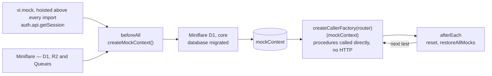

# Server-Side Testing

How tRPC router tests wire up an in-memory D1 database, Miniflare's R2 and Queues bindings, and a controlled auth session so procedures can be called directly without HTTP or real cloud resources.

## Overview



## Components

### 1. `@esposter/db-mock` — in-memory D1

`createMockDb()` in `packages/db-mock/src/createMockDb.ts` returns one `MockDatabase` per test file, backed by one Miniflare instance:

1. Starts Miniflare with a `CORE` D1 database, one R2 bucket per storage bucket and one Queue per job.
2. Applies the core migration folder through drizzle's D1 migrator, the same SQL production runs.
3. Copies the instance's bindings into `env`, the `cloudflare:workers` stand-in that app code reads.
4. Returns `db` (the core database as `Database`), `getBucket`, `getQueue`, `reset` and `dispose`.

**Why Miniflare instead of an in-process database?** It is the runtime's own D1, R2 and Queues, so a test exercises the SQL and bindings production runs, and nothing outlives the test file that started it.

**Environment cost.** Server tests — including almost every tRPC router test — run in the default `node` environment. They get **no DOM** — happy-dom is built by the nuxt environment only, so there is no manual happy-dom registration and node-env tests run without a `window`. A server test pays only the Miniflare boot + the auth `vi.mock` (plus the cheap global `fake-indexeddb/auto` polyfill). The one exception is a router that calls a Nuxt composable neither `context.test.ts` nor `shared/test/setup.ts` mocks, and such a router declares `// @vitest-environment nuxt` and pays the Nuxt environment build.

### 2. Bindings in place of service mocks

No cloud client is mocked. A service takes the binding it uses as a parameter, so a test passes `getBucket(...)` or `getQueue(...)` from `createMockDb` and no in-memory store stands in for a client. `reset()` empties the database and buckets after every test.

### 3. `context.test.ts` — wiring hub

`apps/web/server/trpc/context.test.ts` is the central test utility file. It exports the session helpers and the mock context consumed by every tRPC router test. The auth mock itself is registered once, by the shared test setup file.

**A test names its caller through its context.** Production reads the session once per request, in `createContext`, into `ctx.user` and `ctx.session`. A test builds the context itself, so it hands the caller in rather than mocking a session read: there is no queue, and a context's caller is fixed for its life.

**`createMockContext(authSession?)`** builds a full `Context` over the Miniflare database: the default identity when no caller is named, and signed out for `null`. The default user (base user) is inserted into the database and always available via `getMockSession()`; this user owns every room and resource a test creates.

**Identity helpers:**

| Helper                                   | What it does                                                                                                                  |
| ---------------------------------------- | ----------------------------------------------------------------------------------------------------------------------------- |
| `getMockSession()`                       | The default identity the test acts as: one user and one session for the whole run.                                            |
| `createMockAuthSession(db, user?)`       | A fresh user with a session row, or, given a user, a second session (device) of theirs. A context built over it acts as them. |
| `createMockUser(db)`                     | A second user for the test to act on rather than act as.                                                                      |
| `createMockCaller(router, authSession?)` | A router's caller over a fresh context acting as that caller: the default identity when none is named, signed out for `null`. |

Better-auth's own session read is still mocked in `shared/test/setup.ts` for the routes that read the cookie themselves (the socket routes and the asset route); the tRPC suites never reach it.

### 4. tRPC caller

Tests call procedures directly without HTTP:

```ts
const caller = createCallerFactory(userRouter)(mockContext);
await caller.readStatuses([userId]);
```

`createCallerFactory` (from `#server/trpc`) returns a factory that binds a `Context` to a router, producing a callable object that matches the router's procedure signatures.

## Test lifecycle

```text
beforeAll
  └─ createMockContext()     ← one DB + auth for the whole suite
  └─ createCallerFactory()   ← bind router to context

beforeEach
  └─ per-test setup only     ← vi.useFakeTimers(), fixture rows (e.g. a fresh room)

[ test body ]
  └─ createMockCaller(router, await createMockAuthSession(db))   ← when a non-owner caller is needed
  └─ caller.someProc(input)

afterEach
  └─ reset()                  ← empties every table and bucket
  └─ vi.restoreAllMocks()    ← restores spy implementations + clears call history
```

All cleanup — the database and its buckets — lives in `afterEach`, never `beforeEach`: the database persists for the whole suite, so each test empties what it wrote immediately instead of relying on the next test to sweep up before running. Tests stay order-independent and the suite's last test leaks nothing. `beforeEach` is reserved for per-test setup such as fake timers or fixture rows.

## Key files

| File                                   | Role                                         |
| -------------------------------------- | -------------------------------------------- |
| `packages/db-mock/src/createMockDb.ts` | Miniflare setup, migrations and bindings     |
| `apps/web/server/trpc/context.test.ts` | `createMockContext` and the identity helpers |

## Adding a new router test

1. No environment directive — router tests run in the default `node` environment. Add `// @vitest-environment nuxt` as the first line only when the router calls a Nuxt composable that neither `context.test.ts` nor `shared/test/setup.ts` mocks.
2. Import `createMockContext`, session helpers, and your router from their canonical locations.
3. Follow the `beforeAll → createMockContext → createCallerFactory` pattern.
4. Use the base user (from `getMockSession()`) as the room/resource owner.
5. Build a second caller with `await createMockCaller(router, await createMockAuthSession(db))` only when a non-owner caller is needed.
6. Reset the database in `afterEach` (not `beforeEach`).
