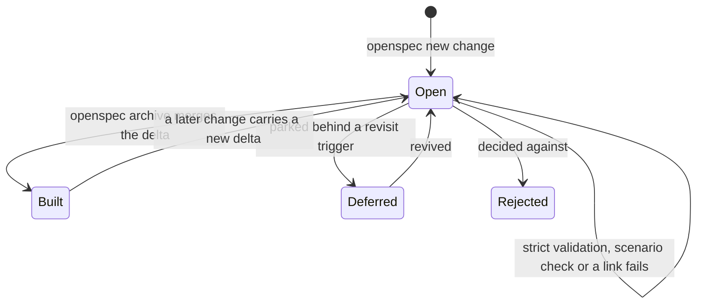

# Spec changes

Every feature is described once, under `openspec/`, and the folder a page sits in tells the reader whether what it describes exists yet.

## How it works

The tree has four states, each a top-level folder. `specs/` holds what the code does today: one folder per capability, its requirements in `spec.md` and its as-built account in `design.md`, grouped by product area with a `README.md` indexing each area. `changes/` holds what is designed and not yet built: one change per folder, named `<area>-<slug>`, carrying a proposal, a design, a task list and the delta it makes to a capability's requirements. Every area keeps one `<area>-roadmap` change as its backlog of open items, and a program change is the umbrella over the changes sharing its prefix. `deferred/` and `rejected/` hold the ideas parked behind a revisit trigger and the ones decided against, foldered by area like the specs. The OpenSpec CLI reads only the first two trees, so a deferred idea taken up again moves into `changes/`.

A change passes three checks while it is open. The CLI validates its structure in strict mode; the repository's scenario check reads every scenario as GIVEN, WHEN and THEN steps; and the workspace tests resolve each relative link and backticked path against the tree. A capability is found through the index above it, the area's README or, for a capability holding others, its own design, and a workspace test fails a capability with no link there. Once the work ships, archiving the change merges its delta into the capability's `spec.md` and moves the folder under `changes/archive/`, and the capability's `design.md` is rewritten in the same commit to describe what was built. Nothing reads the archive afterwards: it is the record of what shipped, and its prose ages with the code on purpose.

The proposals report (`pnpm ai:proposals:report`) ranks the open changes. A change's id gives its area, and its `.openspec.yaml` carries the fields the fleet schedules by beside the CLI's own: the model that wrote it, the changes it needs first, the files it touches and what it waits on.

## Key files

| File                                                      | Role                                                                                                |
| --------------------------------------------------------- | --------------------------------------------------------------------------------------------------- |
| `openspec/config.yaml`                                    | The spec-driven schema and the rules each artifact is written to                                    |
| `scripts/src/workspace/openspecValidate.test.ts`          | The CLI's strict validation over every open change and every capability                             |
| `scripts/src/services/openspec/readSpecFindings.ts`       | The scenario check: each scenario's steps in GIVEN, WHEN, THEN order with nothing else between them |
| `scripts/src/workspace/openspecLinks.test.ts`             | Every relative link in the tree resolves                                                            |
| `scripts/src/workspace/openspecIndexes.test.ts`           | Every capability is linked from the area README, or the capability's design, above it               |
| `scripts/src/workspace/readHandWrittenPages.test.ts`      | The pages every prose check reads: the tree short of its archive, the agent tree and the READMEs    |
| `scripts/src/services/openspec/getOpenSpecOwners.ts`      | The capability or change a page belongs to, so the pages of one owner may share text                |
| `scripts/src/services/proposals/readProposalSummaries.ts` | The open changes the proposals report reads, each with its area and metadata                        |

## Notes

- **GitHub is where the tree is read.** It draws the Mermaid diagrams in place, so the app renders none of these pages and carries no content pipeline, API reference build or diagram renderer for them; a page is read in the same file it is edited in, and there is one copy of it.
- **Changes stay one level deep.** The CLI lists `openspec/changes/` without descending and refuses a nested change, so an area's changes are grouped by their id prefix rather than by a folder; the specs, deferred and rejected trees nest by area because nothing constrains them.
- **A `spec.md` is not read by the duplicate-prose scan.** Requirements are written to one SHALL-and-scenario template, so sibling capabilities share long runs by construction and the strict validation already holds their shape; the scan reads designs, proposals and task lists, where a shared run is a copy someone made. A requirement repeated word for word is kept in one place by where it is written instead (the `openspec` skill): a program's delta holds only what spans its parts, and the capability owning a mechanism holds the rule each of its users would repeat.
