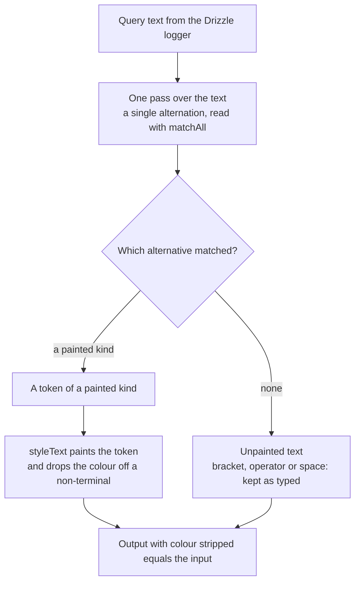

# sql-highlight

`apps/web/server/services/db/highlightSql.ts` colours a SQLite query for the dev query log. It is written in-house rather than taken from the npm package `sql-highlight` (see Upstream below), and it stays in `apps/web` because one server caller uses it and `@esposter/shared` ships to the browser. Its keyword list is SQLite's: `SQLITE_KEYWORDS` holds the keywords SQLite documents, so the upstream's MySQL and SQL Server habits (backtick identifiers, `#` comments, backslash escapes in strings) are not carried over.

## How a query is painted

- **A keyword is matched only at the start of a word**, because the word alternative consumes a whole identifier first. So `index` is not painted for `in`, and a keyword inside a string or a double-quoted identifier is never reached, since the string or identifier alternative takes the whole token first.
- **Quotes are SQLite's.** A single-quoted string ends at its closing quote, with `''` as the only escape, and a backslash is an ordinary character. A double-quoted identifier works the same way.
- **A function is a word followed by an opening bracket.** A keyword followed by one (`values (`, `in (`) is still a keyword, since the keyword alternative is tried first.
- **The output is always the input.** Text that is not a token passes through untouched, so stripping the colour gives the query back exactly.

## Colours

The colour map, `HighlightStyleMap` in the db constants, is the one place the colours live, and the suite reads its colours from it, so a test asserts which kind a token is and never which colour that kind has. The palette is chosen to read on a dark terminal's default colours rather than to match the app's editors: plain blue is too dark there, so a quoted name, a table or a column, is green, a function call bright blue, a string cyan, keywords magenta, numbers and parameters yellow, and comments a grey italic. Only the named ANSI colours `styleText` accepts are used, so the terminal's theme still chooses the shades.

| Token kind                  | Style           |
| :-------------------------- | :-------------- |
| keyword                     | magenta         |
| string                      | cyan            |
| number and `$1` parameter   | yellow          |
| double-quoted identifier    | green           |
| function call               | bright blue     |
| comment                     | gray and italic |
| brackets, operators, spaces | plain           |

`styleText` colours only when stdout is a terminal and `NO_COLOR` is unset, so a log written to a file or a pipe is plain text.

## Upstream

Each `scriptcoded/sql-highlight` issue, open and closed, was read through its comments against the 6.1.0 source and given a single verdict. Four defects are in scope and each has a regression test named after its issue that fails against the upstream package: the test asserts the whole output, and upstream's segments differ. A "fixed upstream, pinned" verdict is a behaviour the upstream 6.1.0 already gets right, which the suite keeps as a pin. The other 26 items are counted here and stay on the [tracker](https://github.com/scriptcoded/sql-highlight/issues?q=is%3Aissue): fixed upstream and pinned 12, out of scope 9, false positive 5 (release automation 2, API shape 1, GitHub-owned 1, docs 1). The in-scope items are listed below, each with its proof.

| Upstream                                                        | Verdict            | Proof                                                                                                                                                                                   |
| :-------------------------------------------------------------- | :----------------- | :-------------------------------------------------------------------------------------------------------------------------------------------------------------------------------------- |
| [#4](https://github.com/scriptcoded/sql-highlight/issues/4)     | In scope — defect  | "#4 paints a double-quoted identifier as an identifier, not a string"; upstream paints `"users"` as a string                                                                            |
| [#133](https://github.com/scriptcoded/sql-highlight/issues/133) | In scope — defect  | "#133 leaves # unpainted, since SQLite has no # comment"; upstream paints `# 3 from t` as a comment. Comments themselves are tested in "comments are painted in the muted style"        |
| [#147](https://github.com/scriptcoded/sql-highlight/issues/147) | In scope — feature | double-quoted identifiers have their own token kind, tested with #4                                                                                                                     |
| [#149](https://github.com/scriptcoded/sql-highlight/issues/149) | In scope — defect  | "#149 reads a minus after an operand as an operator, not as the sign of a number"; upstream paints `-1` as one number. Exponents and decimals are pinned by #13                         |
| [#153](https://github.com/scriptcoded/sql-highlight/issues/153) | In scope — defect  | "#153 ends a string at its quote, since a backslash is an ordinary character"; upstream breaks `'a\'` apart. The report's expectation was the JavaScript display, which is not a defect |

## Key files

| Path                                               | Role                                                 |
| :------------------------------------------------- | :--------------------------------------------------- |
| `apps/web/server/services/db/highlightSql.ts`      | The tokenizer and `highlightSql`                     |
| `apps/web/server/services/db/constants.ts`         | the keyword list and the colour map                  |
| `apps/web/server/db/logger.ts`                     | The Drizzle logger that passes each query through it |
| `apps/web/server/services/db/highlightSql.test.ts` | The suite, with the regression tests named by issue  |

## Sources

- The upstream repository and its issue tracker, [sql-highlight](https://github.com/scriptcoded/sql-highlight), read at the 6.1.0 source.
- The SQLite keyword list, [SQL keywords](https://www.sqlite.org/lang_keywords.html), for what counts as a keyword.
- Node's [`util.styleText`](https://nodejs.org/api/util.html#utilstyletextformat-text-options), for the colour rules and the terminal check.
