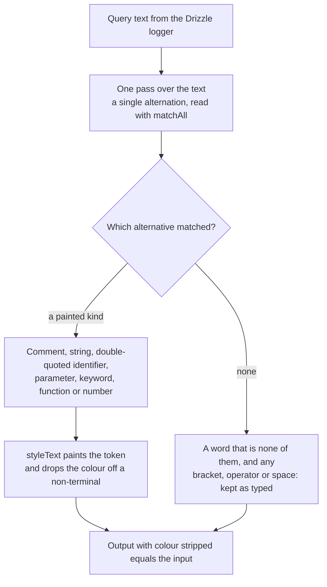

# sql-highlight

`apps/web/server/services/db/highlightSql.ts` colours a Postgres query for the dev query log. It replaced the npm package `sql-highlight`, which the log used until the package was removed, and it stays in `apps/web` because one server caller uses it and `@esposter/shared` ships to the browser. It is written for Postgres, which is the only dialect Drizzle emits here, so the upstream's MySQL and SQL Server habits (backtick identifiers, `#` comments, backslash escapes in strings) are not carried over.

## How a query is painted

- **A keyword is matched only at the start of a word**, because the word alternative consumes a whole identifier first. So `index` is not painted for `in`, and a keyword inside a string or a double-quoted identifier is never reached, since the string or identifier alternative takes the whole token first.
- **Quotes are Postgres's.** A single-quoted string ends at its closing quote, with `''` as the only escape, and a backslash is an ordinary character. A double-quoted identifier works the same way.
- **A function is a word followed by an opening bracket.** A keyword followed by one (`values (`, `in (`) is still a keyword, since the keyword alternative is tried first.
- **The output is always the input.** Text that is not a token passes through untouched, so stripping the colour gives the query back exactly.

## Colours

The colour map, `HighlightStyleMap` in the db constants, is the one place the colours live, and the suite reads its colours from it, so a test asserts which kind a token is and never which colour that kind has. The palette is chosen to read on a dark terminal's default colours rather than to match the app's editors: plain blue is too dark there, so a quoted name, a table or a column, is green as the log showed it before, a function call bright blue, a string cyan, keywords magenta, numbers and parameters yellow, and comments a grey italic. Only the named ANSI colours `styleText` accepts are used, so the terminal's theme still chooses the shades.

| Token kind                  | Style                |
| :-------------------------- | :------------------- |
| keyword                     | magenta              |
| string                      | green                |
| number and `$1` parameter   | yellow               |
| double-quoted identifier    | green                |
| function call               | blue                 |
| comment                     | gray, dim and italic |
| brackets, operators, spaces | plain                |

`styleText` colours only when stdout is a terminal and `NO_COLOR` is unset, so a log written to a file or a pipe is plain text.

## Upstream

Every issue of `scriptcoded/sql-highlight` has one verdict, open or closed, read with its comments and checked against the 6.1.0 source. Four defects are in scope and each has a regression test named after its issue that fails against the upstream package: the test asserts the whole output, and upstream's segments differ. A "fixed upstream, pinned" row is a behaviour the upstream 6.1.0 already gets right, which the suite keeps as a pin.

| Upstream                                                        | Verdict                             | Proof                                                                                                                                                                                   |
| :-------------------------------------------------------------- | :---------------------------------- | :-------------------------------------------------------------------------------------------------------------------------------------------------------------------------------------- |
| [#2](https://github.com/scriptcoded/sql-highlight/issues/2)     | Fixed upstream, pinned              | one pass and the colour-stripped equality test                                                                                                                                          |
| [#3](https://github.com/scriptcoded/sql-highlight/issues/3)     | Out of scope                        | owner: this page; the output is terminal colour, not HTML classes                                                                                                                       |
| [#4](https://github.com/scriptcoded/sql-highlight/issues/4)     | In scope — defect                   | "#4 paints a double-quoted identifier as an identifier, not a string"; upstream paints `"users"` as a string                                                                            |
| [#5](https://github.com/scriptcoded/sql-highlight/issues/5)     | False positive — API shape          | the export is `highlightSql`, the one function the logger uses                                                                                                                          |
| [#6](https://github.com/scriptcoded/sql-highlight/issues/6)     | Out of scope                        | owner: this page; no caller needs a custom highlighter                                                                                                                                  |
| [#7](https://github.com/scriptcoded/sql-highlight/issues/7)     | Out of scope                        | owner: this page; colours are `styleText` names and the terminal's theme decides them                                                                                                   |
| [#8](https://github.com/scriptcoded/sql-highlight/issues/8)     | Fixed upstream, pinned              | LIMIT is in `POSTGRES_KEYWORDS`                                                                                                                                                         |
| [#9](https://github.com/scriptcoded/sql-highlight/issues/9)     | Out of scope                        | owner: this page; the log shows the query as written, with no text transform                                                                                                            |
| [#10](https://github.com/scriptcoded/sql-highlight/issues/10)   | Fixed upstream, pinned              | "with colour stripped, a Drizzle select is the input exactly" keeps `= true`                                                                                                            |
| [#11](https://github.com/scriptcoded/sql-highlight/issues/11)   | Fixed upstream, pinned              | the colour-stripped equality test for a Drizzle select keeps the quoted address whole                                                                                                   |
| [#13](https://github.com/scriptcoded/sql-highlight/issues/13)   | Fixed upstream, pinned              | "#13 reads a decimal number as one number"                                                                                                                                              |
| [#14](https://github.com/scriptcoded/sql-highlight/issues/14)   | Fixed upstream, pinned              | the colour-stripped equality test: words at either end are kept                                                                                                                         |
| [#17](https://github.com/scriptcoded/sql-highlight/issues/17)   | Fixed upstream, pinned              | WITH is in `POSTGRES_KEYWORDS`                                                                                                                                                          |
| [#19](https://github.com/scriptcoded/sql-highlight/issues/19)   | Fixed upstream, pinned              | END is in `POSTGRES_KEYWORDS`; the `!=` operator is left plain                                                                                                                          |
| [#26](https://github.com/scriptcoded/sql-highlight/issues/26)   | Fixed upstream, pinned              | "#26 paints OVERLAPS as a keyword"                                                                                                                                                      |
| [#31](https://github.com/scriptcoded/sql-highlight/issues/31)   | Out of scope                        | owner: this page; the highlighter is server-side, and the browser never loads it                                                                                                        |
| [#35](https://github.com/scriptcoded/sql-highlight/issues/35)   | Fixed upstream, pinned              | "#35 keywords are matched case-insensitively"                                                                                                                                           |
| [#60](https://github.com/scriptcoded/sql-highlight/issues/60)   | Fixed upstream, pinned              | "#60 keeps keywords after a schema-qualified name"                                                                                                                                      |
| [#90](https://github.com/scriptcoded/sql-highlight/issues/90)   | Out of scope                        | owner: this page; there is no HTML output                                                                                                                                               |
| [#106](https://github.com/scriptcoded/sql-highlight/issues/106) | Out of scope                        | owner: this page; the highlighter runs in Node, and its number pattern uses no lookbehind                                                                                               |
| [#133](https://github.com/scriptcoded/sql-highlight/issues/133) | In scope — defect                   | "#133 reads # as an operator, since Postgres has no # comment"; upstream paints `# 3 from t` as a comment. Comments themselves are tested in "comments are painted in the muted style"  |
| [#140](https://github.com/scriptcoded/sql-highlight/issues/140) | False positive — GitHub-owned       | the contributors list is GitHub's own, not the package's                                                                                                                                |
| [#147](https://github.com/scriptcoded/sql-highlight/issues/147) | In scope — feature                  | double-quoted identifiers have their own token kind, tested with #4                                                                                                                     |
| [#149](https://github.com/scriptcoded/sql-highlight/issues/149) | In scope — defect                   | "#149 reads a minus after an operand as an operator, not as the sign of a number"; upstream paints `-1` as one number. Exponents and decimals are pinned by #13                         |
| [#150](https://github.com/scriptcoded/sql-highlight/issues/150) | Out of scope                        | owner: this page; brackets and operators are left plain, so their boundaries are not painted                                                                                            |
| [#153](https://github.com/scriptcoded/sql-highlight/issues/153) | In scope — defect                   | "#153 ends a string at its quote, since a backslash is an ordinary character"; upstream breaks `'a\'` apart. The report's expectation was the JavaScript display, which is not a defect |
| [#178](https://github.com/scriptcoded/sql-highlight/issues/178) | Fixed upstream, pinned              | the colour-stripped equality test: text that is not a token is kept                                                                                                                     |
| [#189](https://github.com/scriptcoded/sql-highlight/issues/189) | Fixed upstream, pinned              | "#189 paints RETURNING as a keyword"                                                                                                                                                    |
| [#219](https://github.com/scriptcoded/sql-highlight/issues/219) | False positive — release automation | a semantic-release failure notice, not a library defect                                                                                                                                 |
| [#220](https://github.com/scriptcoded/sql-highlight/issues/220) | False positive — release automation | a semantic-release failure notice, not a library defect                                                                                                                                 |
| [#233](https://github.com/scriptcoded/sql-highlight/issues/233) | False positive — docs               | answered by the upstream README's HTML-mode paragraph; no behaviour                                                                                                                     |

Verdict counts: 4 in-scope defects, 1 in-scope feature, 13 fixed upstream and pinned, 8 out of scope, 5 false positives.

## Key files

| Path                                               | Role                                                 |
| :------------------------------------------------- | :--------------------------------------------------- |
| `apps/web/server/services/db/highlightSql.ts`      | The tokenizer and `highlightSql`                     |
| `apps/web/server/services/db/constants.ts`         | `POSTGRES_KEYWORDS` and the colour map               |
| `apps/web/server/db/logger.ts`                     | The Drizzle logger that passes each query through it |
| `apps/web/server/services/db/highlightSql.test.ts` | The suite, with the regression tests named by issue  |

## Sources

- The upstream repository and its issue tracker, [scriptcoded/sql-highlight](https://github.com/scriptcoded/sql-highlight), read at the 6.1.0 source.
- The Postgres keyword list, [Appendix C. SQL Key Words](https://www.postgresql.org/docs/current/sql-keywords-appendix.html), for what counts as a keyword.
- Node's [`util.styleText`](https://nodejs.org/api/util.html#utilstyletextformat-text-options), for the colour rules and the terminal check.
