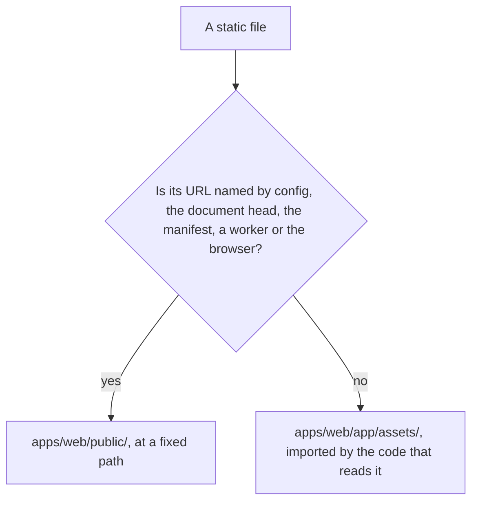

# Static assets

A static file lives in one of two places, and the choice is a rule. `apps/web/app/assets/` holds every file the app's code reads: the bundler gives each one a content-hashed URL, the browser caches it for good, a missing file fails the build, and a small one is inlined into the code that imports it. `apps/web/public/` holds only the files whose URL must be the same from one build to the next, because something outside the bundle names that URL.

## Which place



A bundled URL changes whenever the file's bytes change, so anything that names a file by its URL outside the bundle has to stay in `public/`. Two things do:

- **A URL named by config or the document head.** The files under `configuration/` run in Node and cannot import from the app, so the head links, the manifest's icons and the polyfill head script name their files by path: `pwa/` and `polyfills/`. The service worker is not among them: the module bundles `service-worker/sw.ts` from source, so nothing names it by URL.
- **A file the browser requests by a fixed name.** `favicon.ico` is requested from the root whatever the page says. The apple and manifest icons are linked by their `pwa/` paths, so no icon sits at the root.

Everything else is in `app/assets/`. Packages whose files the server must hand out come from their own installs through Nitro's `publicAssets` (`apps/web/configuration/nitro.ts`), as the [polyfills](../polyfills/design.md) page describes for the polyfills a package ships.

## Saved data names an identifier, never a URL

A value a user's data stores is a name the code resolves to a URL when it reads it. A call background is saved as its preset's enum member, `CallVirtualBackground.Sunrise`, and `CallVirtualBackgroundUrlMap` resolves that member to the bundled URL of its file. The map is typed over every member, so a preset added to the enum without its file fails the typecheck. A rebuild changes the URL but not the name, so a saved setting never goes stale.

The enum follows the repo's convention: each member's value is spelled like its key, and the enum has no `None` member. "No background" is the empty string the setting already defaults to, and the definitions list it as the first entry with an empty `id`, so the picker draws its tile from the same markup as every other preset. A separate None control would repeat the tile's markup, so there is none. Absence is never an enum member, as the `typescript` skill's enum reference says.

## How a bundled file is read

A loader takes any URL, so a bundled URL needs no special handling in Phaser or three.js: `scene.load.image(key, url)` and `textureLoader.load(url)` read it the same as a path under `public/`. The import names the file where it is read, and the URL is the import's value:

```ts
import basicPlainsUrl from "@/assets/dungeons/tilesets/axulart/BasicPlains.png?url";

scene.load.image(TilesetKey.BasicPlains, basicPlainsUrl);
```

A URL-valued import carries `?url`, the form the repo already uses for the PDF worker and the zstd module, so the import is one shape everywhere and a file the bundler does not know as an asset is still served as a URL. A document the code reads as text carries `?raw` instead, so the privacy policy's HTML is a string in its route's chunk and needs no request. The file is never named by a string path in the source, so a missing file is a build error rather than a 404 found at runtime.

A Tiled tileset is named in a map by a relative `source` path, the form the Tiled editor writes, so each map's `index.tmx` and the `tilemap.json` beside it keep that path. The runtime does not follow the path. The external tileset loader in `packages/vue-phaserjs` takes each tileset's Tiled definition from a url, keyed by the tileset's name. `TilesetUrlMap` imports every definition as text with `?raw` and hands the loader a `blob:` url holding that text, so a tileset's folder can change without the loader knowing. The loader never requests a `.tsx` url. The dev server transforms a requested `.tsx` as JavaScript, and that loads Nuxt's JSX plugin, which is the warning a tileset URL triggers. A move still edits the relative paths in each map, because the editor needs them. The tilesets stay in `app/assets/dungeons/tilesets/`, and `app/` holds no `.tsx` that a URL requests.

## Shared code stays out of asset imports

A file under `shared/` is parsed by the server and read by the Nuxt config in Node, so it cannot import from `app/assets/`. A constant that names a bundled file lives beside the code that reads it, in `app/`. What `shared/` may name is a path the config or the server reads, so `PWA_PUBLIC_FOLDER_PATH` stays there.

## Rejected

- **Every static file in `public/`.** It loses the content hash, the immutable cache and the build-time check, and every texture and tileset path becomes an unchecked string.
- **Every static file bundled.** The head links, the manifest and the polyfill script cannot take a bundled URL, since config is read in Node and those files name a fixed path.
- **Saving a bundled URL as user data.** Each edit to a file's bytes would change the URL, so a saved value would silently stop matching. A file under the inline limit would also be inlined into the saved value as a data URL. The fix is the identifier above, not keeping the file in `public/`.
- **Textures kept in `public/` because Phaser needs a path.** Phaser and three.js read any URL, bundled ones included, so the constraint never came from the loader.
- **Tilesets kept in `public/` because the external loader fetched them by a path under a `public` segment.** That derived each tileset's url from the folder name in its `source`, so a tileset anywhere else threw. The loader takes the url of each tileset from the app's import, which is the same rule every other file follows.
- **Tilesets as `data:` urls.** Phaser decodes every data url as base64, and then `XHRLoader` returns `undefined` and overwrites the file's `xhrLoader` with it, so the tileset's text never reaches the loader. A `blob:` url is passed through unchanged and loaded with a real XHR.
- **A positional tileset-url argument on the external loader.** The loader takes one configuration object, which carries `tilesetURLs` beside the map's own fields. A positional form would need that map as a seventh argument after six others, and every new field would add another position; the only caller uses the object form.

## Key files

| File                                                                          | Role                                                                                              |
| ----------------------------------------------------------------------------- | ------------------------------------------------------------------------------------------------- |
| `apps/web/app/assets/`                                                        | Every file the app's code reads, imported where it is read                                        |
| `apps/web/app/assets/dungeons/tilesets/`                                      | The Tiled tilesets, each `.tsx` beside its image, read by the maps and imported by the loader     |
| `apps/web/app/assets/visual/textures/`                                        | The gem model and the textures the visual scenes and the fluid simulator load                     |
| `apps/web/app/assets/message/room/call/backgrounds/`                          | The call background images, bundled and resolved from their preset ids                            |
| `apps/web/app/services/dungeons/loader/TilesetLoaderMap.ts`                   | Each tileset's bundled image URL, handed to Phaser by import                                      |
| `apps/web/app/services/dungeons/loader/TilesetUrlMap.ts`                      | Each tileset's bundled Tiled definition, keyed by name, for the external tileset loader           |
| `packages/vue-phaserjs/src/models/plugins/TiledJSONExternalFile.ts`           | Reads a map's external tilesets from the URL map, never from a folder name                        |
| `apps/web/app/models/message/room/call/CallVirtualBackground.ts`              | The preset ids a user's setting saves, one member per background                                  |
| `apps/web/app/services/message/room/call/CallVirtualBackgroundDefinitions.ts` | The preset list, built from the enum, each URL read from `CallVirtualBackgroundUrlMap`            |
| `apps/web/app/store/message/user/settings/callBackground.ts`                  | Resolves a saved preset id back to its URL                                                        |
| `apps/web/public/`                                                            | The files whose URL is fixed, listed under Which place                                            |
| `apps/web/configuration/app.ts`                                               | The head links and the polyfill script, named by their public paths                               |
| `apps/web/configuration/pwa.ts`                                               | The manifest's icons, named by their public paths                                                 |
| `apps/web/service-worker/sw.ts`                                               | The service worker, bundled from source with the precache list injected, so it has no public path |
| `apps/web/configuration/nitro.ts`                                             | The `publicAssets` mounts that serve package files from their installs                            |
| `apps/web/configuration/typescript.ts`                                        | Excludes the Tiled `.tsx` sources from the app's TypeScript include                               |
| `apps/web/shared/services/app/constants.ts`                                   | `PWA_PUBLIC_FOLDER_PATH`, the one public path the config reads                                    |

## Notes

- **Settings that hold a path rather than a preset id match no preset.** They read as no background. The project is not in production and keeps no compatibility shims, so nothing migrates them.
