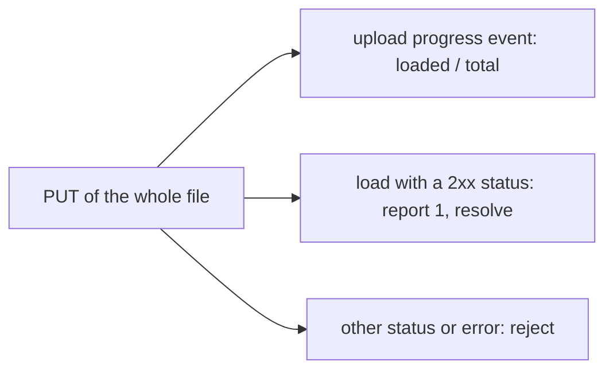

# Upload progress

An upload reports the share of its bytes the browser has sent. `uploadFileToUrl` makes one PUT of the whole file to the presigned URL the server issued for it, and the request's upload progress event gives `loaded / total`. A file that the storage accepts reports `1` as its last progress, which is also the only progress an empty file reports, since it has no bytes to count. A refused PUT, a status outside 2xx or a network error, rejects, so the upload fails.

The progress is the browser's own, so no package provides a counter: the fraction is computed beside the one request that sends the bytes. `uploadFilesToPresignedUrls` runs one such PUT per file and gives each its own progress. The upload is described in [file uploads](../file-uploads/design.md).

## Upstream

Every issue on `sindresorhus/p-progress` is judged by the [triage](../dependency-admission/design.md) before the upload's own progress was written in its place. No issue is an in-scope defect of that progress: each is either outside the surface the upload uses, or a question the upstream README answers. The progress is tested against the mixed case below.

The nine issues are counted here and stay on the [tracker](https://github.com/sindresorhus/p-progress/issues?q=is%3Aissue):

- Out of scope: 7, each an API or behaviour the upload does not use.
- False positive: 2, a documentation question and a resolution that sets progress to `1` by design.

## Key files

Paths relative to `apps/web`.

| File                                              | Role                                                              |
| ------------------------------------------------- | ----------------------------------------------------------------- |
| `app/services/file/uploadFileToUrl.ts`            | the one PUT, its upload progress and its status check             |
| `app/services/file/uploadFilesToPresignedUrls.ts` | one PUT per file, each reporting its own progress, settled as one |

## Sources

- [p-progress](https://github.com/sindresorhus/p-progress) (sindresorhus) — the upstream package, its issue tracker and the `index.d.ts` the verdicts quote.
- [p-map](https://github.com/sindresorhus/p-map) (sindresorhus) — the concurrency loop under `p-times`, whose rejection handling decides which late uploads upstream counts.
