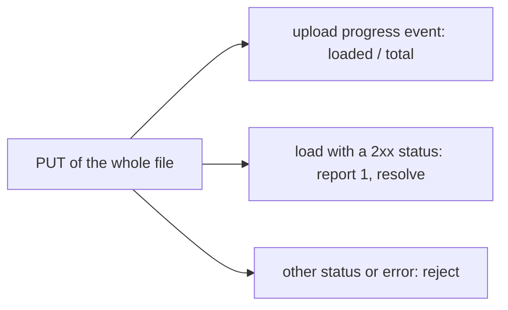

# Upload progress

An upload reports the share of its bytes the browser has sent. `uploadFileToUrl` makes one PUT of the whole file to the presigned URL the server issued for it, and the request's upload progress event gives `loaded / total`. A file that the storage accepts reports `1` as its last progress, which is also the only progress an empty file reports, since it has no bytes to count. A refused PUT, a status outside 2xx or a network error, rejects, so the upload fails.

The progress is the browser's own, so no package provides a counter: the fraction is computed beside the one request that sends the bytes. `uploadFilesToPresignedUrls` runs one such PUT per file and gives each its own progress. The upload is described in [file uploads](../file-uploads/design.md).

## Upstream

Every issue on `sindresorhus/p-progress` is judged by the [triage](../dependency-admission/design.md) before the upload's own progress was written in its place. No issue is an in-scope defect of that progress: each is either outside the surface the upload uses, or a question the upstream README answers. The progress is tested against the mixed case below.

| Issue                                                                            | Verdict        | Evidence                                                                                                                                                                      |
| :------------------------------------------------------------------------------- | :------------- | :---------------------------------------------------------------------------------------------------------------------------------------------------------------------------- |
| [#1](https://github.com/sindresorhus/p-progress/issues/1) done/total API         | Out of scope   | The progress keeps the fraction its one caller takes. A done/total signature would change it for nothing the upload reads.                                                    |
| [#4](https://github.com/sindresorhus/p-progress/issues/4) concurrency            | Out of scope   | The `concurrency` option is not kept. Every file's PUT is in flight at once, as the upload always ran them.                                                                   |
| [#8](https://github.com/sindresorhus/p-progress/issues/8) percentage fell        | Out of scope   | The regression came from percentages a caller passes in through `progress(p)`, which the upload does not take. Its fraction is bytes sent over bytes total, which only rises. |
| [#10](https://github.com/sindresorhus/p-progress/issues/10) allSettled           | Out of scope   | No caller settles a set of progress promises; a refused PUT fails its upload, and the batch fails once every other upload has stopped writing.                                |
| [#11](https://github.com/sindresorhus/p-progress/issues/11) listeners after then | Out of scope   | The progress has no chain. The notifier is passed in before the upload is awaited, so there is no listener to attach late.                                                    |
| [#14](https://github.com/sindresorhus/p-progress/issues/14) vague example        | False positive | A documentation question; answered by upstream's `example.js` and PR 15.                                                                                                      |
| [#17](https://github.com/sindresorhus/p-progress/issues/17) `all` types          | Out of scope   | The mapped tuple types belong to upstream's surface. The upload takes `Promise<void>[]`, typed by us.                                                                         |
| [#18](https://github.com/sindresorhus/p-progress/issues/18) async/await API      | Out of scope   | The constructor and `fn` API are not kept. The upload takes the request's own events, which is the shape the issue asked for.                                                 |
| [#21](https://github.com/sindresorhus/p-progress/issues/21) `fn` returns 1       | False positive | Resolution sets progress to `1` by design, as `index.d.ts` documents ("Progress percentage `1` is reported for you when the promise resolves"). `fn` is not kept.             |

## Key files

Paths relative to `apps/web`.

| File                                              | Role                                                              |
| ------------------------------------------------- | ----------------------------------------------------------------- |
| `app/services/file/uploadFileToUrl.ts`            | the one PUT, its upload progress and its status check             |
| `app/services/file/uploadFilesToPresignedUrls.ts` | one PUT per file, each reporting its own progress, settled as one |

## Sources

- [p-progress](https://github.com/sindresorhus/p-progress) (sindresorhus) — the upstream package, its issue tracker and the `index.d.ts` the verdicts quote.
- [p-map](https://github.com/sindresorhus/p-map) (sindresorhus) — the concurrency loop under `p-times`, whose rejection handling decides which late uploads upstream counts.
