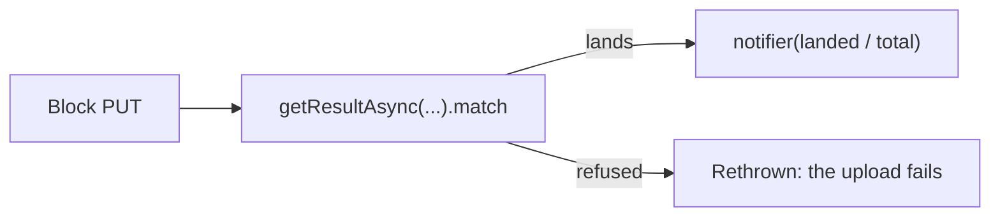

# Upload progress

A block upload reports the share of its blocks that have landed. `uploadBlocks` counts each block as its PUT resolves, through `getResultAsync(...).match`, and hands the notifier `landed / total`. A refused block is rethrown, so the upload fails on it, while the blocks that land around it are still counted. An empty file has no block to count, so it reports `1` alone.

The upload needs one aggregate of its own blocks and nothing else, so the counter sits beside its one caller in `uploadBlocks.ts`, and no package provides it. The upload is described in [file uploads](../file-uploads/design.md).

## Upstream

Every issue on `sindresorhus/p-progress`, open and closed, was read with its comments before the counter was written. No issue is an in-scope defect of the counter: each is either outside the surface the upload uses, or a question the upstream README answers. The counter is tested against the mixed case below.

| Issue                                                                            | Verdict        | Evidence                                                                                                                                                                |
| :------------------------------------------------------------------------------- | :------------- | :---------------------------------------------------------------------------------------------------------------------------------------------------------------------- |
| [#1](https://github.com/sindresorhus/p-progress/issues/1) done/total API         | Out of scope   | The notifier keeps the fraction its one caller takes. A done/total signature would change it for nothing the upload reads.                                              |
| [#4](https://github.com/sindresorhus/p-progress/issues/4) concurrency            | Out of scope   | The `concurrency` option is not kept. Every block is in flight at once, as the upload always ran them.                                                                  |
| [#8](https://github.com/sindresorhus/p-progress/issues/8) percentage fell        | Out of scope   | The regression came from percentages a caller passes in through `progress(p)`, which the counter does not take. Its fraction is `landed / total`, so it cannot go down. |
| [#10](https://github.com/sindresorhus/p-progress/issues/10) allSettled           | Out of scope   | No caller settles a set; a refused block fails the upload.                                                                                                              |
| [#11](https://github.com/sindresorhus/p-progress/issues/11) listeners after then | Out of scope   | The counter has no chain. The notifier is passed in before the upload is awaited, so there is no listener to attach late.                                               |
| [#14](https://github.com/sindresorhus/p-progress/issues/14) vague example        | False positive | A documentation question; answered by upstream's `example.js` and PR 15.                                                                                                |
| [#17](https://github.com/sindresorhus/p-progress/issues/17) `all` types          | Out of scope   | The mapped tuple types belong to upstream's surface. The counter takes `Promise<void>[]`, typed by us.                                                                  |
| [#18](https://github.com/sindresorhus/p-progress/issues/18) async/await API      | Out of scope   | The constructor and `fn` API are not kept. The counter takes promises, which is the shape the issue asked for.                                                          |
| [#21](https://github.com/sindresorhus/p-progress/issues/21) `fn` returns 1       | False positive | Resolution sets progress to `1` by design, as `index.d.ts` documents ("Progress percentage `1` is reported for you when the promise resolves"). `fn` is not kept.       |

## Key files

Paths relative to `apps/web`.

| File                                           | Role                                                 |
| ---------------------------------------------- | ---------------------------------------------------- |
| `app/services/azure/container/uploadBlocks.ts` | the block counter, `landed / total` per resolved PUT |

## Sources

- [p-progress](https://github.com/sindresorhus/p-progress) (sindresorhus) — the upstream package, its issue tracker and the `index.d.ts` the verdicts quote.
- [p-map](https://github.com/sindresorhus/p-map) (sindresorhus) — the concurrency loop under `p-times`, whose rejection handling decides which late blocks upstream counts.
