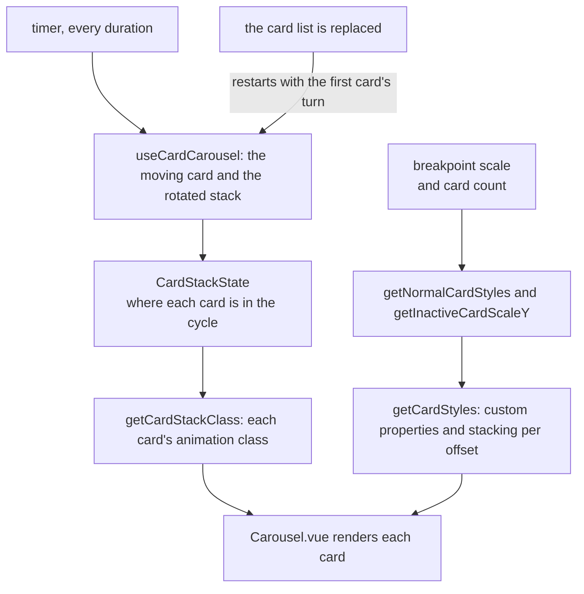

# Card carousel

The About page's supporter cards can be shown as a carousel: one card takes its turn across the front while the rest wait in a stack behind it, and the cycle advances on a timer. The page's other tab shows the same cards as a marquee.

## How it works

Each step, the top-right card of the stack takes its turn: it slides from right to left, then goes back into the stack at the far right, and the cards behind it move one place forward. `useCardCarousel` holds that cycle. It keeps the fake card ids, whose order is the stack's order, which card is moving and which has just moved, and it advances the cycle on a timer every `duration`. Replacing the card list restarts the cycle with the first card's turn. The restart fires on a new list, not on a list changed in place. With one card the card slides out and back rather than cycling, and with a zero duration no timer runs and the first step is shown once.

Each card's look is computed rather than written into the stylesheet. `getNormalCardStyles` gives each stacked card its margin and height for its place, scaled to the current breakpoint, and `getInactiveCardScaleY` gives the card that has just moved the height it settles at. `getCardStyles` hands each card the values of its own offset as custom properties, with its stacking. `getCardStackClass` picks the card's animation class, and the stylesheet has one rule per class that reads those properties.

The gap between the moving card and the stack, and the step each stacked card takes, both grow with the breakpoint. `Carousel.vue` sets them, along with the props' defaults.

## Key files

| File                                                    | Role                                                                                            |
| :------------------------------------------------------ | :---------------------------------------------------------------------------------------------- |
| `apps/web/app/components/Visual/Card/Carousel.vue`      | The component: its breakpoint gap and scale, the template, and the stylesheet's four animations |
| `apps/web/app/composables/visual/useCardCarousel.ts`    | The cycle, the timer and the restart when the card list is replaced                             |
| `apps/web/app/services/visual/getCardStackClass.ts`     | Each card's animation class                                                                     |
| `apps/web/app/services/visual/getNormalCardStyles.ts`   | The stacked cards' margins and heights                                                          |
| `apps/web/app/services/visual/getInactiveCardScaleY.ts` | The height the card that has just moved settles at                                              |
| `apps/web/app/services/visual/getCardStyles.ts`         | Each card's custom properties and stacking, by offset                                           |
| `apps/web/app/models/visual/CardStackClass.ts`          | The class names the stylesheet declares                                                         |
| `apps/web/app/models/visual/CardStackGeometry.ts`       | The breakpoint geometry the stack's styles are computed from                                    |
| `apps/web/app/models/visual/CardStackState.ts`          | Where each card is in the cycle                                                                 |
| `apps/web/app/models/visual/CardStyleVariables.ts`      | The custom properties one card animates between                                                 |
| `apps/web/app/components/Visual/Card/Base.vue`          | The default card template                                                                       |
| `apps/web/app/components/About/Supporters.vue`          | The About page's tab that shows the carousel beside the marquee                                 |

## Notes

- Overflow cards are hidden with `display: none` rather than left unrendered. Leaving them out would also need the top card to be handled when it becomes a normal stacked card.
- A stacked card's animation name alternates with its offset's parity. An animation restarts only when its name changes, and a card moves one offset per step, so the name changes on every step while the values ride on the card.
- The stack's depth follows `maxShownCards` through the computed styles rather than the stylesheet, so a larger stack needs no new rules.

## Sources

- The animation's base is credited to Braedon Wooding in the header comment of `Carousel.vue`. The repository records no link for it.
