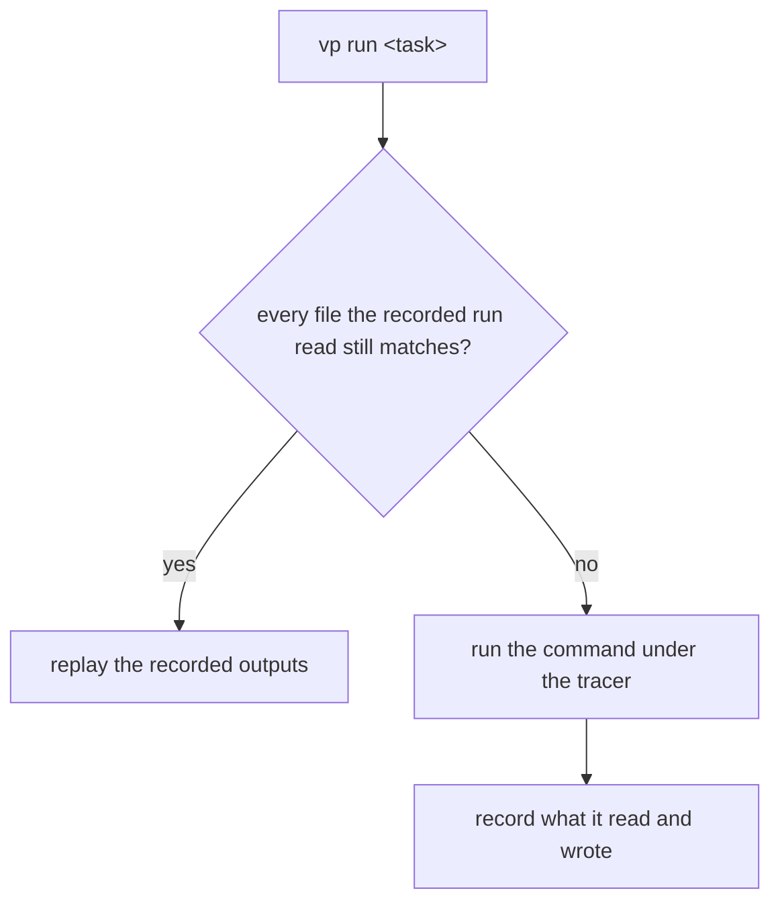

# Vite+

[Vite+](https://viteplus.dev) is the Vite team's toolchain behind one `vp` entry point: a cached task runner, a runtime and package-manager manager, and built-in commands over Vite, Vitest, Oxlint, Oxfmt, Rolldown and tsdown. This repository takes the jobs nothing else here did well — **a task cache keyed on what a command read, the runtime install, and one config every lint and format reader shares** — and leaves the test runner and the app's own commands where they are. Every tool keeps running from the binary the catalog installs.

## The task cache

The library builds and the whole-repository checks run as tasks of the root `vite.config.ts`, which composes them from the modules in `vite/` — `format:check`, `lint`, `typecheck`, and one `build:<directory>` per package, which `build:packages` orders, and `build:parity` for the parity page — under `vp run`, which traces every file a task and its child processes open, probe or list, and replays the recorded run only when each still matches. A task replays only when every file its command read still matches the recorded run, and otherwise runs the command under the tracer again and records the new one:

How CI carries the cache and why a hit needs the install are in [monorepo tooling](../monorepo-tooling/design.md) under `## CI job shape`. Tasks are cached by default, so no `--cache` flag is written; it exists to cache a plain script. The same tasks cache locally, natively on a Windows host: an unchanged `vp run build:packages` replays in seconds where it builds in a minute.

**A cached command is a task, never a script.** A script carries no cache settings, and a task may not share a script's name, so a script that needs caching moves into a task under its own name and the script is deleted — `build:packages`, `lint` and `typecheck` are `vp run <name>`, and so are the leaves those aggregates run (`lint:oxlint`, `typecheck:workspace` and the rest, each with its own command). The aggregates stay uncached, since one with no inputs of its own would replay a verdict no leaf produced, so the cache lives on the leaves. Every leaf is cached, `typecheck:workspace` included: its check reads and writes across `apps/web/.nuxt`, and `vp` traces what it read, so it replays only when nothing it read changed. A task that writes nothing anyone reads keeps no outputs, so its replay restores nothing and is the verdict alone.

**A command earns a task only when a replay is as good as a run, and a run costs enough to skip.** Three things hold together: the command's result depends on nothing but files the tracer sees, it is slow enough that a hit saves a job real time, and something runs it again on a tree that has not changed — a rerun, a re-push, a second workflow on the same commit. Everything else stays a script, which is the default rather than a task waiting to be promoted:

- **A command run for its effect or a fresh reading** — `dev`, `release`, the `lint:fix` passes, and `bench:ci`, whose whole job is measuring again, so a replay would hand back an old measurement.
- **A command reading what the tracer cannot see** — the network, a git remote, the clock.

**Rejected: keeping `format:check` a script.** A hit still pays the install, so caching looks like it saves little. It is a task because the check reruns on an unchanged tree (a rerun, a re-push), where a hit restores the verdict and a pass runs the formatter over the whole workspace. Do not move it back to a script.

**Rejected: caching the app build.** A replay of `build:app` would have to restore the app's build output directory, which the build itself creates. A fresh CI checkout lacks it, while the recorded run's listing of `apps/web` names it, so the listing misses, and no sampled CI run replayed. Carrying the output would restore and save a large directory on every run, most of them a new commit that rebuilds anyway, to save only a rerun of an unchanged tree. The app build is therefore the call site `pnpm -C apps/web build`, uncached in CI, and not a task.

**Rejected: caching the test and coverage shards with the task cache.** No shard replayed in a measured run, because a test's inputs are the whole app, so every commit changes them. The cost was a second task layer to keep.

**A file a task reads and rewrites is traced, not subtracted.** `vp` caches a task that reads and rewrites a file, and a replay restores that file from the task's outputs, so a check carries no list of the files it rewrites: the generated ESLint declaration and each project's build info are read and written like any other file. A package build still subtracts what its own build writes, such as `dist` and its barrels, since those are its outputs and no input of it. pnpm's own install and run state is subtracted from every task, since no build's result depends on it and the dependencies themselves are traced file by file. That listing misses a temporary pnpm writes into the workspace root and removes before the run ends, which is why the run state's pattern names the root and not a package. A test pinning the list would restate the config, so none exists.

**A directory listing is fingerprinted by every name in it, and an input exclusion reaches it** ([vite-task 504](https://github.com/voidzero-dev/vite-task/issues/504), since fixed upstream). A generated file a fresh checkout lacks, such as a package build's `dist` or a generated barrel, is subtracted from the task's inputs, so it no longer makes every run miss, and nothing travels with the cache but the cache directory.

Every cached task is probed against this tree before it is trusted: a source edit, a content edit, a `.vue` edit, and a file created where a build looks for one must each miss the cache, and only a run that read nothing changed may replay. The native tools were probed on Linux as well, because the tracer there interposes on libc for a dynamically linked process and a read that skips libc goes unseen ([vite-task 777](https://github.com/voidzero-dev/vite-task/issues/777)). The Go compiler `typecheck` loads in-process and tsgolint, the statically linked binary behind type-aware lint, both missed on an edit to a file only they read. A new native tool is probed the same way before a task caches it. The edited file is one the task reads: the root project covers the root files and not `packages`, so an edit under a package misses nothing there and reads as a hit that proves nothing.

## Scripts run through `vpx`

The repository's TypeScript scripts run under `vpx`, the bin the `vite-plus` devDependency ships, in place of `tsx`. It runs a file with full TypeScript support (enums, namespaces, tsconfig `paths`) and no devDependency of its own, and every workspace script finds it on its PATH through the root's `node_modules/.bin`. `vpx --tsconfig tsconfig.root.json` is the form `apps/web/scripts/*` take, and `vpx` resolves `paths` aliases for every file under that config. A script that needs `--eval`, the REPL or `--check` stays on `node`, since `vpx` does not transform TypeScript for any of them, and the `package-scripts` skill's `references/typescript-scripts.md` owns which runner a file gets.

The persona plugin runs its TypeScript under plain `node`: its enums are `const` objects, so no loader is registered. The [persona plugin](../../infra/claude-interface/persona-plugin/README.md) records that.

## One copy of every tool

`vite-plus` is a root dev dependency, and it depends on exact versions of Oxlint, Oxfmt, the Oxlint plugin API, tsgolint and Vitest with its subpackages, each behind the catalog, and aliases `vite` to its own core build. Root `overrides` point every one of those at `catalog:`, and its `vite` takes the workspace's global `vite` override like every other dependent, so the lockfile resolves one version of each tool and `vp` runs on plain Vite. The catalog stays the one statement of every version and Renovate keeps bumping it. The cost is running the `vp` CLI a minor or two ahead of the tools it was released against; a release that starts depending on its core build's internals fails the cached tasks loudly, and the fix is narrowing the `vite` override to leave `vite-plus` out.

## One config, composed from a module per tool

`vite.config.ts` composes its blocks the way `nuxt.config.ts` composes `apps/web/configuration/`: `lint` is imported from `oxlint.config.ts`, `fmt` from `oxfmt.config.ts`, and only `run` is written in place. The root lint and format scripts run `vp lint` and `vp fmt`, and the bare `oxlint` and `oxfmt` — the pre-commit hook's formatter, the editor, the ESLint bridge — read the same two files, so every reader of a setting reads one object. The built-in commands run the catalog's binaries, through the overrides above, so a lint run is the same pass whichever reader started it. The config imports its types from `vite-plus` and configures no bundler — the app builds through `nuxt build` from `apps/web/nuxt.config.ts`. Nuxt discourages a standalone `vite.config.ts`, but its check resolves from the app's own root, and this one sits at the workspace root above it, so the two config trees coexist with nothing warned about.

## The runtime

`vp env` provisions node and pnpm from the two pins the repository already keeps, `.node-version` and `packageManager`, through shims that replace Corepack; `pnpm update:node` writes the pin and hands the install to it. The procedure is the `dependency-updates` skill's (`references/updating-node.md`). CI is untouched: `pnpm/setup` reads the same two pins.

## What `vp` does not own

- **`vp test` as the runner** — [deferred](../../../deferred/architecture/vite-plus-test-runner/design.md) behind three blockers.
- **`vp dev`, `vp build` and `vp migrate` for the app** — [deferred](../../../deferred/architecture/vite-plus-app-commands/design.md) while Nuxt owns the module graph.
- **A remote cache** — [deferred](../../../deferred/architecture/vite-plus-remote-cache/design.md) until a release carries the client and there is a server to point it at.

## Key files

| File                                          | Role                                                                                   |
| :-------------------------------------------- | :------------------------------------------------------------------------------------- |
| `vite.config.ts`                              | composes the formatter, linter and `run` settings; the tasks themselves are in `vite/` |
| `vite/*Tasks.ts`, `vite/services/`            | each cached build and check, with the files it rewrites subtracted                     |
| `pnpm-workspace.yaml`                         | the `vite-plus` catalog entry and the overrides that leave one copy of each tool       |
| `.github/actions/run-cached-task/action.yaml` | restores the task cache, runs the task, saves the cache when it executed               |
| `scripts/src/updateNode/index.ts`             | pins node through `vp env pin` and cleans through `vp env clean`                       |

## Sources

- [Announcing Vite+ 1.0](https://voidzero.dev/posts/announcing-vite-plus-1-0) and the [Q3 plan](https://github.com/voidzero-dev/vite-plus/issues/2405) — what 1.0 bundles, and that its semver covers the CLI and config schema but not the bundled tools.
- [Vite+ cache guide](https://viteplus.dev/guide/cache), [run config](https://viteplus.dev/config/run) and [CI guide](https://viteplus.dev/guide/ci) — inputs inferred from what a command reads, tasks cached by default, and the CI shape.
- [Vite+ env guide](https://viteplus.dev/guide/env) — `vp env` resolving the node pin and `packageManager` per directory.
- [vite-task 504](https://github.com/voidzero-dev/vite-task/issues/504), [700](https://github.com/voidzero-dev/vite-task/issues/700) and [777](https://github.com/voidzero-dev/vite-task/issues/777) — directory listings and exclusions, the sandbox, and the Linux reads the tracer misses.
