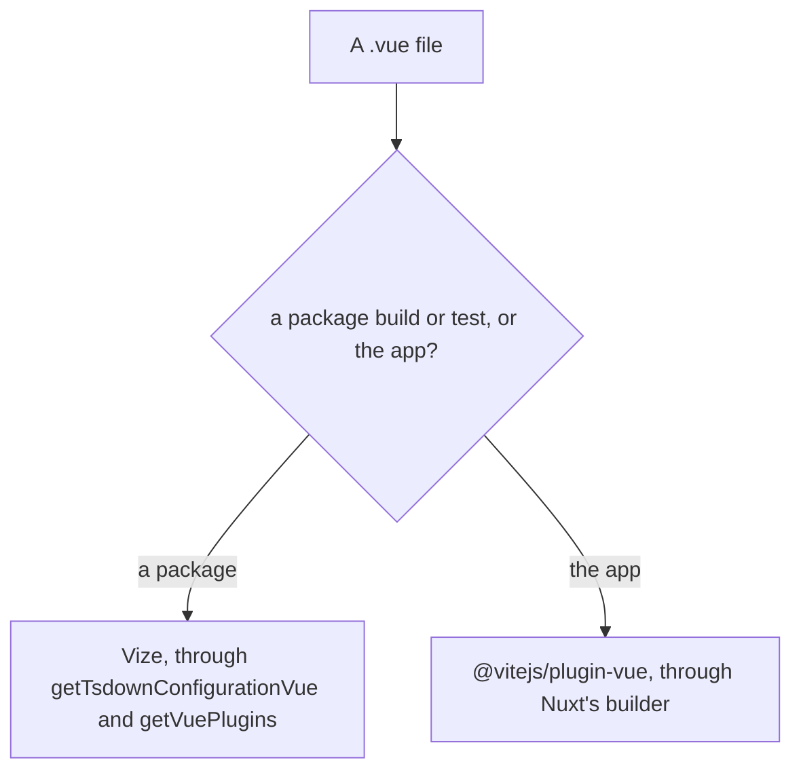

# Vize compiler

Vize compiles Vue single-file components in Rust. The library builds and Vitest compile through it ([build pipeline](../build-pipeline/design.md), "Vue components compile through Vize"). The app does not: it compiles through `@vitejs/plugin-vue`, which Nuxt's builder installs, because `@vizejs/nuxt` made a clean production build on Windows between two and a half and four times as long. This page sets out which compiler reads which file, what the module cost, and what a return to it would have to show.

## Which compiler reads which file

## The TresJS elements

The library builds hand Vize the TresJS elements as `tresCustomElements`, a list, because Vize takes element names where Vue asks a predicate. A `Tres*` pattern would also take `TresCanvas`, which must stay a component, so the list names each class that TresJS's own predicate keeps. `tresjs-nuxt` keeps that predicate for the app's compiler, and the list restates it for Vize.

## What the Nuxt module cost

The module was measured against the same tree without it, on an eight-core Windows desktop with 32 GB of memory and nothing else running. A clean production build took about three and a half to five and a half minutes with the module and about a minute and a half without it. A build that kept its caches took about three and a half to four minutes with the module and about a minute and a half without it. Two runs of each case agree on the order. The builds with the module differ from run to run by up to half again, where the builds without it differ by a few seconds. A Linux build in CI took a little over two minutes with the module, and its baseline without it was not measured. The module claims no gain in build time.

The typecheck and the dev server's start did not move with the module. The typecheck took about half a minute either way, and the dev server was ready in about twenty seconds either way. The first page's compile in the dev server was not compared, because the measuring machine's environment did not let the page render.

The build makes three passes over the app's components (client, server and Nitro). In each the plugin pre-compiles every component, which takes about a minute on the Windows machine and about ten seconds in CI.

The cost was once the native `compileSfc` call resolving imported props types through the project's configuration, which `@vizejs/native` made slower from the release that added the resolution ([Vize issue 12044](https://github.com/ubugeeei-prod/vize/issues/12044)), and then the walk of a star barrel on every call ([Vize issue 12059](https://github.com/ubugeeei-prod/vize/issues/12059), [Vize issue 12062](https://github.com/ubugeeei-prod/vize/issues/12062)). The barrel of every workspace package is a generated list of `export *` lines, and a call on a component typed through one walked the whole barrel again: over twenty seconds for the several thousand lines of the `genshin-world` barrel. A release that bounds the walk closed both ([Vize pull request 12063](https://github.com/ubugeeei-prod/vize/pull/12063)), and the native batches of a pre-compile now take about twenty seconds for every component of the app.

Two costs stay upstream.

- **The client pass on Windows.** The pre-compile stores each compile under a forward-slash path, while the transform hook looks the module up by its id's path, which Nuxt hands over with backslashes on Windows. The two spellings are two keys, so the hook compiles nearly every component again ([Vize issue 12151](https://github.com/ubugeeei-prod/vize/issues/12151)). A copy of the plugin with its three lookups normalised took the whole build from about seven minutes to about five.
- **The server pass.** The hook of the server environment reads a cache of its own, which the pre-compile only clears, so nearly every call compiles again whatever the spelling ([Vize issue 12153](https://github.com/ubugeeei-prod/vize/issues/12153)). The Nitro pass makes no hook call and still pre-compiles every component.

What the native batches do not account for is the rest of each pre-compile, about thirty seconds on the Windows machine, which is the plugin's JavaScript around the native call.

`@nuxt/vite-builder` depends on `@vitejs/plugin-vue` unconditionally and no Nuxt option turns it off, so the package stays in the lockfile whichever compiler the app uses.

## What a return to the module owes

The module was checked against the baseline without it before it left, and a return re-runs that check on a build of each, served against a database:

- **Build time.** A clean production build on Windows no slower than the baseline's.
- **Server HTML.** The parsed HTML of every public route equal after attribute order, nonces, integrity hashes, hashed asset names, scope ids and the page's own origin are normalised. `/about` renders the canvas's own ``, which needs the server registration of a component registered for both client and server ([Vize issue 11757](https://github.com/ubugeeei-prod/vize/issues/11757)).
- **Production client.** Every public route mounts in Chromium with the baseline's console and page errors, `/about` included, where an inline template's `new` on an imported binding must compile to a call the constructor can run. The `/clicker` cocktail counts a click in both.
- **Compilation.** Every `.vue` file compiles with none failing, and props types imported from `@esposter/db-schema`, a private package that emits no declarations, resolve.

## Checking a bump

`vize`, `@vizejs/native`, `@vizejs/unplugin` and `@vizejs/vite-plugin` pin one another and move as one Renovate group, so the library builds, Vitest, the content mapper and the scripts' parser compile with one Vize build.

## Key files

| File                                                               | Role                                                                        |
| :----------------------------------------------------------------- | :-------------------------------------------------------------------------- |
| `apps/web/configuration/modules.ts`                                | the Nuxt module list, where no Vize module registers                        |
| `apps/web/configuration/typescript.ts`                             | the `.vue` content mapper the app's typecheck uses, which needs no module   |
| `apps/web/app/components/Visual/Gem/Index.vue`                     | the component whose inline template holds the `new` form `/about` exercises |
| `packages/genshin-world/scripts/tres/tresCustomElements.ts`        | the element names the library builds hand Vize                              |
| `packages/tresjs-nuxt/src/services/checkIsTresCustomElement.ts`    | the TresJS predicate the app's compiler uses                                |
| `packages/configuration/src/services/getVuePlugins.ts`             | the Vize Vite plugin a package's Vitest and Vite runs add                   |
| `packages/configuration/src/services/getTsdownConfigurationVue.ts` | the Vize unplugin a package's build adds                                    |
| `packages/db-schema/package.json`                                  | the private package, with no declarations, whose props types must resolve   |
| `renovate.json`                                                    | the rule that groups the Vize packages into one bump                        |
| `pnpm-workspace.yaml`                                              | the `vize` and `@vizejs/*` catalog entries                                  |

## Sources

- [Vize repository](https://github.com/ubugeeei-prod/vize) — the repository of the `vize` and `@vizejs/*` packages.
- [Vize issue 11757](https://github.com/ubugeeei-prod/vize/issues/11757) — the server registration of a component registered for both client and server, which `/about`'s canvas depends on. Closed as completed.
- [Vize issue 12044](https://github.com/ubugeeei-prod/vize/issues/12044) — the per-file `compileSfc` cost behind "What the Nuxt module cost". Closed as completed by a barrel fix that reaches a barrel of named re-exports. The cache of the server environment that it also names is still not filled by the pre-compile.
- [Vize issue 12059](https://github.com/ubugeeei-prod/vize/issues/12059) — the cost of a star barrel, which each call walked in full. Closed as completed by pull request 12063.
- [Vize issue 12062](https://github.com/ubugeeei-prod/vize/issues/12062) — the growth with the square of a star barrel whose modules import different types from a shared star barrel. Closed as completed by pull request 12063.
- [Vize pull request 12063](https://github.com/ubugeeei-prod/vize/pull/12063) — the bound on a star export's walk and the validation shared across the calls of one turn.
- [Vize issue 12151](https://github.com/ubugeeei-prod/vize/issues/12151) — the transform hook's cache key on Windows, which the client pass's hook cost depends on. Open.
- [Vize issue 12153](https://github.com/ubugeeei-prod/vize/issues/12153) — the cache the server environment's hook reads, which the pre-compile never fills. Open.
- [Vize issue 12932](https://github.com/ubugeeei-prod/vize/issues/12932) — the content mapper's one-line comment for a `v-for` alias, which a pattern over several lines broke. Closed as completed by pull request 12938, which the 0.749.0 release carries, so the menu items component destructures its item again.
