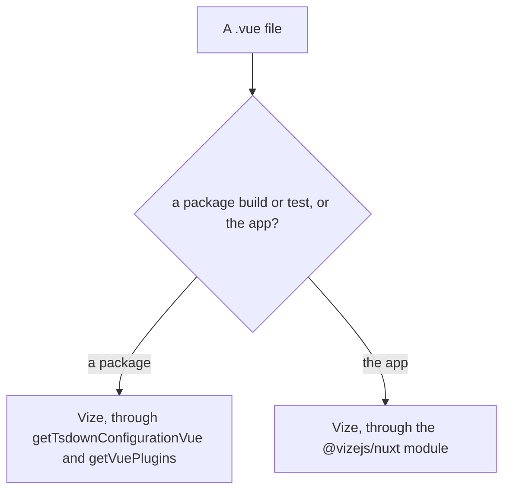

# Vize compiler

Vize compiles Vue single-file components in Rust. The library builds and Vitest compile through it ([build pipeline](../build-pipeline/design.md), "Vue components compile through Vize"). The app does too, through `@vizejs/nuxt`, registered with the TresJS element list and its dev lint off. This page sets out which compiler reads which file, what the module costs the build, and which upstream causes of that cost are still open.

## Which compiler reads which file

## Library builds

One compiler reaches the build through three entries of the same release. `getTsdownConfigurationVue` adds `@vizejs/unplugin/rolldown` with `isProduction: true`, and `getVuePlugins` adds `@vizejs/vite-plugin` for the Vitest and Vite runs of a package whose tests import `.vue` files, which is opt-in per package. Both take their plugin's own options through the factory's argument. The app registers the fourth entry, `@vizejs/nuxt`, from the same release. The packages pin one another exactly, so Renovate bumps them as one group.

- **Styles go through the bundler's CSS pipeline.** Since `@vizejs/unplugin` 0.664.0, every style block, a `<style src>` with a package specifier included, is handed to the bundler (#11523), so tsdown with `@tsdown/css` writes the package's one `style.css` (`css.splitting` is off, since an unbundled build splits CSS per module otherwise). tsdown joins those rules in the order rolldown renders chunks, which moves between builds of one tree, so `mergeStylesheetsPlugin` writes the file again in module-id order. `deps.alwaysBundle` keeps a sibling package's stylesheet in the package's own CSS, so the built JavaScript never imports a `.css` file that Node cannot load, and the scripts and benchmarks that read a Vue package's `dist` under plain Node keep working.
- **Declarations come from `tsrs`.** `getTsdownConfigurationVue` sets the declaration plugin's generator to `tsrs`, over the package's `tsconfig.build.json` with `tsrs.runExternalCode`, so the `.vue` declarations are written through the same vize content mapper the type check runs ([the type-check change](../../../changes/archive/2026-11-05-architecture-vize-vue-typecheck/design.md)). The declaration program is that tsconfig's own file list, so an ambient `auto-imports.d.ts` is in it (`.agents/skills/build/references/declarations.md`). A component's declaration is vize's component model rather than Vue's `DefineComponent`, and the helper types sit once in a `declare global` block.

The compile-side defects found on the way, each reduced and reported to Vize:

| Issue  | What it was                                                                     | Outcome                                                                 |
| :----- | :------------------------------------------------------------------------------ | :---------------------------------------------------------------------- |
| #11456 | the rolldown entry dropped every `<style src>` block without a warning          | an error in 0.656.0, inlined in 0.658.0, a package specifier in 0.661.0 |
| #11481 | a production build kept the development output shape                            | fixed in 0.661.0 (#11488)                                               |
| #11482 | a package specifier in `<style src>` failed the build                           | fixed in 0.661.0 (#11492)                                               |
| #11483 | a plain `<style>` block was injected into the JavaScript and no CSS was written | fixed in 0.664.0 (#11523)                                               |
| #11457 | the Vite plugin ignored `template.compilerOptions.isCustomElement`              | closed as configuration: `customElements`                               |
| #11484 | `customElements` cannot exclude a tag                                           | closed as not planned: the list above names every tag                   |

## The TresJS elements

The library builds hand Vize the TresJS elements as `tresCustomElements`, a list, because Vize takes element names where Vue asks a predicate. A `Tres*` pattern would also take `TresCanvas`, which must stay a component, so the list names each class that TresJS's own predicate keeps. `tresjs-nuxt` keeps that predicate for the app's compiler, and the list restates it for Vize.

## What the Nuxt module costs

The module is measured against the same tree without it, on an eight-core Windows desktop with 32 GB of memory, on clean production builds of each. On the release the module first left the app, a build took about three times as long. On the current release three builds with the module took between about a minute and a minute and a quarter, and two without it took about a minute, so it costs a few seconds to about a sixth of the build, and the spread between runs is several seconds. The client and server passes each take between a twentieth and a quarter longer, and the Nitro pass is within a second. The client bundle's size is the same to within a fraction of a percent, and every component compiles with none failing.

The dev server is ready in about twenty to forty seconds, as without the module. Every public route answers 200 and renders the same body markup as the baseline's, apart from attribute order, a template's own HTML comment, which the module drops from the development output, and the fragment anchors around it.

A timing plugin in each pass shows where the remainder sits:

- **The pre-compile holds no pass.** The wait between a pass's `buildStart` and its first module request is about a fifth of a second with the module and without it, so no pass waits on a pre-compile.
- **The compile callbacks cost what `@vitejs/plugin-vue`'s cost.** In the client pass the module's SFC transform is about 1,500 calls and under five seconds, against about 2,100 calls and five seconds. In the server pass it is about 300 calls and about a second, against about 600 calls and one and a half seconds, because the client pass's compile is shared.
- **The difference is the module's other hooks.** The client pass's module graph takes two to three seconds longer. The transform bridge adds about a second across every module of the pass, and the module's resolver is entered several thousand times in the client pass where `@vitejs/plugin-vue`'s is not. Neither shows a time in the build's own report, so the remainder is not attributed.

## What is still open upstream

[Vize issue 13567](https://github.com/ubugeeei-prod/vize/issues/13567) tracks the causes, with the baseline against `@vitejs/plugin-vue` and an after column per release. Closed as completed: the uncached `realpathSync.native` call per dependency ([13557](https://github.com/ubugeeei-prod/vize/issues/13557)), the pre-compile following the glob rather than the module graph ([13559](https://github.com/ubugeeei-prod/vize/issues/13559)), the server pass repeating the client's analysis ([13560](https://github.com/ubugeeei-prod/vize/issues/13560)), the per-module watched-file set ([13564](https://github.com/ubugeeei-prod/vize/issues/13564)) and the server environment keeping stale components after a type changes ([13566](https://github.com/ubugeeei-prod/vize/issues/13566)). Open:

- **The type behind a component's props is resolved again for every component.** The native cost of a component grows with the barrel behind its props type, while `@vitejs/plugin-vue` resolves a type file once and stays flat however large the barrel is ([Vize issue 13558](https://github.com/ubugeeei-prod/vize/issues/13558)).
- **Type-resolving batches use more CPU at the default thread count than they need.** The batch's threads revalidate the same barrel files under one global lock on the type cache ([Vize issue 13569](https://github.com/ubugeeei-prod/vize/issues/13569)).
- **Files the plugin already holds are touched again.** Each pass reads and stats every component anew, one cheap call per component per pass ([Vize issue 13561](https://github.com/ubugeeei-prod/vize/issues/13561)).
- **A compile outside the pre-compile is a standalone native call.** A hot update's dependents used to compile one file at a time; a wave now compiles in native batches, and the issue stays open for the first load of the server environment ([Vize issue 13565](https://github.com/ubugeeei-prod/vize/issues/13565)).

The module compiles every component without `typescript` in `apps/web`, and the app typechecks without it, with its client, server and Nitro outputs matching the baseline's sizes to within a percent. The app keeps it as a dev dependency for `@vue/compiler-sfc`, which the Vitest component tests still compile through, since the Vitest module list leaves the Vize module out. The direct dependency is the pin the `renovate.json` rule holds below 7. Without it, the optional `typescript` peer that `vue` loads lands on 6.x only because one transitive package's range stops below 7, and the rule's description gives why the cap holds and when it lifts ([vuejs/core#15997](https://github.com/vuejs/core/issues/15997)). `@nuxt/vite-builder` also depends on `@vitejs/plugin-vue` unconditionally and no Nuxt option turns it off, so the package stays in the lockfile.

## What holds the module in the app

- **Build time.** A clean production build on Windows is measured against the same tree without the module on every Vize bump that touches the compile path, and the figures above are replaced with it.
- **Server HTML and production client.** `/about` renders the canvas's own ``, which needs the server registration of a component registered for both client and server ([Vize issue 11757](https://github.com/ubugeeei-prod/vize/issues/11757)), and an inline template's `new` on an imported binding must compile to a call the constructor can run. The Deploy workflow loads every sitemap page in a browser after each deploy and fails on a hydration message ([hydration](../hydration/design.md)), so a regression in either shows there.
- **Compilation.** Every `.vue` file compiles with none failing, and props types imported from `@esposter/db-schema`, a private package that emits no declarations, resolve.

## Checking a bump

`vize`, `@vizejs/native`, `@vizejs/unplugin` and `@vizejs/vite-plugin` pin one another and move as one Renovate group, so the library builds, Vitest, the content mapper and the scripts' parser compile with one Vize build.

## Key files

| File                                                               | Role                                                                        |
| :----------------------------------------------------------------- | :-------------------------------------------------------------------------- |
| `apps/web/configuration/modules.ts`                                | the Nuxt module list, where `@vizejs/nuxt` registers                        |
| `apps/web/configuration/typescript.ts`                             | the `.vue` content mapper the app's typecheck uses, which needs no module   |
| `apps/web/app/components/Visual/Gem/Index.client.vue`              | the component whose inline template holds the `new` form `/about` exercises |
| `packages/genshin-world/scripts/tres/tresCustomElements.ts`        | the element names the library builds hand Vize                              |
| `packages/tresjs-nuxt/src/services/checkIsTresCustomElement.ts`    | the TresJS predicate the app's compiler uses                                |
| `packages/configuration/src/services/getVuePlugins.ts`             | the Vize Vite plugin a package's Vitest and Vite runs add                   |
| `packages/configuration/src/services/getTsdownConfigurationVue.ts` | the Vize unplugin a package's build adds                                    |
| `packages/db-schema/package.json`                                  | the private package, with no declarations, whose props types must resolve   |
| `renovate.json`                                                    | the rule that groups the Vize packages into one bump                        |
| `pnpm-workspace.yaml`                                              | the `vize` and `@vizejs/*` catalog entries                                  |

## Sources

- [Vize repository](https://github.com/ubugeeei-prod/vize) — the repository of the `vize` and `@vizejs/*` packages.
- [Vize issue 11757](https://github.com/ubugeeei-prod/vize/issues/11757) — the server registration of a component registered for both client and server, which `/about`'s canvas depends on. Closed as completed.
- [Vize issue 12044](https://github.com/ubugeeei-prod/vize/issues/12044) — the per-file `compileSfc` cost of resolving imported props types through the project's configuration. Closed as completed by a barrel fix that reaches a barrel of named re-exports. The server environment's cache it also names is the one issue 12153 closed.
- [Vize issue 12059](https://github.com/ubugeeei-prod/vize/issues/12059) — the cost of a star barrel, which each call walked in full. Closed as completed by pull request 12063.
- [Vize issue 12062](https://github.com/ubugeeei-prod/vize/issues/12062) — the growth with the square of a star barrel whose modules import different types from a shared star barrel. Closed as completed by pull request 12063.
- [Vize pull request 12063](https://github.com/ubugeeei-prod/vize/pull/12063) — the bound on a star export's walk and the validation shared across the calls of one turn.
- [Vize issue 12151](https://github.com/ubugeeei-prod/vize/issues/12151) — the transform hook's cache key on Windows, under which the client pass compiled every component again. Closed as completed.
- [Vize issue 12153](https://github.com/ubugeeei-prod/vize/issues/12153) — the cache the server environment's hook reads, which the pre-compile never filled. Closed as completed by pull request 12156, which keeps a client and a server cache that both reuse the pre-compile.
- [Vize issue 13557](https://github.com/ubugeeei-prod/vize/issues/13557) — the uncached `realpathSync.native` call per dependency per compiled component, with a reproduction of a thousand components typed through a star barrel, in one environment and in three. Closed as completed.
- [Vize issue 13558](https://github.com/ubugeeei-prod/vize/issues/13558) — an imported props type resolved again for every component, at a native cost per component that grows with the barrel behind the type. Open.
- [Vize issue 13559](https://github.com/ubugeeei-prod/vize/issues/13559) — the pre-compile of every globbed component in every environment, including components nothing imports and environments that import none. Closed as completed.
- [Vize issue 13560](https://github.com/ubugeeei-prod/vize/issues/13560) — the server environment repeating the client's parsing, script analysis and type resolution. Closed as completed.
- [Vize issue 13561](https://github.com/ubugeeei-prod/vize/issues/13561) — a file the plugin already holds read, stat'ed and probed again in each environment's pre-compile, in `load` and in `resolveId`. Open.
- [Vize issue 13564](https://github.com/ubugeeei-prod/vize/issues/13564) — the dev server's watched-file set kept per module, so shared dependencies are handed to the watcher again for every component. Closed as completed.
- [Vize issue 13565](https://github.com/ubugeeei-prod/vize/issues/13565) — every compile outside the pre-compile, from the server environment's first load to a hot update's dependents, run as one standalone native call per component, not in a batch. Open.
- [Vize issue 13566](https://github.com/ubugeeei-prod/vize/issues/13566) — the server environment left serving components compiled against a type that has since changed, because the hot update looks up dependents for the client environment only. Closed as completed.
- [Vize issue 13567](https://github.com/ubugeeei-prod/vize/issues/13567) — the tracking issue over the nine causes, with the full baseline against `@vitejs/plugin-vue` and an after column per release. Open.
- [Vize issue 13569](https://github.com/ubugeeei-prod/vize/issues/13569) — type-resolving native batches slower at the default thread count than on one thread, the barrel files revalidated by every thread under the type cache's global lock. Open.
- [Vize issue 12932](https://github.com/ubugeeei-prod/vize/issues/12932) — the content mapper's one-line comment for a `v-for` alias, which a pattern over several lines broke. Closed as completed by pull request 12938, which the 0.749.0 release carries, so the menu items component destructures its item again.
