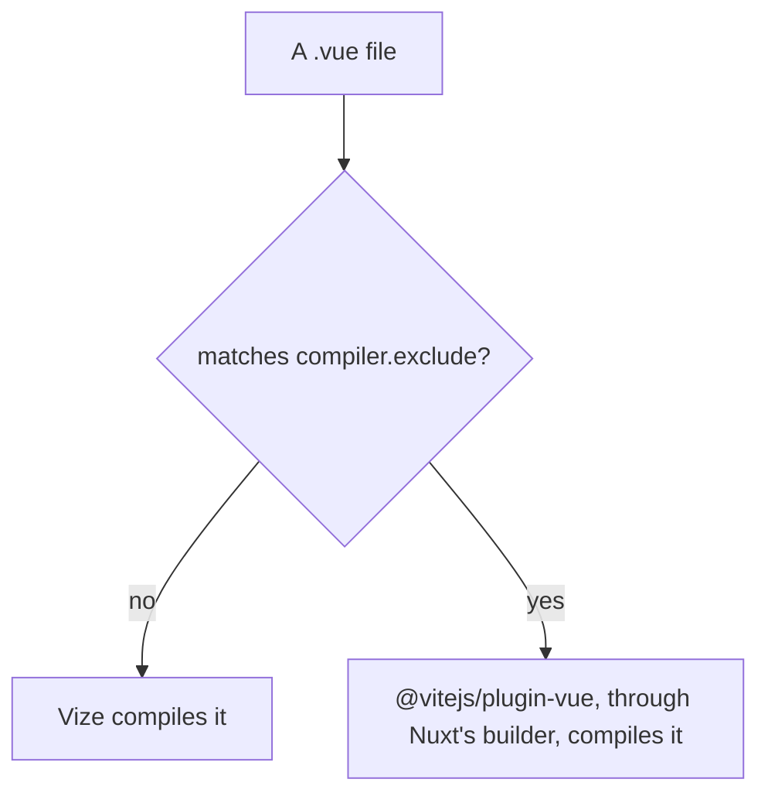

# Vize compiler

Vize compiles Vue single-file components in Rust. The library builds and Vitest compile through it ([build pipeline](../build-pipeline/design.md), "Vue components compile through Vize"), and so does the app: `@vizejs/nuxt` is in the Nuxt module list and takes the compiler's role from `@vitejs/plugin-vue`. One compiler therefore reads every `.vue` file in the repository. This page sets out the module's shape here, what it is checked against, and what it costs.

## How the module compiles

With the module registered, Vize compiles every `.vue` file that `compiler.exclude` does not name. The module hands an excluded file back to the host Vue plugin Nuxt's builder installed, so an excluded component keeps Vue's own compiler. The app names no exclusion.

## The TresJS elements

The module takes its TresJS elements as `compiler.customElements`, the list the library builds already hand Vize (`tresCustomElements`). A `Tres*` pattern would also take `TresCanvas`, which must stay a component, so the list names each class that TresJS's own predicate keeps. `tresjs-nuxt` keeps its predicate for Nuxt's own compiler, which restates the same rule and has not moved onto the list. The module's own lint is off, because the repository's lint is oxlint and ESLint.

## What holds

- **Dev.** With the module registered, the dev server answers `/`, `/about`, `/clicker`, `/fluid-simulator` and `/login` with status 200 and no `NUXT_E1006`, and Chrome mounts each; `/about` logs no hydration error, where the `new` form compiles to a member access. The first request after a cold start logs an outdated-optimised-dependency error until Vite re-optimises, as it does without the module. The dev server logs no "NUXT_B9003": the module's peer range covers the Nuxt the app runs, and its dev stylesheet plugin still imports `nitropack/runtime`, which the app's tree does not resolve, so the warning is silent rather than the import removed.
- **Server HTML.** On every public route it is the baseline's, with attribute order, nonces, integrity hashes, hashed asset names, scope ids and the page's own origin normalised. `/about` renders the canvas's own `` with its attributes: `TresCanvas` is registered as a client file and a server file, and the server render takes the server registration ([ubugeeei-prod/vize#11757](https://github.com/ubugeeei-prod/vize/issues/11757)). The one difference is a `modulepreload` hint `/login` carries without the module, which follows the chunk graph.
- **Production client.** It mounts on every public route with no page error, `/about` included, where an inline template's `new` on an imported binding compiles to a call the constructor can run. The console messages of each route are the baseline's. No client chunk imports a bare `vue` specifier ([ubugeeei-prod/vize#11793](https://github.com/ubugeeei-prod/vize/issues/11793)), and the server output imports it bare only from files the baseline's does, from `node_modules`.
- **Compilation.** The production build compiles every `.vue` file through the module with none failing, and props types imported from `@esposter/db-schema`, a private package that emits no declarations, resolve. `/clicker` renders in full and its cocktail counts a click as the baseline's does. Its SVG group carries the `class` and `cursor` its component passes as `gAttrs`, and props typed through the `@/` alias resolve ([ubugeeei-prod/vize#11794](https://github.com/ubugeeei-prod/vize/issues/11794)).

## What it costs

A clean production build takes about ten times as long with the module as without it: about a minute and a half without, and over a quarter of an hour with it. The difference is the per-file component transform. `vite-plugin-vize:sfc transform` spends hundreds of milliseconds a call in the client build and in the server build, where `vite:vue` spends milliseconds a call, and the plugin's batch pre-compile and the Nitro bundle add seconds. The module claims no gain in build time. The cost is the native `compileSfc` call resolving imported props types through the project's configuration, which `@vizejs/native` made slower from the release that added the resolution ([Vize issue 12044](https://github.com/ubugeeei-prod/vize/issues/12044)). That issue is closed by a release that prunes unrelated type exports from a barrel: a barrel that re-exports its types by name compiles in about a millisecond a file on it, where it took tens of milliseconds before. The app's own components do not follow that case, because the barrel of every workspace package is a generated list of `export *` lines, and a call on a component typed through one walks the whole barrel again ([Vize issue 12059](https://github.com/ubugeeei-prod/vize/issues/12059)). It costs about a second a call for a barrel of a few hundred lines and over twenty seconds for the several thousand lines of the `genshin-world` barrel, whose four components behind it are about a fifth of the time the app's components take to compile. The same release made a star barrel slower again when its modules import different types from another star barrel, so the two largest components take about eight times as long as on the release before it ([Vize issue 12062](https://github.com/ubugeeei-prod/vize/issues/12062)). The app build is not shorter for the fix. `@nuxt/vite-builder` depends on `@vitejs/plugin-vue` unconditionally and no Nuxt option turns it off, so the package stays in the lockfile until Nuxt drops the dependency, and the module keeps it for any component `compiler.exclude` names: that costs an install and changes no behaviour.

## Checking a bump

`vize`, `@vizejs/native`, `@vizejs/nuxt`, `@vizejs/unplugin` and `@vizejs/vite-plugin` pin one another and move as one Renovate group. A bump of the group re-runs the check against the baseline. It builds the app with and without the module, serves each output against a database, and compares the parsed server HTML of every public route after the normalisation above. It then loads every public route in Chromium, compares console errors and page errors, and clicks the `/clicker` cocktail in both. Bare `vue` specifiers are counted in every client chunk, since a directory count also includes chunks of other builds, so a count that compares two builds starts from a clean `.output` and a clean Nuxt build cache. A build served from a copy of `.output` needs the app's `node_modules` reachable from the copy, or the rate limiter's `drizzle-orm` import fails and `/clicker` shows its error screen in both. In a sandbox that cannot reach the font providers, `@nuxt/fonts` is left out of both builds.

## Key files

| File                                                            | Role                                                                        |
| :-------------------------------------------------------------- | :-------------------------------------------------------------------------- |
| `apps/web/configuration/modules.ts`                             | the Nuxt module list, where the Vize module registers                       |
| `apps/web/app/components/Visual/Gem/Index.vue`                  | the component whose inline template holds the `new` form `/about` exercises |
| `packages/genshin-world/scripts/tres/tresCustomElements.ts`     | the element names the library builds hand Vize, which the module takes too  |
| `packages/tresjs-nuxt/src/services/checkIsTresCustomElement.ts` | the TresJS predicate the Nuxt module sets for Nuxt's own compiler           |
| `packages/db-schema/package.json`                               | the private package, with no declarations, whose props types must resolve   |
| `renovate.json`                                                 | the rule that groups the Vize packages into one bump                        |
| `pnpm-workspace.yaml`                                           | the `vize` and `@vizejs/*` catalog entries                                  |

## Sources

- [Vize repository](https://github.com/ubugeeei-prod/vize) — the repository of `@vizejs/nuxt`; the peer range comes from its npm metadata.
- [Vize issue 11757](https://github.com/ubugeeei-prod/vize/issues/11757) — the server registration of a component registered for both client and server, which `/about`'s canvas depends on. Closed as completed.
- [Vize issue 11793](https://github.com/ubugeeei-prod/vize/issues/11793) — bare `vue` imports in the Nuxt 5 client, which the client check depends on. Closed as completed.
- [Vize issue 11794](https://github.com/ubugeeei-prod/vize/issues/11794) — `defineProps` through a tsconfig alias, which the `/clicker` SVG group depends on. Closed as completed.
- [Vize issue 11795](https://github.com/ubugeeei-prod/vize/issues/11795) — the `nitropack/runtime` import behind "NUXT_B9003", and the peer range. Closed as completed.
- [Vize issue 12044](https://github.com/ubugeeei-prod/vize/issues/12044) — the per-file `compileSfc` cost behind "What it costs". Closed as completed by a barrel fix that reaches a barrel of named re-exports and not the app's `export *` barrels.
- [Vize issue 12059](https://github.com/ubugeeei-prod/vize/issues/12059) — the cost of a star barrel, which each call walks in full.
- [Vize issue 12062](https://github.com/ubugeeei-prod/vize/issues/12062) — the regression that fix added for star barrels whose modules import different types from a shared star barrel.
