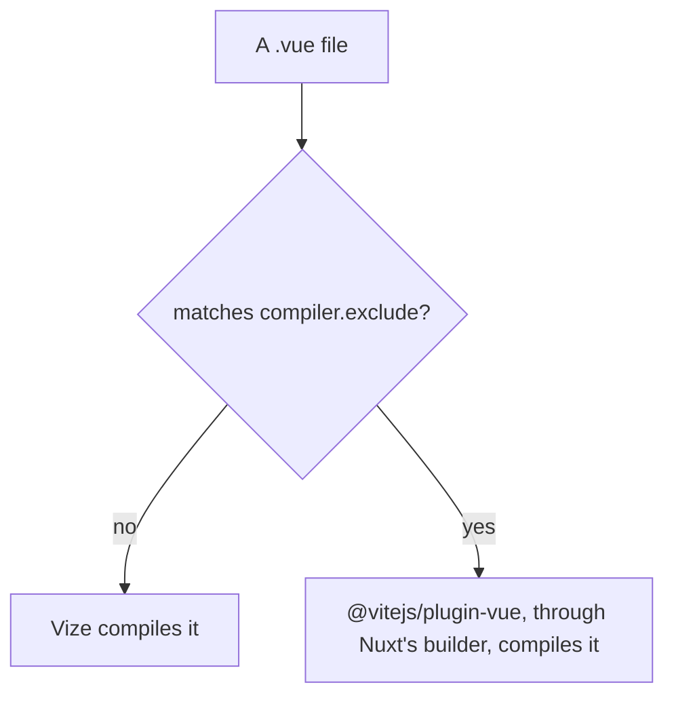

# Vize compiler

Vize compiles Vue single-file components in Rust. The library builds and Vitest compile through it ([build pipeline](../build-pipeline/design.md), "Vue components compile through Vize"), and so does the app: `@vizejs/nuxt` is in the Nuxt module list and takes the compiler's role from `@vitejs/plugin-vue`. One compiler therefore reads every `.vue` file in the repository. This page sets out the module's shape here, what it is checked against, and what it costs.

## How the module compiles

With the module registered, Vize compiles every `.vue` file that `compiler.exclude` does not name. The module hands an excluded file back to the host Vue plugin Nuxt's builder installed, so an excluded component keeps Vue's own compiler. The app names no exclusion.

## The TresJS elements

The module takes its TresJS elements as `compiler.customElements`, the list the library builds already hand Vize (`tresCustomElements`). A `Tres*` pattern would also take `TresCanvas`, which must stay a component, so the list names each class that TresJS's own predicate keeps. `tresjs-nuxt` keeps its predicate for Nuxt's own compiler, which restates the same rule and has not moved onto the list. The module's own lint is off, because the repository's lint is oxlint and ESLint.

## What holds

- **Dev.** With the module registered, the dev server answers `/`, `/about`, `/clicker`, `/fluid-simulator` and `/login` with status 200 and no `NUXT_E1006`, and Chrome mounts each; `/about` logs no hydration error, where the `new` form compiles to a member access. The first request after a cold start logs an outdated-optimised-dependency error until Vite re-optimises, as it does without the module. The dev server logs no "NUXT_B9003": the module's peer range covers the Nuxt the app runs, and its dev stylesheet plugin still imports `nitropack/runtime`, which the app's tree does not resolve, so the warning is silent rather than the import removed.
- **Server HTML.** On every public route it is the baseline's, with attribute order, nonces, integrity hashes, hashed asset names, scope ids and the page's own origin normalised. `/about` renders the canvas's own `` with its attributes: `TresCanvas` is registered as a client file and a server file, and the server render takes the server registration ([ubugeeei-prod/vize#11757](https://github.com/ubugeeei-prod/vize/issues/11757)). The one difference is a `modulepreload` hint `/login` carries without the module, which follows the chunk graph.
- **Production client.** It mounts on every public route with no page error, `/about` included, where an inline template's `new` on an imported binding compiles to a call the constructor can run. The console messages of each route are the baseline's. No client chunk imports a bare `vue` specifier ([ubugeeei-prod/vize#11793](https://github.com/ubugeeei-prod/vize/issues/11793)), and the server output imports it bare only from files the baseline's does, from `node_modules`.
- **Compilation.** The production build compiles every `.vue` file through the module with none failing, and props types imported from `@esposter/db-schema`, a private package that emits no declarations, resolve. `/clicker` renders in full and its cocktail counts a click as the baseline's does. Its SVG group carries the `class` and `cursor` its component passes as `gAttrs`, and props typed through the `@/` alias resolve ([ubugeeei-prod/vize#11794](https://github.com/ubugeeei-prod/vize/issues/11794)).

## What it costs

On Windows a clean production build takes several times as long with the module as without it: under two minutes without, and between seven and ten with it, the range being the machine's other load. A Linux build in CI takes a little over two minutes with the module, and its baseline without it was not measured. The build makes three passes over the app's components (client, server and Nitro). In each the plugin pre-compiles every component, which takes about a minute on the Windows machine and about ten seconds in CI. The module claims no gain in build time.

The dev server does not pre-compile. The app sets `compiler.scanPatterns` to an empty list under `$development` in `apps/web/nuxt.config.ts`, so a dev start runs no pass and each component compiles on its first request. The pass was the wait a dev start's first request sat behind, minutes on the Windows machine. Builds keep it.

The cost was once the native `compileSfc` call resolving imported props types through the project's configuration, which `@vizejs/native` made slower from the release that added the resolution ([Vize issue 12044](https://github.com/ubugeeei-prod/vize/issues/12044)), and then the walk of a star barrel on every call. The barrel of every workspace package is a generated list of `export *` lines, and a call on a component typed through one walked the whole barrel again ([Vize issue 12059](https://github.com/ubugeeei-prod/vize/issues/12059)): about a second a call for a barrel of a few hundred lines and over twenty seconds for the several thousand lines of the `genshin-world` barrel. It grew with the square of the barrel when its modules import different types from another star barrel ([Vize issue 12062](https://github.com/ubugeeei-prod/vize/issues/12062)). A release that stops following `export *` branches once a named re-export satisfies every requested type, and shares the validation across the calls of one turn, closed both ([Vize pull request 12063](https://github.com/ubugeeei-prod/vize/pull/12063)): the native batches of a pre-compile take about twenty seconds for every component of the app, where one `genshin-world` component alone took over twenty seconds.

On Windows the client pass pays for a path spelling. The pre-compile lists the files with a glob that returns forward slashes and stores each compile under that path, while the transform hook looks the module up by its id's path, which Nuxt hands over with backslashes on Windows. The two spellings are two keys, so the lookup misses for every such component, and the hook compiles it again, about a hundred and fifty milliseconds a call where a pre-compile batch costs about twenty milliseconds a component. The source the hook is handed is the file's own text, so the source is not why, and a reproduction of two components with no Nuxt shows the miss ([Vize issue 12151](https://github.com/ubugeeei-prod/vize/issues/12151)). A copy of the plugin with its three lookups of that key normalised to forward slashes takes the client hook from about two minutes to under three seconds, the client pass from about three minutes to about a minute, and the whole build from about seven minutes to about five, with the output folder the same size to within a kilobyte. A Linux build has one spelling, so its client hook costs a few milliseconds a call. The module carries no workaround: the checks are CI's and run on Linux, so the cost is a local Windows build's.

The server pass pays for a cache the pre-compile never fills. Its hook compiles nearly every component again whatever the spelling, which counters in a copy of the plugin showed: nearly every call found no entry to compare, and the compiles took nearly all of the hook's time, about seventy-five seconds of the pass's hundred and thirty on the Windows machine. In CI the hook spends about twenty seconds in that pass. The hook of the server environment reads a cache of its own, which the pre-compile only clears ([Vize issue 12153](https://github.com/ubugeeei-prod/vize/issues/12153) reports it, and [Vize issue 12044](https://github.com/ubugeeei-prod/vize/issues/12044) named it first). The Nitro pass makes no hook call and still pre-compiles every component, which is about a minute of its own on the Windows machine and about ten seconds in CI.

The pre-compile's disk cache restores a share of the components on Windows: a start that finds the cache a previous run wrote takes those components from it and compiles the rest. The dev server's log shows this, and an app build has not been measured for it.

What the native batches do not account for is the rest of each pre-compile, about thirty seconds on the Windows machine, which is the plugin's JavaScript around the native call. A build's log prints the batch figures on its `[vize] Pre-compilation complete` line and the hook's on the plugin-timings warning that follows each pass.

The app build is not shorter for the fix. `@nuxt/vite-builder` depends on `@vitejs/plugin-vue` unconditionally and no Nuxt option turns it off, so the package stays in the lockfile until Nuxt drops the dependency, and the module keeps it for any component `compiler.exclude` names: that costs an install and changes no behaviour.

## Checking a bump

`vize`, `@vizejs/native`, `@vizejs/nuxt`, `@vizejs/unplugin` and `@vizejs/vite-plugin` pin one another and move as one Renovate group. A bump of the group re-runs the check against the baseline. It builds the app with and without the module, serves each output against a database, and compares the parsed server HTML of every public route after the normalisation above. It then loads every public route in Chromium, compares console errors and page errors, and clicks the `/clicker` cocktail in both. Bare `vue` specifiers are counted in every client chunk, since a directory count also includes chunks of other builds, so a count that compares two builds starts from a clean `.output` and a clean Nuxt build cache. A build served from a copy of `.output` needs the app's `node_modules` reachable from the copy, or the rate limiter's `drizzle-orm` import fails and `/clicker` shows its error screen in both. In a sandbox that cannot reach the font providers, `@nuxt/fonts` is left out of both builds.

## Key files

| File                                                            | Role                                                                        |
| :-------------------------------------------------------------- | :-------------------------------------------------------------------------- |
| `apps/web/configuration/modules.ts`                             | the Nuxt module list, where the Vize module registers                       |
| `apps/web/nuxt.config.ts`                                       | the `$development` override that empties the module's pre-compile scan      |
| `apps/web/app/components/Visual/Gem/Index.vue`                  | the component whose inline template holds the `new` form `/about` exercises |
| `packages/genshin-world/scripts/tres/tresCustomElements.ts`     | the element names the library builds hand Vize, which the module takes too  |
| `packages/tresjs-nuxt/src/services/checkIsTresCustomElement.ts` | the TresJS predicate the Nuxt module sets for Nuxt's own compiler           |
| `packages/db-schema/package.json`                               | the private package, with no declarations, whose props types must resolve   |
| `renovate.json`                                                 | the rule that groups the Vize packages into one bump                        |
| `pnpm-workspace.yaml`                                           | the `vize` and `@vizejs/*` catalog entries                                  |

## Sources

- [Vize repository](https://github.com/ubugeeei-prod/vize) — the repository of `@vizejs/nuxt`; the peer range comes from its npm metadata.
- [Vize issue 11757](https://github.com/ubugeeei-prod/vize/issues/11757) — the server registration of a component registered for both client and server, which `/about`'s canvas depends on. Closed as completed.
- [Vize issue 11793](https://github.com/ubugeeei-prod/vize/issues/11793) — bare `vue` imports in the Nuxt 5 client, which the client check depends on. Closed as completed.
- [Vize issue 11794](https://github.com/ubugeeei-prod/vize/issues/11794) — `defineProps` through a tsconfig alias, which the `/clicker` SVG group depends on. Closed as completed.
- [Vize issue 11795](https://github.com/ubugeeei-prod/vize/issues/11795) — the `nitropack/runtime` import behind "NUXT_B9003", and the peer range. Closed as completed.
- [Vize issue 12044](https://github.com/ubugeeei-prod/vize/issues/12044) — the per-file `compileSfc` cost behind "What it costs". Closed as completed by a barrel fix that reaches a barrel of named re-exports. The cache of the server environment that it also names is still not filled by the pre-compile.
- [Vize issue 12059](https://github.com/ubugeeei-prod/vize/issues/12059) — the cost of a star barrel, which each call walked in full. Closed as completed by pull request 12063.
- [Vize issue 12062](https://github.com/ubugeeei-prod/vize/issues/12062) — the growth with the square of a star barrel whose modules import different types from a shared star barrel. Closed as completed by pull request 12063.
- [Vize pull request 12063](https://github.com/ubugeeei-prod/vize/pull/12063) — the bound on a star export's walk and the validation shared across the calls of one turn.
- [Vize issue 12151](https://github.com/ubugeeei-prod/vize/issues/12151) — the transform hook's cache key on Windows, which the client pass's hook cost depends on. Open.
- [Vize issue 12153](https://github.com/ubugeeei-prod/vize/issues/12153) — the cache the server environment's hook reads, which the pre-compile never fills. Open.
