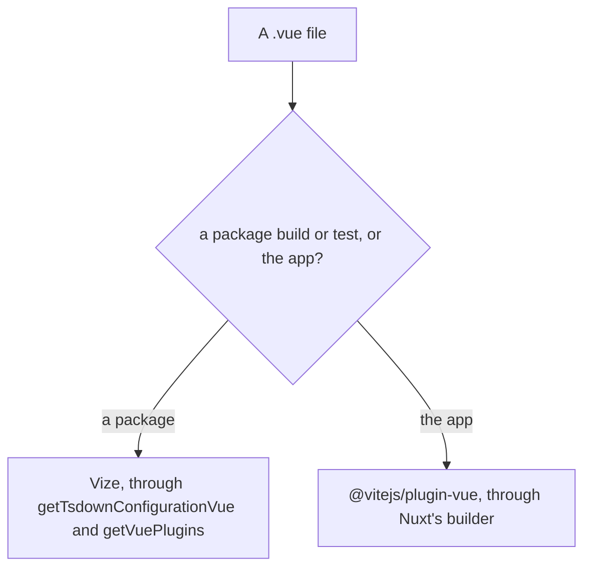

# Vize compiler

Vize compiles Vue single-file components in Rust. The library builds and Vitest compile through it ([build pipeline](../build-pipeline/design.md), "Vue components compile through Vize"). The app does not: it compiles through `@vitejs/plugin-vue`, which Nuxt's builder installs, because `@vizejs/nuxt` makes a clean production build on Windows about three times as long. This page sets out which compiler reads which file, what the module cost, and what a return to it would have to show.

## Which compiler reads which file

## Library builds

One compiler reaches the build through three entries of the same release. `getTsdownConfigurationVue` adds `@vizejs/unplugin/rolldown` with `isProduction: true`, and `getVuePlugins` adds `@vizejs/vite-plugin` for the Vitest and Vite runs of a package whose tests import `.vue` files, which is opt-in per package. Both take their plugin's own options through the factory's argument. The app registers no Vize module and compiles through Nuxt's own `@vitejs/plugin-vue`. The packages pin one another exactly, so Renovate bumps them as one group.

- **Styles go through the bundler's CSS pipeline.** Since `@vizejs/unplugin` 0.664.0, every style block, a `<style src>` with a package specifier included, is handed to the bundler (#11523), so tsdown with `@tsdown/css` writes the package's one `style.css` (`css.splitting` is off, since an unbundled build splits CSS per module otherwise). tsdown joins those rules in the order rolldown renders chunks, which moves between builds of one tree, so `mergeStylesheetsPlugin` writes the file again in module-id order. `deps.alwaysBundle` keeps a sibling package's stylesheet in the package's own CSS, so the built JavaScript never imports a `.css` file that Node cannot load, and the scripts and benchmarks that read a Vue package's `dist` under plain Node keep working.
- **Declarations come from `tsrs`.** `getTsdownConfigurationVue` sets the declaration plugin's generator to `tsrs`, over the package's `tsconfig.build.json` with `tsrs.runExternalCode`, so the `.vue` declarations are written through the same vize content mapper the type check runs ([the type-check change](../../../changes/archive/2026-11-05-architecture-vize-vue-typecheck/design.md)). The declaration program is that tsconfig's own file list, so an ambient `auto-imports.d.ts` is in it (`.agents/skills/build/references/declarations.md`). A component's declaration is vize's component model rather than Vue's `DefineComponent`, and the helper types sit once in a `declare global` block.

The compile-side defects found on the way, each reduced and reported to Vize:

| Issue  | What it was                                                                     | Outcome                                                                 |
| :----- | :------------------------------------------------------------------------------ | :---------------------------------------------------------------------- |
| #11456 | the rolldown entry dropped every `<style src>` block without a warning          | an error in 0.656.0, inlined in 0.658.0, a package specifier in 0.661.0 |
| #11481 | a production build kept the development output shape                            | fixed in 0.661.0 (#11488)                                               |
| #11482 | a package specifier in `<style src>` failed the build                           | fixed in 0.661.0 (#11492)                                               |
| #11483 | a plain `<style>` block was injected into the JavaScript and no CSS was written | fixed in 0.664.0 (#11523)                                               |
| #11457 | the Vite plugin ignored `template.compilerOptions.isCustomElement`              | closed as configuration: `customElements`                               |
| #11484 | `customElements` cannot exclude a tag                                           | closed as not planned: the list above names every tag                   |

## The TresJS elements

The library builds hand Vize the TresJS elements as `tresCustomElements`, a list, because Vize takes element names where Vue asks a predicate. A `Tres*` pattern would also take `TresCanvas`, which must stay a component, so the list names each class that TresJS's own predicate keeps. `tresjs-nuxt` keeps that predicate for the app's compiler, and the list restates it for Vize.

## What the Nuxt module cost

The module was measured against the same tree without it, on an eight-core Windows desktop with 32 GB of memory and nothing else running, three clean production builds of each in alternating order. A build took about four minutes with the module and between one and one and a half minutes without it, so about three times as long. The builds with the module agree to within a few seconds. A Linux build in CI took a little over two minutes with the module, and its baseline without it was not measured. The module claims no gain in build time.

The typecheck and the dev server's start did not move with the module. The typecheck took about half a minute either way, and the dev server was ready in about twenty seconds either way. The first page's compile in the dev server was not compared, because the measuring machine's environment did not let the page render.

The build makes three passes over the app's components (client, server and Nitro). In each pass the plugin pre-compiles every component before any module is requested, which takes about a minute on the Windows machine and about ten seconds in CI. The server pass's pre-compile reads about twice as long, but that is wall time shared with the client bundle running beside it on the same thread, not extra work. Of each pass's minute, the native batches take about ten seconds. Those batches resolve imported props types through the workspace barrels, a cost that bounding the walk of a star barrel brought down from minutes ([Vize pull request 12063](https://github.com/ubugeeei-prod/vize/pull/12063)).

The rest of each pre-compile is `fs.realpathSync.native`. The plugin's compiled-module cache records every path identity of every dependency of every compiled component, and it asks the filesystem again for each one, with nothing memoised. The dependencies of a component typed through a workspace barrel are most of the type project, so one build makes over a million calls for fewer than ten thousand distinct paths. On Windows each call opens a handle to resolve the final path, so together they take about two minutes. A Linux or macOS `realpath` is far cheaper, while the count is the same on every platform ([Vize issue 13557](https://github.com/ubugeeei-prod/vize/issues/13557)). A preload memoising the call, standing in for the fix, cuts each pass's pre-compile to about a quarter and the build to under two minutes. That is still about two fifths longer than the baseline, and three more causes in Vize account for the remainder, each reproduced outside the app.

- **The type behind a component's props is resolved again for every component.** The native cost of a component grows with the barrel behind its props type, while `@vitejs/plugin-vue` resolves a type file once and stays flat however large the barrel is ([Vize issue 13558](https://github.com/ubugeeei-prod/vize/issues/13558)).
- **The pre-compile follows the glob, not the module graph.** Every pass compiles every `.vue` file, including the components no page imports. The Nitro pass imports none and still compiles them all ([Vize issue 13559](https://github.com/ubugeeei-prod/vize/issues/13559)).
- **The server pass repeats the client's analysis.** Parsing, the `<script setup>` analysis and the type resolution run again for each component, although only the generated code differs between the two ([Vize issue 13560](https://github.com/ubugeeei-prod/vize/issues/13560)).

Turning the pre-compile off with `scanPatterns: []` is no remedy. The plugin then compiles each component on request, one at a time and outside the native batches, at about a tenth of a second each against a few milliseconds for `@vitejs/plugin-vue`. The build came out as long as with the pre-compile, which is the measurement that moved Vize's Nuxt module from on-demand compiles to the pre-compile ([Vize issue 9900](https://github.com/ubugeeei-prod/vize/issues/9900)). The pre-compile also feeds the production `components.css` from every scanned component.

`@nuxt/vite-builder` depends on `@vitejs/plugin-vue` unconditionally and no Nuxt option turns it off, so the package stays in the lockfile whichever compiler the app uses.

## What a return to the module owes

The module was checked against the baseline without it before it left, and a return re-runs that check on a build of each, served against a database:

- **Build time.** A clean production build on Windows no slower than the baseline's.
- **Server HTML.** The parsed HTML of every public route equal after attribute order, nonces, integrity hashes, hashed asset names, scope ids and the page's own origin are normalised. `/about` renders the canvas's own ``, which needs the server registration of a component registered for both client and server ([Vize issue 11757](https://github.com/ubugeeei-prod/vize/issues/11757)).
- **Production client.** Every public route mounts in Chromium with the baseline's console and page errors, `/about` included, where an inline template's `new` on an imported binding must compile to a call the constructor can run. The `/clicker` cocktail counts a click in both.
- **Compilation.** Every `.vue` file compiles with none failing, and props types imported from `@esposter/db-schema`, a private package that emits no declarations, resolve.

## Checking a bump

`vize`, `@vizejs/native`, `@vizejs/unplugin` and `@vizejs/vite-plugin` pin one another and move as one Renovate group, so the library builds, Vitest, the content mapper and the scripts' parser compile with one Vize build.

## Key files

| File                                                               | Role                                                                        |
| :----------------------------------------------------------------- | :-------------------------------------------------------------------------- |
| `apps/web/configuration/modules.ts`                                | the Nuxt module list, where no Vize module registers                        |
| `apps/web/configuration/typescript.ts`                             | the `.vue` content mapper the app's typecheck uses, which needs no module   |
| `apps/web/app/components/Visual/Gem/Index.client.vue`              | the component whose inline template holds the `new` form `/about` exercises |
| `packages/genshin-world/scripts/tres/tresCustomElements.ts`        | the element names the library builds hand Vize                              |
| `packages/tresjs-nuxt/src/services/checkIsTresCustomElement.ts`    | the TresJS predicate the app's compiler uses                                |
| `packages/configuration/src/services/getVuePlugins.ts`             | the Vize Vite plugin a package's Vitest and Vite runs add                   |
| `packages/configuration/src/services/getTsdownConfigurationVue.ts` | the Vize unplugin a package's build adds                                    |
| `packages/db-schema/package.json`                                  | the private package, with no declarations, whose props types must resolve   |
| `renovate.json`                                                    | the rule that groups the Vize packages into one bump                        |
| `pnpm-workspace.yaml`                                              | the `vize` and `@vizejs/*` catalog entries                                  |

## Sources

- [Vize repository](https://github.com/ubugeeei-prod/vize) — the repository of the `vize` and `@vizejs/*` packages.
- [Vize issue 11757](https://github.com/ubugeeei-prod/vize/issues/11757) — the server registration of a component registered for both client and server, which `/about`'s canvas depends on. Closed as completed.
- [Vize issue 12044](https://github.com/ubugeeei-prod/vize/issues/12044) — the per-file `compileSfc` cost of resolving imported props types through the project's configuration. Closed as completed by a barrel fix that reaches a barrel of named re-exports. The server environment's cache it also names is the one issue 12153 closed.
- [Vize issue 12059](https://github.com/ubugeeei-prod/vize/issues/12059) — the cost of a star barrel, which each call walked in full. Closed as completed by pull request 12063.
- [Vize issue 12062](https://github.com/ubugeeei-prod/vize/issues/12062) — the growth with the square of a star barrel whose modules import different types from a shared star barrel. Closed as completed by pull request 12063.
- [Vize pull request 12063](https://github.com/ubugeeei-prod/vize/pull/12063) — the bound on a star export's walk and the validation shared across the calls of one turn.
- [Vize issue 9900](https://github.com/ubugeeei-prod/vize/issues/9900) — the Nuxt module's on-demand compiles measured against the pre-compile's native batches, which moved the module's default to the pre-compile. Closed as completed.
- [Vize issue 12151](https://github.com/ubugeeei-prod/vize/issues/12151) — the transform hook's cache key on Windows, under which the client pass compiled every component again. Closed as completed.
- [Vize issue 12153](https://github.com/ubugeeei-prod/vize/issues/12153) — the cache the server environment's hook reads, which the pre-compile never filled. Closed as completed by pull request 12156, which keeps a client and a server cache that both reuse the pre-compile.
- [Vize issue 13557](https://github.com/ubugeeei-prod/vize/issues/13557) — the uncached `realpathSync.native` call per dependency per compiled component, the cost behind "What the Nuxt module cost", with a reproduction of a thousand components typed through a star barrel, in one environment and in three. Open.
- [Vize issue 13558](https://github.com/ubugeeei-prod/vize/issues/13558) — an imported props type resolved again for every component, at a native cost per component that grows with the barrel behind the type. Open.
- [Vize issue 13559](https://github.com/ubugeeei-prod/vize/issues/13559) — the pre-compile of every globbed component in every environment, including components nothing imports and environments that import none. Open.
- [Vize issue 13560](https://github.com/ubugeeei-prod/vize/issues/13560) — the server environment repeating the client's parsing, script analysis and type resolution. Open.
- [Vize issue 12932](https://github.com/ubugeeei-prod/vize/issues/12932) — the content mapper's one-line comment for a `v-for` alias, which a pattern over several lines broke. Closed as completed by pull request 12938, which the 0.749.0 release carries, so the menu items component destructures its item again.
