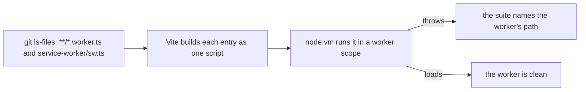

# Worker Scope

A worker runs in its own scope, with no `window`, no `document` and none of the globals only Node adds. A module's top level can read one of them as it loads, several imports out from the worker, and the worker then throws before it registers a listener: a page reports only that the script's evaluation failed. The repository finds every worker entry and runs it in that scope, so the failure is a red test with the worker's path on it.

## How it works

`workerScope.test.ts` lists the tracked and untracked files by pathspec, so a worker is covered from the moment its file exists. Each entry is built by Vite with the package's own `tsconfig` paths, as one script, and run in a `node:vm` context that holds a list of globals a worker has and Node also has, plus `self`, `location`, `addEventListener` and `postMessage`. `process`, `Buffer`, `global`, `setImmediate`, `window` and `document` are absent, so a read of one as the script loads throws.

**The clock is the case that taught it.** `now` once anchored itself as the shared package loaded and chose `process.hrtime` wherever there was no `window`, which a worker is. Any worker that imported the shared barrel threw. `now` reads `performance.timeOrigin` and `performance.now()` instead, which a window, a worker and Node all have, so the shared package evaluates in any of them.

## Key files

| File                                                       | Role                                                                              |
| ---------------------------------------------------------- | --------------------------------------------------------------------------------- |
| `scripts/src/workspace/workerScope.test.ts`                | Finds every worker entry, builds it and runs it in a scope with no window or Node |
| `packages/shared/src/util/time/now.ts`                     | The clock a worker can import: the platform's own, with no load-time work         |
| `apps/web/service-worker/sw.ts`                            | The service worker entry the PWA module fixes by name                             |
| `apps/web/app/workers/`                                    | The app's dedicated workers                                                       |
| `packages/genshin-world/src/workers/terrainTile.worker.ts` | The terrain worker, whose own test also pins its module graph                     |

## Notes

- **Rejected: a lint on a worker's imports.** It sees the worker's own import list, one hop, and would carry a list of package names. The read that failed was in a module the barrel pulled in, so only running the worker sees it.
- **The scope is a list of handed-over globals, not Node's globals minus a few.** A global a worker has that the list lacks is added by name, since the failure names it, and nothing Node adds can be handed over by accident.
- **The build is Vite's defaults with the package's `tsconfig` paths, not the app's own configuration.** The question is what the code reads as it loads, which the bundler's configuration does not change, and a configuration the test did not need would be one more thing for it to drift from.
