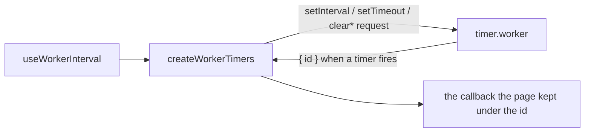

# Worker Timers

A background tab's main-thread timers are throttled by the browser, so a recording's elapsed time or the clicker's production would stall while the tab is hidden. The timers in `services/shared/getWorkerTimers` run in one dedicated Web Worker per page instead, and `useWorkerInterval` is the composable that schedules on them.

## How it works

`getWorkerTimers` makes its worker on first use and shares it across every caller. The page owns the ids and the callbacks; the worker holds only the native timer handles, so a fired timer is reported back by its id and the page runs the callback it kept under that id.

## The protocol

A request carries `id`, `method` and, for a set, `delayMs`. The four methods are `setInterval`, `setTimeout`, `clearInterval` and `clearTimeout`, and the worker replies with `{ id }` for each fire. Ids come from the page, start at 1 as the HTML spec requires, and are never reused.

Clearing an id that is not pending posts nothing, so a late clear after a timeout fired, or a clear of an id never scheduled, is silent. A timeout is forgotten on its fire, so its callback runs at most once. Every browser keeps one list of timers for both clear methods, so the worker clears either kind with the same call.

## Cleanup

`useWorkerInterval` schedules on mount and clears its id on unmount. A caller that arms a timer on an event rather than on mount owns its id and clears it itself.

## Key files

Paths relative to `apps/web`.

| File                                          | Role                                                          |
| --------------------------------------------- | ------------------------------------------------------------- |
| `app/workers/shared/timer.worker.ts`          | the worker: native handles, reports each fire by id           |
| `app/services/shared/createWorkerTimers.ts`   | the page side: ids, callbacks, the request and clear protocol |
| `app/services/shared/getWorkerTimers.ts`      | the one worker per page, made on first use                    |
| `app/models/shared/TimerRequest.ts`           | the request union the page posts                              |
| `app/models/shared/TimerResponse.ts`          | the response the worker posts                                 |
| `app/composables/shared/useWorkerInterval.ts` | the mount-scoped interval, cleared on unmount                 |

## Upstream

Every `worker-timers` issue and pull request is judged by the [triage](../dependency-admission/design.md). The package is absorbed rather than kept, so its tracker was read in full, and each verdict's proof is the test or source line that shows it.

| Upstream                                                                                                                                                                                                                                                                                                                                                                                                                                                                                                                                                                                                                                                                                                                                                                                                                                                                                                                                                                                                                                                                                                                                                                                                                                                                                                                                                                                                            | Verdict             | Proof                                                                                                                                                                                                     |
| ------------------------------------------------------------------------------------------------------------------------------------------------------------------------------------------------------------------------------------------------------------------------------------------------------------------------------------------------------------------------------------------------------------------------------------------------------------------------------------------------------------------------------------------------------------------------------------------------------------------------------------------------------------------------------------------------------------------------------------------------------------------------------------------------------------------------------------------------------------------------------------------------------------------------------------------------------------------------------------------------------------------------------------------------------------------------------------------------------------------------------------------------------------------------------------------------------------------------------------------------------------------------------------------------------------------------------------------------------------------------------------------------------------------- | ------------------- | --------------------------------------------------------------------------------------------------------------------------------------------------------------------------------------------------------- |
| [#449](https://github.com/chrisguttandin/worker-timers/issues/449)                                                                                                                                                                                                                                                                                                                                                                                                                                                                                                                                                                                                                                                                                                                                                                                                                                                                                                                                                                                                                                                                                                                                                                                                                                                                                                                                                  | Out of scope        | The app's CSP keeps `worker-src` `blob:` (`apps/web/configuration/security.ts`), which the Blob-free `?worker` path also satisfies.                                                                       |
| [#448](https://github.com/chrisguttandin/worker-timers/issues/448)                                                                                                                                                                                                                                                                                                                                                                                                                                                                                                                                                                                                                                                                                                                                                                                                                                                                                                                                                                                                                                                                                                                                                                                                                                                                                                                                                  | False positive      | Upstream's broker typings fail without the DOM library; ours uses the DOM `Worker` type and no broker type.                                                                                               |
| [#447](https://github.com/chrisguttandin/worker-timers/issues/447)                                                                                                                                                                                                                                                                                                                                                                                                                                                                                                                                                                                                                                                                                                                                                                                                                                                                                                                                                                                                                                                                                                                                                                                                                                                                                                                                                  | Out of scope        | The app's timers are intervals; no caller relies on equal-delay ordering, a limit stated in Limits.                                                                                                       |
| [#446](https://github.com/chrisguttandin/worker-timers/issues/446)                                                                                                                                                                                                                                                                                                                                                                                                                                                                                                                                                                                                                                                                                                                                                                                                                                                                                                                                                                                                                                                                                                                                                                                                                                                                                                                                                  | Out of scope        | The browser's clock after a suspend, not the package's code; a unit test cannot suspend a machine, see Limits.                                                                                            |
| [#445](https://github.com/chrisguttandin/worker-timers/issues/445)                                                                                                                                                                                                                                                                                                                                                                                                                                                                                                                                                                                                                                                                                                                                                                                                                                                                                                                                                                                                                                                                                                                                                                                                                                                                                                                                                  | In scope — defect   | Set, clear, then set again works; the id is never reused (`createWorkerTimers.test.ts`, 'a timeout with no delay fires at once').                                                                         |
| [#444](https://github.com/chrisguttandin/worker-timers/issues/444)                                                                                                                                                                                                                                                                                                                                                                                                                                                                                                                                                                                                                                                                                                                                                                                                                                                                                                                                                                                                                                                                                                                                                                                                                                                                                                                                                  | False positive      | A usage question: a web worker runs in any webview that loads the page, Tauri included.                                                                                                                   |
| [#443](https://github.com/chrisguttandin/worker-timers/issues/443)                                                                                                                                                                                                                                                                                                                                                                                                                                                                                                                                                                                                                                                                                                                                                                                                                                                                                                                                                                                                                                                                                                                                                                                                                                                                                                                                                  | Out of scope        | The app's CSP sets no `require-trusted-types-for` (`apps/web/configuration/security.ts`), so no policy is needed.                                                                                         |
| [#442](https://github.com/chrisguttandin/worker-timers/issues/442)                                                                                                                                                                                                                                                                                                                                                                                                                                                                                                                                                                                                                                                                                                                                                                                                                                                                                                                                                                                                                                                                                                                                                                                                                                                                                                                                                  | Out of scope        | A device-specific iOS 15 report with no reproduction; checkable only on that device.                                                                                                                      |
| [#441](https://github.com/chrisguttandin/worker-timers/issues/441)                                                                                                                                                                                                                                                                                                                                                                                                                                                                                                                                                                                                                                                                                                                                                                                                                                                                                                                                                                                                                                                                                                                                                                                                                                                                                                                                                  | False positive      | A usage question about extension manifests; the package is not an extension.                                                                                                                              |
| [#440](https://github.com/chrisguttandin/worker-timers/issues/440)                                                                                                                                                                                                                                                                                                                                                                                                                                                                                                                                                                                                                                                                                                                                                                                                                                                                                                                                                                                                                                                                                                                                                                                                                                                                                                                                                  | Out of scope        | Every browser the app supports has a Worker; a missing Worker fails on first use rather than falling back silently (see Limits).                                                                          |
| [#439](https://github.com/chrisguttandin/worker-timers/issues/439)                                                                                                                                                                                                                                                                                                                                                                                                                                                                                                                                                                                                                                                                                                                                                                                                                                                                                                                                                                                                                                                                                                                                                                                                                                                                                                                                                  | False positive      | Fixed upstream: `set-interval-factory.js` in worker-timers-broker 8.0.34 passes `...args`; ours passes them too (`createWorkerTimers.test.ts`).                                                           |
| [#438](https://github.com/chrisguttandin/worker-timers/issues/438)                                                                                                                                                                                                                                                                                                                                                                                                                                                                                                                                                                                                                                                                                                                                                                                                                                                                                                                                                                                                                                                                                                                                                                                                                                                                                                                                                  | Out of scope        | `requestAnimationFrame` is not a timer, and no caller needs it in a worker.                                                                                                                               |
| [#437](https://github.com/chrisguttandin/worker-timers/issues/437)                                                                                                                                                                                                                                                                                                                                                                                                                                                                                                                                                                                                                                                                                                                                                                                                                                                                                                                                                                                                                                                                                                                                                                                                                                                                                                                                                  | In scope — defect   | Clearing an id that is not pending does nothing and throws nothing (`createWorkerTimers.test.ts`).                                                                                                        |
| [#436](https://github.com/chrisguttandin/worker-timers/issues/436)                                                                                                                                                                                                                                                                                                                                                                                                                                                                                                                                                                                                                                                                                                                                                                                                                                                                                                                                                                                                                                                                                                                                                                                                                                                                                                                                                  | In scope — defect   | The delay defaults to 0 (`createWorkerTimers.test.ts`, 'a timeout with no delay fires at once').                                                                                                          |
| [#435](https://github.com/chrisguttandin/worker-timers/issues/435)                                                                                                                                                                                                                                                                                                                                                                                                                                                                                                                                                                                                                                                                                                                                                                                                                                                                                                                                                                                                                                                                                                                                                                                                                                                                                                                                                  | Out of scope        | A transitive Node engine constraint of a dependency we no longer install.                                                                                                                                 |
| [#434](https://github.com/chrisguttandin/worker-timers/issues/434)                                                                                                                                                                                                                                                                                                                                                                                                                                                                                                                                                                                                                                                                                                                                                                                                                                                                                                                                                                                                                                                                                                                                                                                                                                                                                                                                                  | Out of scope        | Content-script isolated worlds in an extension; the app is not an extension.                                                                                                                              |
| [#433](https://github.com/chrisguttandin/worker-timers/issues/433)                                                                                                                                                                                                                                                                                                                                                                                                                                                                                                                                                                                                                                                                                                                                                                                                                                                                                                                                                                                                                                                                                                                                                                                                                                                                                                                                                  | In scope — defect   | Clearing a timeout after it fired is a no-op (`createWorkerTimers.test.ts`, 'a cleared timeout never calls back').                                                                                        |
| [#428](https://github.com/chrisguttandin/worker-timers/issues/428)                                                                                                                                                                                                                                                                                                                                                                                                                                                                                                                                                                                                                                                                                                                                                                                                                                                                                                                                                                                                                                                                                                                                                                                                                                                                                                                                                  | In scope — feature  | A readable source: the worker is `app/workers/shared/timer.worker.ts`, not stringified.                                                                                                                   |
| [#423](https://github.com/chrisguttandin/worker-timers/issues/423)                                                                                                                                                                                                                                                                                                                                                                                                                                                                                                                                                                                                                                                                                                                                                                                                                                                                                                                                                                                                                                                                                                                                                                                                                                                                                                                                                  | Out of scope        | The app bundles its own code; no CDN build is shipped.                                                                                                                                                    |
| [#422](https://github.com/chrisguttandin/worker-timers/issues/422)                                                                                                                                                                                                                                                                                                                                                                                                                                                                                                                                                                                                                                                                                                                                                                                                                                                                                                                                                                                                                                                                                                                                                                                                                                                                                                                                                  | Out of scope        | The app's worker is a Vite worker module built by the app's bundler, not a third-party bundle of the package.                                                                                             |
| [#419](https://github.com/chrisguttandin/worker-timers/issues/419)                                                                                                                                                                                                                                                                                                                                                                                                                                                                                                                                                                                                                                                                                                                                                                                                                                                                                                                                                                                                                                                                                                                                                                                                                                                                                                                                                  | Out of scope        | The worker is a Vite worker module built into its own file; no hand-written `worker.js` is needed.                                                                                                        |
| [#418](https://github.com/chrisguttandin/worker-timers/issues/418)                                                                                                                                                                                                                                                                                                                                                                                                                                                                                                                                                                                                                                                                                                                                                                                                                                                                                                                                                                                                                                                                                                                                                                                                                                                                                                                                                  | In scope — defect   | Same as #415: clearing an id the worker does not hold is silent here.                                                                                                                                     |
| [#417](https://github.com/chrisguttandin/worker-timers/issues/417)                                                                                                                                                                                                                                                                                                                                                                                                                                                                                                                                                                                                                                                                                                                                                                                                                                                                                                                                                                                                                                                                                                                                                                                                                                                                                                                                                  | Out of scope        | A test-double concern: `spyOn` on an ES module namespace. Our tests mock `getWorkerTimers` with `vi.mock`.                                                                                                |
| [#415](https://github.com/chrisguttandin/worker-timers/issues/415)                                                                                                                                                                                                                                                                                                                                                                                                                                                                                                                                                                                                                                                                                                                                                                                                                                                                                                                                                                                                                                                                                                                                                                                                                                                                                                                                                  | In scope — defect   | Clearing an id the worker does not hold is silent here, not a thrown error (`createWorkerTimers.test.ts`).                                                                                                |
| [#414](https://github.com/chrisguttandin/worker-timers/issues/414)                                                                                                                                                                                                                                                                                                                                                                                                                                                                                                                                                                                                                                                                                                                                                                                                                                                                                                                                                                                                                                                                                                                                                                                                                                                                                                                                                  | False positive      | An accuracy question; worker timers are no more precise than the page's, and their value is throttling immunity (see Limits).                                                                             |
| [#413](https://github.com/chrisguttandin/worker-timers/issues/413)                                                                                                                                                                                                                                                                                                                                                                                                                                                                                                                                                                                                                                                                                                                                                                                                                                                                                                                                                                                                                                                                                                                                                                                                                                                                                                                                                  | In scope — recorded | The background-tab timers are the package's purpose; the throttling check is recorded in `openspec/changes/architecture-worker-timers-throttle-check`, as Limits says.                                    |
| [#411](https://github.com/chrisguttandin/worker-timers/issues/411)                                                                                                                                                                                                                                                                                                                                                                                                                                                                                                                                                                                                                                                                                                                                                                                                                                                                                                                                                                                                                                                                                                                                                                                                                                                                                                                                                  | Out of scope        | IE11 is not a browser the app supports.                                                                                                                                                                   |
| [#382](https://github.com/chrisguttandin/worker-timers/issues/382)                                                                                                                                                                                                                                                                                                                                                                                                                                                                                                                                                                                                                                                                                                                                                                                                                                                                                                                                                                                                                                                                                                                                                                                                                                                                                                                                                  | In scope — defect   | Ids start at 1 as the spec requires (`createWorkerTimers.test.ts`, 'hands out ids from 1').                                                                                                               |
| [#366](https://github.com/chrisguttandin/worker-timers/issues/366)                                                                                                                                                                                                                                                                                                                                                                                                                                                                                                                                                                                                                                                                                                                                                                                                                                                                                                                                                                                                                                                                                                                                                                                                                                                                                                                                                  | In scope — feature  | A readable worker: the source is `app/workers/shared/timer.worker.ts`, not minified, so the question no longer arises.                                                                                    |
| [#359](https://github.com/chrisguttandin/worker-timers/issues/359)                                                                                                                                                                                                                                                                                                                                                                                                                                                                                                                                                                                                                                                                                                                                                                                                                                                                                                                                                                                                                                                                                                                                                                                                                                                                                                                                                  | Out of scope        | Old Android WebViews without modern JavaScript; the app targets current browsers.                                                                                                                         |
| [#358](https://github.com/chrisguttandin/worker-timers/issues/358)                                                                                                                                                                                                                                                                                                                                                                                                                                                                                                                                                                                                                                                                                                                                                                                                                                                                                                                                                                                                                                                                                                                                                                                                                                                                                                                                                  | Out of scope        | Node; the module is browser-only by design.                                                                                                                                                               |
| [#352](https://github.com/chrisguttandin/worker-timers/pull/352) (PR)                                                                                                                                                                                                                                                                                                                                                                                                                                                                                                                                                                                                                                                                                                                                                                                                                                                                                                                                                                                                                                                                                                                                                                                                                                                                                                                                               | Out of scope        | An ES5 module build for the package's old consumers; the app compiles its own ES2022 worker.                                                                                                              |
| [#335](https://github.com/chrisguttandin/worker-timers/issues/335)                                                                                                                                                                                                                                                                                                                                                                                                                                                                                                                                                                                                                                                                                                                                                                                                                                                                                                                                                                                                                                                                                                                                                                                                                                                                                                                                                  | False positive      | A typo in the user's own import (`wroker-timers`), not a defect in the package.                                                                                                                           |
| [#320](https://github.com/chrisguttandin/worker-timers/issues/320)                                                                                                                                                                                                                                                                                                                                                                                                                                                                                                                                                                                                                                                                                                                                                                                                                                                                                                                                                                                                                                                                                                                                                                                                                                                                                                                                                  | Out of scope        | Legacy Edge (EdgeHTML), which the app does not support.                                                                                                                                                   |
| [#317](https://github.com/chrisguttandin/worker-timers/issues/317)                                                                                                                                                                                                                                                                                                                                                                                                                                                                                                                                                                                                                                                                                                                                                                                                                                                                                                                                                                                                                                                                                                                                                                                                                                                                                                                                                  | Out of scope        | A Jest gap for `URL.createObjectURL`; our suites replace `getWorkerTimers` and fake the worker, so no test needs the URL.                                                                                 |
| [#309](https://github.com/chrisguttandin/worker-timers/issues/309)                                                                                                                                                                                                                                                                                                                                                                                                                                                                                                                                                                                                                                                                                                                                                                                                                                                                                                                                                                                                                                                                                                                                                                                                                                                                                                                                                  | Out of scope        | A Node 8 engine constraint of a dependency we no longer install.                                                                                                                                          |
| [#286](https://github.com/chrisguttandin/worker-timers/issues/286)                                                                                                                                                                                                                                                                                                                                                                                                                                                                                                                                                                                                                                                                                                                                                                                                                                                                                                                                                                                                                                                                                                                                                                                                                                                                                                                                                  | In scope — feature  | A readable worker: the source is `app/workers/shared/timer.worker.ts`, not minified.                                                                                                                      |
| [#281](https://github.com/chrisguttandin/worker-timers/issues/281)                                                                                                                                                                                                                                                                                                                                                                                                                                                                                                                                                                                                                                                                                                                                                                                                                                                                                                                                                                                                                                                                                                                                                                                                                                                                                                                                                  | Out of scope        | Node usage; the module is browser-only and the app never runs it under Node.                                                                                                                              |
| [#168](https://github.com/chrisguttandin/worker-timers/issues/168)                                                                                                                                                                                                                                                                                                                                                                                                                                                                                                                                                                                                                                                                                                                                                                                                                                                                                                                                                                                                                                                                                                                                                                                                                                                                                                                                                  | Out of scope        | Browser clock behaviour after the machine sleeps, the same as #446; a unit test cannot sleep a machine, see Limits.                                                                                       |
| [#165](https://github.com/chrisguttandin/worker-timers/issues/165)                                                                                                                                                                                                                                                                                                                                                                                                                                                                                                                                                                                                                                                                                                                                                                                                                                                                                                                                                                                                                                                                                                                                                                                                                                                                                                                                                  | Out of scope        | The package is ours now; its licence is the repository's.                                                                                                                                                 |
| [#164](https://github.com/chrisguttandin/worker-timers/issues/164)                                                                                                                                                                                                                                                                                                                                                                                                                                                                                                                                                                                                                                                                                                                                                                                                                                                                                                                                                                                                                                                                                                                                                                                                                                                                                                                                                  | Out of scope        | The app ships for modern browsers and no ES5 bundle, so the ES5 worker string is not a concern here.                                                                                                      |
| [#161](https://github.com/chrisguttandin/worker-timers/issues/161)                                                                                                                                                                                                                                                                                                                                                                                                                                                                                                                                                                                                                                                                                                                                                                                                                                                                                                                                                                                                                                                                                                                                                                                                                                                                                                                                                  | In scope — defect   | Clearing an id that is not pending is safe, not a throw (`createWorkerTimers.test.ts`, 'clearing an id that is not pending').                                                                             |
| [#153](https://github.com/chrisguttandin/worker-timers/issues/153)                                                                                                                                                                                                                                                                                                                                                                                                                                                                                                                                                                                                                                                                                                                                                                                                                                                                                                                                                                                                                                                                                                                                                                                                                                                                                                                                                  | False positive      | A usage question about messaging a component from a worker; the app's composable is the answer (`useWorkerInterval`).                                                                                     |
| [#144](https://github.com/chrisguttandin/worker-timers/pull/144) (PR)                                                                                                                                                                                                                                                                                                                                                                                                                                                                                                                                                                                                                                                                                                                                                                                                                                                                                                                                                                                                                                                                                                                                                                                                                                                                                                                                               | False positive      | A grammar fix to the upstream README; no runtime behaviour.                                                                                                                                               |
| [#134](https://github.com/chrisguttandin/worker-timers/issues/134)                                                                                                                                                                                                                                                                                                                                                                                                                                                                                                                                                                                                                                                                                                                                                                                                                                                                                                                                                                                                                                                                                                                                                                                                                                                                                                                                                  | In scope — defect   | Server render: the worker is made on first use, never at import, so no `Blob` is read on the server (`apps/web/app/services/shared/getWorkerTimers.ts`, the `??=` on first call).                         |
| [#96](https://github.com/chrisguttandin/worker-timers/issues/96)                                                                                                                                                                                                                                                                                                                                                                                                                                                                                                                                                                                                                                                                                                                                                                                                                                                                                                                                                                                                                                                                                                                                                                                                                                                                                                                                                    | False positive      | A usage question about Web Audio scheduling; nothing in the app schedules audio through a timer.                                                                                                          |
| [#83](https://github.com/chrisguttandin/worker-timers/pull/83) (PR)                                                                                                                                                                                                                                                                                                                                                                                                                                                                                                                                                                                                                                                                                                                                                                                                                                                                                                                                                                                                                                                                                                                                                                                                                                                                                                                                                 | False positive      | A dependency bump of upstream's child packages, superseded: our absorbed code has none of them.                                                                                                           |
| [#82](https://github.com/chrisguttandin/worker-timers/pull/82) (PR)                                                                                                                                                                                                                                                                                                                                                                                                                                                                                                                                                                                                                                                                                                                                                                                                                                                                                                                                                                                                                                                                                                                                                                                                                                                                                                                                                 | False positive      | A dependency bump of upstream's child packages, superseded: our absorbed code has none of them.                                                                                                           |
| [#79](https://github.com/chrisguttandin/worker-timers/issues/79)                                                                                                                                                                                                                                                                                                                                                                                                                                                                                                                                                                                                                                                                                                                                                                                                                                                                                                                                                                                                                                                                                                                                                                                                                                                                                                                                                    | False positive      | A usage question for a plain page, answered by the docs rather than a defect.                                                                                                                             |
| [#65](https://github.com/chrisguttandin/worker-timers/issues/65)                                                                                                                                                                                                                                                                                                                                                                                                                                                                                                                                                                                                                                                                                                                                                                                                                                                                                                                                                                                                                                                                                                                                                                                                                                                                                                                                                    | In scope — recorded | Throttling of a background tab is the reason the package exists; the throttling check is recorded in `openspec/changes/architecture-worker-timers-throttle-check`, since no unit test can see throttling. |
| [#52](https://github.com/chrisguttandin/worker-timers/pull/52) (PR)                                                                                                                                                                                                                                                                                                                                                                                                                                                                                                                                                                                                                                                                                                                                                                                                                                                                                                                                                                                                                                                                                                                                                                                                                                                                                                                                                 | False positive      | A dependency bump of upstream's child packages, superseded: our absorbed code has none of them.                                                                                                           |
| [#39](https://github.com/chrisguttandin/worker-timers/issues/39)                                                                                                                                                                                                                                                                                                                                                                                                                                                                                                                                                                                                                                                                                                                                                                                                                                                                                                                                                                                                                                                                                                                                                                                                                                                                                                                                                    | Out of scope        | An old bundle (`main.bundle.js`) from a build the package no longer ships; the worker is compiled by the app's own bundler.                                                                               |
| Bot reports: Greenkeeper, Renovate and dependabot breakage and bumps, 158 issues — #410, #409, #406, #404, #403, #402, #401, #399, #398, #397, #393, #392, #391, #390, #387, #386, #383, #378, #377, #376, #375, #374, #373, #372, #371, #370, #367, #365, #364, #363, #362, #361, #360, #354, #353, #350, #349, #348, #347, #346, #345, #344, #343, #341, #340, #339, #338, #336, #333, #332, #331, #330, #328, #327, #323, #322, #321, #316, #312, #311, #306, #303, #297, #296, #293, #292, #291, #290, #288, #285, #283, #282, #280, #279, #278, #277, #276, #275, #270, #269, #268, #267, #266, #265, #264, #262, #261, #260, #259, #258, #257, #256, #255, #254, #253, #252, #251, #250, #248, #247, #246, #244, #243, #242, #241, #240, #239, #238, #235, #229, #228, #227, #226, #225, #224, #221, #220, #218, #216, #215, #214, #208, #207, #202, #201, #193, #191, #189, #186, #185, #181, #180, #178, #175, #173, #172, #170, #166, #160, #159, #158, #157, #156, #155, #150, #148, #143, #142, #141, #136, #135, #88, #87, #84, #70, #66, #63, #62                                                                                                                                                                                                                                                                                                                                                      | False positive      | A bot's report of upstream's own toolchain or a dependency bump; none is a runtime behaviour of the package.                                                                                              |
| Bot pull requests: 239 — #432, #431, #430, #429, #427, #426, #425, #424, #421, #420, #416, #412, #408, #407, #405, #400, #396, #395, #394, #389, #388, #385, #384, #381, #380, #379, #369, #368, #357, #356, #355, #351, #342, #337, #334, #329, #326, #325, #324, #319, #318, #315, #314, #313, #310, #308, #307, #305, #304, #302, #301, #300, #299, #298, #295, #294, #289, #287, #284, #274, #273, #272, #271, #263, #249, #245, #237, #236, #234, #233, #232, #231, #230, #223, #222, #219, #217, #213, #212, #211, #210, #209, #206, #205, #204, #203, #200, #199, #198, #197, #196, #195, #194, #192, #190, #188, #187, #184, #183, #182, #179, #177, #176, #174, #171, #169, #167, #163, #162, #154, #152, #151, #149, #147, #146, #145, #140, #139, #138, #137, #133, #132, #131, #130, #129, #128, #127, #126, #125, #124, #123, #122, #121, #120, #119, #118, #117, #116, #115, #114, #113, #112, #111, #110, #109, #108, #107, #106, #105, #104, #103, #102, #101, #100, #99, #98, #97, #95, #94, #93, #92, #91, #90, #89, #86, #85, #81, #80, #78, #77, #76, #75, #74, #73, #72, #71, #69, #68, #67, #64, #61, #60, #59, #58, #57, #56, #55, #54, #53, #51, #50, #49, #48, #47, #46, #45, #44, #43, #42, #41, #40, #38, #37, #36, #35, #34, #33, #32, #31, #30, #29, #28, #27, #26, #25, #24, #23, #22, #21, #20, #19, #18, #17, #16, #15, #14, #13, #12, #11, #10, #9, #8, #7, #6, #5, #4, #3, #2, #1 | False positive      | Dependency bumps and badges of upstream's own toolchain, all closed; none changes runtime behaviour.                                                                                                      |

## Limits

- **The throttling this avoids can only be checked in a real browser.** Unit tests run the protocol and the cleanup under fake timers, but no test environment throttles a background tab. The check is to hide a tab that runs an interval, bring it back, and compare the interval's count against the wall clock; a main-thread interval drifts there and the worker's should not.
- **A browser without a Worker fails on first use.** Every browser the app supports has one, so there is no fallback to the main thread; a fallback would silently lose the property the worker exists for.
- **Timeouts with equal delays do not keep a strict order across the worker boundary.** The app's timers are intervals, and no caller depends on the order of equal-delay timeouts.
- **A sleeping machine is the browser's clock, not ours.** Timers after a suspend are the browser's to schedule; this page makes no claim beyond the throttling of a hidden tab.
