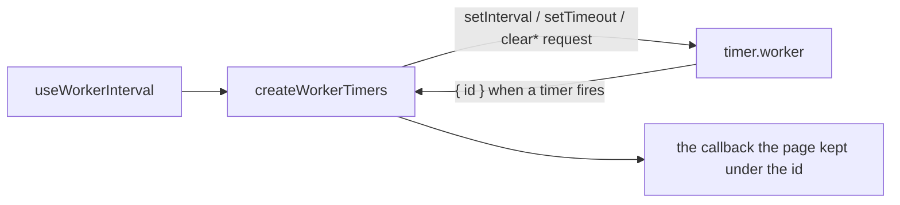

# Worker Timers

A background tab's main-thread timers are throttled by the browser, so a recording's elapsed time or the clicker's production would stall while the tab is hidden. The timers in `services/shared/getWorkerTimers` run in one dedicated Web Worker per page instead, and `useWorkerInterval` is the composable that schedules on them.

## How it works

`getWorkerTimers` makes its worker on first use and shares it across every caller. The page owns the ids and the callbacks; the worker holds only the native timer handles, so a fired timer is reported back by its id and the page runs the callback it kept under that id.

## The protocol

A request carries `id`, `method` and, for a set, `delayMs`. The four methods are `setInterval`, `setTimeout`, `clearInterval` and `clearTimeout`, and the worker replies with `{ id }` for each fire. Ids come from the page, start at 1 as the HTML spec requires, and are never reused.

Clearing an id that is not pending posts nothing, so a late clear after a timeout fired, or a clear of an id never scheduled, is silent. A timeout is forgotten on its fire, so its callback runs at most once. Every browser keeps one list of timers for both clear methods, so the worker clears either kind with the same call.

## Cleanup

`useWorkerInterval` schedules on mount and clears its id on unmount. A caller that arms a timer on an event rather than on mount owns its id and clears it itself.

## Key files

Paths relative to `apps/web`.

| File                                          | Role                                                          |
| --------------------------------------------- | ------------------------------------------------------------- |
| `app/workers/shared/timer.worker.ts`          | the worker: native handles, reports each fire by id           |
| `app/services/shared/createWorkerTimers.ts`   | the page side: ids, callbacks, the request and clear protocol |
| `app/services/shared/getWorkerTimers.ts`      | the one worker per page, made on first use                    |
| `app/models/shared/TimerRequest.ts`           | the request union the page posts                              |
| `app/models/shared/TimerResponse.ts`          | the response the worker posts                                 |
| `app/composables/shared/useWorkerInterval.ts` | the mount-scoped interval, cleared on unmount                 |

## Upstream

Every `worker-timers` issue and pull request is judged by the [triage](../dependency-admission/design.md). The package is absorbed rather than kept, so its tracker was read in full, and each verdict's proof is the test or source line that shows it. The tracker's 449 items are numbered 1 to 449, and each is counted once below. The in-scope items are listed in the table, each with its proof; the rest stay on the [tracker](https://github.com/chrisguttandin/worker-timers/issues?q=is%3Aissue):

- In scope: 14, listed below.
- Out of scope: 25.
- False positive: 410, the 13 rows of single items and the 397 items the two bot rows name.

| Upstream                                                           | Verdict            | Proof                                                                                                                                                                                                                                                                                                                                                                                      |
| ------------------------------------------------------------------ | ------------------ | ------------------------------------------------------------------------------------------------------------------------------------------------------------------------------------------------------------------------------------------------------------------------------------------------------------------------------------------------------------------------------------------ |
| [#445](https://github.com/chrisguttandin/worker-timers/issues/445) | In scope — defect  | Set, clear, then set again works; the id is never reused (`createWorkerTimers.test.ts`, 'a timeout with no delay fires at once').                                                                                                                                                                                                                                                          |
| [#437](https://github.com/chrisguttandin/worker-timers/issues/437) | In scope — defect  | Clearing an id that is not pending does nothing and throws nothing (`createWorkerTimers.test.ts`).                                                                                                                                                                                                                                                                                         |
| [#436](https://github.com/chrisguttandin/worker-timers/issues/436) | In scope — defect  | The delay defaults to 0 (`createWorkerTimers.test.ts`, 'a timeout with no delay fires at once').                                                                                                                                                                                                                                                                                           |
| [#433](https://github.com/chrisguttandin/worker-timers/issues/433) | In scope — defect  | Clearing a timeout after it fired is a no-op (`createWorkerTimers.test.ts`, 'a cleared timeout never calls back').                                                                                                                                                                                                                                                                         |
| [#428](https://github.com/chrisguttandin/worker-timers/issues/428) | In scope — feature | A readable source: the worker is `app/workers/shared/timer.worker.ts`, not stringified.                                                                                                                                                                                                                                                                                                    |
| [#418](https://github.com/chrisguttandin/worker-timers/issues/418) | In scope — defect  | Same as #415: clearing an id the worker does not hold is silent here.                                                                                                                                                                                                                                                                                                                      |
| [#415](https://github.com/chrisguttandin/worker-timers/issues/415) | In scope — defect  | Clearing an id the worker does not hold is silent here, not a thrown error (`createWorkerTimers.test.ts`).                                                                                                                                                                                                                                                                                 |
| [#413](https://github.com/chrisguttandin/worker-timers/issues/413) | In scope — feature | The background-tab timers are the package's purpose, and the worker implements them; the throttling is the manual check in Limits, as the rejected [automated check](../../../rejected/architecture/worker-timers-throttle-check/design.md) records.                                                                                                                                       |
| [#382](https://github.com/chrisguttandin/worker-timers/issues/382) | In scope — defect  | Ids start at 1 as the spec requires (`createWorkerTimers.test.ts`, 'hands out ids from 1').                                                                                                                                                                                                                                                                                                |
| [#366](https://github.com/chrisguttandin/worker-timers/issues/366) | In scope — feature | A readable worker: the source is `app/workers/shared/timer.worker.ts`, not minified, so the question does not arise.                                                                                                                                                                                                                                                                       |
| [#286](https://github.com/chrisguttandin/worker-timers/issues/286) | In scope — feature | A readable worker: the source is `app/workers/shared/timer.worker.ts`, not minified.                                                                                                                                                                                                                                                                                                       |
| [#161](https://github.com/chrisguttandin/worker-timers/issues/161) | In scope — defect  | Clearing an id that is not pending is safe, not a throw (`createWorkerTimers.test.ts`, 'clearing an id that is not pending').                                                                                                                                                                                                                                                              |
| [#134](https://github.com/chrisguttandin/worker-timers/issues/134) | In scope — defect  | Server render: the worker is made on first use, never at import, so no `Blob` is read on the server (`apps/web/app/services/shared/getWorkerTimers.ts`, the `??=` on first call).                                                                                                                                                                                                          |
| [#65](https://github.com/chrisguttandin/worker-timers/issues/65)   | In scope — feature | Throttling of a background tab is the reason the package exists, and the worker is what keeps the timers off the main thread. The protocol is tested under fake timers; the throttling has no automated check, and is the manual one in Limits. The automated check was rejected in [worker-timers-throttle-check](../../../rejected/architecture/worker-timers-throttle-check/design.md). |

## Limits

- **The throttling this avoids can only be checked in a real browser.** Unit tests run the protocol and the cleanup under fake timers, but no test environment throttles a background tab. The check, done by hand in a real browser, is to hide a tab that runs an interval, bring it back, and compare the interval's count against the wall clock; a main-thread interval drifts there and the worker's should not. An automated version was rejected, since no run the suite can host hides a tab ([rejected change](../../../rejected/architecture/worker-timers-throttle-check/design.md)).
- **A browser without a Worker fails on first use.** Every browser the app supports has one, so there is no fallback to the main thread; a fallback would silently lose the property the worker exists for.
- **Timeouts with equal delays do not keep a strict order across the worker boundary.** The app's timers are intervals, and no caller depends on the order of equal-delay timeouts.
- **A sleeping machine is the browser's clock, not ours.** Timers after a suspend are the browser's to schedule; this page makes no claim beyond the throttling of a hidden tab.
