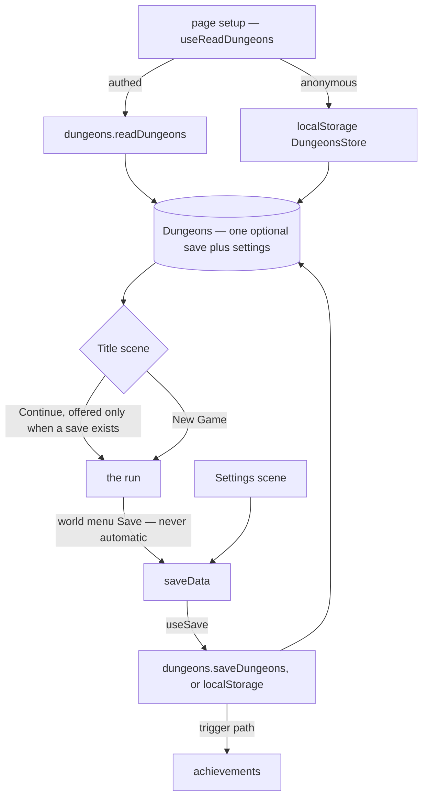

# Saves and Settings

The whole game persists as one `Dungeons` entity per user — a single optional `save` plus `settings` — through the same auth/unauth single-blob pattern as [clicker](../../clicker/game-loop-and-saves/design.md).

## How it works

A `Save` is the full run state: `player` (position, direction, party monsters, inventory, respawn location), the active `tilemapKey`, and per-map `world` state (chest opened-flags). `useReadDungeons` loads the blob at page setup (authed: `dungeons.readDungeons`; anonymous: localStorage `DungeonsStore`, parsed by `toLocalDungeons`, so a stored value that is not a save starts a fresh run rather than failing the page); the Title scene's Continue resumes `dungeons.save` (enabled only when one exists), New Game starts from a fresh `Save`. Saving is **manual** — the world menu's Save option calls `saveData`, which assigns the active save onto `dungeons.save` and persists via `useSave` — there is no autosave.

**No legacy shapes** — per the [latest-shape-only convention](../../architecture/persisted-data-latest-shape-only/design.md), `dungeonsSchema` and the `Dungeons` constructor accept only the current single-`save` shape; a blob that fails to parse starts fresh. If real save slots are ever wanted, design them as slots (their own ids, names, timestamps) rather than as a bare array of saves.

**Settings** — the Settings scene edits `dungeons.settings`, shared across runs: text speed (Slow/Mid/Fast, driving dialog animation delay), battle style, animations on/off, sound on/off + volume percentage, and theme mode (recoloring the UI glass panels via `ThemeModeColorsMap`). Settings persist in the same blob write.

**Achievements** — seven, all on the `dungeons.saveDungeons` trigger path. Two count saves (DungeonCrawler: 1, DungeonMaster: 50); five are play milestones whose `condition` reads the saved run when the player checkpoints ([unlock pipeline](../../achievement/unlock-pipeline/design.md)): MonsterCatcher (party size ≥ 2 — the starter is one, so two means a capture), MonsterTrainer / MonsterElite (any monster at level 10 / 25), MonsterCollector (every species present in the party), and DungeonHomeowner (every chest discovered so far opened, across all maps' `WorldData`). Since saving is manual, all of these reflect play, unlike the clicker's autosave-driven counts.

## Procedures

| Procedure               | Auth | Input                             | Purpose                                       |
| ----------------------- | ---- | --------------------------------- | --------------------------------------------- |
| `dungeons.readDungeons` | user | —                                 | read the user's save blob with its ETag       |
| `dungeons.saveDungeons` | user | `{ data: dungeonsSchema, etag? }` | overwrite the user's save blob under its ETag |

A save is sent under its ETag, the rule the [conditional writes](../../architecture/conditional-writes/design.md) page sets out. A refused save reloads the page, which takes the server's copy, as the Clicker's does.

## The settings cursor

The settings menu is one `SettingsOptionGrid`: a row per option, its name in column 0 and its value cells after it. The cursor is that grid's position, and four actions move it. Each decides for itself whether to save:

- **Up and down** (`moveSettingsRow`) move to the next row and rest there.
- **Left and right** (`moveSettingsColumn`) step to the adjacent value cell and save it. In a row with no value cells they do nothing, because the Volume and Theme Mode controls take those inputs first.
- **A click** (`selectSettingsPosition`) on a value cell moves there and saves it. On a name it only moves to that row.
- **Opening the scene** (`restSettingsCursor`) rests the cursor on the saved values, since they may have loaded after the cursor last moved.

A row with value cells rests on the cell holding its current setting. A row without them (Volume, Theme Mode, Close) rests on its name, so the cursor's column always agrees with the highlighted value.

The save is a consequence of an action, never of where the cursor happens to be. A watch on the cursor was the first design, and it fired on every move, including the ones that land on a row with no value, so it saved an empty value there. Every action goes through one save path, `saveSelectedValue`, and that path runs only from a value cell. A click on the cell the cursor is already on is a second press: on Close it confirms, and anywhere else it does nothing.

## Animations off

Animations off is one setting, read in one place. Every presentation that has an animated form passes its end state to `useSkippableAnimation` (`app/composables/dungeons/animation/useSkippableAnimation.ts`): with the setting on, the animation runs; with it off, the end state is applied and the call resolves at once. Apart from the three things kept outside it, listed below, no call site checks `isSkipAnimations` itself, so adding an animation means passing its end state, not adding a branch.

Dialog text reveals through the same helper. Both forms wait for the same thing before resolving: Vue's next render, then the scene's next tick, since Vue's watchers hand a text change to Phaser on that tick. That wait replaces the millisecond delay the skip path used to take as a stand-in.

Three things stay outside the helper. The experience bar's fast-forward is a player input for one bar, not the setting, so it keeps its own flag. The bar components read the setting only to snap a bar to its value without tweening it, a visual concern that doesn't change any outcome. The GainExperience battle state reads the setting to apply every level-up at once instead of waiting for each bar fill.

## Key files

Paths relative to `apps/web`.

| File                                                                          | Role                                     |
| ----------------------------------------------------------------------------- | ---------------------------------------- |
| `shared/models/dungeons/data/Dungeons.ts`                                     | root entity (save + settings)            |
| `shared/models/dungeons/data/Save.ts`                                         | one run's full state                     |
| `app/store/dungeons/index.ts`                                                 | `useSave` wiring, `saveData`             |
| `app/composables/dungeons/useReadDungeons.ts`                                 | load on page setup                       |
| `app/services/dungeons/toLocalDungeons.ts`                                    | the anonymous read, fresh on a bad value |
| `app/store/dungeons/settings/`                                                | settings scene stores                    |
| `app/store/dungeons/settings/scene.ts`                                        | the cursor's four actions                |
| `app/services/dungeons/scene/settings/SettingsOptionGrid.ts`                  | the option grid and its cells            |
| `app/composables/dungeons/scene/settings/useSettingsOnGridClick.ts`           | a click on a row or cell                 |
| `app/composables/dungeons/animation/useSkippableAnimation.ts`                 | the one Animations-off branch            |
| `shared/services/achievement/definitions/DungeonsAchievementDefinitionMap.ts` | achievements                             |

## Notes

- A party wipe respawns the player at `player.respawnLocation` with the party healed (`useWorldPlayerStore.respawn` / `healParty`) — in-session state is kept, not rolled back to the last save.
