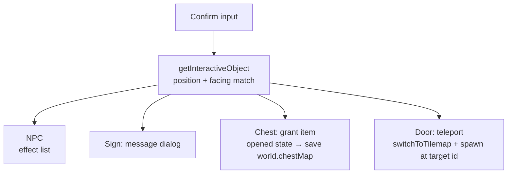

# World

The overworld: tile-based maps authored in Tiled Map Editor, walked on the headless grid engine, populated by NPCs and interactive objects, with random monster encounters in marked areas.

## How it works

**Tiled pipeline** — maps live as `.tmx` files; `pnpm tiled:gen` (`scripts/tiled/index.ts`, built on the `parse-tmx` package) generates typed artifacts into `shared/generated/tiled/`: the `TilemapKey` value set (Home, HomeBuilding1, HomeBuilding2), per-map `LayerName` value sets, object-group names, and typed object-property classes (`TeleportObjectProperty`, `EncounterObjectProperty`, `NpcId`, `ItemId`, …). Map content changes are therefore compile-time-checked against the code that consumes them.

**Movement** — the world's characters walk on the headless grid engine, which the [grid movement](../../grid-engine-headless/grid-movement/design.md) page describes. A binding in the app holds the Phaser side: when a tilemap is built, `createWorldGridEngine` reads its collision layers into the engine's tile grid, and the world store holds the engine raw with the tilemap it was made for. Each frame the world scene resolves the player's input, which may ask the player's move, and then `updateGridEngine` steps the engine with the frame's delta and every character's sprite writer draws its sprite from the engine's state: its pixel, its depth from the tile layer count and its bottom edge, and its walking frame. The player's tile and direction are written from the engine's position events, so the save's position is the engine's. NPCs patrol by `MovementPattern` (idle or clockwise) through `moveNpcs`, which asks the engine for each move.

**Interactions** — pressing Confirm facing an object walks `ObjectInteractionEffectMap`, keyed by Tiled object group:

NPC dialog and effects come from the `NpcMap` content map (`assets/dungeons/data/npcs.ts`); chest opened-state is per-map in `save.world[tilemapKey].chestMap`; doors read a typed `TeleportTarget` property and fade-switch tilemaps, spawning the player at the matching door id.

**Random encounters** — each step on an encounter layer increments `stepsSinceLastEncounter`, and the encounter chance is `steps / MAX_STEPS_BEFORE_NEXT_ENCOUNTER` (guaranteed at the cap). The layer's Tiled `area` property selects an `EncounterAreaMap` entry, a weighted random pick chooses the monster, `createEncounteredMonster` spawns it at the entry's level (replaying the normal level-up rolls above the species base, so rare picks arrive stronger), and the scene fade-switches to [battle](../battle/design.md).

## Decisions

- **The binding's walking frame and placement differ from the plugin's, on purpose.** While idle it shows the standing frame, where the plugin shows a stray foot frame before the first step. The midpoint flip to standing follows the binding's own progress, where the plugin lags it by one sample. The binding also draws the sprite in the frame the engine stepped, so the pixel never lags the progress the engine reports, which the plugin's sprite did by one sample. Alternative: copy the plugin's frames and its lag. Rejected: the idle foot frame is a stray, and the lag is the plugin's own one-sample reading of the progress the engine reports.
- **A door or a respawn places the player before its character joins the new engine.** `switchToTilemap` takes the target tile with the tilemap key, read from the target map before the switch, and the player's position is written before the remount, so `addCharacter` on a smaller map never sees the old map's tile. Alternative: teleport after the switch, as the effect did. Rejected: the new engine refuses a start outside its grid, so the player was never added and stood still.
- **The engine is stored in the world's store, marked raw.** Alternative: a scene-level plugin property. Rejected: a plugin is registered on the scene object and typed by augmentation, and it lives as long as the scene, not the tilemap.
- **The sprite writers are held by the world store, keyed by character id.** The binding's writer is a closure over the sprite and the walking frame, but the store keeps the writers in a map, not the sprites. Each frame `updateGridEngine` steps the engine and then draws every writer, so a sprite shows the state its frame's step left. Alternative: each character subscribes to the scene's update, which orders its write against the engine's step only by registration order. Rejected: the write must follow the engine's step.
- **`/dungeons` stays `ssr: false`, and the import that needs `window` is `phaser`.** With the rule removed, a warm dev server's server render of `/dungeons` answers `500 ReferenceError: window is not defined` in 9 s. The same import throws in plain Node: `phaser`'s module evaluation runs a device detection that reads `window.cordova` at import, and `pages/dungeons.vue` imports `phaser` statically. The rule is restored with a comment naming that import. The earlier hangs were the dev server's cold start, not the page: the first request waits on Nitro's reload of the server graph, which took minutes on a loaded machine and ran past its 120 s limit, as `dev-server.md` in the run-app skill records.

## Test plan

- Binding: the placement table for the sprite offset; the depth rule for the tile layers and a character; the frame sequence on steps, stops and turns; the collision grid read from a tilemap's collision property; a tilemap with no layers reads no collision (#352); a layer without its tilemapLayer property is refused with an InvalidGrid result that names the layer (#428).
- Driven run: the swapped world walked in Chrome on the dev server, by the run-app skill, with no committed suite. Over 1,901 samples of the player, each taking the sprite's pixel, depth and frame beside the engine's state on an animation frame, the placement and depth matched the binding's rules in every sample. The frame matched in every sample but three, each the first sample after a tilemap switch, before the walking frame is drawn again. The first idle sample shows the standing frame (7, facing down), not the plugin's stray frame. The walk moved one tile on one tap, three taps left, and a 1.1 s hold right, from (3,22) to (8,22). A wall above (5,20) turned the player up without moving, and a second bump raised no event. The idle NPC Smith turned to face the player on a held confirm, which opened the dialog. A teleport from (5,21) at progress 400 placed the player on (9,24) at once, emitted one start, one finish and one stop, and the step did not commit its old tile. A step onto an encounter tile raised the encounter counter from 0 to 1, with no battle. A respawn from (10,16) in Home placed the player on (9,4) in the interior at zero progress, healed the party and opened the healing message. The two doors, (5,8) inside and (6,20) in Home, arrived on (6,21) facing down and on (5,7) facing up, and each tilemap made a new engine that held only its own characters. The foreground's depth was the sprite's plus one in both tilemaps, and it sat above the sprite in every sample but one, taken during a door's switch: the door and the respawn both run under a fade, so the frame is dark. The console showed no error or page error in the run.

## Key files

Paths relative to `apps/web`.

| File                                                                                 | Role                                                                                      |
| ------------------------------------------------------------------------------------ | ----------------------------------------------------------------------------------------- |
| `scripts/tiled/index.ts`                                                             | `pnpm tiled:gen` codegen entrypoint                                                       |
| `shared/generated/tiled/`                                                            | generated value sets + typed map properties                                               |
| `app/services/dungeons/tilemap/`                                                     | tilemap asset/metadata creation                                                           |
| `app/services/dungeons/scene/world/interaction/`                                     | interaction dispatch services                                                             |
| `app/services/dungeons/scene/world/interaction/effect/ObjectInteractionEffectMap.ts` | object group → effect                                                                     |
| `app/services/dungeons/scene/world/rollRandomEncounter.ts`                           | encounter roll + battle handoff                                                           |
| `app/assets/dungeons/data/npcs.ts`                                                   | NPC content (dialog, effects, movement)                                                   |
| `app/assets/dungeons/data/encounterAreas.ts`                                         | weighted encounter tables + spawn levels                                                  |
| `app/services/dungeons/monster/createEncounteredMonster.ts`                          | level-scaled wild monster spawn                                                           |
| `app/services/dungeons/gridEngine/createWorldGridEngine.ts`                          | The world's engine: the collision grid read from the tilemap, made into the core's engine |
| `app/services/dungeons/gridEngine/readCollisionLayers.ts`                            | Reads the collision layers of a tilemap, each refused unless it names its tilemapLayer    |
| `app/services/dungeons/gridEngine/createCharacterSpriteWriter.ts`                    | Draws a character's sprite from the engine's state: pixel, depth and walking frame        |
| `app/services/dungeons/gridEngine/getSpritePixelPosition.ts`                         | The sprite's pixel from its tile, its progress through the step and the custom offset     |
| `app/services/dungeons/gridEngine/getCharacterDepth.ts`                              | A character's depth: the tile layer count less one, plus its bottom edge's whole pixels   |
| `app/services/dungeons/gridEngine/getStepFrame.ts`                                   | The walking frame during a step, switching at its midpoint                                |
| `app/services/dungeons/gridEngine/getTurnFrame.ts`                                   | The standing frame of a turn or a stop                                                    |
| `app/store/dungeons/world/scene.ts`                                                  | Holds the world's engine raw, with the sprite writers keyed by character id               |
| `app/components/Dungeons/World/Character/Index.vue`                                  | Attaches a character to the engine and subscribes to its events                           |
| `app/services/dungeons/scene/world/moveNpcs.ts`                                      | Moves each patrolling NPC through the engine and reads whether its next tile is blocked   |
| `app/models/resolvers/dungeons/world/MovementInteractionInputResolver.ts`            | Moves the player through the engine, unless the player is moving or not on the engine     |

## Notes

- `encounterAreas` precomputes cumulative weights at module load so the weighted pick is a single threshold scan.
- World state that must survive reloads (chests) lives in the save's per-tilemap `WorldData`; everything else (NPC positions) resets on scene entry.
- **Teleports roll the encounter a step onto grass rolls.** The position events fire on a teleport, so the player's encounter check runs there as it does today. Whether a teleport should roll an encounter is a product question outside this package.
