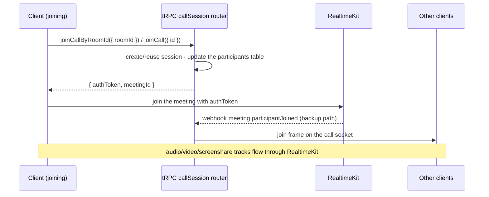
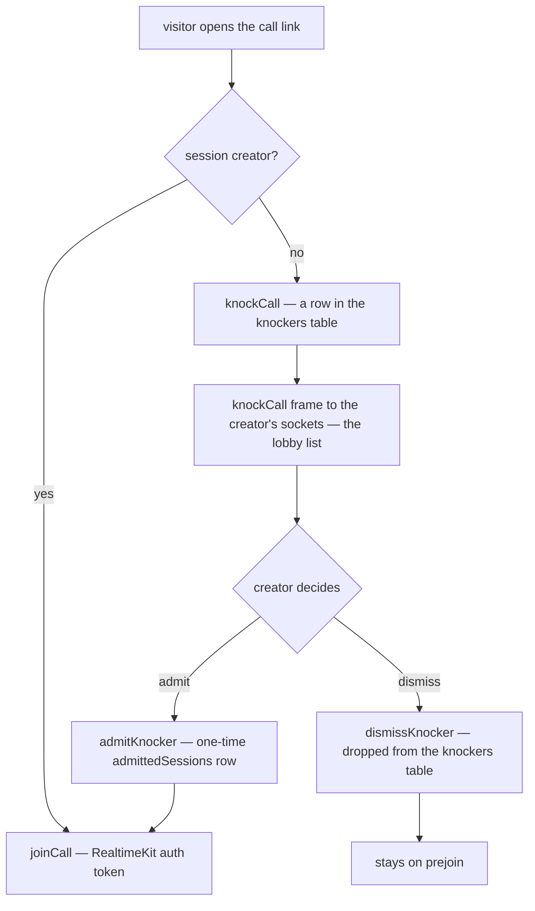
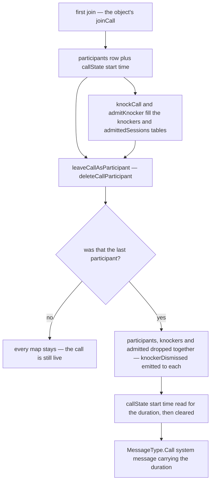

# Calls

Discord-style persistent per-room drop-in audio/video plus standalone share-link calls (like Google Meet). Room members join/leave room calls freely; `/calls` starts a roomless call joinable by anyone with the link. Media runs through the **LiveKit SFU** — the server generates access tokens and keeps a participant map for observers; LiveKit handles all WebRTC signaling, track publication, simulcast, and bandwidth estimation.

Sub-pages: [call view UI](call-view/design.md) · [screenshare](screenshare/design.md) · [picture-in-picture](picture-in-picture/design.md) · [per-user volume](per-user-volume/design.md) · [virtual backgrounds](virtual-backgrounds/design.md) · [blocked call audio](blocked-audio/design.md). Voice preferences applied to calls: [voice & video settings](../voice-video/design.md).

## The session model

A call is anchored to a `callSessionsInMessage` row, not a route:

- `id: text` PK — a **shareable alphanumeric token** (`createId(CALL_ID_LENGTH)`, crypto-secure); the id _is_ the shareable link token.
- `roomId` — set for room calls (unique FK → rooms, cascade); null-scoped standalone calls persist ownership on `userId` (creator).
- The session row is the persistent 1:1 anchor per room and survives restarts, and so do the participants: the call's own `CallObject` keeps them in its SQLite, so an eviction of the object loses nothing.

`CallParticipant.id` is the **auth `session.id`, not `user.id`** — the RealtimeKit participant's `customParticipantId` is `session.id`, so each device is its own participant (separate tracks, separate mute state). Using `user.id` would make multi-device join last-write-wins and let device A's leave evict device B.

## The call lifetime boundary

**Call membership is anchored to `activeCallSessionId`, never the viewed route.** `activeCallSessionId` answers "what call am I in?"; `currentRoomCallSessionId` answers "what call belongs to the room I'm looking at?" — they can differ, and that is valid. Navigating rooms swaps the observer only.

Leave happens only on: explicit **Leave Call**, moderation (`KickFromCall`/`KickFromRoom`/`TimeoutUser`/`CreateBan`/`SoftBan` on the call's room), real session loss (logout, tab close, RealtimeKit `meeting.participantLeft` webhook), or `/calls/[id]` unmount (that page _is_ the call context — except when popped out to [picture-in-picture](picture-in-picture/design.md)). A moderation that narrows a participant's publishing is not a leave: the participant's connection is replaced and its user rejoins the meeting with a new token, and the participant stays in the call.

| Owner                               | Responsibility                                                                                                                                           | Must not do                                         |
| ----------------------------------- | -------------------------------------------------------------------------------------------------------------------------------------------------------- | --------------------------------------------------- |
| `callStore.leaveCall()`             | the only normal path that leaves, leaves the RealtimeKit meeting, and resets active state                                                                | run implicitly during room navigation               |
| `useCallSubscribables()`            | observes the viewed room's session; updates `currentRoomCallSessionId`, and its participants unless the joined call holds that session                   | remove the active participant or disconnect LiveKit |
| `useCallParticipantSubscribables()` | subscribes the joined call's participants, from the messages layout for a room call and the call page for a standalone one; a session has one such owner | subscribe a session the joined call does not hold   |
| `useCallIdSubscribables()`          | owns `/calls/[id]` membership; validates session, subscribes, leaves on unmount (unless popped out)                                                      | reuse room-navigation cleanup semantics             |
| `LeftSideBar/StatusBar.vue`         | surfaces **any** active call (room or standalone) and links back to it                                                                                   | decide membership from `currentRoomCallSessionId`   |

## Join flow

The RealtimeKit webhook (`server/api/webhooks/realtimekit.post.ts`, validated by `verifyRealtimeKitWebhook`) is the **backup** for clients that disconnect without calling `leaveCall` (tab crash, network drop) — never the primary path for in-app route changes. It is also the door a token cannot get around: a room call's `participant_joined` is checked against the room's membership and any timeout (`checkIsCallConnectionAdmitted`), and a connection the room no longer admits is disconnected rather than added, since LiveKit accepts a removed member's old token until it expires.

### Standalone knock lobby

Every `/calls/[id]` visitor sees prejoin (verify mic/camera) first. The creator (persisted `callSessionsInMessage.userId`) gets **Join now**; non-creators get **Request to join** → `knockCall` puts them in the `knockers` table, the creator admits (`admitKnocker` → one-time entry in the `admittedSessions` table) or dismisses, and only then does `joinCall({ id })` succeed. Admitting, dismissing and the `onKnockCall` feed all pass one guard, `requireCallDoorkeeper`: the caller must be the creator, and must be in the call themselves — a creator who has left admits nobody.

The creator's lobby list is optimistic: admitting or dismissing removes that knocker at once, and each knocker is its own write target so a host can work down the queue without the writes queueing. A rejected one therefore puts back **only** its own knocker — reinstating the list as it stood would resurrect one already admitted beside it and drop whoever `onKnockCall` delivered meanwhile.

## Ephemeral server state

Everything about a live call except its anchor row lives in module-level maps under `server/services/message/call/`, each keyed by `callSessionId` and each lost on restart. There are four of them rather than one record per session, and the split is load-bearing rather than incidental:

- The `participants` table — the joined connections, keyed by auth session id. Created by a join and deleted by a leave; a call is live while it has a row. `requireJoinedCallSession` reads it for everyone but the call's creator, who is admitted from the stored session row.
- The `knockers` and `admittedSessions` tables — the standalone waiting room. They are torn down with the participant map, because a call nobody is in has nobody left to admit anyone.
- The `callState` row's start time — set by the first joiner and read by the **last leaver, after the participants are already gone**, to word the call-duration system message. It outlives the teardown on purpose, which is exactly why it cannot be a field of a record deleted as a unit.

Every teardown path funnels through `leaveCallAsParticipant` — the explicit leave, the RealtimeKit `meeting.participantLeft` webhook and the moderation actions alike — so the start time is never orphaned by a call that ended some other way.

### A restart does not end the calls

Losing these maps is survivable, not correct. RealtimeKit is an external service reached over its REST API; this process mints tokens and receives webhooks but holds no media connection, so a call in progress is entirely unaffected by the process going away and its participants stay connected to the SFU throughout. What the restart destroys is only this side's picture of them, and three things follow from that:

- `requireJoinedCallSession` admits the creator from the stored session row but every other participant only from the participant map, so every pre-restart participant other than the creator is locked out of the call procedures until they rejoin, while still being in the call.
- Their eventual `participant_left` webhook finds no map entry, `deleteCallParticipant` returns `false`, and `leaveCallAsParticipant` returns early — no `leaveCall` event, no duration message.
- The next join reads `isFirstJoiner` from that same empty map and re-stamps the `callState` start time, so the duration the call finally reports is measured from the restart rather than from the call.

Rebuilding the maps from RealtimeKit's own view of each meeting is the fix, and it waits on a trigger worth having — [call state reconciliation](../../../deferred/esbabbler/call-state-reconciliation/design.md).

## Procedures

All in `server/trpc/routers/call/index.ts`, registered as `callSession`; the waiting-room procedures live in `server/trpc/routers/call/knocker.ts` and merge in under a `knocker` key:

| Procedure                                                                                                                          | Auth               | Purpose                                                                              |
| ---------------------------------------------------------------------------------------------------------------------------------- | ------------------ | ------------------------------------------------------------------------------------ |
| `createCall`                                                                                                                       | authed             | create a standalone roomless session (`/calls`)                                      |
| `readCallSessionId({ roomId })`                                                                                                    | member             | room observer entry; returns `""` if none (never null)                               |
| `readCallSession({ id })`                                                                                                          | authed             | standalone validation for `/calls/[id]`                                              |
| `joinCallByRoomId({ roomId })`                                                                                                     | member             | create/reuse room session; returns the RealtimeKit auth token                        |
| `joinCall({ id })`                                                                                                                 | authed             | standalone join — creator or admitted knocker only                                   |
| `leaveCall({ callSessionId })`                                                                                                     | authed             | remove from participant map; last leaver posts the `MessageType.Call` system message |
| `readCallParticipantMap({ callSessionId })`                                                                                        | authed             | initial participant map for observers                                                |
| `setMuted` / `setCameraEnabled`                                                                                                    | authed             | sync state to the server map; broadcast                                              |
| `setHandRaised`                                                                                                                    | authed / moderator | raise own hand; lowering another's needs `MuteMembers` on the call's room            |
| `knocker.knockCall` / `knocker.admitKnocker` / `knocker.dismissKnocker`                                                            | authed / creator   | standalone waiting room — admitting and dismissing need the creator, in the call     |
| the call socket `/ws/call/[callSessionId]`, frames `joinCall` / `leaveCall` / `muteChanged` / `videoChanged` / `handRaisedChanged` | joined or knocking | the object broadcasts each frame to the call's sockets                               |
| frames `knockCall` (creator's sockets), `knockerAdmitted` / `knockerDismissed` (the knocker's own session)                         | creator / knocker  | the call socket                                                                      |

The subscriptions above are gated when they open, and then end when the subscriber's access lapses. In a room, a call's subscriptions end when the subscriber leaves that room, by a leave, a kick or a ban, as the room's own streams end (`onWhileCallRoomMember`). A standalone call has no room to leave, so its subscriptions end when the subscriber's own session leaves the call: its `leaveCall`, or the LiveKit disconnect that calls it. Both leave with the same event every participant removal emits.

Tokens grant `canPublishSources: [Microphone, Camera, ScreenShare, ScreenShareAudio]` with `room: callSessionId` and `metadata: { userId }`.

## Client stores

`store/message/room/call/index.ts` is the orchestration root (session boundaries, tRPC + SDK coordination); focused state lives in smaller stores so the realtime bridge never imports the root:

| Store                 | Owns                                                                                                                                          |
| --------------------- | --------------------------------------------------------------------------------------------------------------------------------------------- |
| `call/index.ts`       | `activeCallSessionId`, `currentRoomCallSessionId`, `callRoomId` (admin-action room checks)                                                    |
| `call/participant.ts` | `callSessionParticipantsMap` (keyed by session id), `speakingIds`, join notice                                                                |
| `call/media.ts`       | deafen, force-mute, camera, screenshare + pin state, virtual background, `isPoppedOut`, streams, [per-user volume](per-user-volume/design.md) |
| `call/knocker.ts`     | `knockingCallSessionId`, pre-join options, knocker queue                                                                                      |
| `realtime.ts`         | the RealtimeKit meeting bridge: connect, track events, device switching, mic processor, [blocked audio](blocked-audio/design.md)              |

DM calls work identically — call procedures accept `RoomType.DirectMessage`; membership via `usersToRooms` gates access. The first joiner posts the `MessageType.Call` "started a call" system message, and call end writes the call-duration variant.

## Key files

| File                                                             | Role                                                                        |
| :--------------------------------------------------------------- | :-------------------------------------------------------------------------- |
| `packages/db-schema/src/schema/message/callSessionsInMessage.ts` | session anchor table                                                        |
| `apps/web/server/trpc/routers/call/index.ts`                     | all call procedures (registered as `callSession`)                           |
| `apps/web/server/trpc/routers/call/knocker.ts`                   | waiting-room procedures (merged under `knocker`)                            |
| `apps/web/server/services/message/call/`                         | participant/knocker/admitted maps + CRUD                                    |
| `apps/web/server/services/message/call/onWhileCallRoomMember.ts` | a call's subscription, ended by the room's membership or a standalone leave |
| `apps/web/server/services/message/call/onWhileJoinedCall.ts`     | the same stream behind the join gate, for the participant subscriptions     |
| `apps/web/server/api/webhooks/realtimekit.post.ts`               | webhook backup for join/leave                                               |
| `apps/web/app/store/message/room/call/`                          | root + participant + media + knocker stores                                 |
| `apps/web/app/store/message/room/realtime.ts`                    | RealtimeKit meeting bridge                                                  |
| `apps/web/app/pages/calls/`                                      | standalone lobby (`index.vue`) + call route (`[id].vue`)                    |

## Notes

- **An SFU rather than a mesh.** Mesh WebRTC costs each participant an upload per peer, which video and screenshare make unsustainable past a handful of people.
- Hosting: LiveKit Cloud free tier (5,000 participant-minutes/month) now; self-hosted LiveKit on Azure Container Apps (~$5–15/month, scales to zero) when usage exceeds ~10,000 participant-minutes/month.
