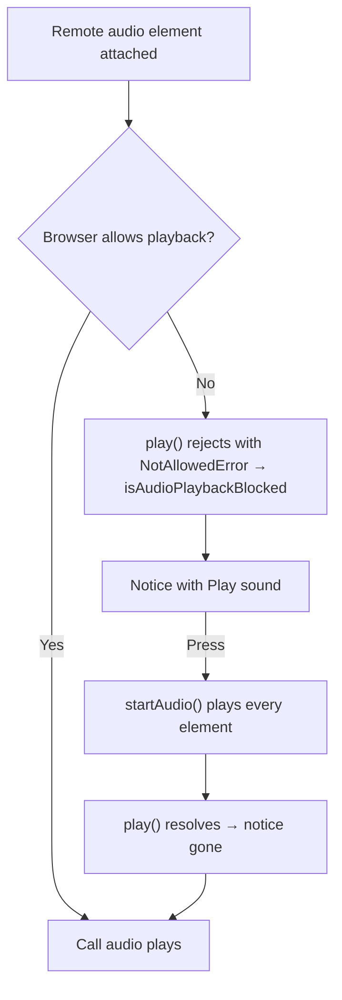

# Blocked Call Audio

A browser plays sound only after the page has had a gesture of the reader's own. Joining a call is usually that gesture, but not always — a call rejoined without a click, or a browser stricter than most — and then the call is up and silent with nothing on screen saying why. Where that happens, a warning notice reads **Your browser is keeping the call quiet until you allow its sound.** with a **Play sound** button; pressing it is the gesture, and the call's sound starts.

## How it works

The store plays each remote microphone's element itself. A `play()` the browser refuses with `NotAllowedError` sets `isAudioPlaybackBlocked`, a play that succeeds clears it, and the notice's button calls `startAudio`, which plays every element again from inside the button's click. Disconnect clears the flag.

Deafen is each element's `muted` flag, which a `play()` leaves alone, so a press does not undo it. A reader deafened while the sound was blocked is still deafened once it plays, and still deafened if the browser refuses it again.

## Where it shows

`MessageContentCallAudioPlaybackNotice` renders in three places, so it is on screen wherever the reader is in the call:

- **The call view**, above its controls — `/calls/[id]` and a room's call view alike.
- **The [picture-in-picture](../picture-in-picture/design.md) window**, above its controls — a press there is a gesture for the page that opened it, whose document holds the audio elements.
- **Under the room's call strip**, while the call view is closed — the reader is reading messages with the call running beside them.

## Key files

| File                                                                     | Role                                                            |
| :----------------------------------------------------------------------- | :-------------------------------------------------------------- |
| `apps/web/app/store/message/room/realtime.ts`                            | `isAudioPlaybackBlocked`, `startAudio` and the per-element mute |
| `apps/web/app/components/Message/Content/Call/Audio/PlaybackNotice.vue`  | the warning and its Play sound button                           |
| `apps/web/app/components/Message/Content/Call/View.vue`                  | places it above the call view's controls                        |
| `apps/web/app/components/Message/Content/Call/PictureInPicture/View.vue` | places it above the PiP window's controls                       |
| `apps/web/app/components/Message/Content/Call/Panel/Index.vue`           | places it under the room's call strip while the view is closed  |
