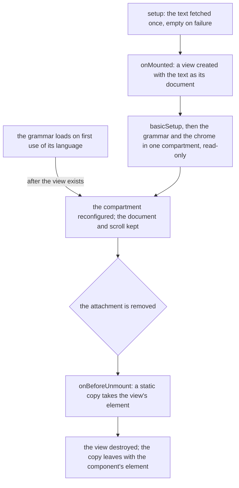

# Code viewer

A code file attached to a message opens in a read-only CodeMirror view. The file renderer hands the file to `Code.vue`, which fetches its text once and mounts CodeMirror's own `EditorView` around it, with the grammar for its language and the app's theme. The other file kinds are in [file media](../file-media/design.md).

## How it works

- **The language comes from the filename.** `getLanguage` matches the name against `LanguageRegexMap`. A name no pattern matches gets no grammar and shows as plain text.
- **The grammar loads on first use.** `getLanguageExtension` looks the language up in `EXTENDED_LANGUAGES`: the list `@codemirror/language-data` ships, with a Vue entry appended because that package has none. A file's grammar loads when a file of that kind first opens, not with the page, and its arrival reconfigures the view that already shows the text.
- **The colours are the app's own.** `uiEditorExtensions` sets the chrome, meaning the transparent background, the text, the selection, the cursor and the gutters, in the UI library's tokens. `uiHighlightSpecs` sets the highlight styles in the same tokens. No bundled theme is loaded, so the viewer follows the app's themes like the rest of the UI.
- **A failed fetch shows an empty file.** The text falls back to empty and the error is logged, so a broken link never blocks the message.
- **A preview is capped.** In a message preview the view takes at most `PREVIEW_MAX_HEIGHT`, and pointer events and selection are enabled on it.

## Decisions

- **The text is the view's document from creation, and nothing writes it afterwards.** The wrapper's model watch replaced the whole document on every external write, which history recorded (#121) and which reset the cursor (#229). The text is fetched before the view exists and never changes, so there is no model, watch or emit to keep. Rejected: keeping `v-model` for parity with the wrapper, since no caller writes the text after it loads.
- **`basicSetup` from `codemirror`, then the app's extensions in one `Compartment`.** The wrapper applied `basicSetup` to every view, so the line numbers, folding and search a reader sees stay. The grammar arrives after the view exists, so the language and the app's chrome sit in one compartment that a watch reconfigures.
- **Read-only is `EditorView.editable` set to false with `EditorState.readOnly` set to true**, the two facets the wrapper's `disabled` set.
- **The preview cap is a theme on the view.** `EditorView.theme` holds the editor at the preview height with pointer events and selection enabled, which is what the wrapper's `style` prop did through the same theme.
- **Teardown leaves a static copy for the leave transition (#78).** `view.destroy()` removes the editor's element at once, while a dialog's leave transition still shows the attachment. The component replaces the live element with a deep clone of itself, then destroys the view; the clone stays in the component's element until the transition removes it. Rejected: destroying in a leave hook, since the transition belongs to the dialog and the component cannot see it end.
- **No component surface.** The wrapper's props, events, plugin and `ready` payload served generic callers; the attachment is the only one here and needs none of them. A test reaches the view through `EditorView.findFromDOM`.

## Upstream

Every issue of [surmon-china/vue-codemirror](https://github.com/surmon-china/vue-codemirror), open and closed, has one verdict below, read with its comments and checked against the installed 6.1.1 source, the wrapper this view replaces. Three defects are in scope: #78 has a regression test beside the component, and #148 and #223 are ruled out by construction. The issues about CodeMirror 5 or the wrapper's releases before 6 are recorded as fixed upstream, since the v5.0.0 rewrite on CodeMirror 6 replaced the surface they describe. A wrapper defect whose trigger is a surface the view no longer has, the model, the global config or a prop, is out of scope, and its proof names the extension a caller would use instead.

| Upstream                                                          | Verdict                                     | Proof                                                                                                                                                                                                              |
| :---------------------------------------------------------------- | :------------------------------------------ | :----------------------------------------------------------------------------------------------------------------------------------------------------------------------------------------------------------------- |
| [#1](https://github.com/surmon-china/vue-codemirror/issues/1)     | False positive — fixed upstream             | v2-era build (ES6 index.js under Uglify); CM5 wrapper, closed                                                                                                                                                      |
| [#2](https://github.com/surmon-china/vue-codemirror/issues/2)     | False positive — fixed upstream             | v2 example 'content of null' from 'this' binding in CM5 wrapper; closed                                                                                                                                            |
| [#6](https://github.com/surmon-china/vue-codemirror/issues/6)     | False positive — fixed upstream             | Vue1 @changed event; author says 2.0 API; closed                                                                                                                                                                   |
| [#8](https://github.com/surmon-china/vue-codemirror/issues/8)     | False positive — usage                      | asks for editor instance; answered with ref .editor (CM5); v6 ready payload gives view                                                                                                                             |
| [#9](https://github.com/surmon-china/vue-codemirror/issues/9)     | False positive — fixed upstream             | vue 2.1.4 display-on-click; wontfix; v2 era                                                                                                                                                                        |
| [#10](https://github.com/surmon-china/vue-codemirror/issues/10)   | False positive — fixed upstream             | custom CM5 mode error; fixed in 2.1.6                                                                                                                                                                              |
| [#11](https://github.com/surmon-china/vue-codemirror/issues/11)   | False positive — usage                      | rich-text HTML expectation; author: not a rich-text editor                                                                                                                                                         |
| [#12](https://github.com/surmon-china/vue-codemirror/issues/12)   | False positive — fixed upstream             | text/plain mode metas.js error; fixed 2.1.7                                                                                                                                                                        |
| [#13](https://github.com/surmon-china/vue-codemirror/issues/13)   | False positive — fixed upstream             | CM5 lint addon request; answered with CM5 example                                                                                                                                                                  |
| [#14](https://github.com/surmon-china/vue-codemirror/issues/14)   | False positive — usage                      | asks for runnable example; answered with import snippet                                                                                                                                                            |
| [#15](https://github.com/surmon-china/vue-codemirror/issues/15)   | False positive — fixed upstream             | dynamic editorOption in CM5 (setOption); fixed in v3.0.0                                                                                                                                                           |
| [#16](https://github.com/surmon-china/vue-codemirror/issues/16)   | False positive — fixed upstream             | multi-language mode switch CM5 mode loading; v3 era, closed                                                                                                                                                        |
| [#18](https://github.com/surmon-china/vue-codemirror/issues/18)   | False positive — fixed upstream             | mode-by-extension CM5 metas; closed v3.0.0                                                                                                                                                                         |
| [#19](https://github.com/surmon-china/vue-codemirror/issues/19)   | False positive — fixed upstream             | resize via CSS in v2/CM5; closed v3                                                                                                                                                                                |
| [#20](https://github.com/surmon-china/vue-codemirror/issues/20)   | False positive — fixed upstream             | only changed event in v2; v6 emits update/focus/blur                                                                                                                                                               |
| [#22](https://github.com/surmon-china/vue-codemirror/issues/22)   | False positive — fixed upstream             | v3.0.0 webpack import break; fixed 3.0.3                                                                                                                                                                           |
| [#23](https://github.com/surmon-china/vue-codemirror/issues/23)   | False positive — fixed upstream             | CM5 keymap import; answered with sublime keymap import                                                                                                                                                             |
| [#24](https://github.com/surmon-china/vue-codemirror/issues/24)   | False positive — fixed upstream             | CM5 modeInfo mime; fixed 3.0.5                                                                                                                                                                                     |
| [#25](https://github.com/surmon-china/vue-codemirror/issues/25)   | False positive — fixed upstream             | Vue1 support question; closed                                                                                                                                                                                      |
| [#26](https://github.com/surmon-china/vue-codemirror/issues/26)   | False positive — usage                      | import path of .vue file in v2; answered by import change                                                                                                                                                          |
| [#27](https://github.com/surmon-china/vue-codemirror/issues/27)   | False positive — usage                      | CSS theme question for CM5; answer points to theme option                                                                                                                                                          |
| [#28](https://github.com/surmon-china/vue-codemirror/issues/28)   | False positive — fixed upstream             | v2/v3 mounted-hook error; closed                                                                                                                                                                                   |
| [#29](https://github.com/surmon-china/vue-codemirror/issues/29)   | False positive — fixed upstream             | CM5 autoLoadMode/setOption lazy modes; closed 2019 (comment says no longer lazy)                                                                                                                                   |
| [#31](https://github.com/surmon-china/vue-codemirror/issues/31)   | False positive — usage                      | Vue 'Unknown custom element' from unregistered md-card; user component registration                                                                                                                                |
| [#32](https://github.com/surmon-china/vue-codemirror/issues/32)   | False positive — fixed upstream             | CM5 simple-mode 'undefined configuration error'; fixed v3.0.8                                                                                                                                                      |
| [#33](https://github.com/surmon-china/vue-codemirror/issues/33)   | False positive — fixed upstream             | CM5 keyMap sublime not imported; answered by importing keymap                                                                                                                                                      |
| [#34](https://github.com/surmon-china/vue-codemirror/issues/34)   | False positive — usage                      | webpack css loader config missing; answered with style-loader rule                                                                                                                                                 |
| [#35](https://github.com/surmon-china/vue-codemirror/issues/35)   | False positive — fixed upstream             | CM5 auto require of theme CSS; v3.1.2 loadtheme option; v6 theme is an extension                                                                                                                                   |
| [#36](https://github.com/surmon-china/vue-codemirror/issues/36)   | False positive — fixed upstream             | CM5 mode-per-build bundle size; v4 rework; bundle is user's choice in v6                                                                                                                                           |
| [#37](https://github.com/surmon-china/vue-codemirror/issues/37)   | False positive — fixed upstream             | CM5 wrapper element remove on IE10; fixed v3.1.4                                                                                                                                                                   |
| [#38](https://github.com/surmon-china/vue-codemirror/issues/38)   | False positive — usage                      | code folding needs foldGutter option; answered in-thread                                                                                                                                                           |
| [#39](https://github.com/surmon-china/vue-codemirror/issues/39)   | False positive — fixed upstream             | CM5 keyMap attach error; same as #33                                                                                                                                                                               |
| [#40](https://github.com/surmon-china/vue-codemirror/issues/40)   | False positive — fixed upstream             | scroll event in v3; closed v3.1.6 (v6 exposes update/focus/blur only)                                                                                                                                              |
| [#42](https://github.com/surmon-china/vue-codemirror/issues/42)   | False positive — usage                      | XML highlighting question; answered with CM5 html example                                                                                                                                                          |
| [#43](https://github.com/surmon-china/vue-codemirror/issues/43)   | False positive — fixed upstream             | SSR import of CM5 css; v6 import verified DOM-free in Node (vue-codemirror.esm.js)                                                                                                                                 |
| [#45](https://github.com/surmon-china/vue-codemirror/issues/45)   | False positive — fixed upstream             | CM5 refresh when dialog hidden; fixed by v-if workaround                                                                                                                                                           |
| [#46](https://github.com/surmon-china/vue-codemirror/issues/46)   | Out of scope — CodeMirror                   | CM5 MergeView request; CM6 merge is @codemirror/merge, a separate view                                                                                                                                             |
| [#47](https://github.com/surmon-china/vue-codemirror/issues/47)   | False positive — fixed upstream             | Nuxt ssr:false window error in CM5 wrapper; closed                                                                                                                                                                 |
| [#48](https://github.com/surmon-china/vue-codemirror/issues/48)   | False positive — usage                      | resize via CSS in CM5; v6 style prop sets & theme                                                                                                                                                                  |
| [#49](https://github.com/surmon-china/vue-codemirror/issues/49)   | False positive — fixed upstream             | CM5 jsonlint lint addon not triggered; v6 uses @codemirror/lint extension                                                                                                                                          |
| [#50](https://github.com/surmon-china/vue-codemirror/issues/50)   | False positive — fixed upstream             | CM5 webpack context require pulls all modes; v4.0.0 core-only, user imports                                                                                                                                        |
| [#51](https://github.com/surmon-china/vue-codemirror/issues/51)   | False positive — usage                      | height via CSS; v6 has style prop (height on &)                                                                                                                                                                    |
| [#52](https://github.com/surmon-china/vue-codemirror/issues/52)   | False positive — fixed upstream             | CM5 shell autocomplete mode; not possible per author                                                                                                                                                               |
| [#53](https://github.com/surmon-china/vue-codemirror/issues/53)   | False positive — fixed upstream             | CM5 $emit 'input' event; v6 emits change and update:modelValue                                                                                                                                                     |
| [#54](https://github.com/surmon-china/vue-codemirror/issues/54)   | False positive — fixed upstream             | CM5 loadmode autoLoadMode/modeURL; v4 era, no v6 equivalent API                                                                                                                                                    |
| [#55](https://github.com/surmon-china/vue-codemirror/issues/55)   | False positive — fixed upstream             | v3->v4 upgrade needing CM5 css imports; closed                                                                                                                                                                     |
| [#56](https://github.com/surmon-china/vue-codemirror/issues/56)   | False positive — fixed upstream             | CM5 mode registration log; answered with import                                                                                                                                                                    |
| [#57](https://github.com/surmon-china/vue-codemirror/issues/57)   | False positive — usage                      | 'Codemirror is not defined' with no repro; answered                                                                                                                                                                |
| [#58](https://github.com/surmon-china/vue-codemirror/issues/58)   | False positive — fixed upstream             | placeholder prop added in v4.0.3; v6.1.1 exposes placeholder prop (see #133)                                                                                                                                       |
| [#59](https://github.com/surmon-china/vue-codemirror/issues/59)   | False positive — fixed upstream             | CM5 changeObj on v4 change event; v6 passes ViewUpdate with changes                                                                                                                                                |
| [#60](https://github.com/surmon-china/vue-codemirror/issues/60)   | False positive — usage                      | SSR question with no body or repro; unanswered usage question                                                                                                                                                      |
| [#61](https://github.com/surmon-china/vue-codemirror/issues/61)   | False positive — fixed upstream             | CM5 refresh when inside hidden tab; v6 mount is at onMounted, see #134                                                                                                                                             |
| [#62](https://github.com/surmon-china/vue-codemirror/issues/62)   | False positive — fixed upstream             | CM5 MergeView refresh via codemirror.refresh; no CM6 analogue in wrapper                                                                                                                                           |
| [#63](https://github.com/surmon-china/vue-codemirror/issues/63)   | False positive — usage                      | electron with no error text or repro                                                                                                                                                                               |
| [#64](https://github.com/surmon-china/vue-codemirror/issues/64)   | False positive — usage                      | build module casing error in user project; closed                                                                                                                                                                  |
| [#66](https://github.com/surmon-china/vue-codemirror/issues/66)   | False positive — fixed upstream             | CM5 showHint/cm.on wiring; v6 wrapper passes ready view; use autocompletion extension                                                                                                                              |
| [#67](https://github.com/surmon-china/vue-codemirror/issues/67)   | False positive — fixed upstream             | CM5 gutterClick breakpoints; v6 offers gutter() extension, not a wrapper prop                                                                                                                                      |
| [#68](https://github.com/surmon-china/vue-codemirror/issues/68)   | False positive — fixed upstream             | CM5-era gutter overlap after route switch; answered with v-if remount; v6 injects its own styles                                                                                                                   |
| [#69](https://github.com/surmon-china/vue-codemirror/issues/69)   | False positive — usage                      | {{ }} inside code parsed by Vue; user template issue                                                                                                                                                               |
| [#70](https://github.com/surmon-china/vue-codemirror/issues/70)   | False positive — usage                      | Emmet/plugin wiring; in v6 add it through extensions prop                                                                                                                                                          |
| [#71](https://github.com/surmon-china/vue-codemirror/issues/71)   | False positive — fixed upstream             | showHint on input loop in CM5; closed                                                                                                                                                                              |
| [#73](https://github.com/surmon-china/vue-codemirror/issues/73)   | False positive — fixed upstream             | rollup 'codemirror not exported' on v4 dist; no repro                                                                                                                                                              |
| [#75](https://github.com/surmon-china/vue-codemirror/issues/75)   | False positive — fixed upstream             | CM5 registerHelper on undefined codemirror; v4 era                                                                                                                                                                 |
| [#76](https://github.com/surmon-china/vue-codemirror/issues/76)   | False positive — fixed upstream             | CM5 cursorActivity event name; closed (CM5 on() API)                                                                                                                                                               |
| [#77](https://github.com/surmon-china/vue-codemirror/issues/77)   | False positive — fixed upstream             | CM5 CDN cursorActivity; answered with kebab event name (v4)                                                                                                                                                        |
| [#78](https://github.com/surmon-china/vue-codemirror/issues/78)   | In scope — defect                           | "#78 A dialog closes around a code attachment"                                                                                                                                                                     |
| [#79](https://github.com/surmon-china/vue-codemirror/issues/79)   | False positive — fixed upstream             | CM5 showHint not a function; needs show-hint addon                                                                                                                                                                 |
| [#80](https://github.com/surmon-china/vue-codemirror/issues/80)   | False positive — usage                      | import of codemirror mode path under old npm layout; answered                                                                                                                                                      |
| [#81](https://github.com/surmon-china/vue-codemirror/issues/81)   | False positive — fixed upstream             | CM5 element-ui hidden-container display; answered with v-if                                                                                                                                                        |
| [#82](https://github.com/surmon-china/vue-codemirror/issues/82)   | Out of scope — CodeMirror                   | a textarea name and the default setup are the caller's own extensions                                                                                                                                              |
| [#83](https://github.com/surmon-china/vue-codemirror/issues/83)   | False positive — fixed upstream             | CM5 contextmenu via codemirror.on; v6 uses domEventHandlers extension                                                                                                                                              |
| [#84](https://github.com/surmon-china/vue-codemirror/issues/84)   | False positive — usage                      | error-line marking is a CM6 decoration/lint extension, not a wrapper prop                                                                                                                                          |
| [#85](https://github.com/surmon-china/vue-codemirror/issues/85)   | False positive — usage                      | auto-format request; no CM6 format in wrapper; user extension                                                                                                                                                      |
| [#86](https://github.com/surmon-china/vue-codemirror/issues/86)   | False positive — fixed upstream             | CM5 modes under webpack4 workarounds; v6 imports codemirror core                                                                                                                                                   |
| [#87](https://github.com/surmon-china/vue-codemirror/issues/87)   | False positive — fixed upstream             | CM5 .CodeMirror-line text-align CSS workaround; closed                                                                                                                                                             |
| [#88](https://github.com/surmon-china/vue-codemirror/issues/88)   | False positive — usage                      | slot text as initial doc; modelValue is the input; no repro                                                                                                                                                        |
| [#89](https://github.com/surmon-china/vue-codemirror/issues/89)   | False positive — usage                      | paste event; v6 @update ViewUpdate carries transactions with userEvent input.paste                                                                                                                                 |
| [#90](https://github.com/surmon-china/vue-codemirror/issues/90)   | False positive — usage                      | focus/blur from code; no exposed focus() on component; use @ready view                                                                                                                                             |
| [#91](https://github.com/surmon-china/vue-codemirror/issues/91)   | False positive — usage                      | missing example sass files; closed                                                                                                                                                                                 |
| [#92](https://github.com/surmon-china/vue-codemirror/issues/92)   | False positive — docs                       | VuePress SSR example link; no doc change                                                                                                                                                                           |
| [#93](https://github.com/surmon-china/vue-codemirror/issues/93)   | False positive — fixed upstream             | TypeScript definitions request; dist ships vue-codemirror.esm.d.ts since v5                                                                                                                                        |
| [#94](https://github.com/surmon-china/vue-codemirror/issues/94)   | False positive — fixed upstream             | CM5 addOverlay option; CM6 equivalent is a ViewPlugin/StateField extension                                                                                                                                         |
| [#96](https://github.com/surmon-china/vue-codemirror/issues/96)   | False positive — fixed upstream             | CM5 scrollTo on codemirror; closed by reporter                                                                                                                                                                     |
| [#98](https://github.com/surmon-china/vue-codemirror/issues/98)   | False positive — fixed upstream             | CM5 keyMap attach error; same as #33                                                                                                                                                                               |
| [#99](https://github.com/surmon-china/vue-codemirror/issues/99)   | False positive — usage                      | lint-gated submit; v6 linting is @codemirror/lint via extensions and @update                                                                                                                                       |
| [#100](https://github.com/surmon-china/vue-codemirror/issues/100) | False positive — usage                      | Nuxt single-component question with no body; answered by docs                                                                                                                                                      |
| [#101](https://github.com/surmon-china/vue-codemirror/issues/101) | False positive — fixed upstream             | CM5 showHint on instance; closed (needs callback argument)                                                                                                                                                         |
| [#102](https://github.com/surmon-china/vue-codemirror/issues/102) | False positive — fixed upstream             | CM5 codemirror 5.41 highlighting after auto-upgrade; v4 era                                                                                                                                                        |
| [#103](https://github.com/surmon-china/vue-codemirror/issues/103) | False positive — fixed upstream             | CM5 highlight/lint/fold with v4 import path; answered by import path                                                                                                                                               |
| [#104](https://github.com/surmon-china/vue-codemirror/issues/104) | False positive — usage                      | insert at cursor; answered in-thread with @ready view and replaceSelection; v6 view.dispatch                                                                                                                       |
| [#105](https://github.com/surmon-china/vue-codemirror/issues/105) | False positive — usage                      | empty report created by mistake; closed                                                                                                                                                                            |
| [#106](https://github.com/surmon-china/vue-codemirror/issues/106) | False positive — fixed upstream             | CM5 emmet plugin registration; closed with CM5 import                                                                                                                                                              |
| [#107](https://github.com/surmon-china/vue-codemirror/issues/107) | False positive — usage                      | how to show a hint list; generic autocomplete question; v6 autocompletion() extension                                                                                                                              |
| [#108](https://github.com/surmon-china/vue-codemirror/issues/108) | False positive — fixed upstream             | CM5 json-lint addon; v6 answer is @codemirror/lint + lang-json (MarcelloTheArcane 2026-04-28)                                                                                                                      |
| [#109](https://github.com/surmon-china/vue-codemirror/issues/109) | False positive — usage                      | graphql mode request with no repro; user extension                                                                                                                                                                 |
| [#110](https://github.com/surmon-china/vue-codemirror/issues/110) | False positive — fixed upstream             | CM5 addLineClass highlight; v6 uses decorations extension                                                                                                                                                          |
| [#111](https://github.com/surmon-china/vue-codemirror/issues/111) | Out of scope — CodeMirror vim               | vim :w command hook; belongs to the vim extension, not the wrapper                                                                                                                                                 |
| [#112](https://github.com/surmon-china/vue-codemirror/issues/112) | False positive — fixed upstream             | CM5 CSS order gutter overlap; v6 injects its own styles via style-mod                                                                                                                                              |
| [#114](https://github.com/surmon-china/vue-codemirror/issues/114) | False positive — fixed upstream             | CM5 loadmode dynamic require warnings under vue-cli 3; closed                                                                                                                                                      |
| [#116](https://github.com/surmon-china/vue-codemirror/issues/116) | False positive — fixed upstream             | CM5 getValue on ref; answered by @input payload; v6 has modelValue and change                                                                                                                                      |
| [#119](https://github.com/surmon-china/vue-codemirror/issues/119) | False positive — fixed upstream             | typescript definitions request; v5 ships d.ts; duplicate of #93                                                                                                                                                    |
| [#120](https://github.com/surmon-china/vue-codemirror/issues/120) | False positive — fixed upstream             | CM5 renderLine event; no CM6 event, workaround via @ready                                                                                                                                                          |
| [#121](https://github.com/surmon-china/vue-codemirror/issues/121) | Out of scope — CodeMirror                   | the view takes its text once, at creation; a caller writing a live document marks the write with the engine's own `Transaction.addToHistory` annotation                                                            |
| [#122](https://github.com/surmon-china/vue-codemirror/issues/122) | False positive — fixed upstream             | duplicate camelCase and lowercase events; v5 emits only the Vue event names                                                                                                                                        |
| [#124](https://github.com/surmon-china/vue-codemirror/issues/124) | False positive — fixed upstream             | Vue 3 support; v5.0.0 released for Vue 3                                                                                                                                                                           |
| [#125](https://github.com/surmon-china/vue-codemirror/issues/125) | False positive — fixed upstream             | CM5 meta.js findModeByExtention; v4 era                                                                                                                                                                            |
| [#126](https://github.com/surmon-china/vue-codemirror/issues/126) | False positive — usage                      | marktext option with no body or repro                                                                                                                                                                              |
| [#128](https://github.com/surmon-china/vue-codemirror/issues/128) | False positive — fixed upstream             | CM5 lint markers with rubyblue; closed without repro                                                                                                                                                               |
| [#129](https://github.com/surmon-china/vue-codemirror/issues/129) | Out of scope — user code                    | document.getElementById lookup in user mounted hook before DOM exists                                                                                                                                              |
| [#131](https://github.com/surmon-china/vue-codemirror/issues/131) | False positive — usage                      | hint keyword list under Nuxt; generic autocomplete question                                                                                                                                                        |
| [#132](https://github.com/surmon-china/vue-codemirror/issues/132) | False positive — fixed upstream             | CM5 CDN theme CSS not applied; v4 era                                                                                                                                                                              |
| [#133](https://github.com/surmon-china/vue-codemirror/issues/133) | False positive — fixed upstream             | placeholder attribute on v4.0.6; v6 has placeholder prop backed by CM6 placeholder extension                                                                                                                       |
| [#134](https://github.com/surmon-china/vue-codemirror/issues/134) | Out of scope — CodeMirror                   | hidden-to-visible rendering exception; no repro, CM6 re-measures on resize via its observers                                                                                                                       |
| [#135](https://github.com/surmon-china/vue-codemirror/issues/135) | False positive — fixed upstream             | CM5 sql mode nested-paren wrapping (v3.1.8)                                                                                                                                                                        |
| [#136](https://github.com/surmon-china/vue-codemirror/issues/136) | False positive — usage                      | access CodeMirror instance; answered with @ready payload                                                                                                                                                           |
| [#137](https://github.com/surmon-china/vue-codemirror/issues/137) | False positive — fixed upstream             | Vue 3 support; v5.0.0                                                                                                                                                                                              |
| [#139](https://github.com/surmon-china/vue-codemirror/issues/139) | False positive — usage                      | Element UI pagerCount prop, not a vue-codemirror prop                                                                                                                                                              |
| [#140](https://github.com/surmon-china/vue-codemirror/issues/140) | False positive — fixed upstream             | Nuxt SSR crash on CM5 lib/codemirror import; v6 import is DOM-free (verified)                                                                                                                                      |
| [#142](https://github.com/surmon-china/vue-codemirror/issues/142) | False positive — usage                      | dblclick on line number; CM6 gutter domEventHandlers via user extension                                                                                                                                            |
| [#143](https://github.com/surmon-china/vue-codemirror/issues/143) | False positive — fixed upstream             | CM5 multiple modes; closed                                                                                                                                                                                         |
| [#148](https://github.com/surmon-china/vue-codemirror/issues/148) | In scope — defect                           | by construction: the app imports its own `codemirror` and `@codemirror/state`, with no wrapper between them to resolve a second copy                                                                               |
| [#149](https://github.com/surmon-china/vue-codemirror/issues/149) | False positive — usage                      | v6.0.0 deliberate: no re-export of @codemirror packages; install them explicitly (CHANGELOG 6.0.0)                                                                                                                 |
| [#150](https://github.com/surmon-china/vue-codemirror/issues/150) | Out of scope — CodeMirror                   | a keymap's precedence is the engine's `Prec`; the read-only view binds no keymap of its own                                                                                                                        |
| [#152](https://github.com/surmon-china/vue-codemirror/issues/152) | False positive — usage                      | Object(...) is not a function on v6 import without codemirror installed; closed                                                                                                                                    |
| [#153](https://github.com/surmon-china/vue-codemirror/issues/153) | False positive — usage                      | yarn does not install peer codemirror; documented as install step in CHANGELOG 6.0.0                                                                                                                               |
| [#154](https://github.com/surmon-china/vue-codemirror/issues/154) | False positive — usage                      | undo/redo from buttons; answered with ready payload and commands                                                                                                                                                   |
| [#155](https://github.com/surmon-china/vue-codemirror/issues/155) | Out of scope — CodeMirror language packages | no @codemirror Vue language package; maintainer points to html and CM community                                                                                                                                    |
| [#158](https://github.com/surmon-china/vue-codemirror/issues/158) | False positive — usage                      | custom language; answered: write a lang package and pass as extension                                                                                                                                              |
| [#162](https://github.com/surmon-china/vue-codemirror/issues/162) | False positive — usage                      | switch language on the fly; answered: extension is data, change it                                                                                                                                                 |
| [#164](https://github.com/surmon-china/vue-codemirror/issues/164) | False positive — usage                      | missing @codemirror/lang-javascript install under storybook; user dependency                                                                                                                                       |
| [#165](https://github.com/surmon-china/vue-codemirror/issues/165) | False positive — duplicate                  | multiple @codemirror/state copies; maintainer marks duplicate of #148                                                                                                                                              |
| [#167](https://github.com/surmon-china/vue-codemirror/issues/167) | Out of scope — CodeMirror                   | a textarea name and the default setup are the caller's own extensions                                                                                                                                              |
| [#168](https://github.com/surmon-china/vue-codemirror/issues/168) | False positive — usage                      | Nuxt 3 with no reproduction; closed without body                                                                                                                                                                   |
| [#169](https://github.com/surmon-china/vue-codemirror/issues/169) | False positive — fixed upstream             | getCursor is a CM5 API; closed with pointer to repo                                                                                                                                                                |
| [#170](https://github.com/surmon-china/vue-codemirror/issues/170) | False positive — fixed upstream             | getSearchCursor is a CM5 searchcursor addon API; no v6 counterpart on the wrapper                                                                                                                                  |
| [#171](https://github.com/surmon-china/vue-codemirror/issues/171) | False positive — duplicate                  | user's autocompletion() duplicates basicSetup's completion; root cause is basicSetup always on                                                                                                                     |
| [#172](https://github.com/surmon-china/vue-codemirror/issues/172) | False positive — fixed upstream             | Vue 2 reserved style attribute; v6 declares style as a prop                                                                                                                                                        |
| [#174](https://github.com/surmon-china/vue-codemirror/issues/174) | False positive — usage                      | how to set options; answered: options are extensions in CM6                                                                                                                                                        |
| [#176](https://github.com/surmon-china/vue-codemirror/issues/176) | False positive — usage                      | readonly request; disabled prop exists                                                                                                                                                                             |
| [#177](https://github.com/surmon-china/vue-codemirror/issues/177) | Out of scope — CodeMirror                   | gutter height measured under scale() transform at mount; CM6 measures in layout coords, needs view.requestMeasure after transform                                                                                  |
| [#179](https://github.com/surmon-china/vue-codemirror/issues/179) | False positive — fixed upstream             | YAML auto-indent; fixed by user upgrading @codemirror/legacy-modes to 6.3.0                                                                                                                                        |
| [#182](https://github.com/surmon-china/vue-codemirror/issues/182) | False positive — usage                      | read-only section; CM6 changeFilter/transactionFilter extension, user-level                                                                                                                                        |
| [#183](https://github.com/surmon-china/vue-codemirror/issues/183) | False positive — usage                      | vite4 build with missing vue auto-imports; user bundler setup                                                                                                                                                      |
| [#186](https://github.com/surmon-china/vue-codemirror/issues/186) | False positive — duplicate                  | change basicSetup per instance; duplicate of #167 (2025 hack via install() shows no per-instance API)                                                                                                              |
| [#189](https://github.com/surmon-china/vue-codemirror/issues/189) | False positive — usage                      | other theme (cm6-themes); answered with extensions example                                                                                                                                                         |
| [#190](https://github.com/surmon-china/vue-codemirror/issues/190) | False positive — usage                      | openSearchPanel in JSX; search() extension and view API, user code                                                                                                                                                 |
| [#191](https://github.com/surmon-china/vue-codemirror/issues/191) | Out of scope — Vue                          | v-model under @vue/compat build; Vue compat config for component v-model                                                                                                                                           |
| [#192](https://github.com/surmon-china/vue-codemirror/issues/192) | False positive — usage                      | undefined element from user's own createEditorState wrapper; wrapper always passes arrays                                                                                                                          |
| [#195](https://github.com/surmon-china/vue-codemirror/issues/195) | False positive — usage                      | insert widget; CM6 widget decoration extension, no example request detail                                                                                                                                          |
| [#196](https://github.com/surmon-china/vue-codemirror/issues/196) | False positive — usage                      | disabled removes spaces; interfering user CSS class per reporter                                                                                                                                                   |
| [#197](https://github.com/surmon-china/vue-codemirror/issues/197) | False positive — duplicate                  | hide line numbers; basicSetup opt-out is #167                                                                                                                                                                      |
| [#198](https://github.com/surmon-china/vue-codemirror/issues/198) | False positive — fixed upstream             | reporter's stack is CM5 codemirror.js (rm/patchDisplay); workaround refresh()                                                                                                                                      |
| [#199](https://github.com/surmon-china/vue-codemirror/issues/199) | False positive — duplicate                  | error text is the duplicate @codemirror/state error; Rem486 2025-10-29 says pass a JSON string                                                                                                                     |
| [#200](https://github.com/surmon-china/vue-codemirror/issues/200) | False positive — usage                      | language error messages; lint extension is user-level                                                                                                                                                              |
| [#201](https://github.com/surmon-china/vue-codemirror/issues/201) | Out of scope — CodeMirror                   | a read-only view takes no focus, and `@codemirror/view` shows the cursor layer only on a focused view                                                                                                              |
| [#203](https://github.com/surmon-china/vue-codemirror/issues/203) | False positive — usage                      | delete removes two chars; no repro; user @click/@longtap/@change handlers present                                                                                                                                  |
| [#204](https://github.com/surmon-china/vue-codemirror/issues/204) | False positive — usage                      | ready payload state is an immutable snapshot; read view.state instead                                                                                                                                              |
| [#205](https://github.com/surmon-china/vue-codemirror/issues/205) | Out of scope — CodeMirror language packages | logstash language mode; community lang package                                                                                                                                                                     |
| [#206](https://github.com/surmon-china/vue-codemirror/issues/206) | False positive — duplicate                  | remove gutter and line numbers; basicSetup opt-out is #167; cyrilluce 2024-01-24 hack                                                                                                                              |
| [#207](https://github.com/surmon-china/vue-codemirror/issues/207) | False positive — usage                      | per-language hint filtering; user autocompletion config                                                                                                                                                            |
| [#208](https://github.com/surmon-china/vue-codemirror/issues/208) | False positive — usage                      | no code prompt; autocompletion extension not provided by user                                                                                                                                                      |
| [#210](https://github.com/surmon-china/vue-codemirror/issues/210) | Out of scope — user code                    | multi-tab UI is application composition, not one editor                                                                                                                                                            |
| [#211](https://github.com/surmon-china/vue-codemirror/issues/211) | False positive — fixed upstream             | v4 declaration path for codemirror.vue                                                                                                                                                                             |
| [#212](https://github.com/surmon-china/vue-codemirror/issues/212) | False positive — usage                      | Object(...) not a function; codemirror resolves to a non-6 package; CatMiaogu 2026-02-06 on #231 confirms                                                                                                          |
| [#213](https://github.com/surmon-china/vue-codemirror/issues/213) | False positive — usage                      | sql repeat; no report content                                                                                                                                                                                      |
| [#214](https://github.com/surmon-china/vue-codemirror/issues/214) | False positive — usage                      | long text not wrapping; EditorView.lineWrapping in extensions (ngseke 2023-12-27); options prop no longer exists                                                                                                   |
| [#215](https://github.com/surmon-china/vue-codemirror/issues/215) | Out of scope — CodeMirror                   | mount with a pre-filled doc in a 300px scroller scrolls to middle; v-if path is not setDoc (doc given at EditorState.create), so wrapper hands doc through unchanged; unconfirmed, needs raw EditorView comparison |
| [#216](https://github.com/surmon-china/vue-codemirror/issues/216) | False positive — usage                      | highlight lines; decorations extension, reporter cites CM5 markselection                                                                                                                                           |
| [#217](https://github.com/surmon-china/vue-codemirror/issues/217) | False positive — duplicate                  | two components each bundling @codemirror/state; state-copy conflict                                                                                                                                                |
| [#218](https://github.com/surmon-china/vue-codemirror/issues/218) | Out of scope — third-party plugin           | another plugin's keydown preventDefault on space; not in the editor                                                                                                                                                |
| [#220](https://github.com/surmon-china/vue-codemirror/issues/220) | False positive — usage                      | change on blur; use @blur or @update; change fires per doc change by design                                                                                                                                        |
| [#221](https://github.com/surmon-china/vue-codemirror/issues/221) | False positive — usage                      | v-model:code bound to user's CodeEdit component, not this wrapper's prop                                                                                                                                           |
| [#222](https://github.com/surmon-china/vue-codemirror/issues/222) | Out of scope — CodeMirror legacy modes      | nginx /* parsed as comment; @codemirror/legacy-modes mode                                                                                                                                                          |
| [#223](https://github.com/surmon-china/vue-codemirror/issues/223) | In scope — defect                           | by construction: no package is published, so no manifest has to declare its module type                                                                                                                            |
| [#224](https://github.com/surmon-china/vue-codemirror/issues/224) | False positive — usage                      | theme package name does not exist on npm (E404); user package name                                                                                                                                                 |
| [#225](https://github.com/surmon-china/vue-codemirror/issues/225) | Out of scope — CodeMirror language packages | go autocompletion missing on language switch; completions come from the language package                                                                                                                           |
| [#226](https://github.com/surmon-china/vue-codemirror/issues/226) | False positive — duplicate                  | [object Object] extension error; dedupe fixed it per yegorLitvinov 2025-06-20                                                                                                                                      |
| [#227](https://github.com/surmon-china/vue-codemirror/issues/227) | Out of scope — CodeMirror merge             | diff/compare view; @codemirror/merge is a separate view, wrapper mounts one EditorView                                                                                                                             |
| [#228](https://github.com/surmon-china/vue-codemirror/issues/228) | False positive — usage                      | auto wrap; lineWrapping extension (XiaoMouz points to #214)                                                                                                                                                        |
| [#229](https://github.com/surmon-china/vue-codemirror/issues/229) | Out of scope — CodeMirror                   | the view takes its text once, at creation; a caller writing a live document marks the write with the engine's own `Transaction.addToHistory` annotation                                                            |
| [#230](https://github.com/surmon-china/vue-codemirror/issues/230) | False positive — usage                      | insert at position; ready view then view.dispatch                                                                                                                                                                  |
| [#231](https://github.com/surmon-china/vue-codemirror/issues/231) | False positive — usage                      | reading 'extension' from codemirror 5 resolved as codemirror dependency; CatMiaogu 2026-02-06 confirms version fix                                                                                                 |

## Key files

| File                                                              | Role                                                              |
| :---------------------------------------------------------------- | :---------------------------------------------------------------- |
| `apps/web/app/components/Message/Model/FileRenderer/Code.vue`     | Fetches the text and mounts the read-only view                    |
| `apps/web/app/components/Message/Model/FileRenderer/Code.test.ts` | The view's mount, failed fetch, preview cap, teardown and grammar |
| `apps/web/app/services/codemirror/getLanguage.ts`                 | Filename to language, through `LanguageRegexMap`                  |
| `apps/web/app/services/codemirror/constants.ts`                   | `EXTENDED_LANGUAGES`: the language-data list with Vue appended    |
| `apps/web/app/services/codemirror/getLanguageExtension.ts`        | Loads a language's grammar when its file first opens              |
| `apps/web/app/services/codemirror/uiEditorExtensions.ts`          | The chrome, in the app's tokens                                   |
| `apps/web/app/services/codemirror/uiHighlightSpecs.ts`            | The highlight styles, in the app's tokens                         |

## Notes

- **The theme this replaces has no readable tracker.** The chrome stands in for `codemirror/theme-one-dark`, and nothing reachable overturns that choice. The repository is archived, its last push was 2026-04-15, and its issue tracker is disabled, so no issue can be ruled on; its four closed pull requests touch a type import and build configuration only. Issues filed before the tracker was disabled are not visible, so this is a caveat rather than a verdict.

## Sources

- [vue-codemirror](https://github.com/surmon-china/vue-codemirror) at 6.1.1, the wrapper replaced.
- [CodeMirror reference manual](https://codemirror.net/docs/ref/): `EditorView`, `EditorView.findFromDOM`, `Compartment`, `EditorView.editable`, `EditorState.readOnly`, `Transaction.addToHistory`.
