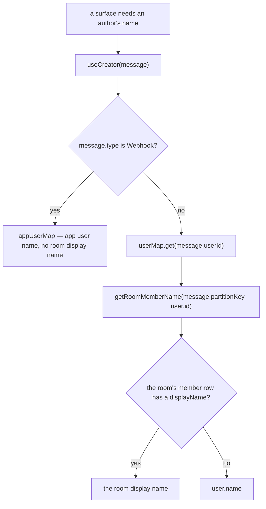
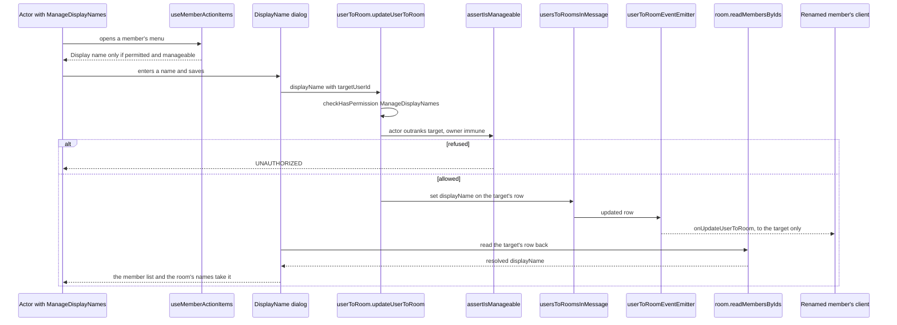

# Per-Room Display Names

Members can set a per-room display name that overrides their global username within that room.

## The resolution rule

Every member name is resolved through the one function the `esbabbler` skill names (`getRoomMemberName`), **never `user.name` or `member.name` read directly in a room context.**

```text
WRONG   — {{ member.name }}                     (ignores the room display name)
CORRECT — {{ getRoomMemberName(roomId, member.id, member.name) }}  (room display name, falls back to account name)
```

Where the member list, the settings Members panel and the @-mention list name a member by display name, the account name follows it beside the row only where the two differ, through `getMemberDescription`, which the rule is written in. A row whose room shows the account name alone has no second name, so nothing is printed twice. The one name a template may render directly is `creator.name` from `useCreator`, because that composable has already resolved it — see below.

Room display names are stored as `usersToRooms.displayName`, a `text().notNull().default("")` column, where empty means "no room-specific name". Every query that returns a member's name for display goes through `getDisplayNameExpression`, which is `coalesce(nullif(displayName, ''), name)`, so the server never hands back an empty display name in those. So the client takes the value it is given with `??`, and the one fallback to the account name lives in `getRoomMemberName`, which takes the account name a caller already holds, or reads it from the account map. Two reads return the raw column on purpose: `readMyUsersToRooms` returns the current user's own display name, where empty is the "no display name" state the My Profile field edits; and the typing broadcast reads its own row's raw value and applies `||` to the account name at the call site.

Applied in: mention labels (`useMessageHtml`), the member list sidebar (`Member/List`), the profile card that pops out of it (`ProfileCard/Index`), the room settings Members panel (`Settings/Type/Member/List`), the @-mention suggestion list (`Suggestion/MentionList`), the push notification title (queried server-side before the EventGrid publish), a room call's tiles, strip and action menu (resolved once in the two call composables every call surface reads — a standalone call has no room, so it keeps the account's name), the typing broadcast (resolved server-side), an unnamed room's "<creator>'s Room", the member editor's heading, the invite list's creator, and — through `useCreator` — every message in the timeline.

**`useCreator` resolves the display name itself**, so every surface that renders a message author — avatar initials, the batch header, reply titles, forward and pin lines, the delete and pin confirmations — gets it from one place rather than each remembering to call `getRoomMemberName`. It reads the room from the message's own `partitionKey`, so a message rendered outside the current room — a search hit, a thread preview — resolves against the room it was written in rather than the room on screen. A webhook message is the one exception: its author is an app user, which is not a member of the room and therefore has no room display name to overlay.

The resolution is a single ordered chain, and every surface enters it at the same point:



## Data model

One column: `usersToRooms.displayName` — `text`, NOT NULL DEFAULT `""`, length capped by `DISPLAY_NAME_MAX_LENGTH`.

## Client state — `useUserToRoomStore` and `useUserStore`

Two internal maps, both keyed by `roomId`, deliberately split for privacy:

- **`myUserToRoom`** — `Map<roomId, UserToRoomInMessage | undefined>` — the **current user's own** full row for that room (notificationType, lastReadAt, isHidden…), reached per room through `getMyUserToRoom` / `setMyUserToRoom`; populated by `readMyUsersToRooms` and the `onUpdateUserToRoom` subscription. There is no per-user inner map here — nobody else's row is ever held. What the store **exports** under that name is `useDataMap`'s current-key ref, not the map — one row, the room in view's — so it is named for the row rather than for the map behind it.
- **Room member map** — `getRoomMemberMap(roomId)`, held by `useUserStore` as `Map<roomId, Map<userId, MemberInRoom>>` — **all members'** rows as the room shows them (including self); filled from each row's server-resolved `displayName` as `readMembers` pages it in, and kept current by the same subscription. `getRoomMemberName` reads it, and falls back to the account name where the room has no row for the user.

## Procedures

Member display names are returned by `readMembers` on each row as `displayName`. The procedure that reads the membership table keeps each member's private fields (notificationType, lastReadAt, lastMessageAt, isHidden) to themselves:

| Procedure            | Input           | Returns                      | Who               |
| :------------------- | :-------------- | :--------------------------- | :---------------- |
| `readMyUsersToRooms` | `{ roomIds[] }` | Full `UserToRoomInMessage[]` | Current user only |

`readMyUsersToRooms` is called from `useReadRooms` to pre-load the current user's private settings (unread state, notification type) for all rooms at startup.

The quick switcher needs to search and page direct messages by the same name it renders. `readRooms` can include DMs for that surface and returns the resolved value as `displayName`: participant display names (falling back to each account's `name`) are sorted by display name and user id, then joined in that order. `readDirectMessageParticipants` returns those participants with the same `displayName` values and order, so the client joins the server-resolved values instead of resolving them again. The UI still labels the per-room setting **Display name**; persisted fields and code use `displayName` consistently.

## Setting your display name

Room settings → **My Profile** tab (visible to all members, no permission required). The field is labeled **Display name** in the UI; it edits `displayName`, and an empty value falls back to the account name. Saves via `updateUserToRoom({ roomId, displayName })`; the update propagates via the `onUpdateUserToRoom` subscription into both maps.

## Setting another member's display name

A member holding `ManageDisplayNames` sets the name of a member they outrank from that member's menu. The member list's row menu and the profile card's overflow menu both read the one list `useMemberActionItems` builds, and its **Display name** item is offered only where the server would accept the write: the actor holds the permission, the target is not the actor, and `checkIsMemberManageable` allows it. The item opens a dialog over the same field the self-service form uses, so the length limit and the empty-clears rule are the same.

The save is `updateUserToRoom` with `targetUserId`. The server checks the permission, then `assertIsManageable`, the hierarchy guard the moderation and role procedures share, so a refused target is `UNAUTHORIZED` whatever the client shows. The input rule admits a targeted write only when it sets a display name and nothing else. A self-edit needs no permission and carries the caller's own id, or none.

After the write the dialog reads the target's row back with `room.readMembersByIds`, and the member store and the room's names take the resolved name, so the moderator's own list is current at once. The renamed member's client receives the row on `onUpdateUserToRoom` and takes it the same way.



## Key files

| File                                                                        | Role                                                                              |
| :-------------------------------------------------------------------------- | :-------------------------------------------------------------------------------- |
| `apps/web/app/store/message/room/userToRoom.ts`                             | `useUserToRoomStore`, the current user's own row                                  |
| `apps/web/app/store/message/user/index.ts`                                  | `useUserStore`, `getRoomMemberName`                                               |
| `apps/web/app/composables/message/room/useCreator.ts`                       | message author, display name already applied                                      |
| `apps/web/app/composables/message/useMessageHtml.ts`                        | mention label resolution                                                          |
| `apps/web/app/services/message/member/getMemberDescription.ts`              | The account name beside a display name, only where they differ                    |
| `apps/web/app/components/Message/Model/Message/Suggestion/MentionList.vue`  | @-mention list: display name, the account name beside it where they differ        |
| `apps/web/app/components/Message/Model/Room/Settings/Type/Profile/`         | My Profile tab + display name field (labeled Display name)                        |
| `apps/web/server/services/message/updateUserToRoom.ts`                      | the display-name path; the hierarchy guard for a target other than the actor      |
| `apps/web/server/services/room/rbac/assertIsManageable.ts`                  | the hierarchy guard the path calls                                                |
| `apps/web/app/composables/message/user/useMemberActionItems.ts`             | the one list both member menus read; offers the Display name item                 |
| `apps/web/app/components/Message/Model/Member/ActionDialog/DisplayName.vue` | the moderator's dialog over `DisplayNameField`, mounted by the member dialog host |
| `apps/web/app/store/message/user/member.ts`                                 | `storeUpdateMembers`, the read-back row into the room's list and names            |

## Notes

- **Other members see a moderator's rename when they next read the room's members, not at once.** The caller's list and the renamed member's list are current when the write lands, but no subscription carries the change to the rest of the room: `onUpdateUserToRoom` reaches only the row's own member, and a row already held is not read again. A self-service rename reaches the room the same way.
- **A rename is in neither the moderation log nor the audit log.** A display name is not a sanction, and a moderation action type would be enumerated across the [moderation design](../moderation/design.md). An audit entry is a follow-up for the moderation owner if the room asks for one.
- **Last write wins.** The field holds one name, so a moderator's rename and the member's own edit overwrite each other, and the later save is the one the room sees.
