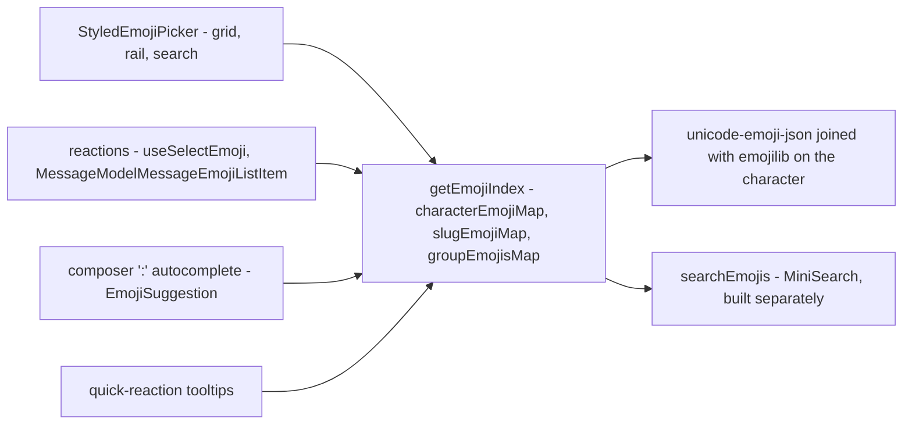

# Emoji

Every emoji surface — the picker grid, a stored reaction, the composer's `:` autocomplete and the quick-reaction tooltips — resolves through **one index built from one dataset**, plus whatever the room itself has uploaded ([custom emoji](../custom-emoji/design.md)), which every surface renders through the same records without knowing which vocabulary it was handed. There is no emoji dependency: the picker is our own `<script setup>` components, and the lookups are three maps.

Owning the picker is what buys the single vocabulary. An off-the-shelf grid brings its own: one library's picker and another's shortcode resolver index different Unicode releases, so a glyph the picker offers has no shortcode to store and the round trip only appears to work because both directions fall back to their input. They also cost what a component dependency costs — a sprite sheet fetched from a CDN the CSP then has to whitelist, no dark mode without overriding theirs, and an Options API component that turns `vue.optionsApi` back on for the whole app. Three maps over one dataset have none of that surface.

## The shape of it

## The dataset

Two data-only MIT packages, both keyed by the emoji character and both tracking the same Unicode release, so the join is a lookup rather than a reconciliation.

| Package              | Provides                                                        |
| -------------------- | --------------------------------------------------------------- |
| `unicode-emoji-json` | name, slug, CLDR group, canonical order, skin-tone support flag |
| `emojilib`           | keywords per character                                          |

**No version cutoff.** Whichever Unicode release `unicode-emoji-json` is pinned to in the catalog is the release the picker offers, so bumping the dependency is the whole of "support the newest emoji". Whether a glyph actually renders is the reader's OS and font talking, which no build-time filter can know — if a box is ever reported, the answer is runtime canvas measurement, not a hardcoded version. Ordering, both of the categories and within them, is the CLDR order the dataset already ships in.

`emojibase-data` is the richer alternative — tags, subgroups, shortcode presets for several vocabularies — but it unpacks to tens of megabytes because it ships every locale, and we would import one file. Reconsider only if localisation lands.

## The index

`getEmojiIndex` builds three maps on first use, once for the whole app. It is deliberately not built at import: a page with no emoji surface never pays for it, and the server never builds it at all.

| Structure           | Answers                                            |
| ------------------- | -------------------------------------------------- |
| `groupEmojisMap`    | what a category tab shows, in CLDR order           |
| `slugEmojiMap`      | which record an exact shortcode query names        |
| `characterEmojiMap` | which record a glyph belongs to, for its shortcode |

`characterEmojiMap` is keyed by `getEmojiCharacterKey`, which strips skin-tone modifiers and variation selectors, so a toned glyph (👋🏽) and an unqualified one (`❤` vs `❤️`) still find their record. There are no collisions across the whole dataset under that normalisation, and slugs are unique, so both maps are total.

## Reactions store the emoji, not a name for it

`emojiTag` holds **the emoji character exactly as it was picked**, toned or not. That makes a reaction's identity plain string equality, so nothing about storing, matching or rendering one touches the index at all: `MessageModelMessageEmojiListItem` renders `emoji.emojiTag`, and `useSelectEmoji` finds the existing row with `emojiTag === emoji`. Leaving one is `toggleEmoji`, a store action both surfaces call, so a reaction and the quick-reaction bar cannot disagree about what leaving means: the row goes with its last reactor and is only rewritten for everyone else.

This is what Discord and Slack both do, and **reactions are therefore tone-sensitive**: 👍 and 👍🏽 are different strings and so different reactions, each with its own count. It also means there is no shortcode vocabulary in the storage path to keep two ends of agreeing on, no parsing, and no composite tag format to version — the alternative, a `slug` plus an encoded tone suffix, buys nothing over the character it would encode.

Shortcodes stay where they are a **label** rather than a key: the composer's `:` autocomplete inserts by name, and `getEmojiDescription` resolves the quick-reaction tooltips through `getEmojiSlug`.

### Reading who reacted

A reaction is a **pressed toggle**: a field-toned pill button holding the emoji and its count, pressed while the reader is among those who reacted, so pressing it adds or takes back theirs. Pressed, it takes a light tint of the info colour rather than the accent's fill, which would read too heavy beside the count ([design language](../../architecture/design-language/design.md#surfaces)). Its **tooltip** is Discord's hover card: the emoji large, then the sentence `:slug: reacted by <names>`, naming the first few reactors and counting the rest through `Intl.ListFormat` so it stays one line at any count, and a line saying a right-click shows everyone.

A tooltip cannot be clicked through, so everyone who reacted is the reaction's own [context menu](../../architecture/context-menus/design.md) — a right-click, long press or menu key offers **View Reactions**. The gestures stop at the reaction, so the message around it opens nothing of its own. View Reactions opens the **Reactions dialog** — one instance mounted at the list level and targeted through `messageDialogStore.reactionsRowKey` beside `reactionsRoomId` — the reaction's own room, since the thread pane renders messages beside whichever room is on screen — per [singleton dialogs](../../architecture/singleton-dialogs/design.md), never one per reaction. A rail of reactions sorted by count sits beside the reactors of whichever is selected. The selection is _derived_ rather than assigned when the dialog opens, so a reaction that overtakes another — or that disappears while the dialog is open — never leaves the rail pointing at nothing; and a message whose last reaction goes closes the dialog with it.

Each reactor renders under the room's resolved display name (`getMemberName`), with the account name on a second line only when the two differ.

### Search

Search is **MiniSearch**, the repo's one client-side index, per the [search standard](../../architecture/search/design.md) — a `computed` over an already-built index, with no server call, abort or pending state. It is built separately from the three maps, so a surface that only renders a stored reaction never builds a search index at all.

Three fields are indexed — slug, name, keywords — with the slug boosted hardest, because the shortcode is what a `:` query is naming. Two settings carry most of the relevance: `combineWith: "AND"` (the default unions terms, which makes `grin f` return most of the dataset) and `prefix: true`. An exact shortcode is pinned ahead of the ranked results, so `thumbs_up` resolves to 👍 alone. `fuzzy` is off: on names this short it manufactures noise.

**Punctuation is a delimiter, never an operator.** MiniSearch tokenizes on it rather than parsing it, so `grin(` searches for `grin`, and a query that is punctuation alone tokenizes to nothing and shows the empty state. There is no escaping step and no query syntax.

The picker and the `:` autocomplete share this one function and therefore one ranking — the two surfaces cannot disagree about what a query means.

## Skin tones

One tone, chosen once and persisted per device, applied to every emoji that supports one — Discord's model, not a per-emoji long-press.

`applySkinTone` takes the record rather than the character so the support flag cannot be forgotten; toning an emoji that does not support one would otherwise append a stray modifier beside it (🍎🏽). **The modifier attaches to the first code point, never the end**: 🧑‍💻 is a ZWJ sequence whose tone belongs to the person, so appending naively gives 🧑‍💻🏻 where the correct form is 🧑🏽‍💻. Variation selectors are dropped from the remainder, since a toned code point is already fully qualified.

The accepted limitation: Unicode allows a different tone per person in a sequence like 🧑‍🤝‍🧑, and one global setting only tones the first. Discord behaves the same way.

## The picker

`StyledEmojiPicker` is the trigger and the container it opens; everything else lives in `StyledEmojiPicker/`. The panel mounts on the first open and stays, which is what defers the index build to the first picker anyone opens, and keeps what its footer opened — a room's add-emoji dialog — alive after the panel closes behind it.

- **Search** replaces the grid wholesale while a query is running. The rail stays live rather than being disabled by it — picking a category clears the query.
- **One category renders at a time, and there is no virtualisation.** The largest CLDR group is under four hundred buttons, which a grid handles without help; the repo has no virtual-scroll primitive, and adding one for a cost that does not exist would be the opposite of lean. Discord scrolls continuously across all categories, which does need virtualisation — a deliberate deferral.
- **Categories are data, not the enum.** `getEmojiCategories` pins Frequently Used ahead of the nine CLDR groups when it has anything in it, and the room's own uploads sit between the two — where Discord puts a server's set.
- **Recents and the chosen tone live in Pinia**, persisted through the `LocalStorageKey` registry. Recents are stored as slugs rather than characters so they survive a change of skin tone, and holding them in a store rather than a module singleton is what makes the category update the moment an emoji is picked.
- **Keyboard.** The grid is one stop in the tab order, on its first emoji, so Tab goes from the search field to the rail and then the grid, and out again. The arrows walk the grid a cell at a time and a row up or down where one exists, Home and End go to a row's ends, and Enter picks the focused emoji. The focused emoji is announced by its name. The rail's arrows are its toggle group's, and the grid's are the UI library's one grid keyboard, `useGridKeyboard`.
- **Every theme and style comes free** — the UI library's components and tokens throughout, no hardcoded palette.
- **One popover at every width.** The picker is a `UiPopover` anchored to its trigger, opening above it and toward the row's start, since every trigger ends a row near the foot of what it acts on, and flipping below only where the top has no room; a pick closes it back onto that trigger. The panel sizes itself to the screen — never wider than the viewport less a gutter, never taller than a share of it — so a phone needs no second container. A sheet up from a phone's bottom edge is not used: it lies over the dock, away from the message it reacts to. On a touch screen the search field does not autofocus: raising the keyboard would cover the emoji the reader opened the picker to tap.

## Upstream

Both packages this replaced, every issue and pull request on each tracker, read with its comments and given one of the [dependency admission](../../architecture/dependency-admission/design.md) verdicts. The numbers are shared by a repository's issues and pull requests, so each opens at its tracker under the number: [emoji-mart-vue-fast](https://github.com/serebrov/emoji-mart-vue/issues) is the repository of the package, and [node-emoji](https://github.com/omnidan/node-emoji/issues) is the other. A proof names the test that holds the behaviour or the section of this page that does. **Not carried** marks a feature the replacement does not expose; it is a gap, not an out-of-scope verdict.

### emoji-mart-vue-fast

| Upstream                                                                                                                                                                                                                                                                                                                                                                                                                                                                                                                                                                                                                                                               | Verdict            | Proof                                                                                                                                                                                                             |
| ---------------------------------------------------------------------------------------------------------------------------------------------------------------------------------------------------------------------------------------------------------------------------------------------------------------------------------------------------------------------------------------------------------------------------------------------------------------------------------------------------------------------------------------------------------------------------------------------------------------------------------------------------------------------- | ------------------ | ----------------------------------------------------------------------------------------------------------------------------------------------------------------------------------------------------------------- |
| #19                                                                                                                                                                                                                                                                                                                                                                                                                                                                                                                                                                                                                                                                    | In scope — defect  | "intersects a multi-word query rather than unioning it" in getEmojiIndex.test.ts; ours is MiniSearch, not the upstream's union search                                                                             |
| #25                                                                                                                                                                                                                                                                                                                                                                                                                                                                                                                                                                                                                                                                    | In scope — defect  | "round trips every emoji from character to slug and back" in getEmojiIndex.test.ts (one index for every surface, so the vocabularies cannot drift)                                                                |
| #26                                                                                                                                                                                                                                                                                                                                                                                                                                                                                                                                                                                                                                                                    | In scope — defect  | "round trips every emoji from character to slug and back" in getEmojiIndex.test.ts                                                                                                                                |
| #33                                                                                                                                                                                                                                                                                                                                                                                                                                                                                                                                                                                                                                                                    | In scope — defect  | "emits the toned character with its record and stores the pick as a recent" in Panel.test.ts (the emitted tag carries the tone)                                                                                   |
| #34, #54                                                                                                                                                                                                                                                                                                                                                                                                                                                                                                                                                                                                                                                               | In scope — defect  | the index above: the index is built on first use and never at import, so a page without a picker and the server never build it (the dataset is not in the entry chunk)                                            |
| #46                                                                                                                                                                                                                                                                                                                                                                                                                                                                                                                                                                                                                                                                    | In scope — defect  | the index above: the index is built on first use and never at import, so a page without a picker and the server never build it; no picker file reads window at import                                             |
| #47, #48                                                                                                                                                                                                                                                                                                                                                                                                                                                                                                                                                                                                                                                               | In scope — defect  | the index above: the index is built on first use and never at import, so a page without a picker and the server never build it                                                                                    |
| #53                                                                                                                                                                                                                                                                                                                                                                                                                                                                                                                                                                                                                                                                    | In scope — defect  | the index above: the index is built on first use and never at import, so a page without a picker and the server never build it, so the dataset is not bundled into the entry chunk                                |
| #74                                                                                                                                                                                                                                                                                                                                                                                                                                                                                                                                                                                                                                                                    | In scope — defect  | fixed upstream in 7.0.2; ours emits the record with the tone applied: "emits the toned character with its record and stores the pick as a recent" in Panel.test.ts                                                |
| #75                                                                                                                                                                                                                                                                                                                                                                                                                                                                                                                                                                                                                                                                    | In scope — defect  | same defect as #74: "emits the toned character with its record and stores the pick as a recent" in Panel.test.ts                                                                                                  |
| #81                                                                                                                                                                                                                                                                                                                                                                                                                                                                                                                                                                                                                                                                    | In scope — defect  | "#136 picking a category during a search clears the search and shows that category" in Panel.test.ts (a category pick during a search)                                                                            |
| #82                                                                                                                                                                                                                                                                                                                                                                                                                                                                                                                                                                                                                                                                    | In scope — defect  | same defect as #81: "#136 picking a category during a search clears the search and shows that category" in Panel.test.ts                                                                                          |
| #95                                                                                                                                                                                                                                                                                                                                                                                                                                                                                                                                                                                                                                                                    | In scope — defect  | the index above: the index is built on first use and never at import, so a page without a picker and the server never build it; the dataset is loaded on the first picker open                                    |
| #136                                                                                                                                                                                                                                                                                                                                                                                                                                                                                                                                                                                                                                                                   | In scope — defect  | "#136 picking a category during a search clears the search and shows that category" in Panel.test.ts                                                                                                              |
| #152                                                                                                                                                                                                                                                                                                                                                                                                                                                                                                                                                                                                                                                                   | In scope — defect  | "round trips every emoji from character to slug and back" in getEmojiIndex.test.ts (every slug is unique, so the maps are total)                                                                                  |
| #162                                                                                                                                                                                                                                                                                                                                                                                                                                                                                                                                                                                                                                                                   | In scope — defect  | same defect as #152: "round trips every emoji from character to slug and back" in getEmojiIndex.test.ts                                                                                                           |
| #196                                                                                                                                                                                                                                                                                                                                                                                                                                                                                                                                                                                                                                                                   | In scope — defect  | every emoji cell is a button with type=button (Grid.vue), so a pick inside a form does not submit it                                                                                                              |
| #197                                                                                                                                                                                                                                                                                                                                                                                                                                                                                                                                                                                                                                                                   | In scope — defect  | same defect as #196: Grid.vue sets type=button                                                                                                                                                                    |
| #204                                                                                                                                                                                                                                                                                                                                                                                                                                                                                                                                                                                                                                                                   | In scope — defect  | fixed upstream in 12.0.1; ours emits once from the grid button: "emits the toned character with its record and stores the pick as a recent" in Panel.test.ts                                                      |
| #243                                                                                                                                                                                                                                                                                                                                                                                                                                                                                                                                                                                                                                                                   | In scope — defect  | fixed upstream in 12.0.1: "emits the toned character with its record and stores the pick as a recent" in Panel.test.ts                                                                                            |
| #263                                                                                                                                                                                                                                                                                                                                                                                                                                                                                                                                                                                                                                                                   | In scope — defect  | "shows the empty state rather than an empty grid when nothing matches" in Panel.test.ts (an empty search, pressed Enter)                                                                                          |
| #264                                                                                                                                                                                                                                                                                                                                                                                                                                                                                                                                                                                                                                                                   | In scope — defect  | the search field cannot emit a pick: the panel emits select only from a grid cell (Panel.vue)                                                                                                                     |
| #265                                                                                                                                                                                                                                                                                                                                                                                                                                                                                                                                                                                                                                                                   | In scope — defect  | same defect as #264: the search field cannot emit a pick (Panel.vue)                                                                                                                                              |
| #266                                                                                                                                                                                                                                                                                                                                                                                                                                                                                                                                                                                                                                                                   | In scope — defect  | same defect as #263: "shows the empty state rather than an empty grid when nothing matches" in Panel.test.ts                                                                                                      |
| #289                                                                                                                                                                                                                                                                                                                                                                                                                                                                                                                                                                                                                                                                   | In scope — defect  | recents are a store the category reads, so the category updates on the pick (the picker above)                                                                                                                    |
| #300                                                                                                                                                                                                                                                                                                                                                                                                                                                                                                                                                                                                                                                                   | In scope — defect  | same defect as #136: "#136 picking a category during a search clears the search and shows that category" in Panel.test.ts                                                                                         |
| #302, #303                                                                                                                                                                                                                                                                                                                                                                                                                                                                                                                                                                                                                                                             | In scope — defect  | same defect as #289: recents are a store the category reads                                                                                                                                                       |
| #305                                                                                                                                                                                                                                                                                                                                                                                                                                                                                                                                                                                                                                                                   | In scope — defect  | the upstream scroll handler's null guard; ours has no scroll handler (Grid.vue)                                                                                                                                   |
| #306                                                                                                                                                                                                                                                                                                                                                                                                                                                                                                                                                                                                                                                                   | In scope — defect  | same defect as #305: the upstream scroll guard; ours has no scroll handler                                                                                                                                        |
| #62                                                                                                                                                                                                                                                                                                                                                                                                                                                                                                                                                                                                                                                                    | In scope — feature | the dataset above: no version cutoff, the Unicode release is whatever unicode-emoji-json is pinned to; "finds an emoji from a recent Unicode release" in getEmojiIndex.test.ts                                    |
| #64, #108, #109, #132, #205, #208, #270, #273                                                                                                                                                                                                                                                                                                                                                                                                                                                                                                                                                                                                                          | In scope — feature | the dataset above: no version cutoff, the Unicode release is whatever unicode-emoji-json is pinned to                                                                                                             |
| #80                                                                                                                                                                                                                                                                                                                                                                                                                                                                                                                                                                                                                                                                    | In scope — feature | the static grid is the picker's only form (no scroller); the picker above: one category renders at a time with no virtual scroller, so the scroller's defects have no code here                                   |
| #83, #106                                                                                                                                                                                                                                                                                                                                                                                                                                                                                                                                                                                                                                                              | In scope — feature | Grid.vue: cells are native buttons, focusable and activated by Enter; Panel.test.ts selects them by aria-label                                                                                                    |
| #88, #101                                                                                                                                                                                                                                                                                                                                                                                                                                                                                                                                                                                                                                                              | In scope — feature | the app is Vue 3; the picker is a single-file component (Panel.vue)                                                                                                                                               |
| #99                                                                                                                                                                                                                                                                                                                                                                                                                                                                                                                                                                                                                                                                    | In scope — feature | the static grid is the only picker (the picker above: one category renders at a time with no virtual scroller, so the scroller's defects have no code here)                                                       |
| #104                                                                                                                                                                                                                                                                                                                                                                                                                                                                                                                                                                                                                                                                   | In scope — feature | Grid.vue: cells are native buttons, focusable and activated by Enter; Panel.test.ts selects them by aria-label; the arrow-key movement the issue asks for is built, and #258's tests hold it                      |
| #105                                                                                                                                                                                                                                                                                                                                                                                                                                                                                                                                                                                                                                                                   | In scope — feature | "finds an emoji from a recent Unicode release" in getEmojiIndex.test.ts                                                                                                                                           |
| #113                                                                                                                                                                                                                                                                                                                                                                                                                                                                                                                                                                                                                                                                   | In scope — feature | the picker opens above its trigger and flips below only where the top has no room (One popover at every width)                                                                                                    |
| #121                                                                                                                                                                                                                                                                                                                                                                                                                                                                                                                                                                                                                                                                   | In scope — feature | the replacement is TypeScript throughout (apps/web types, no .d.ts shim)                                                                                                                                          |
| #123                                                                                                                                                                                                                                                                                                                                                                                                                                                                                                                                                                                                                                                                   | In scope — feature | the tone is a reactive store field the footer writes (emojiPicker store, skinTone)                                                                                                                                |
| #126                                                                                                                                                                                                                                                                                                                                                                                                                                                                                                                                                                                                                                                                   | In scope — feature | the picker above: every theme and style comes free, tokens throughout                                                                                                                                             |
| #203                                                                                                                                                                                                                                                                                                                                                                                                                                                                                                                                                                                                                                                                   | In scope — feature | the dataset above: no version cutoff, the Unicode release is whatever unicode-emoji-json is pinned to; the emoji 14 update is the dataset release the catalog pins                                                |
| #294                                                                                                                                                                                                                                                                                                                                                                                                                                                                                                                                                                                                                                                                   | In scope — feature | the tone is a reactive store field: the footer and the grid both read it (emojiPicker store)                                                                                                                      |
| #8                                                                                                                                                                                                                                                                                                                                                                                                                                                                                                                                                                                                                                                                     | Out of scope       | the dataset above: whether a glyph renders is the reader's OS and font, so colour, width and missing glyphs are the OS's to draw (the sprite background)                                                          |
| #16, #17, #18, #24, #72, #78, #125, #133, #262                                                                                                                                                                                                                                                                                                                                                                                                                                                                                                                                                                                                                         | Out of scope       | the dataset above: whether a glyph renders is the reader's OS and font, so colour, width and missing glyphs are the OS's to draw                                                                                  |
| #20                                                                                                                                                                                                                                                                                                                                                                                                                                                                                                                                                                                                                                                                    | Out of scope       | the virtual scroller, owned by vue-virtual-scroller; the picker above: one category renders at a time with no virtual scroller, so the scroller's defects have no code here                                       |
| #49                                                                                                                                                                                                                                                                                                                                                                                                                                                                                                                                                                                                                                                                    | Out of scope       | vue-virtual-scroller, which the thread diagnoses; the picker above: one category renders at a time with no virtual scroller, so the scroller's defects have no code here                                          |
| #50                                                                                                                                                                                                                                                                                                                                                                                                                                                                                                                                                                                                                                                                    | Out of scope       | the consumer's dialog CSS; the thread found the cause in the Quasar dialog                                                                                                                                        |
| #51                                                                                                                                                                                                                                                                                                                                                                                                                                                                                                                                                                                                                                                                    | Out of scope       | the virtual scroller's scroll position, owned by vue-virtual-scroller; the picker above: one category renders at a time with no virtual scroller, so the scroller's defects have no code here                     |
| #52                                                                                                                                                                                                                                                                                                                                                                                                                                                                                                                                                                                                                                                                    | Out of scope       | vue-virtual-scroller, the dependency the issue asks to drop; the picker above: one category renders at a time with no virtual scroller, so the scroller's defects have no code here                               |
| #57                                                                                                                                                                                                                                                                                                                                                                                                                                                                                                                                                                                                                                                                    | Out of scope       | vue-virtual-scroller's category layout, which the thread found; the picker above: one category renders at a time with no virtual scroller, so the scroller's defects have no code here                            |
| #59                                                                                                                                                                                                                                                                                                                                                                                                                                                                                                                                                                                                                                                                    | Out of scope       | making the virtual scroller optional, which we do not carry: the picker above: one category renders at a time with no virtual scroller, so the scroller's defects have no code here                               |
| #69                                                                                                                                                                                                                                                                                                                                                                                                                                                                                                                                                                                                                                                                    | Out of scope       | the upstream's sprite CSS edges; ours draws no sprite                                                                                                                                                             |
| #71                                                                                                                                                                                                                                                                                                                                                                                                                                                                                                                                                                                                                                                                    | Out of scope       | the operating system's colour font shaping a ZWJ sequence; the dataset above: whether a glyph renders is the reader's OS and font, so colour, width and missing glyphs are the OS's to draw                       |
| #77                                                                                                                                                                                                                                                                                                                                                                                                                                                                                                                                                                                                                                                                    | Out of scope       | vue-virtual-scroller's anchor tracking, which the thread isolates to the scroller; the picker above: one category renders at a time with no virtual scroller, so the scroller's defects have no code here         |
| #79                                                                                                                                                                                                                                                                                                                                                                                                                                                                                                                                                                                                                                                                    | Out of scope       | the virtual scroller's active category; the picker above: one category renders at a time with no virtual scroller, so the scroller's defects have no code here                                                    |
| #87                                                                                                                                                                                                                                                                                                                                                                                                                                                                                                                                                                                                                                                                    | Out of scope       | vue-virtual-scroller, which the thread isolates; StaticPicker is the workaround there, and the picker above: one category renders at a time with no virtual scroller, so the scroller's defects have no code here |
| #93                                                                                                                                                                                                                                                                                                                                                                                                                                                                                                                                                                                                                                                                    | Out of scope       | the virtual scroller's rendering in Chrome on Android, per the thread; the picker above: one category renders at a time with no virtual scroller, so the scroller's defects have no code here                     |
| #94                                                                                                                                                                                                                                                                                                                                                                                                                                                                                                                                                                                                                                                                    | Out of scope       | scoped CSS of vue-recycle-scroller, the dependency's own styles                                                                                                                                                   |
| #102                                                                                                                                                                                                                                                                                                                                                                                                                                                                                                                                                                                                                                                                   | Out of scope       | the virtual scroller's scroll fix; the picker above: one category renders at a time with no virtual scroller, so the scroller's defects have no code here                                                         |
| #120                                                                                                                                                                                                                                                                                                                                                                                                                                                                                                                                                                                                                                                                   | Out of scope       | vue-virtual-scroller, whose VirtualScrollPicker the upstream removed; the picker above: one category renders at a time with no virtual scroller, so the scroller's defects have no code here                      |
| #140                                                                                                                                                                                                                                                                                                                                                                                                                                                                                                                                                                                                                                                                   | Out of scope       | the bundler's JSON import (Vite's read-only module object), which the thread isolates                                                                                                                             |
| #236                                                                                                                                                                                                                                                                                                                                                                                                                                                                                                                                                                                                                                                                   | Out of scope       | vue-virtual-scroller's peer range, the dependency the thread names; removed upstream in 12.0.0 and not a dependency of ours                                                                                       |
| #241                                                                                                                                                                                                                                                                                                                                                                                                                                                                                                                                                                                                                                                                   | Out of scope       | removing the VirtualScrollPicker, owned by vue-virtual-scroller (#236); the picker above: one category renders at a time with no virtual scroller, so the scroller's defects have no code here                    |
| #15                                                                                                                                                                                                                                                                                                                                                                                                                                                                                                                                                                                                                                                                    | Not carried        | the upstream's exposed data getter; the index is internal to our app                                                                                                                                              |
| #23                                                                                                                                                                                                                                                                                                                                                                                                                                                                                                                                                                                                                                                                    | Not carried        | the upstream's string emoji prop on NimbleEmoji; our picker has no such component                                                                                                                                 |
| #32                                                                                                                                                                                                                                                                                                                                                                                                                                                                                                                                                                                                                                                                    | Not carried        | the upstream's scoped-slot API; ours is a component with its own slots                                                                                                                                            |
| #39                                                                                                                                                                                                                                                                                                                                                                                                                                                                                                                                                                                                                                                                    | Not carried        | the emojiSize prop; our sizes are tokens                                                                                                                                                                          |
| #60                                                                                                                                                                                                                                                                                                                                                                                                                                                                                                                                                                                                                                                                    | Not carried        | a configuration surface, not carried because the picker is configured once: the upstream EmojiIndex exclude option; the picker shows every CLDR group and has no exclude                                          |
| #61                                                                                                                                                                                                                                                                                                                                                                                                                                                                                                                                                                                                                                                                    | Not carried        | a configuration surface, not carried because the picker is configured once: the upstream's exclude option (#60); the picker has no exclude                                                                        |
| #89                                                                                                                                                                                                                                                                                                                                                                                                                                                                                                                                                                                                                                                                    | Not carried        | a configuration surface, not carried because the picker is configured once: the upstream exclude option; the default preview is ours and never depends on an excluded set                                         |
| #90                                                                                                                                                                                                                                                                                                                                                                                                                                                                                                                                                                                                                                                                    | Not carried        | the upstream's preview option; ours shows a preview in the footer (Footer.vue)                                                                                                                                    |
| #91                                                                                                                                                                                                                                                                                                                                                                                                                                                                                                                                                                                                                                                                    | Not carried        | a configuration surface, not carried because the picker is configured once: the upstream include option; the picker's category order is the CLDR order (getEmojiCategories)                                       |
| #92                                                                                                                                                                                                                                                                                                                                                                                                                                                                                                                                                                                                                                                                    | Not carried        | a configuration surface, not carried because the picker is configured once: the upstream's include ordering (#91); the picker's order is CLDR                                                                     |
| #124                                                                                                                                                                                                                                                                                                                                                                                                                                                                                                                                                                                                                                                                   | Not carried        | the emojiSize prop; our rail icons are UI-library icons sized by tokens                                                                                                                                           |
| #141                                                                                                                                                                                                                                                                                                                                                                                                                                                                                                                                                                                                                                                                   | Not carried        | default frequently-used counts; ours keeps recents per user in a store (emojiPicker store)                                                                                                                        |
| #142                                                                                                                                                                                                                                                                                                                                                                                                                                                                                                                                                                                                                                                                   | Not carried        | default population of frequently-used counts; ours keeps recents per user in a store                                                                                                                              |
| #253                                                                                                                                                                                                                                                                                                                                                                                                                                                                                                                                                                                                                                                                   | Not carried        | an unselect option on the picker; a reaction is removed through toggleEmoji (Reactions: a reaction is toggled through toggleEmoji, with no picker unselect option)                                                |
| #258                                                                                                                                                                                                                                                                                                                                                                                                                                                                                                                                                                                                                                                                   | In scope — feature | "#258 the grid has one tab stop", "#258 arrow keys walk the grid by cell and by row", and "#258 Enter picks the focused emoji" in Panel.test.ts                                                                   |
| #268                                                                                                                                                                                                                                                                                                                                                                                                                                                                                                                                                                                                                                                                   | Not carried        | a selectable-emoji prototype, an upstream selection API; our picker emits one select                                                                                                                              |
| #271                                                                                                                                                                                                                                                                                                                                                                                                                                                                                                                                                                                                                                                                   | Not carried        | a selectable slot; our picker's footer is the one slot (Panel.vue)                                                                                                                                                |
| #298                                                                                                                                                                                                                                                                                                                                                                                                                                                                                                                                                                                                                                                                   | Not carried        | infinite scroll, which the picker does not have                                                                                                                                                                   |
| #1                                                                                                                                                                                                                                                                                                                                                                                                                                                                                                                                                                                                                                                                     | False positive     | upstream-internal refactor of the data loader; ours has no loader                                                                                                                                                 |
| #2, #3, #4, #6                                                                                                                                                                                                                                                                                                                                                                                                                                                                                                                                                                                                                                                         | False positive     | upstream-internal refactor; no behaviour a report asks for                                                                                                                                                        |
| #5                                                                                                                                                                                                                                                                                                                                                                                                                                                                                                                                                                                                                                                                     | False positive     | upstream-internal global removed; ours has no global index (getEmojiIndex is built once and passed)                                                                                                               |
| #7                                                                                                                                                                                                                                                                                                                                                                                                                                                                                                                                                                                                                                                                     | False positive     | upstream-internal rendering optimisation; the grid renders one category at a time (the picker above: one category renders at a time with no virtual scroller, so the scroller's defects have no code here)        |
| #9, #12, #14, #100                                                                                                                                                                                                                                                                                                                                                                                                                                                                                                                                                                                                                                                     | False positive     | upstream-internal cleanup                                                                                                                                                                                         |
| #10                                                                                                                                                                                                                                                                                                                                                                                                                                                                                                                                                                                                                                                                    | False positive     | a docs toggle for the upstream's own performance check                                                                                                                                                            |
| #11                                                                                                                                                                                                                                                                                                                                                                                                                                                                                                                                                                                                                                                                    | False positive     | upstream-internal optimisation                                                                                                                                                                                    |
| #13                                                                                                                                                                                                                                                                                                                                                                                                                                                                                                                                                                                                                                                                    | False positive     | upstream-internal refactor; ours freezes nothing: the index is built once (the index above: the index is built on first use and never at import, so a page without a picker and the server never build it)        |
| #21                                                                                                                                                                                                                                                                                                                                                                                                                                                                                                                                                                                                                                                                    | False positive     | upstream-internal CSS extraction; ours is UnoCSS attributify                                                                                                                                                      |
| #22                                                                                                                                                                                                                                                                                                                                                                                                                                                                                                                                                                                                                                                                    | False positive     | upstream README update                                                                                                                                                                                            |
| #27                                                                                                                                                                                                                                                                                                                                                                                                                                                                                                                                                                                                                                                                    | False positive     | upstream-internal title attribute; ours names each cell by aria-label (Grid.vue)                                                                                                                                  |
| #28                                                                                                                                                                                                                                                                                                                                                                                                                                                                                                                                                                                                                                                                    | False positive     | upstream-internal title attribute                                                                                                                                                                                 |
| #29                                                                                                                                                                                                                                                                                                                                                                                                                                                                                                                                                                                                                                                                    | False positive     | upstream-internal preview title                                                                                                                                                                                   |
| #30                                                                                                                                                                                                                                                                                                                                                                                                                                                                                                                                                                                                                                                                    | False positive     | upstream-internal preview emoji                                                                                                                                                                                   |
| #31                                                                                                                                                                                                                                                                                                                                                                                                                                                                                                                                                                                                                                                                    | False positive     | upstream-internal native index; ours is one index ("round trips every emoji from character to slug and back" in getEmojiIndex.test.ts)                                                                            |
| #35                                                                                                                                                                                                                                                                                                                                                                                                                                                                                                                                                                                                                                                                    | False positive     | upstream test and babel setup                                                                                                                                                                                     |
| #36                                                                                                                                                                                                                                                                                                                                                                                                                                                                                                                                                                                                                                                                    | False positive     | upstream CI setup                                                                                                                                                                                                 |
| #37, #40                                                                                                                                                                                                                                                                                                                                                                                                                                                                                                                                                                                                                                                               | False positive     | upstream tests                                                                                                                                                                                                    |
| #38                                                                                                                                                                                                                                                                                                                                                                                                                                                                                                                                                                                                                                                                    | False positive     | closed; the upstream's emoji-size fix, superseded by our own sizing tokens                                                                                                                                        |
| #41                                                                                                                                                                                                                                                                                                                                                                                                                                                                                                                                                                                                                                                                    | False positive     | upstream-internal rename                                                                                                                                                                                          |
| #42                                                                                                                                                                                                                                                                                                                                                                                                                                                                                                                                                                                                                                                                    | False positive     | upstream build path                                                                                                                                                                                               |
| #43                                                                                                                                                                                                                                                                                                                                                                                                                                                                                                                                                                                                                                                                    | False positive     | closed by the reporter: a Nuxt setup mistake, with the link that fixed it                                                                                                                                         |
| #44                                                                                                                                                                                                                                                                                                                                                                                                                                                                                                                                                                                                                                                                    | False positive     | answered in the thread (a missing CSS import); fixed upstream in 5.4.12                                                                                                                                           |
| #45                                                                                                                                                                                                                                                                                                                                                                                                                                                                                                                                                                                                                                                                    | False positive     | fixed upstream in 5.4.12 (the component fix for #44)                                                                                                                                                              |
| #55                                                                                                                                                                                                                                                                                                                                                                                                                                                                                                                                                                                                                                                                    | False positive     | fixed upstream in 6.0.1 (the thread confirms)                                                                                                                                                                     |
| #56                                                                                                                                                                                                                                                                                                                                                                                                                                                                                                                                                                                                                                                                    | False positive     | fixed upstream in 6.0.1 (the non-native sets)                                                                                                                                                                     |
| #58                                                                                                                                                                                                                                                                                                                                                                                                                                                                                                                                                                                                                                                                    | False positive     | a Quasar demo for the upstream's docs                                                                                                                                                                             |
| #63                                                                                                                                                                                                                                                                                                                                                                                                                                                                                                                                                                                                                                                                    | False positive     | a usage question, answered in the thread with the onAnchorClick call                                                                                                                                              |
| #65                                                                                                                                                                                                                                                                                                                                                                                                                                                                                                                                                                                                                                                                    | False positive     | a closed test PR with no change                                                                                                                                                                                   |
| #66                                                                                                                                                                                                                                                                                                                                                                                                                                                                                                                                                                                                                                                                    | False positive     | a jQuery attribute-casing mistake the reporter retracted                                                                                                                                                          |
| #67                                                                                                                                                                                                                                                                                                                                                                                                                                                                                                                                                                                                                                                                    | False positive     | a question with no reproduction; answered by the demo folder                                                                                                                                                      |
| #68                                                                                                                                                                                                                                                                                                                                                                                                                                                                                                                                                                                                                                                                    | False positive     | fixed upstream in 7.0.1; a CSS shift the release corrected                                                                                                                                                        |
| #70                                                                                                                                                                                                                                                                                                                                                                                                                                                                                                                                                                                                                                                                    | False positive     | a usage question, answered in the thread                                                                                                                                                                          |
| #73                                                                                                                                                                                                                                                                                                                                                                                                                                                                                                                                                                                                                                                                    | False positive     | closed by the reporter: a mount-timing mistake, not reproduced                                                                                                                                                    |
| #76                                                                                                                                                                                                                                                                                                                                                                                                                                                                                                                                                                                                                                                                    | False positive     | a question about dialog size, answered with CSS and slots                                                                                                                                                         |
| #84                                                                                                                                                                                                                                                                                                                                                                                                                                                                                                                                                                                                                                                                    | False positive     | a question about exporting one image; the picker renders glyphs, not sprites                                                                                                                                      |
| #85                                                                                                                                                                                                                                                                                                                                                                                                                                                                                                                                                                                                                                                                    | False positive     | a closed upstream README update                                                                                                                                                                                   |
| #86                                                                                                                                                                                                                                                                                                                                                                                                                                                                                                                                                                                                                                                                    | False positive     | an upstream README update                                                                                                                                                                                         |
| #96                                                                                                                                                                                                                                                                                                                                                                                                                                                                                                                                                                                                                                                                    | False positive     | a question: the emoticons field is optional on the dataset                                                                                                                                                        |
| #97                                                                                                                                                                                                                                                                                                                                                                                                                                                                                                                                                                                                                                                                    | False positive     | a question about include and exclude, which are EmojiIndex options                                                                                                                                                |
| #98                                                                                                                                                                                                                                                                                                                                                                                                                                                                                                                                                                                                                                                                    | False positive     | the dataset's own file naming, answered in the thread with the unified code                                                                                                                                       |
| #103                                                                                                                                                                                                                                                                                                                                                                                                                                                                                                                                                                                                                                                                   | False positive     | duplicate of #104                                                                                                                                                                                                 |
| #107                                                                                                                                                                                                                                                                                                                                                                                                                                                                                                                                                                                                                                                                   | False positive     | fixed upstream in 9.1.0 (the ESM extension); not reproducible in ours                                                                                                                                             |
| #110                                                                                                                                                                                                                                                                                                                                                                                                                                                                                                                                                                                                                                                                   | False positive     | fixed upstream in 9.1.0 (the vite import)                                                                                                                                                                         |
| #111                                                                                                                                                                                                                                                                                                                                                                                                                                                                                                                                                                                                                                                                   | False positive     | fixed upstream in 9.1.0 (the export format)                                                                                                                                                                       |
| #112                                                                                                                                                                                                                                                                                                                                                                                                                                                                                                                                                                                                                                                                   | False positive     | upstream build script                                                                                                                                                                                             |
| #114, #115, #116, #117, #118, #127, #128, #129, #130, #134, #135, #137, #138, #139, #146, #147, #149, #150, #151, #153, #154, #158, #159, #161, #163, #164, #165, #166, #167, #168, #169, #170, #173, #174, #175, #177, #178, #179, #184, #185, #186, #187, #188, #189, #190, #191, #192, #193, #195, #198, #199, #200, #201, #202, #206, #207, #209, #210, #211, #212, #213, #214, #215, #216, #217, #218, #219, #223, #224, #225, #226, #228, #229, #230, #231, #233, #234, #235, #237, #238, #239, #244, #245, #246, #247, #248, #249, #252, #254, #256, #257, #260, #261, #274, #275, #276, #277, #278, #280, #281, #282, #283, #284, #285, #286, #288, #290, #291 | False positive     | dependency or tooling housekeeping; no behaviour, and the package is retired                                                                                                                                      |
| #119                                                                                                                                                                                                                                                                                                                                                                                                                                                                                                                                                                                                                                                                   | False positive     | custom CSS on the consumer's side; the thread finds the default styles have a white background                                                                                                                    |
| #122                                                                                                                                                                                                                                                                                                                                                                                                                                                                                                                                                                                                                                                                   | False positive     | fixed upstream in 10.0.1; our styles are UnoCSS with no global hidden class                                                                                                                                       |
| #131                                                                                                                                                                                                                                                                                                                                                                                                                                                                                                                                                                                                                                                                   | False positive     | a usage mistake (importing the built package instead of src), answered in the thread                                                                                                                              |
| #143                                                                                                                                                                                                                                                                                                                                                                                                                                                                                                                                                                                                                                                                   | False positive     | upstream dependabot config                                                                                                                                                                                        |
| #144                                                                                                                                                                                                                                                                                                                                                                                                                                                                                                                                                                                                                                                                   | False positive     | upstream dependency update                                                                                                                                                                                        |
| #145                                                                                                                                                                                                                                                                                                                                                                                                                                                                                                                                                                                                                                                                   | False positive     | fixed upstream in the demo app                                                                                                                                                                                    |
| #148                                                                                                                                                                                                                                                                                                                                                                                                                                                                                                                                                                                                                                                                   | False positive     | upstream lockfile and docker setup                                                                                                                                                                                |
| #155, #156                                                                                                                                                                                                                                                                                                                                                                                                                                                                                                                                                                                                                                                             | False positive     | not reproduced; closed for want of a sequence of steps                                                                                                                                                            |
| #160                                                                                                                                                                                                                                                                                                                                                                                                                                                                                                                                                                                                                                                                   | False positive     | a question: the index is built once and reused (the index above: the index is built on first use and never at import, so a page without a picker and the server never build it)                                   |
| #171                                                                                                                                                                                                                                                                                                                                                                                                                                                                                                                                                                                                                                                                   | False positive     | a question with no actionable detail; closed by its author                                                                                                                                                        |
| #172                                                                                                                                                                                                                                                                                                                                                                                                                                                                                                                                                                                                                                                                   | False positive     | a version mismatch on the reporter's side (Quasar 2 with an old package), resolved by upgrading                                                                                                                   |
| #176                                                                                                                                                                                                                                                                                                                                                                                                                                                                                                                                                                                                                                                                   | False positive     | a question about a custom category                                                                                                                                                                                |
| #180                                                                                                                                                                                                                                                                                                                                                                                                                                                                                                                                                                                                                                                                   | False positive     | a Vue 2.6.12 bug, fixed by upgrading Vue                                                                                                                                                                          |
| #181                                                                                                                                                                                                                                                                                                                                                                                                                                                                                                                                                                                                                                                                   | False positive     | duplicate of the emoji-coverage discussion (#78, #71, #72, #133)                                                                                                                                                  |
| #182                                                                                                                                                                                                                                                                                                                                                                                                                                                                                                                                                                                                                                                                   | False positive     | a typo fix in the upstream docs                                                                                                                                                                                   |
| #183                                                                                                                                                                                                                                                                                                                                                                                                                                                                                                                                                                                                                                                                   | False positive     | no actionable detail; the reporter's own reply                                                                                                                                                                    |
| #194                                                                                                                                                                                                                                                                                                                                                                                                                                                                                                                                                                                                                                                                   | False positive     | a question about customising the anchors' SVG, with no detail                                                                                                                                                     |
| #220                                                                                                                                                                                                                                                                                                                                                                                                                                                                                                                                                                                                                                                                   | False positive     | a revert of a dependency bump                                                                                                                                                                                     |
| #221                                                                                                                                                                                                                                                                                                                                                                                                                                                                                                                                                                                                                                                                   | False positive     | upstream CI                                                                                                                                                                                                       |
| #222                                                                                                                                                                                                                                                                                                                                                                                                                                                                                                                                                                                                                                                                   | False positive     | upstream dependency and polyfill update                                                                                                                                                                           |
| #227                                                                                                                                                                                                                                                                                                                                                                                                                                                                                                                                                                                                                                                                   | False positive     | an upstream README edit about updating the emoji list                                                                                                                                                             |
| #232                                                                                                                                                                                                                                                                                                                                                                                                                                                                                                                                                                                                                                                                   | False positive     | not reproduced; closed for want of detail                                                                                                                                                                         |
| #240                                                                                                                                                                                                                                                                                                                                                                                                                                                                                                                                                                                                                                                                   | False positive     | upstream README order                                                                                                                                                                                             |
| #242                                                                                                                                                                                                                                                                                                                                                                                                                                                                                                                                                                                                                                                                   | False positive     | upstream minor fixes                                                                                                                                                                                              |
| #250                                                                                                                                                                                                                                                                                                                                                                                                                                                                                                                                                                                                                                                                   | False positive     | not reproduced in the upstream's Vue 3 demo                                                                                                                                                                       |
| #251                                                                                                                                                                                                                                                                                                                                                                                                                                                                                                                                                                                                                                                                   | False positive     | duplicate of #259, fixed upstream in 12.0.4                                                                                                                                                                       |
| #255                                                                                                                                                                                                                                                                                                                                                                                                                                                                                                                                                                                                                                                                   | False positive     | no reproduction; the reporter's code is not given                                                                                                                                                                 |
| #259                                                                                                                                                                                                                                                                                                                                                                                                                                                                                                                                                                                                                                                                   | False positive     | fixed upstream in 12.0.4 (added the missing emits)                                                                                                                                                                |
| #267                                                                                                                                                                                                                                                                                                                                                                                                                                                                                                                                                                                                                                                                   | False positive     | fixed upstream in 12.0.4 (the emits)                                                                                                                                                                              |
| #269                                                                                                                                                                                                                                                                                                                                                                                                                                                                                                                                                                                                                                                                   | False positive     | the first-load delay is the upstream's PNG sprite download, which the thread isolates; ours has no sprite                                                                                                         |
| #272                                                                                                                                                                                                                                                                                                                                                                                                                                                                                                                                                                                                                                                                   | False positive     | upstream demo app                                                                                                                                                                                                 |
| #279                                                                                                                                                                                                                                                                                                                                                                                                                                                                                                                                                                                                                                                                   | False positive     | a question about the peer range, answered by the package's own declaration                                                                                                                                        |
| #287                                                                                                                                                                                                                                                                                                                                                                                                                                                                                                                                                                                                                                                                   | False positive     | a usage question: the bundler needs the Vue plugin, answered in the thread                                                                                                                                        |
| #292                                                                                                                                                                                                                                                                                                                                                                                                                                                                                                                                                                                                                                                                   | False positive     | a usage question: the upstream never inserts text; insertion is the composer's (EmojiSuggestion)                                                                                                                  |
| #293                                                                                                                                                                                                                                                                                                                                                                                                                                                                                                                                                                                                                                                                   | False positive     | the unpkg image URL was blank; the README names the image source                                                                                                                                                  |
| #296                                                                                                                                                                                                                                                                                                                                                                                                                                                                                                                                                                                                                                                                   | False positive     | fixed upstream: declared emits in the Vue 2 era; ours declares every emit (Panel.vue defineEmits)                                                                                                                 |
| #297                                                                                                                                                                                                                                                                                                                                                                                                                                                                                                                                                                                                                                                                   | False positive     | a question about Nuxt 3, answered in the thread by pointing elsewhere                                                                                                                                             |
| #299                                                                                                                                                                                                                                                                                                                                                                                                                                                                                                                                                                                                                                                                   | False positive     | upstream demo and test                                                                                                                                                                                            |
| #301                                                                                                                                                                                                                                                                                                                                                                                                                                                                                                                                                                                                                                                                   | False positive     | upstream-internal hasOwnProperty call                                                                                                                                                                             |
| #304                                                                                                                                                                                                                                                                                                                                                                                                                                                                                                                                                                                                                                                                   | False positive     | a question about image sizes; the picker renders glyphs                                                                                                                                                           |

### node-emoji

| Upstream                                                                                                                                                                                                                                                                                                                                                                                                                                                                                                                                                                                                                                                                                                                                                                                                                                                                                                                                                                                                                  | Verdict            | Proof                                                                                                                                                                                                                                                       |
| ------------------------------------------------------------------------------------------------------------------------------------------------------------------------------------------------------------------------------------------------------------------------------------------------------------------------------------------------------------------------------------------------------------------------------------------------------------------------------------------------------------------------------------------------------------------------------------------------------------------------------------------------------------------------------------------------------------------------------------------------------------------------------------------------------------------------------------------------------------------------------------------------------------------------------------------------------------------------------------------------------------------------- | ------------------ | ----------------------------------------------------------------------------------------------------------------------------------------------------------------------------------------------------------------------------------------------------------- |
| #58                                                                                                                                                                                                                                                                                                                                                                                                                                                                                                                                                                                                                                                                                                                                                                                                                                                                                                                                                                                                                       | In scope — defect  | "round trips every emoji from character to slug and back" in getEmojiIndex.test.ts (the dataset carries the emoji)                                                                                                                                          |
| #59                                                                                                                                                                                                                                                                                                                                                                                                                                                                                                                                                                                                                                                                                                                                                                                                                                                                                                                                                                                                                       | In scope — defect  | "resolves a toned character back to its untoned slug" in getEmojiIndex.test.ts (a toned glyph resolves to its record)                                                                                                                                       |
| #67                                                                                                                                                                                                                                                                                                                                                                                                                                                                                                                                                                                                                                                                                                                                                                                                                                                                                                                                                                                                                       | In scope — defect  | "round trips every emoji from character to slug and back" in getEmojiIndex.test.ts (every glyph and slug pair comes from the dataset)                                                                                                                       |
| #68                                                                                                                                                                                                                                                                                                                                                                                                                                                                                                                                                                                                                                                                                                                                                                                                                                                                                                                                                                                                                       | In scope — defect  | "round trips every emoji from character to slug and back" in getEmojiIndex.test.ts (the email emoji's slug is the dataset's)                                                                                                                                |
| #71                                                                                                                                                                                                                                                                                                                                                                                                                                                                                                                                                                                                                                                                                                                                                                                                                                                                                                                                                                                                                       | In scope — defect  | "round trips every emoji from character to slug and back" in getEmojiIndex.test.ts (the swapped pair comes from the dataset)                                                                                                                                |
| #76                                                                                                                                                                                                                                                                                                                                                                                                                                                                                                                                                                                                                                                                                                                                                                                                                                                                                                                                                                                                                       | In scope — defect  | "round trips every emoji from character to slug and back" in getEmojiIndex.test.ts (get on a glyph returns its record, not an extra-colon form)                                                                                                             |
| #82                                                                                                                                                                                                                                                                                                                                                                                                                                                                                                                                                                                                                                                                                                                                                                                                                                                                                                                                                                                                                       | In scope — defect  | same defect as #68: "round trips every emoji from character to slug and back" in getEmojiIndex.test.ts                                                                                                                                                      |
| #84                                                                                                                                                                                                                                                                                                                                                                                                                                                                                                                                                                                                                                                                                                                                                                                                                                                                                                                                                                                                                       | In scope — defect  | "round trips every emoji from character to slug and back" in getEmojiIndex.test.ts (the character map is total)                                                                                                                                             |
| #85                                                                                                                                                                                                                                                                                                                                                                                                                                                                                                                                                                                                                                                                                                                                                                                                                                                                                                                                                                                                                       | In scope — defect  | same defect as #76: "round trips every emoji from character to slug and back" in getEmojiIndex.test.ts                                                                                                                                                      |
| #106                                                                                                                                                                                                                                                                                                                                                                                                                                                                                                                                                                                                                                                                                                                                                                                                                                                                                                                                                                                                                      | In scope — defect  | "round trips every emoji from character to slug and back" in getEmojiIndex.test.ts (flags are dataset characters)                                                                                                                                           |
| #116                                                                                                                                                                                                                                                                                                                                                                                                                                                                                                                                                                                                                                                                                                                                                                                                                                                                                                                                                                                                                      | In scope — defect  | "leaves a slug it already knows untouched" in getEmojiIndex.test.ts (dashed slugs are kept as the dataset names them)                                                                                                                                       |
| #118                                                                                                                                                                                                                                                                                                                                                                                                                                                                                                                                                                                                                                                                                                                                                                                                                                                                                                                                                                                                                      | In scope — defect  | "leaves a slug it already knows untouched" in getEmojiIndex.test.ts (the dashed name the issue asks about)                                                                                                                                                  |
| #121                                                                                                                                                                                                                                                                                                                                                                                                                                                                                                                                                                                                                                                                                                                                                                                                                                                                                                                                                                                                                      | In scope — defect  | "finds an emoji from a recent Unicode release" in getEmojiIndex.test.ts (Unicode 14 is in the dataset)                                                                                                                                                      |
| #131                                                                                                                                                                                                                                                                                                                                                                                                                                                                                                                                                                                                                                                                                                                                                                                                                                                                                                                                                                                                                      | In scope — defect  | "finds an emoji from a recent Unicode release" in getEmojiIndex.test.ts (the dataset is the emojilib release the join uses)                                                                                                                                 |
| #202                                                                                                                                                                                                                                                                                                                                                                                                                                                                                                                                                                                                                                                                                                                                                                                                                                                                                                                                                                                                                      | In scope — defect  | "finds an emoji from a recent Unicode release" in getEmojiIndex.test.ts (a dataset emoji missing upstream)                                                                                                                                                  |
| #206                                                                                                                                                                                                                                                                                                                                                                                                                                                                                                                                                                                                                                                                                                                                                                                                                                                                                                                                                                                                                      | In scope — defect  | "finds an emoji from a recent Unicode release" in getEmojiIndex.test.ts (the common emoji are in the dataset the replacement reads)                                                                                                                         |
| #319                                                                                                                                                                                                                                                                                                                                                                                                                                                                                                                                                                                                                                                                                                                                                                                                                                                                                                                                                                                                                      | In scope — defect  | "round trips every emoji from character to slug and back" in getEmojiIndex.test.ts (the slug the dataset gives the character is the one the picker stores)                                                                                                  |
| #322                                                                                                                                                                                                                                                                                                                                                                                                                                                                                                                                                                                                                                                                                                                                                                                                                                                                                                                                                                                                                      | In scope — defect  | "treats punctuation as a delimiter rather than compiling it" in getEmojiIndex.test.ts (a query is never compiled, so punctuation cannot throw)                                                                                                              |
| #9                                                                                                                                                                                                                                                                                                                                                                                                                                                                                                                                                                                                                                                                                                                                                                                                                                                                                                                                                                                                                        | In scope — feature | "matches on keywords, not only on names" in getEmojiIndex.test.ts (keywords as the aliases a query can name)                                                                                                                                                |
| #11                                                                                                                                                                                                                                                                                                                                                                                                                                                                                                                                                                                                                                                                                                                                                                                                                                                                                                                                                                                                                       | In scope — feature | "matches on keywords, not only on names" in getEmojiIndex.test.ts                                                                                                                                                                                           |
| #12, #13, #69                                                                                                                                                                                                                                                                                                                                                                                                                                                                                                                                                                                                                                                                                                                                                                                                                                                                                                                                                                                                             | In scope — feature | "finds an emoji from a recent Unicode release" in getEmojiIndex.test.ts                                                                                                                                                                                     |
| #14                                                                                                                                                                                                                                                                                                                                                                                                                                                                                                                                                                                                                                                                                                                                                                                                                                                                                                                                                                                                                       | In scope — feature | a category-grouped list the picker renders (getEmojiCategories, "opens on the first category with its emoji rendered" in Panel.test.ts)                                                                                                                     |
| #31, #43                                                                                                                                                                                                                                                                                                                                                                                                                                                                                                                                                                                                                                                                                                                                                                                                                                                                                                                                                                                                                  | In scope — feature | category groups of emoji, from getEmojiCategories ("round trips every emoji from character to slug and back" in getEmojiIndex.test.ts)                                                                                                                      |
| #36                                                                                                                                                                                                                                                                                                                                                                                                                                                                                                                                                                                                                                                                                                                                                                                                                                                                                                                                                                                                                       | In scope — feature | the reverse lookup from a glyph to its shortcode, getEmojiSlug ("round trips every emoji from character to slug and back" in getEmojiIndex.test.ts)                                                                                                         |
| #57, #62                                                                                                                                                                                                                                                                                                                                                                                                                                                                                                                                                                                                                                                                                                                                                                                                                                                                                                                                                                                                                  | In scope — feature | "attaches the modifier to the first code point of a ZWJ sequence" in getEmojiIndex.test.ts and "resolves a toned character back to its untoned slug" in getEmojiIndex.test.ts                                                                               |
| #60, #61, #66, #72, #75, #99, #110                                                                                                                                                                                                                                                                                                                                                                                                                                                                                                                                                                                                                                                                                                                                                                                                                                                                                                                                                                                        | In scope — feature | the dataset is unicode-emoji-json joined with emojilib on the character (the dataset above)                                                                                                                                                                 |
| #92                                                                                                                                                                                                                                                                                                                                                                                                                                                                                                                                                                                                                                                                                                                                                                                                                                                                                                                                                                                                                       | In scope — feature | "finds an emoji from a recent Unicode release" in getEmojiIndex.test.ts (the dataset carries the emoji that were unsupported)                                                                                                                               |
| #95                                                                                                                                                                                                                                                                                                                                                                                                                                                                                                                                                                                                                                                                                                                                                                                                                                                                                                                                                                                                                       | In scope — feature | the dataset is unicode-emoji-json joined with emojilib on the character (the dataset above); a room's own custom emoji are a separate set (custom-emoji page)                                                                                               |
| #120                                                                                                                                                                                                                                                                                                                                                                                                                                                                                                                                                                                                                                                                                                                                                                                                                                                                                                                                                                                                                      | In scope — feature | the dataset is unicode-emoji-json joined with emojilib on the character (the dataset above) (regional indicators are dataset characters)                                                                                                                    |
| #127, #128, #139                                                                                                                                                                                                                                                                                                                                                                                                                                                                                                                                                                                                                                                                                                                                                                                                                                                                                                                                                                                                          | In scope — feature | the replacement is TypeScript throughout                                                                                                                                                                                                                    |
| #129                                                                                                                                                                                                                                                                                                                                                                                                                                                                                                                                                                                                                                                                                                                                                                                                                                                                                                                                                                                                                      | In scope — feature | the dataset is unicode-emoji-json joined with emojilib on the character (the dataset above) (emojilib is the keyword source)                                                                                                                                |
| #132                                                                                                                                                                                                                                                                                                                                                                                                                                                                                                                                                                                                                                                                                                                                                                                                                                                                                                                                                                                                                      | In scope — feature | the dataset is unicode-emoji-json joined with emojilib on the character (the dataset above); the emojilib version is the catalog pin                                                                                                                        |
| #318                                                                                                                                                                                                                                                                                                                                                                                                                                                                                                                                                                                                                                                                                                                                                                                                                                                                                                                                                                                                                      | In scope — feature | the dataset is unicode-emoji-json joined with emojilib on the character (the dataset above) (an emoji 16 upgrade is whatever unicode-emoji-json is pinned to)                                                                                               |
| #27, #65, #103                                                                                                                                                                                                                                                                                                                                                                                                                                                                                                                                                                                                                                                                                                                                                                                                                                                                                                                                                                                                            | Out of scope       | the dataset above: whether a glyph renders is the reader's OS and font, so colour, width and missing glyphs are the OS's to draw                                                                                                                            |
| #42                                                                                                                                                                                                                                                                                                                                                                                                                                                                                                                                                                                                                                                                                                                                                                                                                                                                                                                                                                                                                       | Out of scope       | the dataset above: whether a glyph renders is the reader's OS and font, so colour, width and missing glyphs are the OS's to draw (React Native's glyph rendering)                                                                                           |
| #79                                                                                                                                                                                                                                                                                                                                                                                                                                                                                                                                                                                                                                                                                                                                                                                                                                                                                                                                                                                                                       | Out of scope       | the dataset above: whether a glyph renders is the reader's OS and font, so colour, width and missing glyphs are the OS's to draw (the terminal's font)                                                                                                      |
| #130                                                                                                                                                                                                                                                                                                                                                                                                                                                                                                                                                                                                                                                                                                                                                                                                                                                                                                                                                                                                                      | Out of scope       | node-fetch's ESM-only release, a dependency of another package                                                                                                                                                                                              |
| #162                                                                                                                                                                                                                                                                                                                                                                                                                                                                                                                                                                                                                                                                                                                                                                                                                                                                                                                                                                                                                      | Out of scope       | Nuxt 2's Babel and webpack reading an ESM-only package, the consumer's bundler                                                                                                                                                                              |
| #1                                                                                                                                                                                                                                                                                                                                                                                                                                                                                                                                                                                                                                                                                                                                                                                                                                                                                                                                                                                                                        | Not carried        | the node-emoji text API (emojify, unemojify, strip, has, find, which) is not carried because nothing in the app calls it, and the in-repo index only resolves what the picker, reactions and the composer hand it (emojify of a string)                     |
| #3                                                                                                                                                                                                                                                                                                                                                                                                                                                                                                                                                                                                                                                                                                                                                                                                                                                                                                                                                                                                                        | Not carried        | the node-emoji text API (emojify, unemojify, strip, has, find, which) is not carried because nothing in the app calls it, and the in-repo index only resolves what the picker, reactions and the composer hand it (an unknown emoji returns the input)      |
| #4                                                                                                                                                                                                                                                                                                                                                                                                                                                                                                                                                                                                                                                                                                                                                                                                                                                                                                                                                                                                                        | Not carried        | the node-emoji text API (emojify, unemojify, strip, has, find, which) is not carried because nothing in the app calls it, and the in-repo index only resolves what the picker, reactions and the composer hand it (text emoticons to glyphs)                |
| #5                                                                                                                                                                                                                                                                                                                                                                                                                                                                                                                                                                                                                                                                                                                                                                                                                                                                                                                                                                                                                        | Not carried        | the node-emoji text API (emojify, unemojify, strip, has, find, which) is not carried because nothing in the app calls it, and the in-repo index only resolves what the picker, reactions and the composer hand it (text emoticons)                          |
| #16                                                                                                                                                                                                                                                                                                                                                                                                                                                                                                                                                                                                                                                                                                                                                                                                                                                                                                                                                                                                                       | Not carried        | the node-emoji text API (emojify, unemojify, strip, has, find, which) is not carried because nothing in the app calls it, and the in-repo index only resolves what the picker, reactions and the composer hand it (has)                                     |
| #17, #56, #119                                                                                                                                                                                                                                                                                                                                                                                                                                                                                                                                                                                                                                                                                                                                                                                                                                                                                                                                                                                                            | Not carried        | the node-emoji text API (emojify, unemojify, strip, has, find, which) is not carried because nothing in the app calls it, and the in-repo index only resolves what the picker, reactions and the composer hand it (strip)                                   |
| #18                                                                                                                                                                                                                                                                                                                                                                                                                                                                                                                                                                                                                                                                                                                                                                                                                                                                                                                                                                                                                       | Not carried        | the node-emoji text API (emojify, unemojify, strip, has, find, which) is not carried because nothing in the app calls it, and the in-repo index only resolves what the picker, reactions and the composer hand it (a format callback)                       |
| #19                                                                                                                                                                                                                                                                                                                                                                                                                                                                                                                                                                                                                                                                                                                                                                                                                                                                                                                                                                                                                       | Not carried        | the node-emoji text API (emojify, unemojify, strip, has, find, which) is not carried because nothing in the app calls it, and the in-repo index only resolves what the picker, reactions and the composer hand it (a missing-emoji handler)                 |
| #23                                                                                                                                                                                                                                                                                                                                                                                                                                                                                                                                                                                                                                                                                                                                                                                                                                                                                                                                                                                                                       | Not carried        | a random-emoji helper of the node-emoji text API; nothing in the app calls it                                                                                                                                                                               |
| #30, #53                                                                                                                                                                                                                                                                                                                                                                                                                                                                                                                                                                                                                                                                                                                                                                                                                                                                                                                                                                                                                  | Not carried        | the node-emoji text API (emojify, unemojify, strip, has, find, which) is not carried because nothing in the app calls it, and the in-repo index only resolves what the picker, reactions and the composer hand it (find)                                    |
| #32                                                                                                                                                                                                                                                                                                                                                                                                                                                                                                                                                                                                                                                                                                                                                                                                                                                                                                                                                                                                                       | Not carried        | the node-emoji text API (emojify, unemojify, strip, has, find, which) is not carried because nothing in the app calls it, and the in-repo index only resolves what the picker, reactions and the composer hand it (emojify of null)                         |
| #38, #41                                                                                                                                                                                                                                                                                                                                                                                                                                                                                                                                                                                                                                                                                                                                                                                                                                                                                                                                                                                                                  | Not carried        | the node-emoji text API (emojify, unemojify, strip, has, find, which) is not carried because nothing in the app calls it, and the in-repo index only resolves what the picker, reactions and the composer hand it (unemojify)                               |
| #44                                                                                                                                                                                                                                                                                                                                                                                                                                                                                                                                                                                                                                                                                                                                                                                                                                                                                                                                                                                                                       | Not carried        | a formatting hook around each emoji; our picker and reactions render their own elements                                                                                                                                                                     |
| #48                                                                                                                                                                                                                                                                                                                                                                                                                                                                                                                                                                                                                                                                                                                                                                                                                                                                                                                                                                                                                       | Not carried        | the node-emoji text API (emojify, unemojify, strip, has, find, which) is not carried because nothing in the app calls it, and the in-repo index only resolves what the picker, reactions and the composer hand it (a format argument)                       |
| #49                                                                                                                                                                                                                                                                                                                                                                                                                                                                                                                                                                                                                                                                                                                                                                                                                                                                                                                                                                                                                       | Not carried        | the format and onMissing options of the node-emoji text API; nothing in the app calls it                                                                                                                                                                    |
| #50                                                                                                                                                                                                                                                                                                                                                                                                                                                                                                                                                                                                                                                                                                                                                                                                                                                                                                                                                                                                                       | Not carried        | the node-emoji text API (emojify, unemojify, strip, has, find, which) is not carried because nothing in the app calls it, and the in-repo index only resolves what the picker, reactions and the composer hand it (format of missing emoji)                 |
| #51                                                                                                                                                                                                                                                                                                                                                                                                                                                                                                                                                                                                                                                                                                                                                                                                                                                                                                                                                                                                                       | Not carried        | the node-emoji text API (emojify, unemojify, strip, has, find, which) is not carried because nothing in the app calls it, and the in-repo index only resolves what the picker, reactions and the composer hand it (which on a flag)                         |
| #54                                                                                                                                                                                                                                                                                                                                                                                                                                                                                                                                                                                                                                                                                                                                                                                                                                                                                                                                                                                                                       | Not carried        | the node-emoji text API (emojify, unemojify, strip, has, find, which) is not carried because nothing in the app calls it, and the in-repo index only resolves what the picker, reactions and the composer hand it (hasEmoji)                                |
| #64                                                                                                                                                                                                                                                                                                                                                                                                                                                                                                                                                                                                                                                                                                                                                                                                                                                                                                                                                                                                                       | Not carried        | the node-emoji text API (emojify, unemojify, strip, has, find, which) is not carried because nothing in the app calls it, and the in-repo index only resolves what the picker, reactions and the composer hand it (a CLI)                                   |
| #74                                                                                                                                                                                                                                                                                                                                                                                                                                                                                                                                                                                                                                                                                                                                                                                                                                                                                                                                                                                                                       | Not carried        | the node-emoji text API (emojify, unemojify, strip, has, find, which) is not carried because nothing in the app calls it, and the in-repo index only resolves what the picker, reactions and the composer hand it (detect emojis in a sentence)             |
| #77                                                                                                                                                                                                                                                                                                                                                                                                                                                                                                                                                                                                                                                                                                                                                                                                                                                                                                                                                                                                                       | Not carried        | a contains-search; ours is a ranked prefix search ("treats punctuation as a delimiter rather than compiling it" in getEmojiIndex.test.ts)                                                                                                                   |
| #87                                                                                                                                                                                                                                                                                                                                                                                                                                                                                                                                                                                                                                                                                                                                                                                                                                                                                                                                                                                                                       | Not carried        | the node-emoji text API (emojify, unemojify, strip, has, find, which) is not carried because nothing in the app calls it, and the in-repo index only resolves what the picker, reactions and the composer hand it (unemojify and replace)                   |
| #94                                                                                                                                                                                                                                                                                                                                                                                                                                                                                                                                                                                                                                                                                                                                                                                                                                                                                                                                                                                                                       | Not carried        | a default icons list; ours is the dataset's CLDR groups                                                                                                                                                                                                     |
| #98                                                                                                                                                                                                                                                                                                                                                                                                                                                                                                                                                                                                                                                                                                                                                                                                                                                                                                                                                                                                                       | Not carried        | a more robust search with a different ranking; ours is MiniSearch ("treats punctuation as a delimiter rather than compiling it" in getEmojiIndex.test.ts)                                                                                                   |
| #100                                                                                                                                                                                                                                                                                                                                                                                                                                                                                                                                                                                                                                                                                                                                                                                                                                                                                                                                                                                                                      | Not carried        | the node-emoji text API (emojify, unemojify, strip, has, find, which) is not carried because nothing in the app calls it, and the in-repo index only resolves what the picker, reactions and the composer hand it (strip keeps the space)                   |
| #101                                                                                                                                                                                                                                                                                                                                                                                                                                                                                                                                                                                                                                                                                                                                                                                                                                                                                                                                                                                                                      | Not carried        | the node-emoji text API (emojify, unemojify, strip, has, find, which) is not carried because nothing in the app calls it, and the in-repo index only resolves what the picker, reactions and the composer hand it (strip keys)                              |
| #104                                                                                                                                                                                                                                                                                                                                                                                                                                                                                                                                                                                                                                                                                                                                                                                                                                                                                                                                                                                                                      | Not carried        | the node-emoji text API (emojify, unemojify, strip, has, find, which) is not carried because nothing in the app calls it, and the in-repo index only resolves what the picker, reactions and the composer hand it (emojify of an ambiguous colon sequence)  |
| #105                                                                                                                                                                                                                                                                                                                                                                                                                                                                                                                                                                                                                                                                                                                                                                                                                                                                                                                                                                                                                      | Not carried        | a configuration surface, not carried because the picker is configured once: a RegExp search argument; our search tokenises punctuation and never compiles a pattern ("treats punctuation as a delimiter rather than compiling it" in getEmojiIndex.test.ts) |
| #144                                                                                                                                                                                                                                                                                                                                                                                                                                                                                                                                                                                                                                                                                                                                                                                                                                                                                                                                                                                                                      | Not carried        | an extend option of the node-emoji text API; a configuration surface, not carried because the picker is configured once                                                                                                                                     |
| #194                                                                                                                                                                                                                                                                                                                                                                                                                                                                                                                                                                                                                                                                                                                                                                                                                                                                                                                                                                                                                      | Not carried        | the node-emoji text API (emojify, unemojify, strip, has, find, which) is not carried because nothing in the app calls it, and the in-repo index only resolves what the picker, reactions and the composer hand it (a .only filter)                          |
| #204                                                                                                                                                                                                                                                                                                                                                                                                                                                                                                                                                                                                                                                                                                                                                                                                                                                                                                                                                                                                                      | Not carried        | a configuration surface, not carried because the picker is configured once: a regex search argument ("treats punctuation as a delimiter rather than compiling it" in getEmojiIndex.test.ts)                                                                 |
| #321                                                                                                                                                                                                                                                                                                                                                                                                                                                                                                                                                                                                                                                                                                                                                                                                                                                                                                                                                                                                                      | Not carried        | the node-emoji text API (emojify, unemojify, strip, has, find, which) is not carried because nothing in the app calls it, and the in-repo index only resolves what the picker, reactions and the composer hand it (strip and replace with a skin tone)      |
| #2                                                                                                                                                                                                                                                                                                                                                                                                                                                                                                                                                                                                                                                                                                                                                                                                                                                                                                                                                                                                                        | False positive     | a broken link in the upstream README; the list it pointed to is now unicode-emoji-json                                                                                                                                                                      |
| #6                                                                                                                                                                                                                                                                                                                                                                                                                                                                                                                                                                                                                                                                                                                                                                                                                                                                                                                                                                                                                        | False positive     | a question about terminal support, closed for inactivity; rendering is the terminal's                                                                                                                                                                       |
| #7                                                                                                                                                                                                                                                                                                                                                                                                                                                                                                                                                                                                                                                                                                                                                                                                                                                                                                                                                                                                                        | False positive     | a question: emoji are unicode characters, answered in the thread                                                                                                                                                                                            |
| #8                                                                                                                                                                                                                                                                                                                                                                                                                                                                                                                                                                                                                                                                                                                                                                                                                                                                                                                                                                                                                        | False positive     | fixed upstream by the v2 rewrite on emojilib; the replacement does not carry the v1 code (named exports)                                                                                                                                                    |
| #10                                                                                                                                                                                                                                                                                                                                                                                                                                                                                                                                                                                                                                                                                                                                                                                                                                                                                                                                                                                                                       | False positive     | superseded: a module shape of the upstream, replaced by an in-repo index                                                                                                                                                                                    |
| #15                                                                                                                                                                                                                                                                                                                                                                                                                                                                                                                                                                                                                                                                                                                                                                                                                                                                                                                                                                                                                       | False positive     | superseded: the character-code lookup is the dataset join ("round trips every emoji from character to slug and back" in getEmojiIndex.test.ts)                                                                                                              |
| #20                                                                                                                                                                                                                                                                                                                                                                                                                                                                                                                                                                                                                                                                                                                                                                                                                                                                                                                                                                                                                       | False positive     | closed for inactivity; the question is not stated                                                                                                                                                                                                           |
| #21                                                                                                                                                                                                                                                                                                                                                                                                                                                                                                                                                                                                                                                                                                                                                                                                                                                                                                                                                                                                                       | False positive     | closed: the flag identification bug, superseded by the dataset join ("round trips every emoji from character to slug and back" in getEmojiIndex.test.ts)                                                                                                    |
| #22                                                                                                                                                                                                                                                                                                                                                                                                                                                                                                                                                                                                                                                                                                                                                                                                                                                                                                                                                                                                                       | False positive     | a dependency update, housekeeping                                                                                                                                                                                                                           |
| #24                                                                                                                                                                                                                                                                                                                                                                                                                                                                                                                                                                                                                                                                                                                                                                                                                                                                                                                                                                                                                       | False positive     | fixed upstream in 1.4.1 (the Random key)                                                                                                                                                                                                                    |
| #25                                                                                                                                                                                                                                                                                                                                                                                                                                                                                                                                                                                                                                                                                                                                                                                                                                                                                                                                                                                                                       | False positive     | not reproduced; closed for inactivity                                                                                                                                                                                                                       |
| #26                                                                                                                                                                                                                                                                                                                                                                                                                                                                                                                                                                                                                                                                                                                                                                                                                                                                                                                                                                                                                       | False positive     | upstream coverage reporting                                                                                                                                                                                                                                 |
| #28                                                                                                                                                                                                                                                                                                                                                                                                                                                                                                                                                                                                                                                                                                                                                                                                                                                                                                                                                                                                                       | False positive     | upstream package files                                                                                                                                                                                                                                      |
| #29                                                                                                                                                                                                                                                                                                                                                                                                                                                                                                                                                                                                                                                                                                                                                                                                                                                                                                                                                                                                                       | False positive     | a packaging gap in 1.4.2, fixed by a later release; not a behaviour of the replacement                                                                                                                                                                      |
| #33                                                                                                                                                                                                                                                                                                                                                                                                                                                                                                                                                                                                                                                                                                                                                                                                                                                                                                                                                                                                                       | False positive     | a README screenshot, updated upstream                                                                                                                                                                                                                       |
| #34                                                                                                                                                                                                                                                                                                                                                                                                                                                                                                                                                                                                                                                                                                                                                                                                                                                                                                                                                                                                                       | False positive     | a question: emoji are unicode sequences, answered in the thread                                                                                                                                                                                             |
| #35                                                                                                                                                                                                                                                                                                                                                                                                                                                                                                                                                                                                                                                                                                                                                                                                                                                                                                                                                                                                                       | False positive     | a Node version floor, housekeeping for the upstream                                                                                                                                                                                                         |
| #37                                                                                                                                                                                                                                                                                                                                                                                                                                                                                                                                                                                                                                                                                                                                                                                                                                                                                                                                                                                                                       | False positive     | closed: a Node floor, housekeeping                                                                                                                                                                                                                          |
| #39                                                                                                                                                                                                                                                                                                                                                                                                                                                                                                                                                                                                                                                                                                                                                                                                                                                                                                                                                                                                                       | False positive     | per-emoji imports, answered in the thread: the app loads one index on first use (the index above)                                                                                                                                                           |
| #40                                                                                                                                                                                                                                                                                                                                                                                                                                                                                                                                                                                                                                                                                                                                                                                                                                                                                                                                                                                                                       | False positive     | an environment question (Facebook's rendering), answered in the thread                                                                                                                                                                                      |
| #45, #214                                                                                                                                                                                                                                                                                                                                                                                                                                                                                                                                                                                                                                                                                                                                                                                                                                                                                                                                                                                                                 | False positive     | a dependency bump                                                                                                                                                                                                                                           |
| #46, #47                                                                                                                                                                                                                                                                                                                                                                                                                                                                                                                                                                                                                                                                                                                                                                                                                                                                                                                                                                                                                  | False positive     | superseded: the upstream's prototype handling; ours has no prototype map                                                                                                                                                                                    |
| #52                                                                                                                                                                                                                                                                                                                                                                                                                                                                                                                                                                                                                                                                                                                                                                                                                                                                                                                                                                                                                       | False positive     | upstream refactor, superseded                                                                                                                                                                                                                               |
| #55                                                                                                                                                                                                                                                                                                                                                                                                                                                                                                                                                                                                                                                                                                                                                                                                                                                                                                                                                                                                                       | False positive     | a README rework, docs only                                                                                                                                                                                                                                  |
| #63                                                                                                                                                                                                                                                                                                                                                                                                                                                                                                                                                                                                                                                                                                                                                                                                                                                                                                                                                                                                                       | False positive     | answered: the 1.10.0 dataset already had the emoji                                                                                                                                                                                                          |
| #70                                                                                                                                                                                                                                                                                                                                                                                                                                                                                                                                                                                                                                                                                                                                                                                                                                                                                                                                                                                                                       | False positive     | upstream documentation                                                                                                                                                                                                                                      |
| #73                                                                                                                                                                                                                                                                                                                                                                                                                                                                                                                                                                                                                                                                                                                                                                                                                                                                                                                                                                                                                       | False positive     | a docs gap: no changelog file, releases are the record                                                                                                                                                                                                      |
| #78                                                                                                                                                                                                                                                                                                                                                                                                                                                                                                                                                                                                                                                                                                                                                                                                                                                                                                                                                                                                                       | False positive     | a license scan report                                                                                                                                                                                                                                       |
| #80                                                                                                                                                                                                                                                                                                                                                                                                                                                                                                                                                                                                                                                                                                                                                                                                                                                                                                                                                                                                                       | False positive     | a question: a custom image is not an emoji; answered in the thread                                                                                                                                                                                          |
| #81                                                                                                                                                                                                                                                                                                                                                                                                                                                                                                                                                                                                                                                                                                                                                                                                                                                                                                                                                                                                                       | False positive     | reverts the swapped pair; the dataset decides the glyph                                                                                                                                                                                                     |
| #83                                                                                                                                                                                                                                                                                                                                                                                                                                                                                                                                                                                                                                                                                                                                                                                                                                                                                                                                                                                                                       | False positive     | answered: the emoji is found by its keyword, zap ("matches on keywords, not only on names" in getEmojiIndex.test.ts)                                                                                                                                        |
| #86, #113                                                                                                                                                                                                                                                                                                                                                                                                                                                                                                                                                                                                                                                                                                                                                                                                                                                                                                                                                                                                                 | False positive     | superseded: the v2 rewrite, replaced by the in-repo index                                                                                                                                                                                                   |
| #88                                                                                                                                                                                                                                                                                                                                                                                                                                                                                                                                                                                                                                                                                                                                                                                                                                                                                                                                                                                                                       | False positive     | a dependency change, housekeeping                                                                                                                                                                                                                           |
| #89, #90, #93, #107, #108, #117, #122, #125, #126, #147, #148, #149, #150, #152, #155, #156, #158, #159, #160, #161, #163, #164, #165, #166, #167, #168, #169, #170, #171, #172, #173, #174, #175, #176, #177, #178, #179, #180, #181, #182, #183, #184, #185, #186, #187, #188, #189, #190, #191, #192, #193, #197, #198, #199, #200, #201, #207, #208, #209, #210, #211, #212, #213, #215, #216, #217, #218, #219, #220, #221, #222, #223, #224, #225, #226, #227, #228, #229, #230, #231, #232, #233, #234, #235, #236, #237, #238, #239, #240, #241, #242, #243, #244, #245, #246, #247, #248, #249, #250, #251, #252, #253, #254, #255, #256, #257, #258, #259, #260, #261, #262, #263, #264, #265, #266, #267, #268, #269, #270, #271, #272, #273, #274, #275, #276, #277, #278, #279, #280, #281, #282, #283, #284, #285, #286, #287, #288, #289, #290, #291, #292, #293, #294, #295, #296, #297, #298, #299, #300, #301, #302, #303, #304, #305, #306, #307, #308, #309, #310, #311, #312, #313, #315, #316, #317 | False positive     | dependency or tooling housekeeping; no behaviour, and the package is retired                                                                                                                                                                                |
| #96                                                                                                                                                                                                                                                                                                                                                                                                                                                                                                                                                                                                                                                                                                                                                                                                                                                                                                                                                                                                                       | False positive     | a bundle-size question, answered with a link                                                                                                                                                                                                                |
| #97                                                                                                                                                                                                                                                                                                                                                                                                                                                                                                                                                                                                                                                                                                                                                                                                                                                                                                                                                                                                                       | False positive     | dependency housekeeping, with a release already cut                                                                                                                                                                                                         |
| #102                                                                                                                                                                                                                                                                                                                                                                                                                                                                                                                                                                                                                                                                                                                                                                                                                                                                                                                                                                                                                      | False positive     | a closed CI change                                                                                                                                                                                                                                          |
| #109                                                                                                                                                                                                                                                                                                                                                                                                                                                                                                                                                                                                                                                                                                                                                                                                                                                                                                                                                                                                                      | False positive     | closed as aged away with no snippet; flags are dataset characters ("round trips every emoji from character to slug and back" in getEmojiIndex.test.ts)                                                                                                      |
| #111                                                                                                                                                                                                                                                                                                                                                                                                                                                                                                                                                                                                                                                                                                                                                                                                                                                                                                                                                                                                                      | False positive     | a security contact, not a behaviour                                                                                                                                                                                                                         |
| #112                                                                                                                                                                                                                                                                                                                                                                                                                                                                                                                                                                                                                                                                                                                                                                                                                                                                                                                                                                                                                      | False positive     | open and unmerged; the names come from the CLDR dataset, which round-trips ("round trips every emoji from character to slug and back" in getEmojiIndex.test.ts)                                                                                             |
| #114                                                                                                                                                                                                                                                                                                                                                                                                                                                                                                                                                                                                                                                                                                                                                                                                                                                                                                                                                                                                                      | False positive     | a missing release, housekeeping                                                                                                                                                                                                                             |
| #115                                                                                                                                                                                                                                                                                                                                                                                                                                                                                                                                                                                                                                                                                                                                                                                                                                                                                                                                                                                                                      | False positive     | a new syntax, not a defect                                                                                                                                                                                                                                  |
| #123                                                                                                                                                                                                                                                                                                                                                                                                                                                                                                                                                                                                                                                                                                                                                                                                                                                                                                                                                                                                                      | False positive     | fixed upstream by the v2 rewrite on emojilib; the replacement does not carry the v1 code (an ESM build)                                                                                                                                                     |
| #124                                                                                                                                                                                                                                                                                                                                                                                                                                                                                                                                                                                                                                                                                                                                                                                                                                                                                                                                                                                                                      | False positive     | a build refactor, housekeeping                                                                                                                                                                                                                              |
| #133                                                                                                                                                                                                                                                                                                                                                                                                                                                                                                                                                                                                                                                                                                                                                                                                                                                                                                                                                                                                                      | False positive     | fixed upstream by the v2 rewrite on emojilib; the replacement does not carry the v1 code (CJS is not carried; the app is ESM)                                                                                                                               |
| #134                                                                                                                                                                                                                                                                                                                                                                                                                                                                                                                                                                                                                                                                                                                                                                                                                                                                                                                                                                                                                      | False positive     | a tooling label change                                                                                                                                                                                                                                      |
| #135, #195                                                                                                                                                                                                                                                                                                                                                                                                                                                                                                                                                                                                                                                                                                                                                                                                                                                                                                                                                                                                                | False positive     | a tooling template                                                                                                                                                                                                                                          |
| #136, #203                                                                                                                                                                                                                                                                                                                                                                                                                                                                                                                                                                                                                                                                                                                                                                                                                                                                                                                                                                                                                | False positive     | JSDoc on the upstream's own types                                                                                                                                                                                                                           |
| #137, #138                                                                                                                                                                                                                                                                                                                                                                                                                                                                                                                                                                                                                                                                                                                                                                                                                                                                                                                                                                                                                | False positive     | a dependency placement, housekeeping                                                                                                                                                                                                                        |
| #140                                                                                                                                                                                                                                                                                                                                                                                                                                                                                                                                                                                                                                                                                                                                                                                                                                                                                                                                                                                                                      | False positive     | a build output, housekeeping                                                                                                                                                                                                                                |
| #141                                                                                                                                                                                                                                                                                                                                                                                                                                                                                                                                                                                                                                                                                                                                                                                                                                                                                                                                                                                                                      | False positive     | a typings release, superseded by the v2.1.0 release                                                                                                                                                                                                         |
| #142                                                                                                                                                                                                                                                                                                                                                                                                                                                                                                                                                                                                                                                                                                                                                                                                                                                                                                                                                                                                                      | False positive     | tooling overhaul                                                                                                                                                                                                                                            |
| #143                                                                                                                                                                                                                                                                                                                                                                                                                                                                                                                                                                                                                                                                                                                                                                                                                                                                                                                                                                                                                      | False positive     | duplicate of #131                                                                                                                                                                                                                                           |
| #145                                                                                                                                                                                                                                                                                                                                                                                                                                                                                                                                                                                                                                                                                                                                                                                                                                                                                                                                                                                                                      | False positive     | a workflow fix                                                                                                                                                                                                                                              |
| #146                                                                                                                                                                                                                                                                                                                                                                                                                                                                                                                                                                                                                                                                                                                                                                                                                                                                                                                                                                                                                      | False positive     | a tooling workflow                                                                                                                                                                                                                                          |
| #151                                                                                                                                                                                                                                                                                                                                                                                                                                                                                                                                                                                                                                                                                                                                                                                                                                                                                                                                                                                                                      | False positive     | fixed by a later upstream release (2.1.3)                                                                                                                                                                                                                   |
| #153                                                                                                                                                                                                                                                                                                                                                                                                                                                                                                                                                                                                                                                                                                                                                                                                                                                                                                                                                                                                                      | False positive     | a tooling test                                                                                                                                                                                                                                              |
| #154                                                                                                                                                                                                                                                                                                                                                                                                                                                                                                                                                                                                                                                                                                                                                                                                                                                                                                                                                                                                                      | False positive     | CJS compatibility, not carried: the app is ESM                                                                                                                                                                                                              |
| #157                                                                                                                                                                                                                                                                                                                                                                                                                                                                                                                                                                                                                                                                                                                                                                                                                                                                                                                                                                                                                      | False positive     | a dependency pin for skin-tone, housekeeping                                                                                                                                                                                                                |
| #196                                                                                                                                                                                                                                                                                                                                                                                                                                                                                                                                                                                                                                                                                                                                                                                                                                                                                                                                                                                                                      | False positive     | a PR template                                                                                                                                                                                                                                               |
| #205                                                                                                                                                                                                                                                                                                                                                                                                                                                                                                                                                                                                                                                                                                                                                                                                                                                                                                                                                                                                                      | False positive     | a dependency bump, housekeeping                                                                                                                                                                                                                             |
| #314                                                                                                                                                                                                                                                                                                                                                                                                                                                                                                                                                                                                                                                                                                                                                                                                                                                                                                                                                                                                                      | False positive     | housekeeping                                                                                                                                                                                                                                                |
| #320                                                                                                                                                                                                                                                                                                                                                                                                                                                                                                                                                                                                                                                                                                                                                                                                                                                                                                                                                                                                                      | False positive     | a README note, docs only                                                                                                                                                                                                                                    |

## Key files

| File                                                                        | Role                                                             |
| --------------------------------------------------------------------------- | ---------------------------------------------------------------- |
| `apps/web/app/services/message/emoji/getEmojiIndex.ts`                      | The three maps, built once on first use                          |
| `apps/web/app/services/message/emoji/searchEmojis.ts`                       | MiniSearch index and the exact-shortcode pin                     |
| `apps/web/app/services/message/emoji/getEmojiCharacterKey.ts`               | Normalisation that finds a glyph's record whatever form it is in |
| `apps/web/app/services/message/emoji/applySkinTone.ts`                      | Tone synthesis, including the ZWJ rule                           |
| `apps/web/app/services/message/emoji/getEmojiSlug.ts`                       | Reverse lookup — the shortcode behind a glyph, for tooltips      |
| `apps/web/app/services/message/emoji/getEmojiCategories.ts`                 | Frequently Used, the room's own set, then the nine CLDR groups   |
| `apps/web/app/services/message/emoji/EmojiSuggestion.ts`                    | The composer's `:` trigger, on the same index and ranking        |
| `apps/web/app/components/Styled/EmojiPicker/Index.vue`                      | The trigger and its popover, at every width                      |
| `apps/web/app/components/Styled/EmojiPicker/Panel.vue`                      | Search field, category rail, grid, footer                        |
| `apps/web/app/store/message/emojiPicker.ts`                                 | Recents and the chosen skin tone                                 |
| `apps/web/app/components/Message/Model/Message/Emoji/ListItem.vue`          | A reaction: the pressed toggle, its tooltip and its context menu |
| `apps/web/app/components/Message/Model/Message/Emoji/ListItemHoverCard.vue` | What a reaction's tooltip shows: the emoji over who reacted      |
| `apps/web/app/components/Message/Model/Message/ReactionsDialog/Index.vue`   | Singleton Reactions dialog — rail plus reactors                  |
| `apps/web/app/services/message/emoji/getReactorNames.ts`                    | "Alice, Bob and 4 others", via `Intl.ListFormat`                 |
| `apps/web/app/types/unicodeEmojiJson.d.ts`                                  | Declares the dataset's shape so TypeScript never reads the JSON  |
