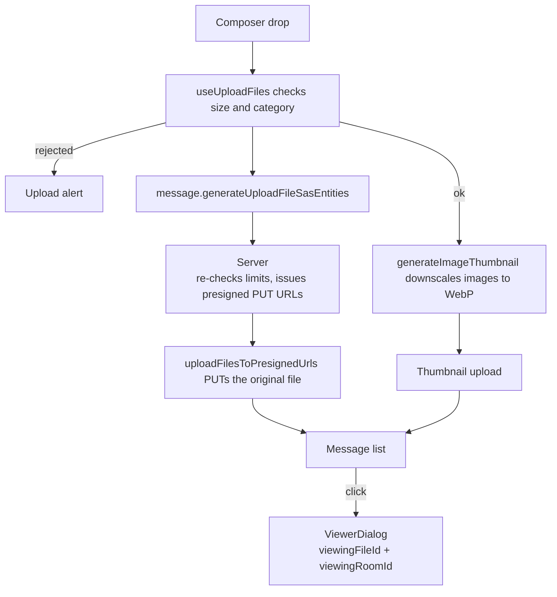

# File & Media

Message attachments upload through one shared presigned round-trip ([file uploads](../../architecture/file-uploads/design.md)). This page covers four enhancements layered on top of it: image thumbnails, the media viewer they open into, per-room attachment limits, and browsing a room's attachments.

## How it works

Every upload site funnels through the `uploadFilesToPresignedUrls` service, which asks the server for the write targets, PUTs each file to its presigned URL, and optionally returns read urls. The message composer adds two things on top: it validates each file against the room's limits before the target query, and it downscales images to a thumbnail that uploads alongside the original.

Thumbnails are generated on the client with a canvas — each image is scaled so its longest edge is a fixed size and re-encoded to WebP. The server issues a second presigned PUT for the sibling object at `{roomId}/{fileId}.thumb` whenever an image is uploaded, so the thumbnail lands in the same bucket and inherits the same lifecycle rule as the original. The message list renders the thumbnail inline and opens the full-resolution original in the media viewer.

Per-room limits live as columns on the `rooms` table and are checked at the target-issuing procedure, the only place a server sees an upload at all — the PUT goes straight to R2 and never passes back through the Worker. The composer mirrors the same limits so a rejected file is surfaced before any network call.

The two limits are not enforced equally, and the difference matters:

- **The mime category is enforced.** The category is derived from the declared mimetype, and that same mimetype is signed into the presigned PUT as its `Content-Type`, so the PUT cannot store the object as anything else.
- **The size cap is not enforced — it is checked against the size the client declares.** A presigned PUT carries no length constraint, and the persisted `FileEntity.size` is what the client declared, never a measurement. The stored size does reach the uploader's allowance, through the object-create reconcile, but not this field. A client that declares a small size receives a URL and can write past the room's cap with it until the URL expires. The check rejects an honest oversized drop early; it is not a defence against a client that lies.

Rejecting an over-cap upload outright needs something the direct-to-bucket design does not have: the upload would have to pass back through the server, or the stored size would have to be checked against the cap and the object removed. The reconcile that measures the object charges the uploader, so an over-cap object moves the counter and the uploader's next reserve is refused. Nothing rejects or deletes the object itself, so the size cap is a room-configured guardrail rather than a security boundary, and nothing downstream should assume an attachment is no larger than `maxFileSizeBytes`.

One rejected file rejects the whole drop, and the alert names it — the repo-wide rule for batch input ([file uploads](../../architecture/file-uploads/design.md)).

## The media viewer

Clicking an image or a video attachment opens one viewer, mounted once beside the message list and targeted by
the id of the file that was clicked and the room its message is in ([singleton dialogs](../../architecture/singleton-dialogs/design.md)).
The gallery it walks is every viewable file that room has read a url for — its list and, when the thread pane is
open on it, the pane's replies — so the arrows and the `ArrowLeft`/`ArrowRight` keys
move through the room's media rather than through one message's attachments. The ends are ends: nothing wraps.

Two things the viewer deliberately does not hold. A PDF opens its own dialog from its own renderer and audio
plays from the row it is in, so neither joins the gallery — both would mean two dialogs racing for one click.
And the url is read from the store by id on every render rather than captured when the viewer opened, which is
what lets the store's refresh sweep re-mint an expiring read URL underneath a viewer that is still on screen.

An image zooms on the wheel and pans on a drag once it is past the fitted size, with both reset when the viewer
moves to another file; a video renders with its own controls and does neither. Download is the same
`downloadUrl` anchor the file card's own options menu calls.

A PDF is not in this viewer's gallery, and it does not open here at all. Its row draws the first page as a thumbnail, and its own dialog holds the viewer, both over the renderer that `pdfjs-dist` ships; the [PDF viewer](../../architecture/pdf-viewer/design.md) page covers the loader, the toolbar and the config.

## Data model

Two columns on `rooms` (`packages/db-schema/src/schema/message/roomsInMessage.ts`):

- `maxFileSizeBytes` — integer; `0` (the default) falls back to the global `MAX_FILE_REQUEST_SIZE`. The server clamps the effective cap to that global maximum regardless of the stored value.
- `allowedMimeCategories` — a list of the categories (`Image` / `Video` / `Audio` / `Document`), defaulting to every category. A file's category is derived from its mimetype prefix via `getMimeCategory`.

## Procedures

| Procedure                                  | Auth        | Input                               | Purpose                                                                                    |
| :----------------------------------------- | :---------- | :---------------------------------- | :----------------------------------------------------------------------------------------- |
| `message.generateUploadFileSasEntities`    | Room member | files (filename, mimetype, size)    | Check the declared limits, issue presigned PUT URLs for the original and its thumbnail     |
| `message.generateDownloadThumbnailSasUrls` | Room member | file ids                            | Presigned GET URLs for the `.thumb` objects the message list renders                       |
| `message.searchMessages`                   | Room member | query, filters                      | `has: file` lists a room's attachments — see [message search](../message-search/design.md) |
| `room.updateRoom`                          | ManageRoom  | room fields incl. attachment limits | Persist per-room limits from the settings Moderation group                                 |

## Deletion is eventual, not guaranteed

Removing an attachment (`deleteFile`), deleting a message with attachments, or deleting a whole room does not delete the objects inline. Presigned GET URLs are signed for a day, long enough to outlast a session held open and short enough that a leaked url dies quickly, so a delete that silently failed would still leave the file downloadable for the rest of that window. Instead the mutation sends a `ProcessBlobDeletion` job carrying the object keys to its queue (every delete funnels through the shared `publishBlobDeletion` helper), and an idempotent queue consumer in the functions Worker deletes each object, retrying until it completes. A job that exhausts its retries lands in the job's dead-letter queue, which keeps it; there is no replay. Once the job is queued, delivery is durable. The **send itself stays best-effort** after the primary write ([persist then notify](../../architecture/persist-then-notify/design.md)), and there is no outbox or reconciliation sweep behind it: if the send fails, no job is ever queued to retry or dead-letter, so the orphaned object stays downloadable through its day-long URL until that expires. The delete cannot fail for the _user_ (the row is already gone), but object removal is best-effort/eventual, not a hard guarantee — a durable outbox would be required to close that gap. The helper splits object keys into one job per `MAX_BLOB_DELETION_EVENT_BLOB_NAMES` chunk, so a room deletion's listing can never outgrow a queue message's size limit.

**Every delete names the thumbnail too**, unconditionally — `{roomId}/{fileId}.thumb` sits in the same bucket as its original, so it rides the same job. There is no is-this-an-image check because there is no need for one: deleting a key that was never written is a no-op, while deriving image-ness at delete time has to agree with whatever the upload decided — and the delete that guesses wrong leaves the thumbnail behind with nothing left to name it.

## Key files

| File                                                                             | Role                                                              |
| :------------------------------------------------------------------------------- | :---------------------------------------------------------------- |
| `apps/web/app/services/file/uploadFilesToPresignedUrls.ts`                       | The one presigned upload round-trip every site funnels through    |
| `apps/web/app/services/file/validateFile.ts`                                     | Single file validator returning a discriminated result            |
| `apps/web/app/services/file/generateImageThumbnail.ts`                           | Canvas downscale to a WebP thumbnail blob                         |
| `apps/web/app/components/Message/Model/Message/File/ViewerDialog.vue`            | The media viewer — one file, the gallery around it                |
| `apps/web/app/store/message/file/dialog.ts`                                      | The viewer's target id                                            |
| `apps/web/app/components/Message/Model/FileRenderer/Pdf.vue`                     | The PDF's thumbnail in the row, and the dialog holding its viewer |
| `apps/web/app/composables/message/file/useUploadFiles.ts`                        | Composer path — validate, upload original, upload thumbnail       |
| `apps/web/app/composables/message/file/useReadFileUrls.ts`                       | Batch-resolves originals and thumbnails into read urls            |
| `apps/web/app/components/Message/Model/FileRenderer/Image.vue`                   | Renders the thumbnail inline, original in the viewer              |
| `packages/db-schema/src/schema/message/roomsInMessage.ts`                        | `maxFileSizeBytes` + `allowedMimeCategories` columns              |
| `packages/db-schema/src/services/file/getMimeCategory.ts`                        | Mimetype to coarse category mapping                               |
| `packages/db/src/services/storage/generateUploadFileSasEntities.ts`              | Issues the original and sibling thumbnail presigned PUTs          |
| `packages/db/src/services/storage/createPresignedPutUrl.ts`                      | The presigned PUT the targets are signed with                     |
| `apps/web/app/components/Message/Model/Room/Settings/Type/Attachments/Index.vue` | Room-settings Moderation page editing the limits                  |
| `apps/web/server/services/queue/publishBlobDeletion.ts`                          | chunked, best-effort blob deletion shared by every delete         |
| `apps/functions/src/handlers/processBlobDeletionHandler.ts`                      | Object deletion — idempotent queue consumer                       |
| `packages/db-schema/src/models/queue/BlobDeletionQueueMessage.ts`                | The deletion job payload and its schema                           |

## Notes

There is no server-side image processing — the [server-side transcoding](../../../deferred/esbabbler/server-side-transcoding/design.md) deferral still stands. Thumbnails are best-effort: if a browser cannot produce one, or an older image predates the feature, the message list falls back to the original url. Older attachments therefore keep working without a backfill.

The renderer records **which thumbnail urls failed, as a set** — not a single "the thumbnail failed" flag. Whether the thumbnail blob exists at all is already recorded on the file by the upload that wrote it (`hasThumbnail`), so a load error here can only mean the url went stale: the presigned GET expired ahead of the store's hourly sweep. Keying the failure to the url is what makes that terminate on its own — the sweep re-mints, the new url is not in the set, and the thumbnail comes back. A flag latched on the error never recovers, and downgrades every image in the room to its full-resolution original for the component's whole lifetime. The cost is that entries accumulate for as long as the message list stays mounted — one dead string per failed thumbnail per refresh cycle — and nothing prunes them. Accepted: a single ref reads as the tidier shape and is the one to reach for, which is why this says so — it is the shape that breaks recovery.
