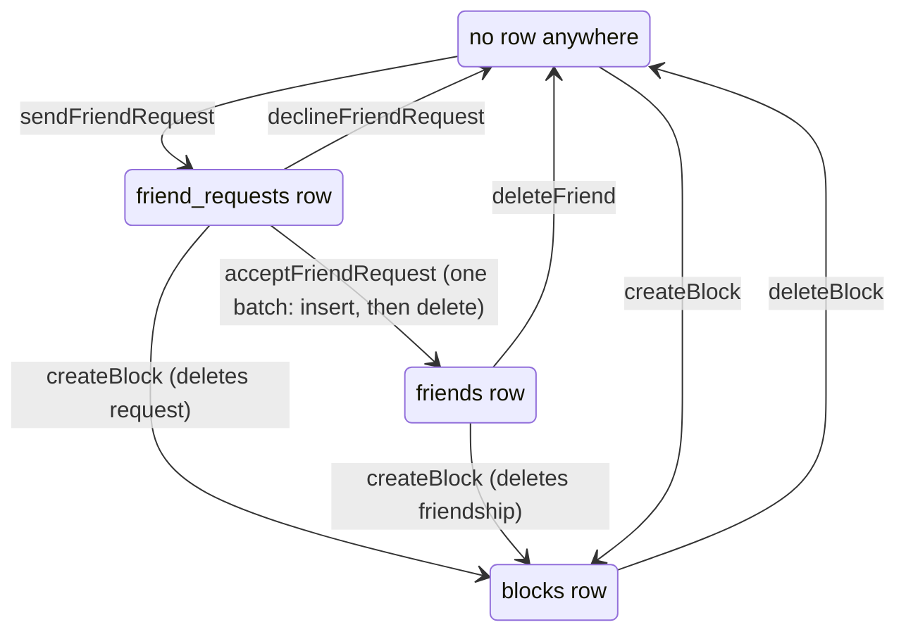

# Friends & Direct Messages

Friends are the only source of DM recipients — there is no separate messaging-permissions layer. Direct messages reuse the entire room/message infrastructure via `RoomType.DirectMessage`.

## How it works

Relationship state is encoded by which table a row lives in — no status value set. The pending and accepted tables use a deterministic natural key (`getFriendshipId(senderId, receiverId)`, sorted ids joined by a separator), so duplicate sends conflict on the primary key and become no-ops, and any relationship check is an O(1) key lookup. The blocks table is keyed by its ordered `(blockerId, blockedId)` pair.

In the diagram, `None` means no live row. A row that leaves its state is soft-deleted: it keeps its key, `deletedAt` is set and its version rises, and the next change to that pair revives the same row under the same key at a higher version, through an upsert whose conflict branch clears `deletedAt`. The tombstone is what lets a read or a write answer that arrives late lose to the removal. Tombstones are purged seven days after their deletion ([cloudflare services](../../architecture/cloudflare-services/design.md#row-versions-and-tombstones)).

Blocking is unilateral, but a block in either direction prevents friend requests and excludes the user from `searchUsers` results. Self-relationships are rejected by database CHECK constraints, not just router validation.

On the client, the friend and request lists are kept current by the rows their reads watch: `readFriends` and `readFriendRequests` watch the rows they read, and every change publishes the rows it touches, so a request or an accept made by the other party reaches this person's tabs as a refetch of the list, and no typed event carries them. The three stores hold the server's rows on the optimistic overlay (`apps/web/app/store/overlay.ts`): each read and each write's answer arrives at its row version, and a pending write is an entry applied over them (`apps/web/app/services/message/user/pair/`), so a response taken before an accept does not write the new friend back out, one taken before an unblock does not restore the unblocked user, and a failed write's entry is dropped. On the client, a transition out of `Pending` is an entry over the pair's request row. Accepting, declining and blocking each tombstone the request between the two users, and an accept also holds the friendship in the request's direction, as the server does. Each entry keys the pair by `getFriendRowKey`, the one place a pair key is built, over the session user and the other party. The entries are one per action in `apps/web/app/services/message/user/pair/`, and the three stores issue them, so a removal reaches every store's view through the same arrival.

The **New Message** dialog lists accepted friends; selecting one or more and confirming calls `createDirectMessage`, which finds or creates the DM room. Idempotency comes from `rooms.participantKey` — the sorted participant ids joined into one string with a unique index — so two users always share exactly one DM room. Group DMs have no size cap of their own — `createDirectMessageInputSchema` bounds the participant list only by the shared `MAX_READ_LIMIT`, and the router's own check is that every participant is an accepted friend — the creator is deduplicated out of the target list first, so naming yourself is a no-op and naming only yourself is the one rejection. They show a generated name ("You, Alice, Bob") unless the creator sets one, and 1:1 DM names are derived at display time from the other participant so they never go stale. Hovering a DM row reveals a close action that soft-hides it (`usersToRooms.isHidden = true`) without deleting the thread.

Anyone in a group DM may leave it, and only its owner — the participant who created it — removes somebody else, as in Discord. `deleteDirectMessageParticipant` refuses any other removal, and the participants popover offers Remove to the owner alone and Leave Group to everyone else — leaving calls the same procedure with the reader's own id and takes the conversation out of their list. The removal is awaited: its answer is the membership it tombstoned, shaped as a member's row, and that tombstone is what takes the participant off the popover and a reader's conversation off their list. An owner who leaves hands the group to a remaining participant in the same transaction, because the owner's permissions are checked without a membership lookup and a departed owner would otherwise keep every gate on a conversation they are not in; `deleteRoom` refuses a direct message for the same reason, so the only exits are leaving and hiding. When the owner leaves, the members still in the group who are online are sent an `updateRoom` event naming the new owner, so their owner controls follow without a reload.

DMs are invisible to non-participants: invite links are rejected for `RoomType.DirectMessage` and public room discovery excludes them. DM calls work like room calls (see [calls](../calls/README.md)); starting one posts a `MessageType.Call` system message in the thread.

## Data model

| Table            | Key facts                                                                                                      |
| ---------------- | -------------------------------------------------------------------------------------------------------------- |
| `friendRequests` | pending requests; `id` natural key, sender/receiver FKs, no-self CHECK; a removed request is a tombstone       |
| `friends`        | accepted friendships; same natural key; directionality preserved (who initiated); a removed one is a tombstone |
| `blocks`         | `(blockerId, blockedId)` PK; unilateral; an unblock is a tombstone                                             |
| `rooms`          | `type` (`Room` \| `DirectMessage`), `participantKey` (unique, DM-only)                                         |
| `usersToRooms`   | membership for both room types; `isHidden` soft-hide; a removal is a tombstone                                 |

## Procedures

| Router                          | Procedures                                                                                                                            |
| ------------------------------- | ------------------------------------------------------------------------------------------------------------------------------------- |
| `friend`                        | `readFriends`, `deleteFriend`, `searchUsers` (excludes self + blocks)                                                                 |
| `friendRequest`                 | `sendFriendRequest`, `acceptFriendRequest`, `declineFriendRequest`, `readFriendRequests`                                              |
| `block`                         | `createBlock`, `deleteBlock`, `readBlockedUsers`                                                                                      |
| `room` (nested `directMessage`) | `createDirectMessage`, `readDirectMessages`, `createDirectMessageParticipants`, `deleteDirectMessageParticipant`, `hideDirectMessage` |

## Key files

| File                                                             | Role                                                                                                    |
| ---------------------------------------------------------------- | ------------------------------------------------------------------------------------------------------- |
| `packages/db-schema/src/schema/social/friendRequestsInSocial.ts` | Pending-request table                                                                                   |
| `packages/db-schema/src/schema/social/friendsInSocial.ts`        | Accepted-friendship table                                                                               |
| `packages/db-schema/src/schema/social/blocksInSocial.ts`         | Block table                                                                                             |
| `apps/web/server/trpc/routers/friend.ts`                         | Friend procedures                                                                                       |
| `apps/web/server/trpc/routers/friendRequest.ts`                  | Request lifecycle                                                                                       |
| `apps/web/server/trpc/routers/block.ts`                          | Blocking                                                                                                |
| `apps/web/server/trpc/routers/room/directMessage.ts`             | DM creation, participants, hide                                                                         |
| `apps/web/app/store/message/room/directMessage.ts`               | DM list as a view over the rooms and the reader's live memberships, participants from the member rows   |
| `apps/web/app/pages/messages/friends.vue`                        | Friends management page                                                                                 |
| `apps/web/app/store/message/user/friend.ts`                      | Friends client state (+ `friendRequest.ts`, `block.ts`), each an overlay view over the pair rows        |
| `apps/web/app/services/message/user/pair/`                       | The pair entries the three stores issue: accept, decline, block, unblock and unfriend, and the pair key |

## Notes

- DMs are not a special case in the push path: `getMessageRecipientUserIds` has no room-type branch, so a DM is filtered exactly like a room. What makes DMs feel different is the default value of `usersToRooms.notificationType` — `NotificationType.DirectMessage`, whose UI label is **Only @mentions**. That member names the _notification preference_, not `RoomType.DirectMessage`, and the two are unrelated: it means notify me when I am mentioned by id. A member who wants every message opts into `All`. See [push notifications](../push-notifications/design.md).
- Re-adding someone to a group DM they hid works because their `usersToRooms` row is kept.
