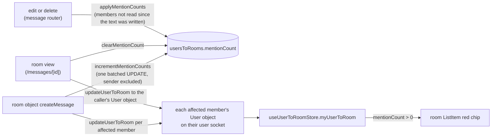

# Mention Badges

Red count chips in the room sidebar for rooms with unread `@mentions` of the current user. Full unread tracking is decided against ([read receipts and unread badges](../../../rejected/esbabbler/read-receipts-unread-badges/design.md)) and mention-only counts are the narrower version that page explicitly allows.

## How it works

A per-user, per-room counter (`usersToRooms.mentionCount`) increments when a message mentioning the user arrives, goes back down when that message is deleted or edited away from the mention, and resets when the user views the room. The room list item renders it as a red chip, taking precedence over the plain unread name colour — Discord behaviour.

The room object's `createMessage` classifies the message's mentions (`getSenderClassifiedMentions`) and bumps every targeted member's counter in a single batched UPDATE (`incrementMentionCounts`): direct and role mentions badge unconditionally; `@everyone`/`@here` follow each member's notification rules (`Never` opts out; `@here` requires online, with no status row treated as online — the same broadcast targeting as [push notifications](../push-notifications/design.md)), and only for a sender who holds `MentionEveryone`; the sender is always excluded. The room object runs the increment after its message write, for every message a member writes: a live send, a forward and a scheduled send alike, so no path leaves a mention uncounted. It sends each targeted member's `updateUserToRoom` through that member's object. The increment is best-effort — a failed increment loses one badge count, never a message, so there is no retry.

An edit and a delete move the counts from the web side, in the message router, after the object's write. A delete takes back the counts the message made (`decrementMentionCounts`), as of the time its text was last written — its edit, or else its send — and an edit takes back the counts of the old text and adds the counts of the new text (`incrementMentionCounts`). Both resolve their targets the same way the send does (`getMentionTargetWhere`), so a delete or an edit reaches the same members a send would have counted, and the sender is excluded from both. A message from a webhook has no sender and moves no count on edit or delete, as it counted none on arrival. A soft ban's purge and an account's erase take back the counts of every message they tombstone, the same way a delete does. Only a text message counts: a poll's body is its own JSON.

A take-back reaches only the members whose count the message can still stand on: the member was in the room when the message was sent, and has not read the room since the message was sent. A read clears the counts a member holds, so a count a later message made must stay, and a member who joined after the message was never counted for it. No count goes below zero. The targets are re-derived from the room's current membership, statuses and the sender's current `MentionEveryone`, not from a record of who was counted at send time. So a count whose target has since changed stands: a member who went offline after an `@here` is no longer a target and keeps its count, and a sender who has lost `MentionEveryone` makes no broadcast that reaches anyone, so the broadcast's counts stand too. The take-back is best-effort after the write, the same as the increment.

### Each consumer classifies for itself

Badging, in the room object's write, and [push notifications](../push-notifications/design.md), in the notification consumer, both resolve the same three mention kinds from the same body — so both call `getSenderClassifiedMentions` on it. That repetition is deliberate: the classification is a regex pass over the message text, and each query behind it is skipped unless the message needs it — `getRoleMemberIds` unless it mentions a role, and the sender's `MentionEveryone` read unless it mentions a broadcast.

Threading a precomputed `ClassifiedMentions` through instead would buy that back at a real cost. `getMessageRecipientUserIds` is also called from outside the send path, where no classification has happened, so the parameter would have to be optional — and an optional precomputed input is a parameter a caller can pass from the _wrong_ message, turning a self-contained function into one whose correctness depends on its caller. What the two functions share is the resolution rule, and that is already shared: `getMentionConditions` holds one copy of it, and the badge and notification variants differ only in the condition a resolved set of user ids becomes, which is its one parameter.

Counts arrive with `readMyUsersToRooms` at startup (already loaded for every room — see [display names](../display-names/design.md)) and update live through the `updateUserToRoom` UserEvent on the user socket: both the increment and the clear send `updateUserToRoom` to each affected member's User object, per affected row, so the chip appears and disappears with no new subscription.

## Data model

`usersToRooms.mentionCount` — integer, NOT NULL DEFAULT 0, with a `>= 0` check. The counter is the only state — there is no per-message read tracking anywhere, keeping the rejected read-receipt semantics out.

## Procedures

| Procedure                       | Auth   | Purpose                                                                |
| ------------------------------- | ------ | ---------------------------------------------------------------------- |
| `clearMentionCount({ roomId })` | member | reset own count on room view; idempotent, emits only when a count fell |

(The increment on send happens inside `createMessage`; the increment on edit and the take-back on edit or delete happen in the message router after the object's write. There is no public write endpoint for any of them.)

## Key files

| File                                                                           | Role                                                                                               |
| ------------------------------------------------------------------------------ | -------------------------------------------------------------------------------------------------- |
| `packages/db-schema/src/schema/message/usersToRoomsInMessage.ts`               | `mentionCount` column + check                                                                      |
| `packages/db/src/services/message/incrementMentionCounts.ts`                   | batched increment (`getMentionBadgeConditions` targeting)                                          |
| `packages/db/src/services/message/decrementMentionCounts.ts`                   | batched take-back on delete, edit, purge or erase, for members not read since the text was written |
| `packages/db/src/services/message/mention/getMentionTargetWhere.ts`            | the member rows a message's mentions reach, shared by increment and take-back                      |
| `apps/web/server/services/message/addMentionCounts.ts`                         | the edit's increment, through `applyMentionCounts`                                                 |
| `apps/web/server/services/message/applyMentionCounts.ts`                       | a count write applied best-effort, then `notifyMentionCounts`                                      |
| `apps/web/server/services/message/notifyMentionCounts.ts`                      | the `updateUserToRoom` fan-out to each member whose count moved                                    |
| `apps/web/server/services/message/takeBackMentionCounts.ts`                    | the delete's, the edit's and the purge's take-back, through `applyMentionCounts`                   |
| `packages/db/src/services/message/mention/getSenderClassifiedMentions.ts`      | broadcasts held to the sender's `MentionEveryone`                                                  |
| `apps/realtime/src/durableObjects/RoomObject.ts`                               | the post-write increment + `updateUserToRoom` to each affected member's User object                |
| `apps/web/server/trpc/routers/userToRoom.ts`                                   | `clearMentionCount`                                                                                |
| `apps/web/app/composables/message/subscribables/useUserToRoomSubscribables.ts` | the client's `updateUserToRoom` handler on the connection store                                    |
| `apps/web/app/pages/messages/[id]/index.vue`                                   | clears the count on room view                                                                      |
| `apps/web/app/components/Message/Model/Room/List/Item.vue`                     | red count chip                                                                                     |
| `apps/web/app/services/message/room/list/checkIsRoomUnread.ts`                 | the unread flag that un-mutes the row, beside the chip                                             |

## Notes

Mentions arriving while the room is being viewed are suppressed in the sidebar (`isActive`), matching the unread name-colour behaviour beside them; the stored count still clears on the next room view.
