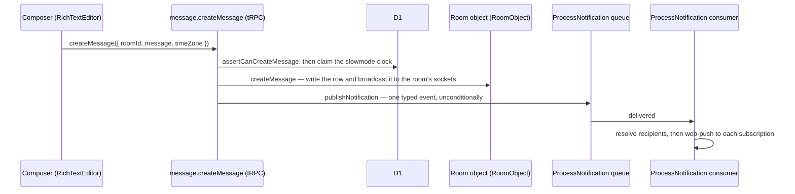
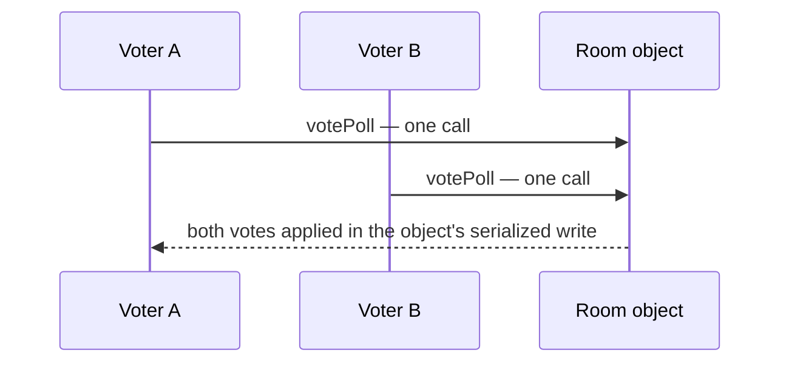

# Messaging

Messages are high-volume, append-heavy, and time-ordered, so each room's object holds them in its own SQLite rather than in D1. Everything relational around them (rooms, membership, roles) stays in D1.

## How it works

A message is one row in `messagesInRoom`, the room object's table (`apps/functions/src/durableObjects/room/schema.ts`). Its `id` is an integer that only grows within its room, so id order is send order: a page without a cursor reads newest first (`desc(id)`), and a page past a cursor reads oldest first (`asc(id)`), which is how a jump to an older message reads its newer side. The message's files, link preview, mentions and reply target are columns on that same row, so there is no companion table to keep in step. Reactions live in `messageEmojisInRoom` and scheduled messages in `scheduledMessagesInRoom`, in the same object.

Sending a message flows through one server service, `createUserMessage`, which claims the slowmode clock in D1, writes the message to the room's object, and publishes its notification:

The send does not write the room's `updatedAt`. The room object marks the room active, and its alarm writes `updatedAt` in D1 once per window and tells each member online, so the room moves to the top of their list.

Real-time delivery is owned by [Cloudflare services](../../architecture/cloudflare-services/design.md), and a [cross-process event bridge](../../../deferred/esbabbler/cross-process-event-bridge/design.md) is decided against for now. A client opens its room's socket at `/ws/room/:roomId`, which the web Worker authorises against D1 before it forwards the upgrade to the room object. A member who leaves or is removed is taken off the room's online list, and every socket of theirs is closed there (`removeMember`).

Push notification filtering and delivery detail lives in [push notifications](../push-notifications/design.md).

## Serialized writes

A write that depends on what it read runs inside its room's object in one synchronous turn, so no other write lands between its read and its write. [Conditional Writes](../../architecture/conditional-writes/design.md) is the rule for the D1 rows that have no such owner, and poll voting is where a message needs it most: every member of the room writes into the same poll body.

`getMessageProcedure` reads the message from its room's object and hands the procedure the copy the object held when it was read. A vote is not written from that copy: `votePoll` sends only the option id to the object, which applies it to the poll body the object holds at that moment.

A vote is one call to the room object, which applies it to the stored poll inside its single-threaded write, so two votes on one poll never race and no version check or retry runs.

`applyPollVote` (`apps/functions/src/services/room/applyPollVote.ts`) reads the stored body, checks that it is a poll with options and votes, and changes only the voter's entry in `votes`. Every other field is written back exactly as it was read, so a vote never rewrites the question or the option labels. The client parses the same body with `pollMessageContentSchema` (`apps/web/shared/models/message/poll/`), the one schema that owns a poll's shape, to render it and to create one.

## Message types

`MessageType` (in `@esposter/db-schema`) discriminates rendering and behaviour: `Message`, `Poll`, `Call` (call started / call-end duration system message), `EditRoom`, `PinMessage`, `System` (join/leave), and `Webhook`. Adding a type requires updating `MessageComponentMap` (type → Vue rendering component) and `MessageTypeOperationPermissionMap` (type → the operations it supports and who may perform each).

**A member posts only `Message` and `Poll`** (`userMessageTypeSchema` on the create input). The other standard types are drawn in the room's own voice, so a member able to post one could announce a join, a call or a rename that never happened; the server writes each of them itself, the rename line included (`updateRoom`). Those server-written lines carry member names verbatim rather than through the sanitizer, so any surface that renders a message as markup does so only for the `Message` and `Webhook` bodies, which the Zod boundary sanitized — the reply preview shows every other type as text.

`MessageTypeOperationPermissionMap` is the one source of truth for what may be done to a message, and it is declared `as const satisfies Record<MessageType, …>`, so it is exhaustive — a new type does not compile until it declares its operations. Presence answers whether the type supports the operation at all: `Call`, `EditRoom`, `PinMessage` and `System` messages are written by the server on the room's behalf and support none, so update, delete and pin on them are a `BAD_REQUEST` for every caller, including one holding `ManageMessages`. The value answers which of the callers who could perform it actually may — `Author` means the author _or_ a member with `ManageMessages`, `AnyMember` means the membership check already settled it, and `ManageMessages` means that permission alone. A webhook message has no user author, so all of its operations resolve to `ManageMessages`.

Mentions are stored as HTML: the TipTap mention suggestion inserts `` nodes, which the server later parses for notification targeting and the client resolves to display names (see [display names](../display-names/design.md)).

All three composer suggestion popovers — mentions, emoji and [slash commands](../slash-commands/design.md) — render through one `MessageModelMessageSuggestionList` surface, so the composer's chrome is the same whichever trigger opened it. It owns the lifted surface, the group title from `getSuggestionListTitle`, and the listbox, which it scrolls to keep the option the editor's arrow keys select in view while focus stays in the editor; each popover supplies its own rows and its own width as a passthrough attribute, and nothing else.

## Procedures

The `message` router is flat-merged at the tRPC root, with `emoji`, `moderation`, and `scheduledMessageJob` nested under it. Every row marked _author_ below is a `getMessageProcedure` built on the operation it guards, so its real answer comes from `MessageTypeOperationPermissionMap` as described above — author or `ManageMessages` on a `Message`/`Poll`, `ManageMessages` on a `Webhook`, refused outright on the server-written types. A delete only stamps `deletedAt`, and the room object's reads answer a deleted message as absent, as `forwardMessage` and `readThread` do, so nothing can edit, pin, vote on or forward a message its author removed. Highlights:

| Procedure                         | Auth   | Purpose                                                                                                                                                                                                 |
| --------------------------------- | ------ | ------------------------------------------------------------------------------------------------------------------------------------------------------------------------------------------------------- |
| `createMessage`                   | member | Claim the slowmode clock, write the message to the room's object, publish its notification                                                                                                              |
| `updateMessage` / `deleteMessage` | author | Edit/delete own messages (message-scoped procedure)                                                                                                                                                     |
| `forwardMessage`                  | member | Forward into another room                                                                                                                                                                               |
| `pinMessage` / `unpinMessage`     | author | Room-wide pins (message-scoped, `Pin` operation)                                                                                                                                                        |
| `votePoll`                        | member | Cast/withdraw a poll vote in the room object's serialized write                                                                                                                                         |
| `readMessages` / `readThread`     | member | Cursor pagination / thread view                                                                                                                                                                         |
| `searchMessages`                  | member | Filtered search, fanned out to each named room's object and merged                                                                                                                                      |
| `readMySentMessages`              | authed | Cross-room sent list from the user object's sent index, read per room                                                                                                                                   |
| Socket events, not subscriptions  | member | The room object's `RoomEvent` frames                                                                                                                                                                    |
| `createTyping`                    | member | Typing indicator, broadcast as a `createTyping` room event — the typist and the name shown (room display name, else account name) are resolved server-side from the session, never taken from the input |
| `generate*FileSas*`               | member | Presigned R2 upload and download URLs (the procedure names keep the `Sas` form)                                                                                                                         |

## Key files

| File                                                                    | Role                                                                           |
| ----------------------------------------------------------------------- | ------------------------------------------------------------------------------ |
| `apps/web/server/trpc/routers/message/index.ts`                         | Message router (procedures above)                                              |
| `apps/web/server/services/message/createUserMessage.ts`                 | Send pipeline: slowmode claim, object write, ProcessNotification publish       |
| `apps/functions/src/durableObjects/room/schema.ts`                      | The room object's tables: messages, reactions, scheduled messages              |
| `apps/functions/src/durableObjects/RoomObject.ts`                       | The room object: message writes and reads, votes, and the broadcast to sockets |
| `packages/db-schema/src/models/message/MessageType.ts`                  | Message type discriminator                                                     |
| `apps/web/shared/services/message/MessageTypeOperationPermissionMap.ts` | Which operations each type supports, and for whom                              |
| `apps/functions/src/services/room/applyPollVote.ts`                     | The vote applied to a stored poll body                                         |

## Notes

- Never bypass `createUserMessage` when adding a message-producing path — timeout, `SendMessages`, read-only, slowmode, and word-filter checks happen there and in the member procedures. `forwardMessage` is the one exception: it fans out over N rooms with a per-room `assertCanCreateMessage` and cloned files, so it reproduces the pipeline instead of calling it. Any _new_ path goes through `createUserMessage`.
- **Send order is fixed on every send path**, following [persist then notify](../../architecture/persist-then-notify/design.md): `assertCanCreateMessage` → claim the slowmode clock (`createUserMessage`'s guarded D1 update, or `updateUserToRoom` on a forward) → the room object's write and broadcast → best-effort side effects (mention counts, thread follows, the notification publish). The clock advances _before_ the write because it is the value the next send is checked against — a send that skips it keeps comparing against a stale `lastMessageAt` and slowmode silently never applies, so it fails closed on a failed write rather than open on a failed update. The same stamp moves `lastReadAt`, since a sender has read their own room.
- **`lastMessageAt` is server-only.** It is the slowmode clock and nothing else: `updateUserToRoom`'s input carries `lastReadAt` — the read marker the room list's unread dot and Mark Unread From Here move, which a member who has never read the room counts from joining it — so a client can never reset the clock its next send is checked against. Only a send path writes `lastMessageAt`.
- **The room object has no joins.** Its SQLite holds the room's messages and nothing relational, so anything that must be joined (membership, who to notify) is read from D1, and the recipients are resolved at delivery by ProcessNotification.
- **Single owner per store transition.** The room-event handler (`useMessageEvents`) owns every remote-visible state change: its `createMessage`, `updateMessage` and `deleteMessage` handlers write the message list through `storeCreateMessage`/`storeUpdateMessage`/`storeDeleteMessage`, and the same rule holds across the room, userToRoom, emoji, pin, call, and member stores. A caller-side store mutation is kept only when it is a genuine optimistic update with revert (the [client data](../../architecture/client-data/design.md) `applyOptimistic` rule) or when the broadcast excludes the actor's own device (the object's `excludeTag` for `device:<deviceId>`), so the socket can never reach the caller. No store applies a plain, non-optimistic mutation that a caller-reaching socket event would double-apply.
- **Idempotent by id.** A sender's other tabs hear their own send, and a reconnect replays the messages after the last id it heard, so `storeCreateMessage` dedups on the message `id` via `createOperationData`, and update/delete handlers are set/filter operations that re-apply cleanly. Re-emitting an already-applied event is a no-op — locked in by `store/message/data.test.ts` and `services/shared/createOperationData.test.ts`.
- **Ascending reads are one range read.** `readMessages` with a cursor reads the messages past it oldest first in a single query over the room's ids, so an ascending page comes back in send order without a second read to put it right.
