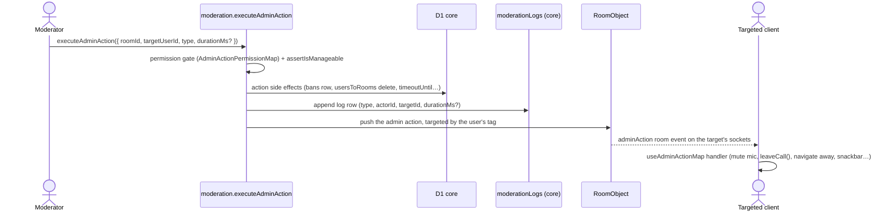

# Moderation

One unified admin action system: every moderation operation is an `AdminActionType` executed through a single procedure, gated behind a specific `RoomPermission` bit (see [RBAC](../rbac/design.md)), hierarchy-checked with `assertIsManageable`, logged to an append-only audit table, and delivered live to the targeted user.

**One procedure, and only one.** Everything that removes, mutes, times out or warns a member goes through `executeAdminAction` — which is why the permission is looked up per action type rather than fixed by the procedure. A second route to the same effect would be a second place to hold the hierarchy check, the audit row and the departure announcement.

## How it works

### Action behaviours

| Action                      | Permission       | Behaviour                                                                                                                                                                                                                                                                                                                    |
| :-------------------------- | :--------------- | :--------------------------------------------------------------------------------------------------------------------------------------------------------------------------------------------------------------------------------------------------------------------------------------------------------------------------- |
| `ForceMute` / `ForceUnmute` | `MuteMembers`    | server narrows (or restores) the target's call preset: a mute kicks the connection and adds it back without the microphone, so the live track is taken off the air, while an unmute switches the preset in place; targeted client also toggles its microphone + force-muted state, only when the action's room is the call's |
| `StopScreenShare`           | `MuteMembers`    | server narrows the target's preset without screen share, by the same kick and rejoin; targeted client also calls `setScreenShare(false)` + snackbar                                                                                                                                                                          |
| `KickFromCall`              | `MoveMembers`    | server takes the target out of every call in the room and removes its connections from the RealtimeKit meeting; targeted client also calls `leaveCall()`; snackbar                                                                                                                                                           |
| `KickFromRoom`              | `KickMembers`    | server deletes the `usersToRooms` row, announces the departure and takes the target out of the room's calls; targeted client navigates away                                                                                                                                                                                  |
| `TimeoutUser`               | `KickMembers`    | `durationMs` required; sets `timeoutUntil` on `usersToRooms` and takes the target out of the room's calls, which refuse them until it ends; all message-producing mutations reject while `timeoutUntil > now()`                                                                                                              |
| `CreateBan`                 | `BanMembers`     | permanent; deletes `usersToRooms`, announces the departure and takes the target out of the room's calls, inserts into `bans`; join/invite flows reject banned users                                                                                                                                                          |
| `SoftBan`                   | `BanMembers`     | ban + remove from room and its calls + mark the user's visible messages deleted                                                                                                                                                                                                                                              |
| `Warn`                      | `ManageMessages` | records and emits the action; targeted client shows a warning notification                                                                                                                                                                                                                                                   |

**The server enforces every call action; the client's own reaction is a courtesy.** A targeted client that ignored the event would otherwise stay connected, talking or presenting. A removal from a call takes the member out of each call's object, which drops their connections, writes the call's summary where the removal ends it, and removes the connections from the RealtimeKit meeting (`evictRoomCallParticipants`). It reaches every call the room runs, its own and each thread's. A token already issued is not withdrawn by a removal, so the `meeting.participantJoined` webhook asks the room's door again (`checkIsCallConnectionAdmitted`) and drops a connection whose membership is gone or timed out — `joinCallByRoomId` asks the same door before minting a token, so a timeout keeps the member out of the room's calls until it ends. A publish revoke is computed by the call's object from what the connection may publish now, so a force-muted presenter whose screen share is stopped stays muted. It runs one at a time per connection, since a preset replaces the whole set of publish sources, and two moderations reading one set would each restore what the other took. A RealtimeKit failure fails the action rather than reporting an enforcement that never landed. A revoke lasts for the connection: a rejoin is granted the full join set again, as a moderator watching the call sees.

### A removal is a departure

Kick, ban and soft ban all delete a membership row, and a deleted membership row that nobody is told about leaves every other client rendering a member the room no longer has. So each of them ends in the same announcement a voluntary leave makes — the room-left event every member list prunes from, and the system line naming who went — through one `announceRoomMemberRemoval`, best-effort after the removal has committed ([persist then notify](../../architecture/persist-then-notify/design.md)). The same announcement closes the removed member's sockets on the room's object, since a socket checks membership only when it opens and a client that kept one would otherwise go on receiving the room. The room-level events a member's sockets carry are delivered only while the member is in the room: a room they left stops reaching their sockets, because the departure closes them on that room's object, and a room they join reaches them from the join on, since a joiner who is online is attached to the room at once (`announceRoomMembersJoined`). A member's own leave still reaches its other devices that listed the room, since the device it did not leave from still shows the room.

**A removed member's messages keep their name.** A kick or a ban leaves the member's messages in the room, as their own leave does; a soft ban marks them deleted instead. The messages that stay are named by their author through `room.readUsersByIds`, which returns a user who is no longer a member too, with `isMember` false, so the room shows the name the author had rather than dropping the messages.

**Nobody moderates themselves.** The hierarchy comparison cannot express it: an actor and a target at the same position fail the strict comparison, but a room owner is above every rule it knows and would pass against their own row. The self-target rejection therefore sits in front of the comparison rather than inside it, and a direct message is rejected in front of both — a pair with no roles has no moderators, and blocking is what it has instead.

### Word filter

Rooms can define filtered words (`room.filter` router, `roomFiltersInMessage`). The word filter is the last rule in `getMessageCreationRejection`, the shared gate every message-producing path decides with — after the timeout, the sender's `SendMessages` permission, the read-only check and slowmode. It reports the match; the caller (`assertCanCreateMessage`) applies the configured action and rejects. Every rule rejects with the sentence it owns, from one map beside that caller — the sender is shown the message text, so a bare code would tell them neither what stopped the send nor whether waiting helps. Slowmode is the one that answers yes to that second question, which is why it alone rejects as a rate limit.

## Data model

The moderation log is an append-only SQLite table in core (`moderationLogs`): one row per action, belonging to its room through a `roomId` foreign key that cascades with the room, and read newest first by a cursor over `id`, which is creation order. Its fields are `type`, `actorUserId`, `targetUserId` and `durationMs?`. `targetUserId` cascades with the account, while `actorUserId` is nullable with no foreign key, since an AutoMod action names the reserved AutoMod id rather than an account. When a moderator's account is deleted, the sweep sets its `actorUserId` to null, so the room keeps the record without naming the person. It is surfaced in the room settings **Audit Log** tab (behind `ManageRoom`), with a filter bar over action type, actor, and target — the filters become extra `WHERE` clauses on the room's index (fine at room-log scale), so filtered pagination stays stateless through the same cursor. The empty state distinguishes "no entries" from "no matches". Bans are relational (`bans` table in `core`: `roomId`, `userId`, `bannedByUserId`).

The **Bans** tab searches by the banned user's name, over the join that already renders the row, so the predicate costs nothing beyond the case-insensitive `LIKE`. The ban reason is deliberately not matched: it is free text a moderator wrote, searching it makes the panel feel like a log search, and the want the tab serves is whether a person is banned — which is a name. An emptied field lists the room's bans again rather than leaving the last term's rows on screen, because the empty query is issued as a query rather than treated as a reset, and paging carries the term with the cursor so a ban placed mid-scroll cannot appear in a page of a search it does not match.

## Procedures

`moderation` router (`server/trpc/routers/message/moderation.ts`):

| Procedure                                                                   | Auth (permission)           | Purpose                                         |
| :-------------------------------------------------------------------------- | :-------------------------- | :---------------------------------------------- |
| `executeAdminAction({ roomId, targetUserId, type, durationMs? })`           | per-action gate + hierarchy | Execute any admin action                        |
| `readBans({ roomId, cursor, filter, limit })`                               | `BanMembers`                | Cursor-paginated ban list, searchable by name   |
| `deleteBan({ roomId, userId })`                                             | `BanMembers`                | Unban                                           |
| `readModerationLog({ roomId, cursor, type?, actorUserId?, targetUserId? })` | `ManageRoom`                | Cursor-paginated audit log, optionally filtered |

## Key files

| File                                                                               | Role                                                                                      |
| :--------------------------------------------------------------------------------- | :---------------------------------------------------------------------------------------- |
| `packages/db-schema/src/models/message/AdminActionType.ts`                         | action type enum                                                                          |
| `apps/web/server/trpc/routers/message/moderation.ts`                               | moderation router                                                                         |
| `apps/web/server/services/message/moderation/AdminActionPermissionMap.ts`          | action → required permission                                                              |
| `apps/web/server/services/room/announceRoomMemberRemoval.ts`                       | the departure event + system line                                                         |
| `apps/web/server/services/room/announceRoomMemberDeparture.ts`                     | the member's sockets closed on the room's object, then the room-left event                |
| `apps/web/server/services/room/announceRoomMembersJoined.ts`                       | the join to the room's online members, then the joiner, and the joiner attached if online |
| `apps/web/server/services/message/call/evictRoomCallParticipants.ts`               | a removal reaching the room's calls                                                       |
| `apps/functions/src/durableObjects/CallObject.ts`                                  | publish revokes: the preset update, kick and rejoin                                       |
| `apps/web/shared/models/db/moderation/ExecuteAdminActionInput.ts`                  | discriminated union input                                                                 |
| `apps/web/shared/models/db/moderation/UnparameterizedAdminActionType.ts`           | the actions that take nothing past their target                                           |
| `apps/web/app/composables/message/moderation/useAdminActionMap.ts`                 | client-side per-action handlers                                                           |
| `packages/db/src/services/message/moderation/getMessageCreationRejection.ts`       | shared message-creation gate                                                              |
| `apps/web/server/services/message/moderation/assertCanCreateMessage.ts`            | tRPC face — applies + rejects                                                             |
| `apps/web/server/services/message/moderation/MessageCreationRejectionReasonMap.ts` | what each rule tells the sender                                                           |
| `apps/web/server/trpc/routers/room/filter.ts`                                      | word filter CRUD                                                                          |

## Notes

Adding a new action type touches five places (kept in lockstep by types — the permission, icon and color maps are a `Record<AdminActionType, …>`, and `ExecuteAdminActionInput.test-d.ts` holds the input union to the enum): the `AdminActionType` enum, an `ExecuteAdminActionInput` variant (a member of `UnparameterizedAdminActionTypes`, the list `UnparameterizedAdminActionInput` and its schema both read, when the action takes nothing past its target, otherwise its own model file joined into the union), `AdminActionPermissionMap`, the `useAdminActionMap` client handler, and the icon/color/label maps in `app/services/message/moderation/`.

A warning carries no free-text reason, because nothing would read one: the log row holds the actor, the target and the type alone, and the targeted client's notice is fixed. Its dialog is therefore a plain confirmation, like a kick's, and a reason field returns only together with somewhere to store and show it.
