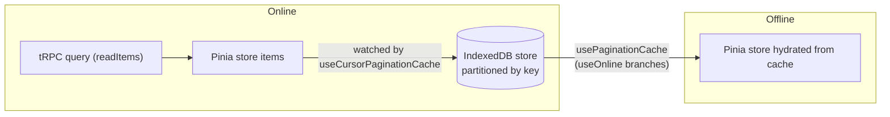
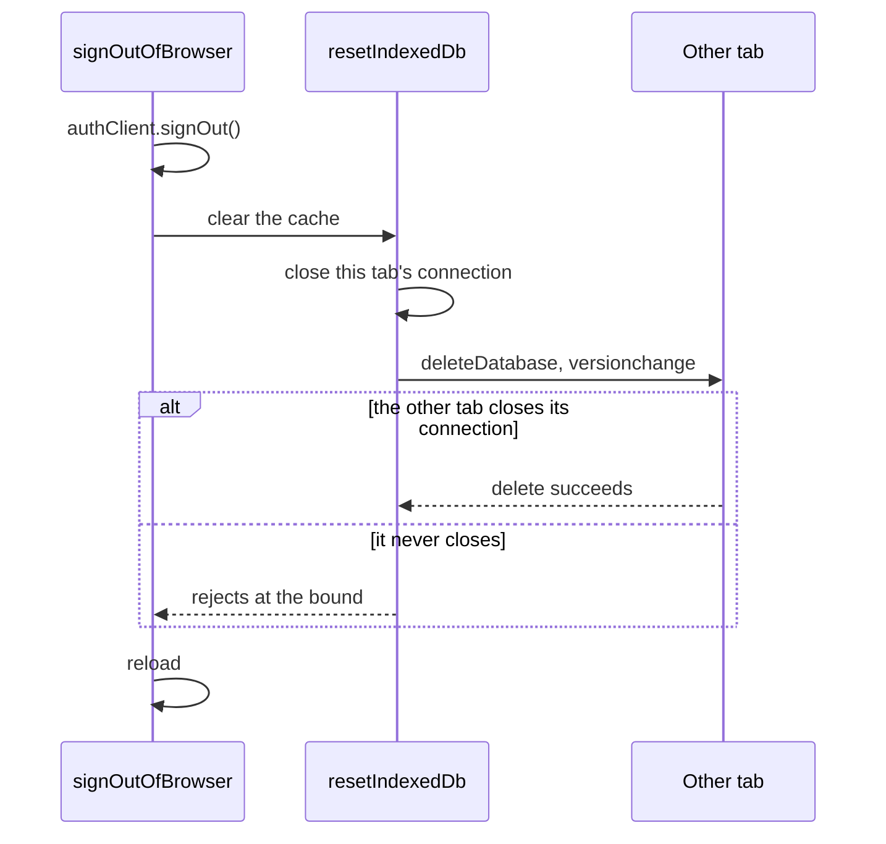

# Offline Cache

The offline cache is a local IndexedDB mirror of Pinia state. **The stores remain the source of truth**; generic cache composables handle online/offline branching, store-to-cache writes, and offline hydration. Pagination helpers (`readItems` / `readMoreItems`) stay focused on pagination state — they never accept cache options or call IndexedDB.

## How it works



One generic composable owns the whole lifecycle, behind a thin shape adapter per pagination variant:

| Composable                 | Purpose                                                                                |
| -------------------------- | -------------------------------------------------------------------------------------- |
| `usePaginationCache`       | Persists on change, clears on empty, hydrates on mount, on switch and on going offline |
| `useCursorPaginationCache` | Adapts the hydrated rows into a `CursorPaginationData` for the store's hook            |
| `useOffsetPaginationCache` | Offset-paginated equivalent                                                            |

Feature wiring is a thin wrapper supplying partition key, store refs, and hooks: `useMessageCache` (room partition, filters loading messages), `useMemberCache` (room partition, hydrates counts/user store), `useRoomCache` (user partition).

### partitionKey is always required

Every object store is partitioned; `readIndexedDb` / `writeIndexedDb` always take an explicit `partitionKey`:

- **Messages** → `roomId` (the row already carries `roomId`; key path `[roomId, id]`, limit 50)
- **Members** → `roomId` (injected as `roomId`; key path `[roomId, id]`)
- **Rooms** → the viewing user, injected as `viewerId` (key path `[viewerId, id]`). A room's own `userId` is its creator, so it is not the partition

Each store's index is named for the field it partitions on, and `writeIndexedDb` stamps that field onto every record it writes. The keys changed from the Azure-shaped `[partitionKey, rowKey]`, so `DATABASE_VERSION` is bumped and an upgrade clears the stores rather than migrating them: the cache is refilled from the server.

### Sign-out clears the whole database

Messages and members are partitioned by room, not by reader, so the rows one reader cached for a room are what the next reader of the browser would be served there, and the rooms partition on the user does not cover them. `signOutOfBrowser` therefore deletes the whole database, after the network sign-out and immediately before the load: a write still queued on the cache can reopen the database only in that instant, not for the round trip signing out takes. A failed delete is logged while the sign-out goes on. Draining the page's pending fire-and-forget work first was rejected: `waitForSynchronizedFunctions` waits on every one of them, so one that never settles would hold the sign-out.

The delete waits for other tabs, since an open connection holds the database against a delete until it closes. The cache's connection therefore gives way when asked: its `blocking` handler closes it and forgets the cached promise, and the next read or write opens a fresh connection queued behind the delete. The delete resolves only on its own success or error. Resolving on `blocked` is rejected: the sign-out goes on while the delete is still pending, so the first user's rows stay on disk for the other tab to read, and the next sign-out queues a delete behind it that never settles. An unbounded wait is rejected for the same reason, so a tab from older code that never releases holds the sign-out for `RESET_DATABASE_TIMEOUT_MS` at most, and the expired wait rejects as a failed delete.



### Readiness is the store's, not the cache's

A partitioned cache asks one question, on every switch and on every mount: **are the rows currently loaded this partition's own?** The list cannot answer it — emptiness says nothing about whether a load happened — so the answer is a per-partition `isLoaded` flag **recorded by the store that performed the load**, set the moment a read or a hydration lands and therefore set for a partition the server says is empty too. The pagination data map keys it exactly like the slice it describes, and the cache takes it as an option.

Both halves of the cache read that one flag, and neither keeps a copy:

- **Hydration** bails when the partition is already loaded, so a cache page can never replace rows the store already holds. This matters most on a **remount over a surviving list**: the layout that owns the cache is torn down and rebuilt whenever the user navigates away and back, while the Pinia list is not, and a readiness flag owned by the cache would start fresh under rows that did not — hydrating the capped cache page over a room the user has scrolled back through, offline, with no way to refetch it.
- **Persistence** happens only for a loaded partition, and readiness is watched beside the rows rather than only reacting to them: a first load that lands empty changes nothing in the list, so without that the previous session's rows would stay cached — and reachable on the next offline open — for a partition the server reports as empty.

That flag only means anything while **the store's list cannot outlive its partition**, so a store whose partition key can change while it is alive keys its list per partition (below). Guards added inside the cache to compensate for a list that is shared across partitions are guesses over ambiguous state; fix the store's scoping instead.

### The store list must be partition-scoped too

A store whose partition key can change while it is alive therefore uses `useCursorPaginationDataMap(() => currentKey)` / `useOffsetPaginationDataMap` — messages and members both key on `currentRoomId`. The unkeyed `useCursorPaginationData` is correct only where the key cannot change under the store: the room list partitions on the signed-in user, and signing out reloads the page, so that list is recreated with its partition rather than outliving it.

**Every field describing that partition is keyed, not only the rows.** A cursor is the clearest case: the message list pages in both directions, and a deep link opens the room around an older message and leaves a _newer_ cursor to page forward from. Held in a plain `ref` beside a room-keyed list, that cursor and its `hasMoreNewer` flag survive the room switch the rows do not — the next room renders a "load newer" waypoint it never earned, then pages in a window cut from the previous room's timestamps. Anything that answers for one room goes through `useDataMap(() => currentRoomId, …)` like the rows do.

## Patterns

Feature cache composables wrap the generic one — `getWriteItems` only for feature-specific filtering, `onHydrate` only for side effects not represented by the paginated store itself (member counts, companion user maps):

```ts
export const useFooCache = () => {
  const roomStore = useRoomStore();
  const { currentRoomId } = storeToRefs(roomStore);
  const fooStore = useFooStore();
  const { getSlice } = fooStore;

  useCursorPaginationCache({
    configuration: FooIndexedDbStoreConfiguration,
    getSlice,
    getWriteItems: (items) => items.filter((item) => !item.isLoading),
    partitionKey: currentRoomId,
  });
};
```

The store hands over `getSlice`, not its `items` — the cache always has the partition key in hand, so both directions name it and a hydrate that finishes after the room changed lands under the room it was read for. The store's ambient `items` is `readonly` for exactly this reason (`pinia` skill, keyed state).

Nothing in a fetch composable touches the cache: hydration is a watcher's job, fired on mount, on a partition switch and on going offline, so `readItems` stays an online query and the store's own hook is the only seam between them.

## Key files

| File                                                          | Role                                                                                       |
| :------------------------------------------------------------ | :----------------------------------------------------------------------------------------- |
| `apps/web/app/models/cache/indexedDb/`                        | store name enum, configuration interface, typed `DBSchema`                                 |
| `apps/web/app/services/cache/indexedDb/openIndexedDb.ts`      | singleton open, releasing to another tab's delete, + `resetIndexedDb` (sign-out and tests) |
| `apps/web/app/services/cache/constants.ts`                    | `RESET_DATABASE_TIMEOUT_MS`, the bound on the delete's wait                                |
| `apps/web/app/services/auth/signOutOfBrowser.ts`              | deletes the whole database just before the load                                            |
| `apps/web/app/services/cache/indexedDb/readIndexedDb.ts`      | read all items by `partitionKey`                                                           |
| `apps/web/app/services/cache/indexedDb/writeIndexedDb.ts`     | replace all items for a `partitionKey` (respects `limit`)                                  |
| `apps/web/app/composables/cache/indexedDb/`                   | the generic pagination cache composables                                                   |
| `apps/web/app/composables/message/message/useMessageCache.ts` | message wiring                                                                             |
| `apps/web/app/composables/message/room/useMemberCache.ts`     | member wiring                                                                              |
| `apps/web/app/composables/message/room/useRoomCache.ts`       | room wiring                                                                                |

## Notes

- The cache is wired at the composable layer, so a read helper never learns whether one exists — threading cache parameters back through them would give the same question two answers.
- Neither half of the cache alerts. `readIndexedDb` / `writeIndexedDb` report a refused operation to their caller rather than swallowing it, and `usePaginationCache` declares the one `onError` both halves use — the user never asked for the cache, so a browser that refuses it (quota reached, private mode) is logged and nothing more. A second error channel inside the services is a channel that can disagree with that one.
- Tests: the generic composable owns the whole cache lifecycle (persist on change, clear on empty, hydrate on mount/switch/offline, readiness and partition-key guards), tested once for both pagination variants. A feature cache tests only what is its own — its `getWriteItems` filter, its `onHydrate` side effects, and one end-to-end wiring pass over its partition-key source and store hook. Awaiting landed cache state follows the [no-polling](../../architecture/no-polling/design.md) rule; the composables return nothing. `fake-indexeddb/auto` is loaded in `vitest.config.ts` `setupFiles` — no mocking needed.
