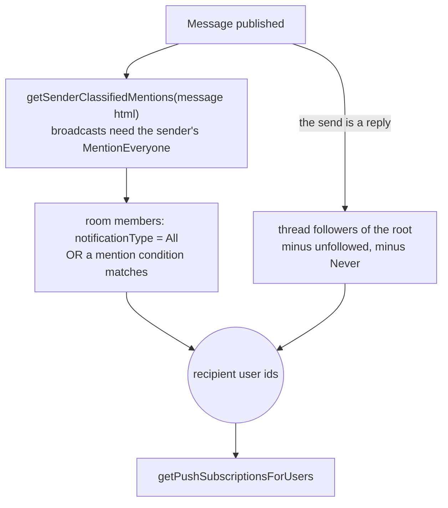

# Push Notifications

Delivery is not this page's subject. Every notification in the repo — a message, a friend request, a reminder, a resource operation — is published once and delivered by one Function ([notifications](../../architecture/notifications/design.md)). What is specific to chat is **who a message reaches**, and that is the one question `ProcessNotification` asks a message-shaped resolver.

The send itself publishes unconditionally: the request path never asks whether anyone is subscribed, so no message send pays a recipient query.

## Recipients



Recipients are resolved as **user ids**, not as device rows, and the devices are looked up once from the union. That ordering is what lets a recipient with no push subscription still receive the surfaces that do not need one, and it is why a follower the room already notifies is de-duplicated by a set rather than subtracted by a query.

`getMessageRecipientUserIds(db, { message, roomId, threadRootId, userId })`:

1. Parse mention `data-id` attributes from the message HTML → split into `regularUserIds | @here | @everyone`, with the two broadcasts dropped unless the sender holds `MentionEveryone`.
2. One SQL query over the room's members:

```text
usersToRooms
  LEFT JOIN userStatuses ON userId   ← always joined (needed for @here)
  WHERE roomId = the message's room
    AND userId != sender
    AND (
      notificationType = All
      OR (DirectMessage AND userId IN regularIds)
      OR (@everyone AND notificationType != Never)
      OR (@here AND notificationType != Never AND status IN (Online, null))
    )
```

`userStatuses` is always left-joined even when there is no `@here` mention, so the query shape stays consistent.

3. When the send is a reply, union in the thread's followers — everyone following the root, minus the replier and minus anyone muted at room level. The follow model and its rules are [thread follows](../thread-follows/design.md).

A webhook message has no sender to exclude, so every `All` member is reached including the app user's own account. It has no sender permission to read either, so its `@everyone` and `@here` reach as they always have. Its room's object publishes the notification once, for the insert: a push is delivered at least once, and a redelivery that finds its message already written publishes nothing.

### `NotificationType` (on `usersToRooms`)

| Value           | Behavior                                   |
| --------------- | ------------------------------------------ |
| `All`           | Notified for all messages in the room      |
| `DirectMessage` | Only when directly `@mentioned` by user ID |
| `Never`         | Muted — no notifications                   |

## Rendering

The notification is shown as its author, resolved at delivery from the ids the event carries: the sender's per-room display name when set ([display names](../display-names/design.md)), otherwise their account name; a webhook message resolves the app user that posted on its behalf. The body is the message's first paragraph as plain text — a send that renders to nothing at all (an attachment-only message) resolves to no notification rather than an empty one.

A reply deep-links to the thread root rather than to itself: the thread is where the reply is read, and it is the one destination that is right for a room member and a thread follower alike.

## The device's subscription

A device is pushed only once its browser holds a subscription the server stored, and a browser grants the permission behind one only from a press. So the ask is the app's own line, as Discord's bar over the app is: `MessageContentPushPermissionAlert` shows above a room while the permission is still unanswered, its **Enable** asks the browser, and closing it is remembered by the browser. Nothing asks on load, which Firefox and Safari ignore and Chrome quiets.

`usePushSubscription` follows the permission live (`usePermission`), so a grant from that line or from the browser's site settings subscribes the device as it happens, and a revoke unsubscribes it. A subscription is bound to the VAPID key it was made under, and a push signed with any other is refused, so one whose key is not the deployment's is replaced rather than registered again — the one case where a device would otherwise stay subscribed and never be reached. `unsubscribe` is idempotent, since the row may already be pruned ([notifications](../../architecture/notifications/design.md)).

The endpoint is the one url the server stores and the jobs worker later POSTs to, so it must be an `https` url on a browser's push service: `PUSH_SERVICE_HOSTS` in `@esposter/db-schema` names them, one per browser, and `isPushServiceEndpoint` is the one check. The subscribe input refuses any other endpoint as an error, and the worker checks each stored endpoint against the same check before it sends, so a row written around the rule is never POSTed to. A signed-in user cannot point the worker at another host.

## Key files

| File                                                                      | Role                                                |
| :------------------------------------------------------------------------ | :-------------------------------------------------- |
| `packages/db/src/services/notification/getMessageRecipientUserIds.ts`     | the room's recipients, thread followers unioned in  |
| `packages/db/src/services/notification/getThreadFollowerUserIds.ts`       | the thread half of that union                       |
| `packages/db/src/services/message/mention/getSenderClassifiedMentions.ts` | broadcasts held to the sender's `MentionEveryone`   |
| `apps/jobs/src/services/notification/resolveNotification.ts`              | the message case — body, deep link, recipients      |
| `apps/web/server/services/message/createUserMessage.ts`                   | publishes one notification per send, reply included |
| `apps/web/app/composables/usePushSubscription.ts`                         | the device's subscription, kept to the permission   |
| `apps/web/app/components/Message/Content/PushPermissionAlert.vue`         | the ask for the permission, from a press            |
