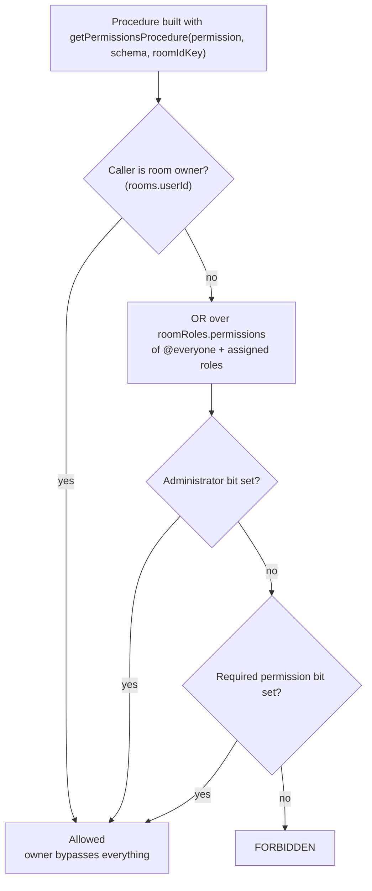

# RBAC

Discord-complexity role-based access control per room. Every privileged operation — moderation, settings, invites, webhooks — is gated through it.

## How it works

Each room has roles (`roomRoles`) carrying a `permissions` **bitfield** of `RoomPermission` flags. The field is read and written as a `bigint` through `createBitfieldColumn`, which stores it as decimal text: a JS number loses bits past 2^53 on the way out of D1, so the column is never read as a number. Since TypeScript enums cannot hold bigints, `RoomPermission` is a `const` object of `1n << n` values. A user's effective permissions are the bitwise OR of the room's `@everyone` role plus every role assigned to them in `usersToRoomRoles`, then their own [overrides](../member-permission-overrides/design.md) are folded in: allowed bits are added and denied bits removed, so a member's row is the last word over their roles and never over Administrator.

The diagram's shape is also the query plan: `checkHasPermission` awaits the owner lookup and only then reads the bitfield, rather than firing both together and picking a winner. Running them in parallel would shave one round trip off the member case, but it would make every owner pay for a role aggregation whose result is discarded — and the callers that reach here most are owners administering their own room, since `getPermissionsProcedure` guards the moderation and settings endpoints. Both reads are indexed single-row lookups against the same connection, so the sequential cost is small and lands on the branch that is about to do more work anyway. Ordering guards cheapest-and-most-decisive first is the rule; `Promise.all` is for reads where every result is used.

Authority is layered: **Owner** (`rooms.userId`, immune to all role manipulation) → **Administrator** permission (all bits, though hierarchy still applies to acting on a member; only ownership sits above it) → explicit permission bits (subject to hierarchy) → `@everyone` baseline. The `@everyone` role is a real `roomRoles` row (`isEveryone = true`, one per room via partial unique index) applied implicitly to every member — it is never stored in `usersToRoomRoles`. `createRoom` seeds it in the same batch as the room.

**Hierarchy** prevents lower roles acting upward: a user's _top position_ is the max `position` across explicitly assigned roles, and role management or member-targeting actions require the actor's top position to exceed the target's. That comparison is the pure predicate `checkIsManageable`, which lives in `shared/` because both the server guards and the client `role` store evaluate it.

**A role is assigned from two surfaces, both over one toggle.** Settings → Members is the list view — pick a member, see every role. The member's own profile card carries the same rows under a `Roles` menu, because the moment someone should be able to do more is the moment you are reading who they are, which is Discord's placement too. Both render `MessageModelRoomRoleMemberListItem` over `useToggleMemberRole`, which reads the actor's own standing from the role store rather than taking it as a prop — a surface cannot hand the toggle a hierarchy it read at a different moment than the guard it is checking.

**The owner is immune as a target, and position cannot express that.** An owner holds no `usersToRoomRoles` row — ownership is `rooms.userId`, not a role — so their top position is the floor every assigned role beats. Ranked on position alone the owner is the _most_ manageable member of their own room, which is why a member-targeting action compares through `checkIsMemberManageable` instead: it answers `actor.isOwner` when the target is the owner, and defers to the position comparison otherwise. A room has exactly one owner, so that first branch is the owner acting on themselves — which is what keeps an owner able to assign themselves a role while nobody else can kick, ban or strip them. The server reaches it through `assertIsManageable`, which resolves both sides against one read of the room and throws `UNAUTHORIZED` when it fails.

Every procedure that names a target member calls that guard, because holding the permission and outranking the target are two different questions: `getPermissionsProcedure` answers only the first. A member-targeting procedure that checks the permission alone is a hierarchy bypass, whatever the permission was.

**Two bits are enforced where a message is created, not at a procedure.** The shared message gate refuses a sender whose roles do not grant `SendMessages` in a room — a direct message has no roles and passes it — after the timeout and before the room's own rules ([moderation](../moderation/design.md) owns that order). Every send, forward and scheduled delivery goes through that gate, and the functions Worker's deliveries run it too, so a procedure guard would leave the consumer's path unchecked. System lines written on a member's behalf through `createSystemRoomMessage`, the join line and the pin line among them, are not messages the member sends, so the `SendMessages` gate does not apply to them. The owner and an Administrator pass it through the same permission read as every other check.

`MentionEveryone` is held where a message's mentions are classified, not where it is sent. `@everyone` and `@here` notify the whole room, so a sender without the bit has the broadcast read as plain text and notifies no one by it; the send itself is not refused. [Mention badges](../mention-badges/design.md) and [push notifications](../push-notifications/design.md) both classify through `getSenderClassifiedMentions`, which holds that one lookup. The composer offers the two only to a member who holds the bit (`getBroadcastMentionItems`), and to any member of a room whose permissions the page has not read yet, such as one made or joined in this session, which the server then judges; but the stored text keeps what was typed, so a broadcast a sender could not make still renders as a mention for every reader and pings no one. Rewriting the text at the send would leave every other path that sends a message unrewritten, where classifying where the notification is made keeps one rule for all of them.

**The bits are ordered by what they are, not by when they were added.** They run in category order — the text-channel permissions, then the room-wide ones, then moderation, then the advanced ones — with `Administrator` last, and adding one in the middle renumbers everything after it. That is only possible because a stored bitfield is read as the current shape rather than migrated ([clean slate](../../architecture/persisted-data-latest-shape-only/design.md)); the alternative, appending each new permission to whatever bit happened to be free, buys nothing here and costs the list its readability.

## Why a bitfield, and what it does not bound

A bitfield bounds **permissions**, never roles. A role is a `roomRoles` row and a grant is a `usersToRoomRoles` row, so a room may hold as many roles as it likes and a member as many of them as they like — the bits are the vocabulary each role draws its grant from, not a per-role slot. Nothing in the model gets tighter as roles are added.

This is the same shape Discord uses, and for the same reason: a room is a **flat scope over a fixed vocabulary**, so a permission check is one aggregate and one `AND` rather than a join per action name. Azure's RBAC solves a different problem — role definitions listing action strings (`Microsoft.Storage/*/read`) evaluated against a scope tree — which is what an open-ended, hierarchical resource surface needs and what a room does not have. Adopting it here would buy a wildcard syntax nobody would write and pay for it in a string match per check.

The one real limit is width: bit 62 is the highest bit the vocabulary uses. The number to watch is how many permissions the vocabulary has, not how many roles a room has. If the vocabulary ever exhausts them, the escape hatch is the read path, not the model: the text column already holds any width, and `createBitfieldColumn` is the one place a wider value would be parsed. Nothing about the roles, the grants or the checks changes with it.

## Data model

| Table                   | Key facts                                                                                                                                                             |
| ----------------------- | --------------------------------------------------------------------------------------------------------------------------------------------------------------------- |
| `roomRoles`             | `roomId` FK, `name`, `color`, `position` (higher = more authority), `permissions` bitfield, `isEveryone`                                                              |
| `usersToRoomRoles`      | `(userId, roomId, roleId)` composite PK — explicit role assignments                                                                                                   |
| `roomMemberPermissions` | `(userId, roomId)` PK — one member's `allow` and `deny` bits, disjoint by the writer rather than a `CHECK`; see [overrides](../member-permission-overrides/design.md) |

## Service layer & guards

The functions are split across three homes by who needs them. The two permission reads live in `@esposter/db`, because the functions Worker evaluates them too; `server/services/room/rbac/` re-exports each as a one-line shim so server code keeps importing them from one place. The pure hierarchy predicate lives in `shared/` so the client can evaluate it without a round trip, and the server-only helpers stay under `server/`.

| Function                                                           | Home                         | Purpose                                            |
| ------------------------------------------------------------------ | ---------------------------- | -------------------------------------------------- |
| `getPermissions(db, userId, roomId)`                               | `@esposter/db`               | bitwise OR of the bitfields, as `bigint`s in JS    |
| `checkHasPermission(db, userId, roomId, perm)`                     | `@esposter/db`               | Owner bypass → Administrator bit → specific bit    |
| `getTopRolePosition(db, userId, roomId)`                           | `server/services/room/rbac/` | Max assigned-role position                         |
| `getRoomMemberAuthority(db, userId, roomId)`                       | `server/services/room/rbac/` | One side of a comparison: top position + ownership |
| `assertIsManageable(db, actorId, targetId, roomId)`                | `server/services/room/rbac/` | Resolves both sides, throws `UNAUTHORIZED`         |
| `checkIsManageable(actorTopPosition, targetPosition, isRoomOwner)` | `shared/services/room/rbac/` | The position comparison itself — no DB access      |
| `checkIsMemberManageable(actor, target)`                           | `shared/services/room/rbac/` | The same comparison plus owner immunity            |

tRPC procedure builders in `server/trpc/procedure/room/`:

| Guard                     | Use                                                             |
| ------------------------- | --------------------------------------------------------------- |
| `getMemberProcedure`      | Caller must be a room member — standard message/room operations |
| `getPermissionsProcedure` | Caller must hold a specific `RoomPermission` — moderation/admin |

**A read is guarded by what it discloses, never by where it is rendered.** [Room settings](../room-settings/design.md) hides a panel the caller lacks the permission for, and that is presentation alone — the procedures behind it stay callable by any member who opens a console. So a read behind a permission-gated panel takes `getPermissionsProcedure` with the permission the panel names: the word filter's list is `ManageRoom` on both the read and the write, because a member who can read the banned words can spell around every one of them. The exception is a read whose data members already see elsewhere — the emoji list feeds the picker, the member list feeds the sidebar — where the panel is a management surface over public-to-the-room data and `getMemberProcedure` is the honest gate.

## Key files

| File                                                                         | Role                                              |
| ---------------------------------------------------------------------------- | ------------------------------------------------- |
| `packages/db-schema/src/schema/message/roomRolesInMessage.ts`                | `RoomPermission` const + roles table              |
| `packages/db-schema/src/schema/message/usersToRoomRolesInMessage.ts`         | Assignment table                                  |
| `packages/db/src/services/room/rbac/`                                        | `getPermissions` + `checkHasPermission`           |
| `apps/web/server/services/room/rbac/`                                        | Server helpers + re-export shims                  |
| `apps/web/shared/services/room/rbac/checkIsManageable.ts`                    | Hierarchy predicate shared w/ client              |
| `apps/web/server/trpc/procedure/room/getPermissionsProcedure.ts`             | Permission middleware builder                     |
| `apps/web/server/trpc/routers/role.ts`                                       | Role CRUD + `readMemberRoles`                     |
| `packages/db/src/services/message/moderation/getMessageCreationRejection.ts` | The message gate, where `SendMessages` is checked |
| `packages/db/src/services/message/mention/getSenderClassifiedMentions.ts`    | Broadcast mentions held to `MentionEveryone`      |

## Notes

- `readMemberRoles` is deliberately a separate procedure from `readMembers` (called in parallel from `useReadMembers`) rather than a join.
- The permissions a new server room's `@everyone` role holds are `DEFAULT_EVERYONE_PERMISSIONS` in `packages/db-schema/src/services/room/constants.ts`, and `createRoom` seeds them.
- **Every server room has an `@everyone` role.** `createRoom` seeds it, and a migration backfills the rooms that predate it, so no server room lacks the row the send gate reads. Backfilling direct messages was rejected: a direct message has no roles by design and its gate skips `SendMessages`, so a row would hand its two members permissions a direct message has never held.
