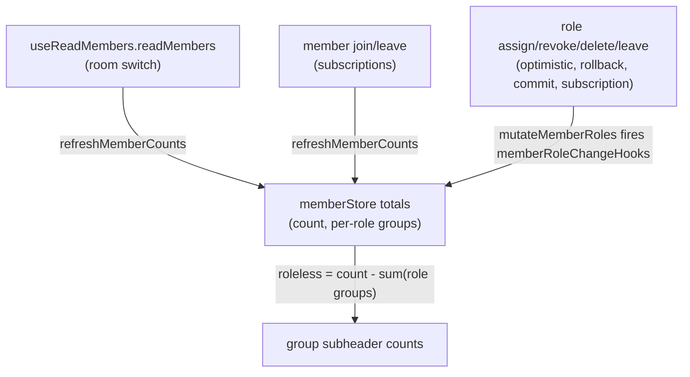
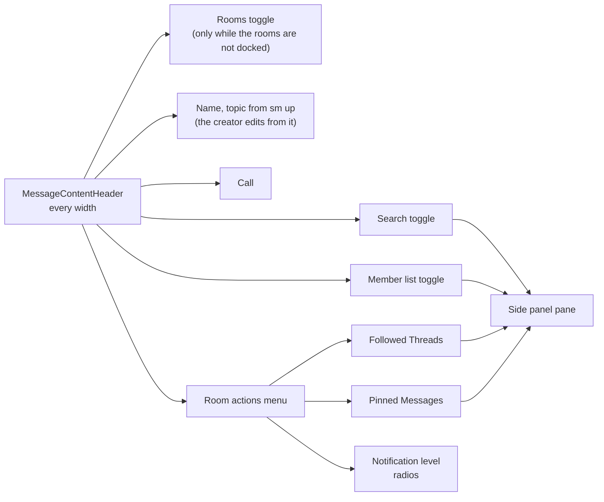

# Room UI

The room shell's polish, matching Discord's refinements. Visual preferences (sidebar widths, message density) are device-local `localStorage`, per the [settings](../settings/design.md) persistence rule; the one exception is category ordering, which is server-persisted through a dedicated `reorderRoomCategories` procedure.

## Role-grouped member list

The member sidebar groups members Discord-style: one group per top hoisted role ordered by role position (highest first), with roleless members trailing in a single "Members" group. A member's display name is tinted with their top role's color; the implicit `@everyone` role never groups or tints. Grouping and top-role resolution are pure services (`getMemberGroups`, `getTopRole`). The rows are built by `getMemberListItems` from those groups, which takes each heading, count and description rule from its own pure service. The list and the description have co-located tests; the heading and the roleless count are tested through the list.

### Group counts

Each group subheader shows the group's **total** member count, not the loaded-page count — the list is cursor-paginated, so counting loaded members would silently undercount. Totals stay correct through three mechanisms, each owning a different change source:

- **Room switch** — `readMembers` re-reads the totals through `refreshMemberCounts`: the total from `room.readMembersCount` and the per-role groups from `room.readMemberCountsByTopRole` (one `DISTINCT ON` query grouping members by their highest-positioned non-`@everyone` role), served by `usersToRoomRoles_roomId_userId_index`, and the member total by `usersToRooms_roomId_index`; the primary key of each table leads with the user, so each room-wide read is served by its own index, ordered with every other re-read of the room.
- **Join/leave** — the totals are never adjusted by a delta: a join or a leave re-reads them, since the server has committed the change before its event is sent. The roleless group is never fetched; it is derived as `count - sum(role groups)` from the two re-read numbers. A leave is also a write of the member's roles (`storeDeleteMember` routes through `mutateMemberRoles` with no roles), so it re-reads through the same hook as a role change. Without the re-read the roleless remainder absorbs every departure of a roled member and goes negative in a room where everyone holds a role.
- **Role changes** — every role-membership write (optimistic apply, rollback, `onSuccess`, and the role subscription handlers) funnels through the role store's `mutateMemberRoles`, which fires `memberRoleChangeHooks` on every write, and the member store re-reads the room's totals for each. The re-read is used rather than a delta because the group a change leaves is not always known here: a member whose roles were never read has no prior role at all. The server filters its own events from the originating device, so a local write also re-reads when it settles, and the echo that does arrive from other devices re-reads again.
- **Ordering** — the re-read rule and its latest-started-wins order are owned by the [client data](../../architecture/client-data/design.md) page ("Server-owned aggregates are re-read, never adjusted"). This page holds only the room's use of it.

#### A failed re-read and the snapshot race

Each room's re-read is one pair: the total and the per-role groups are read together and written only once both return, so a failed read leaves the last settled pair standing. A total is never written beside groups from another read, which keeps the roleless remainder from going negative on a mixed pair.

On failure the batched refresh puts the room back as dirty and retries with exponential backoff, up to the number of retries in a row that `MAX_RETRIES` declares in `apps/web/app/services/shared/createBatchedRefresh.ts`. After that the room waits for the next change to mark it, and that change's re-read is the retry. Until a read settles, the counts show the pre-change pair.

Options rejected for a failed read:

- **Reset the room's totals to zero.** Every group heading would read 0 beside the members listed under it, and the roleless group would show the whole room. The reset shows a count the room does not have, with nothing marking it as unknown.
- **Reset the totals from a fresh read.** A failed read has no value to reset to, and a read that later succeeds is only the retry. A reset to a read the store has not seen settle can drop a change the settled pair already counted, and no event brings that change back.
- **Retry without a bound.** A server that stays down would be read forever. The retry bound and the next change bound it.

The snapshot race is the case where a role event for a loaded member is committed before a re-read but delivered after it, so the change looks counted twice. A double count needs a delta, and no delta is ever applied to these totals ([client data](../../architecture/client-data/design.md)): the event's own re-read reads state at or after the commit, so the change is counted once. What remains is a window. While a re-read is in flight, the counts show the last settled read, and they are exact once the latest re-read settles, because the read ordering in [client data](../../architecture/client-data/design.md) makes that read reflect every change the client has been told of.

Closing that window by numbering the server's member events, so a delta and a snapshot could be ordered, was rejected for size. It needs a server sequence on every join, leave and role event, a protocol change on each subscription that carries them, and an ordering across the subscriptions that feed the counts. That is more change than the window costs.

## Resizable, persisted sidebars

The left (rooms) sidebar and right (members/search/thread) drawer have a drag handle on their inner edge. Widths clamp between the min and max sidebar constants, persist per device in `localStorage` via the message layout store, and feed both the layout's drawer width and the fixed-layout offset styles so the chat content reflows while dragging. Handles render on desktop only — drawers float over content on mobile.

## Message display density

User Settings → Appearance → Message Display offers Discord's Cozy/Compact choice. Compact halves the gap between message batches and the per-message vertical padding so more messages fit on screen. The mode is device-visual state in the appearance store (`localStorage`), consistent with the theme staying on the cookie rather than in `userSettingsInMessage`.

## Empty states

The library's `UiEmptyState` (a mark named by its meaning, a title, a line on how that changes) backs every placeholder: the room list shows "No rooms yet" with a create/join hint when the user has no rooms, message search shows "No results" with a hint to change the keywords or filters when a query matches nothing, and the Drafts & Sent lists say what waits in them once something does.

## One room header at every width

The room header is the same component on a phone and on a desktop, and there is no second bar of buttons above the composer. It holds the room-list toggle while the rooms are not docked, the room's name (the topic beside it from `sm` up), and at its end the call, the search and member-list toggles, and the room's overflow menu. The overflow menu holds what is read now and then — the followed threads and the pinned messages, each opening its pane in the side panel — and the notification level as a group of radios, marked with the level the reader has. Pinned messages are a pane rather than a popover off the header, as Slack's are, so a phone reads them in the same sheet as the members.

Discord keeps a bell of its own in the header; folding it into the menu is the one mark fewer that lets the header fit a phone. The rule the header follows — one presentation per surface, promoted to a device-specific one only by the test in [Responsive layout](../../architecture/responsive/design.md) — is the architecture page's.

## Category drag-reorder

Room categories in the left sidebar reorder by dragging their headers by the UI library's `REORDER_HANDLE_CLASS`, through its [drag reorder](../../architecture/drag-reorder/design.md); the held category wears the library's global `reorder-ghost`, lifted over the others while they move aside for it, as in every reorderable list and table. Touch drags wait the UI library's `TOUCH_DRAG_DELAY_MS`, as a reorderable list's do, so a swipe that starts on a header scrolls the list instead of reordering it. Alt+↑/Alt+↓ on a focused category header moves it without a pointer, through the same `getMovedItems` a reorderable list's keys use. The store applies the new positions optimistically (via [`useMutation`](../../architecture/client-data/design.md)), then persists only the rows whose position changed (`getRoomCategoryPositionUpdates`) through the `reorderRoomCategories` procedure — a single DB transaction, so a drag either fully lands or fully rolls back. `readRoomCategories` orders by `position` first with `name` as tiebreaker, and `createRoomCategory` appends below the existing order (`max(position) + 1`) so a new category never jumps above a drag-assigned top.

## Key files

| File                                                                           | Role                                                          |
| ------------------------------------------------------------------------------ | ------------------------------------------------------------- |
| `apps/web/app/services/message/member/getMemberGroups.ts`                      | Discord-style member grouping by top role                     |
| `apps/web/app/services/message/member/getMemberListItems.ts`                   | The member list's rows, each under its group's heading        |
| `apps/web/app/services/message/member/getMemberGroupTitle.ts`                  | A group's heading: its role's name and how many hold it       |
| `apps/web/app/services/message/member/getRolelessMemberCount.ts`               | The roleless group's count: the total less the role groups    |
| `apps/web/app/services/message/member/getMemberDescription.ts`                 | A row's account name, when the room shows another, and status |
| `apps/web/app/services/message/member/getTopRole.ts`                           | Top hoisted role for grouping + name tint                     |
| `apps/web/app/services/message/member/memberRoleChangeHooks.ts`                | Role store → member store totals re-read hook                 |
| `apps/web/shared/models/db/room/MemberCountByTopRole.ts`                       | Per-top-role count row from the server                        |
| `apps/web/app/store/message/ui/layout.ts`                                      | Persisted sidebar widths + right drawer selection             |
| `apps/web/app/components/Ui/ResizeHandle.vue`                                  | A sidebar's edge, dragged or stepped by the arrows to size it |
| `apps/web/app/store/message/ui/appearance.ts`                                  | Persisted message display density                             |
| `apps/web/app/components/Message/Model/User/Settings/Type/Appearance/`         | Appearance settings panel (Message Display)                   |
| `apps/web/app/components/Ui/EmptyState.vue`                                    | The library's mark/title/description empty state              |
| `apps/web/app/components/Message/Content/Header/Index.vue`                     | The one room header, at every width                           |
| `apps/web/app/components/Message/Content/Header/OverflowMenu.vue`              | The room's occasional panes and its notification level        |
| `apps/web/app/services/message/roomCategory/getRoomCategoryPositionUpdates.ts` | Position diff for category reorder persistence                |

## Notes

- Room drag-reorder (rooms within/between categories) is out of scope — only categories reorder.
