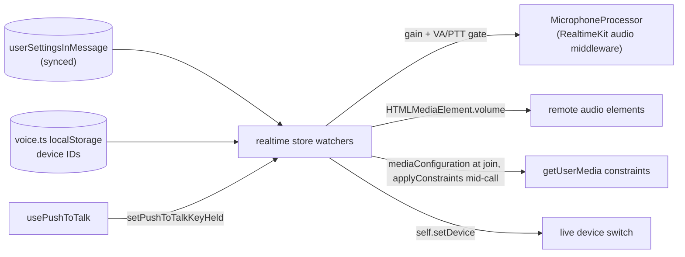

# Voice & Video Settings

The Voice & Video panel of the [user settings dialog](../settings/design.md), aligned with Discord's Voice & Video page. Preferences are DB-backed and sync across devices; only the hardware device IDs stay device-local. The realtime store reads the settings and applies them on join and on live change (reactive watchers).

## Panel structure (top → bottom)

1. **Devices** — Microphone/Speaker selects two-up; Microphone/Speaker Volume sliders two-up; Camera select; Test Mic button + segmented level meter.
2. **Input Profile** — radio: Voice Isolation / Studio / Custom (`noiseSuppressionMode`).
3. **Input Sensitivity** — a gradient slider (yellow→green): the thumb is the activation **threshold**, a darker overlay shows the **live mic level**; a warning + permission link appears when no input device is granted.
4. **Input Mode** (Voice Activity / Push To Talk + keybind + release delay) and **Join Settings** (mute/deafen on join).

## How each setting applies

| Setting                 | Field                             | Applied via                                                                                                                                                                                                                                                                                                   |
| ----------------------- | --------------------------------- | ------------------------------------------------------------------------------------------------------------------------------------------------------------------------------------------------------------------------------------------------------------------------------------------------------------- |
| **Microphone Volume**   | `microphoneVolumePercentage`      | `MicrophoneProcessor` gain in its Web Audio middleware on the local mic — supports >100% boost                                                                                                                                                                                                                |
| **Speaker Volume**      | `speakerVolumePercentage`         | master output: `HTMLMediaElement.volume` on every remote audio element, multiplied per participant by the in-call [per-user volume](../calls/per-user-volume/design.md) (caps at 100% — boosting past it is deferred, see [speaker volume boost](../../../deferred/esbabbler/speaker-volume-boost/design.md)) |
| **Input Profile**       | `noiseSuppressionMode`            | browser-native getUserMedia constraints via `getAudioCaptureDefaults` → the meeting's `mediaConfiguration.audio` at join, `applyConstraints` on the raw mic track mid-call                                                                                                                                    |
| **Input Sensitivity**   | `inputSensitivityDecibels`        | voice-activity gate in `MicrophoneProcessor`: gain → 0 when live dB < threshold (Voice Activity mode only)                                                                                                                                                                                                    |
| **Input mode**          | `voiceInputMode`                  | `VoiceActivity` enables the sensitivity gate; `PushToTalk` gates on the held keybind — [push-to-talk](../push-to-talk/design.md)                                                                                                                                                                              |
| **Default mute/deafen** | `isMuteOnJoin` / `isDeafenOnJoin` | initial mic/deafen state in the join flow                                                                                                                                                                                                                                                                     |
| **Devices**             | `inputDeviceId` etc. (local)      | join: `self.setDevice` before the microphone turns on; mid-call: `self.setDevice` via store watchers                                                                                                                                                                                                          |

## Device selection — single source of truth

The persisted `useVoiceDeviceSettingsStore` (`voiceDevice.ts`, `localStorage`) holds the selected mic/speaker/camera IDs and is the **only** source of truth, so a device picked anywhere is honoured everywhere:

- **Settings panel selects** bind `v-model` directly on the store refs.
- **Mic test** (`useMicrophoneLevel`) and **pre-join preview** (`useCallPreJoinMedia`) build reactive `computed` `useUserMedia` constraints from the IDs — a device change re-requests the right stream immediately.
- **The live call**: `connect` applies the stored input, camera and output picks through `self.setDevice` before the microphone turns on; the in-call picker (`useCallDeviceSettings`) and the `HealthButton` readout bind the same refs.

`realtime.ts` keeps no device refs of its own. `setActiveDevice` writes the store; per-kind watchers hand the picked device to `self.setDevice`, which switches the live device mid-call. The SDK does not write a switch back into the store, so there is no echo to guard against. RealtimeKit also keeps its own copy of each pick under its `Realtimekit::…UserDeviceID` keys, which it reads only when no device has been chosen.

## Input profile (noise suppression)

Browser-native only — **no Krisp** (paid). `getAudioCaptureDefaults` maps the mode to getUserMedia audio constraints: Voice Isolation = `echoCancellation`/`noiseSuppression`/`autoGainControl` all on; Studio = all off (raw mic); Custom = browser defaults, which are on as well. A true ML denoiser would need Krisp and is out of scope.

## Microphone processing — `MicrophoneProcessor`

`models/message/room/call/MicrophoneProcessor.ts` is a RealtimeKit audio middleware. RealtimeKit calls it with a new audio context on each run of its audio pipeline (on enable and on a device switch) and sends the node it returns in place of the raw microphone. The processor adds its gate module to that context (`workers/message/room/call/microphoneGate.worklet.ts`, bundled by Vite's `?worker&url`) and returns an `AudioWorkletNode` running `MicrophoneGateProcessor` on the audio thread. The gate reads each 128-frame render quantum before the gain applies, computes the live dB level to drive the gate, and writes the block at `microphoneVolumePercentage / 100` or silence. Its four settings travel as `MicrophoneGateSettings` over the node's port: each setter on the processor posts the current set, and a node built later is sent the set it starts with. Until the first set arrives the gate writes silence. The gate source follows `voiceInputMode`: the dB threshold in Voice Activity, the held keybind (`isPushToTalkKeyHeld`) in Push To Talk — see [push-to-talk](../push-to-talk/design.md).

There is **no** shared "speaking indicator analyser" to reuse — in-call active-speaker state comes from RealtimeKit's `activeSpeaker` event, which names one remote speaker and fires when the speaker changes. The local microphone is not marked as speaking, and a speaker who falls silent stays marked until the next speaker starts. Local level analysis (panel meter + processor gate) is its own Web Audio graph; the panel meter uses the separate read-only `useMicrophoneLevel` composable.

## Key files

| File                                                                   | Role                                                                                      |
| :--------------------------------------------------------------------- | :---------------------------------------------------------------------------------------- |
| `packages/db-schema/src/schema/message/userSettingsInMessage.ts`       | fields + `NoiseSuppressionMode` enum + check constraints                                  |
| `apps/web/app/components/Message/Model/User/Settings/Type/Voice/`      | the panel: `Devices/`, `Volume/`, `MicrophoneTest/`, `InputProfile/`, `InputSensitivity/` |
| `apps/web/app/composables/message/user/settings/useMicrophoneLevel.ts` | read-only mic level for the panel meters                                                  |
| `apps/web/app/models/message/room/call/MicrophoneProcessor.ts`         | RealtimeKit audio middleware: builds the gate's AudioWorkletNode and posts its settings   |
| `apps/web/app/models/message/room/call/MicrophoneGateProcessor.ts`     | the gain + voice-activity/push-to-talk gate on the audio thread                           |
| `apps/web/app/workers/message/room/call/microphoneGate.worklet.ts`     | the worklet entry that registers `MicrophoneGateProcessor`                                |
| `apps/web/app/composables/message/room/call/usePushToTalk.ts`          | hold-to-talk key listeners (hosted by the call store + PiP host)                          |
| `apps/web/app/services/message/room/call/getAudioCaptureDefaults.ts`   | noise-suppression mode → getUserMedia constraints                                         |
| `apps/web/app/store/message/room/realtime.ts`                          | speaker volume, noise mode, mic processor; `setActiveDevice` + device watchers            |
| `apps/web/app/composables/message/room/call/useCallPreJoinMedia.ts`    | pre-join preview — reactive constraints from device IDs                                   |
| `apps/web/app/composables/message/room/call/useCallDeviceSettings.ts`  | in-call device picker                                                                     |

## Unverified

The live audio path (mic gain, voice-activity/push-to-talk gating, noise-suppression modes) has only ever been exercised single-party — one browser, no remote peer. The RealtimeKit path (the middleware's gate, noise modes applied to a live track, device switching) has not yet been run in a browser at all. Nothing above is proven against a real two-party call, so treat the applied-behaviour column as intent rather than observed fact until someone runs one.
