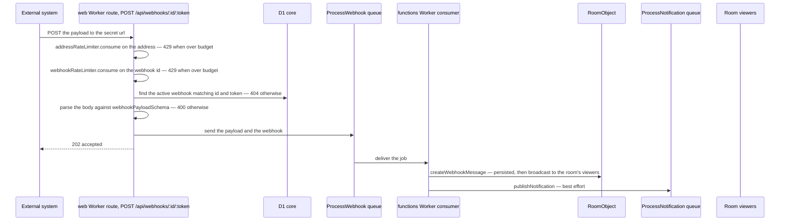

# Webhooks

A webhook lets an external system post a message into a room without a user account. A member with the `ManageWebhooks` permission creates one from room settings, copies the secret url it produces, and anything that can send an HTTP request can then speak in that room. The message arrives under a **bot identity** of its own rather than under the creator's name, and is marked as such in the message list.

This page is about **inbound** webhooks only. Posting room events out to a user-registered endpoint is a separate, unbuilt idea — see [outbound webhooks](../../../deferred/esbabbler/outbound-webhooks/design.md).

## Data model

Two tables, one-to-one. `webhooksInMessage` holds the room membership and the secret: `roomId`, `creatorId` (the member who made it), `token`, an `isActive` switch, a display `name`, and a `userId` that is `unique` and references the second table. `appUsersInMessage` is the bot identity — nothing but `id`, `name` and `image`. Separating them is what lets a webhook message carry an author at all: the identity is a row a message can point at, so rendering does not have to special-case "no user".

The pairing is enforced by construction. `createWebhook` inserts both rows in one batch, and `deleteWebhook` deletes the app user, which cascades the webhook away with it. A room may hold up to `WEBHOOK_MAX_LENGTH` webhooks (declared in `apps/web/shared/services/message/constants.ts`), checked inside that same batch.

## Delivery

The url a member copies points at the **app**, at the web Worker's own route `POST /api/webhooks/:id/:token` in `server/api/webhooks/[id]/[token].post.ts`, with no forwarder in between. The route validates the two route parameters against the schema shapes, spends a point from the address budget and then from the per-webhook budget, both described in [rate limiting](../../architecture/rate-limiting/design.md), and answers each refusal with its own status. Keying the budget on the webhook id rather than on a caller is the point — a webhook is a machine identity, and one misconfigured integration should exhaust only its own allowance. The id is still the caller's to choose, though, so the address is spent first: without it, every id matching no webhook would arrive with a fresh allowance and nothing would cap the route across ids.

**The token in the url is the credential**: the route looks for a webhook row whose id and token both match and whose `isActive` is true, and answers 404 when there is none — an inactive webhook and a wrong token are indistinguishable from outside. It then parses the body against `webhookPayloadSchema` (a Discord-shaped `content` / `username` / `avatar_url` payload with `content` required — and sanitized by `sanitizeTextHtml` before its length bound applies, since it renders as message markup like every other body — and strict: a key it does not declare fails the request with 400 — Discord's `embeds` among them, beside `content` or alone, since a message has nowhere to store one and a field accepted but never stored would be dropped silently). The payload is checked before anything is queued, so a malformed one is answered with its status rather than failing its job. The route then sends one `ProcessWebhook` job and answers 202 without waiting for the message to exist. Every string in the payload carries a length, `avatar_url` included, which a test over the schema's JSON Schema holds (`apps/web/server/services/request/webhookPayloadSchema.test.ts`). That split is deliberate: the sender gets a fast, cheap acknowledgement, and the work that can fail happens behind the queue.

The job is not idempotent, so its queue does not retry it: each accepted push is delivered once. `ProcessWebhook` turns the payload into a `MessageType.Webhook` message — the payload's `username` and `avatar_url` override the stored bot name and image for that message — and calls the room's object to persist it, which broadcasts the message to the room's viewers as part of the same call. It then sends a [push notification](../push-notifications/design.md) job titled with the bot's name. The notification is best-effort, as [persist then notify](../../architecture/persist-then-notify/design.md) requires of every step after the write.

## Rendering

`MessageComponentMap` points `MessageType.Webhook` at the ordinary message component — a webhook message is a message, not a distinct surface. What differs is authorship. `WebhookMessageEntity` carries an `appUser` instead of a `userId`, `useCreator` resolves the author from the app-user store merged over the identity embedded in the message, and an "app" badge renders beside the name. Grouping consecutive messages compares the app user's id rather than a user id, and [thread follows](../thread-follows/design.md) skip the root-author follow entirely for these messages because there is no user to follow.

## Procedures

All webhook procedures live in the `webhook` router.

| Procedure       | Auth             | Purpose                                                           |
| --------------- | ---------------- | ----------------------------------------------------------------- |
| `createWebhook` | `ManageWebhooks` | creates the app user and the webhook together, on the slow budget |
| `readWebhooks`  | `ManageWebhooks` | lists a room's webhooks with their tokens                         |
| `updateWebhook` | `ManageWebhooks` | renames a webhook or toggles `isActive`                           |
| `rotateToken`   | `ManageWebhooks` | mints a new token, invalidating the old url                       |
| `deleteWebhook` | `ManageWebhooks` | deletes the app user, cascading the webhook                       |
| `readAppUsers`  | room member      | resolves bot identities for rendering the message list            |

`createWebhook` is the one procedure on the slow rate-limit budget, because it is the only one that mints a credential. `readAppUsers` is deliberately open to any member: rendering a room's history requires the identities of everything that has spoken in it, while the tokens stay behind the permission gate.

## UI

The webhook surface is the **Integrations → Webhooks** tab of the [room settings](../room-settings/design.md) dialog, permission-gated like every other tab there. **New Webhook** creates the row outright, named `DEFAULT_WEBHOOK_NAME` — Discord's arrangement, and the reason the panel holds no create form: the name is the only thing a create could ask for, and the row it lands on already renames it. Each row is an inline-editable name, a copy button for the full url, rotate and delete buttons, and an active switch. Rotating is the revocation story — the url is a bearer credential, so the answer to a leak is a new token rather than an access list.

## Key files

Paths are relative to `apps/web`, except those under `apps/functions/` and `packages/`, which are relative to the repository root.

| File                                                                  | Role                                                                                |
| --------------------------------------------------------------------- | ----------------------------------------------------------------------------------- |
| `packages/db-schema/src/schema/message/webhooksInMessage.ts`          | the webhook row — room, creator, token, active flag                                 |
| `packages/db-schema/src/schema/message/appUsersInMessage.ts`          | the bot identity a webhook message is authored by                                   |
| `packages/db-schema/src/models/message/webhook/WebhookPayload.ts`     | the accepted request body                                                           |
| `packages/db-schema/src/models/message/WebhookMessageEntity.ts`       | message entity carrying `appUser` in place of `userId`                              |
| `server/trpc/routers/webhook.ts`                                      | create, read, update, rotate, delete, and identity lookup                           |
| `server/api/webhooks/[id]/[token].post.ts`                            | the public url — rate limits, token and payload checks, then the ProcessWebhook job |
| `apps/functions/src/handlers/processWebhookHandler.ts`                | the ProcessWebhook job — message creation on the room, push notification job        |
| `apps/functions/src/services/message/getWebhookCreateMessageInput.ts` | payload to `MessageType.Webhook` message input                                      |
| `app/store/message/room/webhook.ts`                                   | client store for the settings tab                                                   |
| `app/store/message/user/appUser.ts`                                   | cache of bot identities for the message list                                        |
| `app/composables/message/room/useCreator.ts`                          | resolves a message's author, app user or user                                       |
| `app/components/Message/Model/Room/Settings/Type/Webhook/Index.vue`   | the Integrations tab content                                                        |
| `app/components/Message/Model/Message/AppUserBadge.vue`               | the "app" badge on a webhook message                                                |
