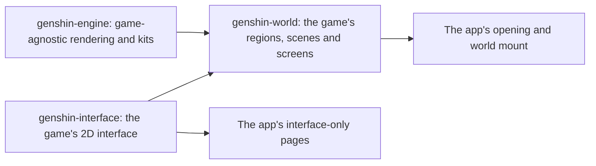

# Genshin

Genshin Impact's continent is being rebuilt in the app as a fan work, walkable at the game's own scale and in its anime look. `/genshin` plays it as the game does: the opening, then the world full screen, with nothing over it (the [agent console](../infra/claude-interface/agent-console/README.md) is hidden from it until it is rebuilt in the game's style). The world is drawn by `genshin-engine`, a published package of plain TypeScript and TSL modules that knows no place by name. The game's world on it is `genshin-world`, a published package holding the catalogue, each region's data (its heights, colours, landmarks and look) and the TresJS components that build it. The game's 2D interface is `genshin-interface`, a published package of presentational Vue components with no three.js in it, which the world's screens are built from. The app keeps only the game's two pieces: `apps/web/app/components/Genshin/Index.vue`, the opening over the world loading behind it, and `Genshin/World.vue`, the world's screen (`WorldScreen`, which owns its canvas), loaded lazily so the opening shows at once, which hands the world what only the app can: the terrain worker its bundler builds, the URL its server serves region data at, and whether the tuning panel shows.

- **Three packages, split by what a page loads.** A page that shows only interface loads `genshin-interface` and no three.js; the engine knows no place by name; the world is everything that is the game's own. A fourth package for assets was rejected: nothing taken from the game is committed, so it would hold nothing.

It is unofficial and non-commercial, and makes no claim to be HoYoverse's. No model, texture, sound or image file is taken from the game: every world asset is generated by our own code at measures taken off the game, and the interface's glyphs are traced from the game's marks into paths of our own ([derived assets](derived-assets/design.md)).

## Key concepts

- **Windrise is the first scene.** Every scene starts in the Windrise the [rendering style](rendering-style/design.md) page describes, loaded at three in the afternoon. Every engine page is first shown there.
- **Light is shared uniforms.** Every material reads one set of light uniforms, and the fog one set of fog uniforms, so the hour and the weather will move the whole world by writing a few values.
- **A quality tier removes cost, never the style.** What a tier trims and what it keeps is set on the [rendering style](rendering-style/design.md) page.

## The pages of this area

| Page                                                   | What it covers                                                                                                                                                                   |
| :----------------------------------------------------- | :------------------------------------------------------------------------------------------------------------------------------------------------------------------------------- |
| [Engine architecture](engine-architecture/design.md)   | the engine as modules with one job each, and the order a frame runs in                                                                                                           |
| [Rendering style](rendering-style/design.md)           | the toon materials, outlines, cascaded shadows, god rays, fog, grade and AA                                                                                                      |
| [Sky and time](sky-and-time/design.md)                 | the twenty-four-minute day, the painted sky, and the light it casts                                                                                                              |
| [Weather](weather/design.md)                           | each area's weather, blended as it changes: rain, snow, fog, sand, lightning and wet ground                                                                                      |
| [Terrain](terrain/design.md)                           | the ground on a streamed CDLOD quadtree, morphing between levels, and the floating origin                                                                                        |
| [Terrain shape height](terrain-shape-height/design.md) | a ground's height as hills over a base, the sharp features they smear, and a fine residual                                                                                       |
| [Ground paint](ground-paint/design.md)                 | the ground painted in layers of grass, earth, sand, snow, path and rock, where a field fitted to the terrain's base maps lays them                                               |
| [Water](water/design.md)                               | still water graded by depth, foam, glints, caustics, and the world under the surface                                                                                             |
| [Flowing water](flowing-water/design.md)               | rivers along their courses with foam on their bends, and waterfalls over cliffs                                                                                                  |
| [Vegetation](vegetation/design.md)                     | the wind field, grass blades generated in two rings, and swaying crowns                                                                                                          |
| [Trees](trees/design.md)                               | tree species, each drawn as its mesh near the eye and a baked impostor far from it                                                                                               |
| [Scatter](scatter/design.md)                           | the flowers no record places, scattered on each finest tile in the terrain's worker                                                                                              |
| [World map](world-map/design.md)                       | the catalogue of regions, areas and subareas, and region data loaded by reach                                                                                                    |
| [Region buildings](region-buildings/design.md)         | each region's capital built by its own kit, on the world's one ground with every region's laid over                                                                              |
| [Buildings](buildings/design.md)                       | the generic kit: a platform, four walls and a flat or conical roof, one geometry from its options                                                                                |
| [Mondstadt buildings](mondstadt-buildings/design.md)   | Mondstadt's timber-framed house over a stone ground floor, under a steep gable                                                                                                   |
| [Liyue building kit](liyue-building-kit/design.md)     | Liyue's terrace, lacquer columns and lattice under tiers of upturned eaves, and its palette                                                                                      |
| [Inazuma](inazuma/design.md)                           | Inazuma's post-and-beam kit with deep eaves, its island palette and its region data                                                                                              |
| [Sumeru kits](sumeru-kits/design.md)                   | Sumeru's terraced rainforest city, its stilt hut and its desert ruins                                                                                                            |
| [Nod-Krai's kits](nod-krai-kits/design.md)             | Nod-Krai's dieselpunk works and the Frostmoon Scions' stone rings                                                                                                                |
| [Snezhnaya](snezhnaya/design.md)                       | Snezhnaya's industrial and capital halls and the Kresnik's Torch                                                                                                                 |
| [Character controller](character-controller/design.md) | the body walked through the game's movement states on its stamina, against the ground and the landmarks                                                                          |
| [Follow camera](follow-camera/design.md)               | the camera behind the character, pulled in by the ground and the landmarks, and the pointer's lock                                                                               |
| [Free camera](free-camera/design.md)                   | the tuning panel's camera in photo mode, flown with the keys, the pointer and a gamepad above the ground                                                                         |
| [Controls](controls/design.md)                         | the game's default key, mouse and gamepad bindings, read once a frame into the actions held and pressed                                                                          |
| [Screens](screens/design.md)                           | the screens opened over the world one at a time, what each holds                                                                                                                 |
| [Paimon menu](paimon-menu/design.md)                   | the pause menu over the world, its contents and side bar in the game's order, the entries of unbuilt screens disabled, and the quit prompt                                       |
| [Load budget](load-budget/design.md)                   | what a screen loads before it shows, each load step measured as `genshin:load:<step>` and each screen held to its budget by `genshin:parity load`                                |
| [Map](map/design.md)                                   | the map on M at full screen, dragged to pan and zoomed by the wheel or slider, its keyboard jump list, and a jump's fade to black and back                                       |
| [Minimap](minimap/design.md)                           | the HUD's corner map, the map's drawing cut to a circle round the camera and turned with it                                                                                      |
| [Map unlocking](map-unlocking/design.md)               | a Statue of The Seven resonated with on F, its area filled in on the map and minimap, and only the unlocked statues offered as jumps and revives                                 |
| [Statues of The Seven](statues-of-the-seven/design.md) | a region's levels and rewards from the game's table, the stamina they raise to 240, and the Blessing's pool and heals, not yet on a screen                                       |
| [Offering systems](offering-systems/design.md)         | the offering rule, each held item offered to its levels, and the Frostbearing Tree in Dragonspine with its levels and saved progress                                             |
| [HUD](hud/design.md)                                   | the heads-up display's Paimon button, minimap, quest tracker, stamina meter, party, health and skill and burst buttons, and hiding it                                            |
| [Touch controls](touch-controls/design.md)             | the stick at the bottom left, the look anywhere else and the jump button, fed into the one input                                                                                 |
| [Enemies](enemies/design.md)                           | enemy kinds and their stats, their AI and camps, respawn and drops, struck by the kit and drawn as stand-in capsules                                                             |
| [Adventure Rank](adventure-rank/design.md)             | the rank to 60 on the game's table, held at the ascension quests, the World Level and its lowering, and the enemies it raises                                                    |
| [Original Resin](original-resin/design.md)             | resin regenerating to 200 from its last change, refilled from Primogems at daily prices, and a blossom's ways to pay, Condensed Resin included                                   |
| [Save data](save-data/design.md)                       | one save blob per signed-in player under a session lease, every write conditional on the blob's ETag                                                                             |
| [Domains](domains/design.md)                           | each kind's opening by Adventure Rank, and by the day: Blessing every day, Forgery and Mastery on Sundays and their set days                                                     |
| [Ley line outcrops](ley-line-outcrops/design.md)       | each region's two blossoms read from the game's tables, opened by Adventure Rank and a nation's area, started and moved on along their places                                    |
| [Bosses](bosses/design.md)                             | a normal boss back five seconds after its Trounce Blossom's claim, and the weekly claims counted from the Monday 04:00 reset in the reader's zone                                |
| [Combat](combat/design.md)                             | auras and reactions in the game's priority, the damage formula, internal cooldown, shields and energy, and the Traveler's kit's hits                                             |
| [Character kits](kits/README.md)                       | each playable character's skill sets from the game's tables, the Traveler's kit in its own module reading its multipliers from the proud skill table                             |
| [Characters](characters/README.md)                     | the official MMD packs read by our own PMX reader and drawn in the game's character shader, with their terms                                                                     |
| [Character attributes](character-attributes/design.md) | the roster, weapons and artifacts from the game's tables, and a character's attributes summed as the game sums them                                                              |
| [Artifact enhancement](artifact-enhancement/design.md) | an artifact rolled from its slot's pool and the rarity's minor affixes, enhanced with Artifact EXP at a Mora a point, and locked against fodder                                  |
| [Weapon enhancement](weapon-enhancement/design.md)     | a weapon levelled from ores and fodder at Mora, ascended at each phase's cap, and refined from a copy or a material, its passive waiting on the kits                             |
| [Talents](talents/design.md)                           | each combat talent levelled from 1 to 10 by the game's table, each level paid in Mora and materials at its phase, and the passives each phase opens                              |
| [Constellations](constellations/design.md)             | each playable character's six constellations from the game's table, activated with its own Stella Fortuna, and the talent its third and fifth raise                              |
| [Companionship](companionship/design.md)               | each character's Friendship Level from total Companionship EXP and the level table, the level-10 namecard and the claim's grant; the Pot dialogue and namecard art not yet built |
| [Reputation](reputation/design.md)                     | Mondstadt's levels, requests, thresholds and bounties from the game's table, the EXP carried up each level; nothing yet on a screen                                              |
| [Character screen](character-screen/design.md)         | the C screen's frame, its six tabs in the game's words, and the Attributes tab's level and attributes                                                                            |
| [Character profile](character-profile/design.md)       | each character's stories from the fetter table in every language, opened at its Friendship Level and locked until then                                                           |
| [Party](party/design.md)                               | the teams and the one deployed, switched on 1 to 4 past the one second cooldown or a burst on Left Alt, each team with its own HP, energy and cooldowns                          |
| [Interaction](interaction/design.md)                   | the F prompts over the world: the drops and talks in reach nearest first, F picking up or talking, the wheel and a held F's repeat                                               |
| [Elemental Sight](elemental-sight/design.md)           | the range that spreads from the character, the world muted and what matters lit, enemies' colours and names                                                                      |
| [Inventory](inventory/design.md)                       | the bag's nine tabs, stacks, room and sorts, the wallet's currencies, the screen on B and the destroy rule                                                                       |
| [Gadgets](gadgets/design.md)                           | the widget config's gadgets by kind with their cooldowns and cooldown groups; nothing yet equipped or used                                                                       |
| [Wish](wish/design.md)                                 | the standard and beginners' pools, the rates, pity and guarantees, Capturing Radiance, the Epitomized Path and returns, and its screen on F3                                     |
| [Dialogue](dialogue/design.md)                         | a talk's graph of lines and replies, its runner, the dialogue screen with auto-play and skip, and the residents' standing talks offering their open quest talks                  |
| [Resident schedules](resident-schedules/design.md)     | a resident's day and night spots, the one the clock gives at the hour, held while they are in view at its turn                                                                   |
| [Quests](quests/design.md)                             | the quests' kinds, steps and objectives, their progression, the quest screen, navigation and the reader                                                                          |
| [Adventurer Handbook](adventurer-handbook/design.md)   | F1's book and its six tabs, their pages waiting on what they track                                                                                                               |
| [Genius Invokation TCG](genius-invokation/README.md)   | the card game's rules engine, the tutorial's and the early challengers' decks, and the duel board: a duel's dice, round, skills, cards, reactions and outcome                    |
| [Parity](parity/README.md)                             | matching a screen to the game's: references, tracing, scoring, motion and the visual suite                                                                                       |
| [Game reading](game-reading/design.md)                 | a question's route through the game's own files: its source, the machine that reads it, a shader's port through equations, and what stays local                                  |
| [Scene derivation](scene-derivation/design.md)         | how the game's own assets are re-derived into a scene, each loss priced first                                                                                                    |
| [Derived assets](derived-assets/design.md)             | which reference each part is measured from, how it becomes ours, and each part's progress                                                                                        |
| [Spawned places](spawned-places/design.md)             | the official map's statues and waypoints fitted to the scene's transport points, each region's Oculi written into its slice                                                      |
| [Scene groups](scene-groups/design.md)                 | the open world's scene group record, each group's NPCs, viewpoints and quest triggers and the scene's building points, each field naming its source                              |
| [Chests](chests/design.md)                             | the official map's chests fitted into each region as five tiers and the buried and sealed places; opening pays three tiers                                                       |
| [Puzzles](puzzles/README.md)                           | the official map's puzzle marks fitted into each region by kind, and the state machines of three puzzle kinds; none placed in the world yet                                      |
| [Gathering](gathering/design.md)                       | the official map's plants and specialties fitted into each region, bar five not yet typed; respawns and ores not yet                                                             |
| [Mining outcrops](mining-outcrops/design.md)           | the Adventure Rank 30 that opens them, and a mined outcrop back at the next 06:00 draw in the game's time zone; their places and draw not yet                                    |
| [Investigation](investigation/design.md)               | the daily cap of a hundred investigations, after which no more spots spawn; the spots and their rewards not yet                                                                  |
| [Exploration progress](exploration-progress/design.md) | the map's area labels with each area's percentage in the game's own line once a statue is unlocked, Galesong Hill first, its scale provisional                                   |
| [Crafting](crafting/design.md)                         | the bench's tiers, potions, baits, Condensed Resin and gadgets from the combine table, learned and paid from the bag and wallet; nothing yet placed                              |
| [Cooking](cooking/design.md)                           | the dishes cooked by hand to a quality and a proficiency, Auto Cook, the special dishes and the processings queued over real time; nothing yet placed                            |
| [Forging](forging/design.md)                           | the blacksmith's enhancement ores and four-star weapons from their billets, queued by rank over real time, and the forge points held to their cap                                |
| [Spiral Abyss](spiral-abyss/design.md)                 | the tower's floors and chambers from its tables, each chamber cleared on one shared clock, stars kept as the best; no enemies or screen yet                                      |
| [Imaginarium Theater](imaginarium-theater/design.md)   | the season's difficulties and their level floors, Vigor and readiness, Blessing Level and its stats; the cast, acts and screen not built yet                                     |
| [Achievements](achievements/design.md)                 | the game's achievements counted off their quest triggers and paid in Primogems, their tiers chained, and the Achievements screen by category                                     |
| [Archive](archive/design.md)                           | the codex's seven sections from the game's tables in every language, entries opened as items are taken in, and the Books reader                                                  |
| [Serenitea Pot](serenitea-pot/design.md)               | the realm's rules: furnishings made from blueprints in one queue per Trust Rank, Trust EXP, Adeptal Energy and stores; nothing placed yet                                        |
| [Shops](shops/design.md)                               | Paimon's Bargains' Fates and the Mondstadt grocery's goods, from the game's shop table, restocked daily or monthly; nothing yet on a screen                                      |
| [Expeditions](expeditions/design.md)                   | Mondstadt's expedition places sent for 4 to 20 hours, returned on the moment they left and claimed for items and Mora, nothing yet on a screen                                   |
| [Commissions](commissions/design.md)                   | Mondstadt's daily tasks dealt four a day from the areas reached, each claimed for its rank's reward; nothing yet on a screen                                                     |
| [Wildlife](wildlife/design.md)                         | the official map's fleeing birds and beasts stood in Windrise's scene and running from the character in reach, nothing struck or dropped yet                                     |
| [Fishing](fishing/design.md)                           | the official map's fishing points by region, the fish, rods and pools from the game's tables, each stock refilled after seventy-two hours; nothing cast yet                      |
| [Interface library](interface-library/design.md)       | `genshin-interface`: the game's screen root, units, pointer, and the pieces its screens share                                                                                    |
| [Interface layout](interface-layout/design.md)         | every screen laid out from the game's own RectTransform tree, nothing by hand                                                                                                    |
| [Title splash](title-splash/design.md)                 | the game's title logo as each language's client draws it                                                                                                                         |
| [Login screen](login-screen/README.md)                 | the opening's login: its stages, its flight, its scene and its door                                                                                                              |
| [Music](music/README.md)                               | the game's music re-derived from its sound banks and played by the engine's synthesizer                                                                                          |
| [Sampled instruments](sampled-instruments/design.md)   | public-domain recordings layered over a piece's voices where they bring it nearer the game                                                                                       |
| [Sound effects](sound-effects/design.md)               | the game's sounds beside its music, found by a recording and played as our own noise                                                                                             |
| [Game data formats](game-data-formats/design.md)       | how each kind of the game's data reads, and the shortcuts to reach for first                                                                                                     |
| [Game text](game-text/design.md)                       | `genshin-text`: every language the game ships, and its strings by the game's own text id                                                                                         |
| [Hosted game data](hosted-game-data/design.md)         | every dataset the world reads, published to Blob storage under a committed lock of hashes and fetched at the world's gate                                                        |
| [Compute queue](compute/README.md)                     | the runs owed on the parity work, one page per area, each an item a runner takes once its calls are made                                                                         |

What is still to build is the [Genshin proposal](../../changes/genshin-program/design.md), and the open work on what is built is the [roadmap](../../changes/genshin-roadmap/tasks.md). Decided ideas: [deferred](../../deferred/genshin/) and [rejected](../../rejected/genshin/).

## Shipped

- The engine as a package of single-purpose modules under the world package, each module added by the page that first needs it.
- The rendering style, in the Windrise scene, replacing the console's voxel world.
- The sky and the game's day over it.
- The terrain, streamed and morphing, in place of Windrise's one fixed heightfield.
- Still water, first in the lake east of Windrise.
- The wind, and grass generated around the camera.
- The world map's catalogue, and Mondstadt's landmarks loaded by reach.
- The free camera flying the world, on the engine's input, simulation, camera and collision modules.
- The character walking the world on the controller's body through the game's movement states and stamina, the follow camera behind it, photo mode's orbit round it, and the free camera kept for the tuning panel.
- Scene derivation: every scene re-derived from the game's own exports, drawn beside them by the witness render and priced term by term.
- The game's opening: its splashes, health notice, login screen with its flight to the door, and startup loading screen.
- The game's own words in its fifteen languages, served to the page in the reader's and to the persona plugin.
- The login's music, its second piece played with public-domain recordings layered over the synthesizer.
- The game's default controls, and its screens opened over the world from them and from the Paimon menu, an unbuilt screen a placeholder under its title.
- The map on M with its jump list, a jump fading to black and back, the HUD's shell with its minimap, and the touch controls.
- Map unlocking's statues: resonating with a Statue of The Seven on F fills its area in on the map and minimap, and only the unlocked statues are jumps and places to revive.
- Enemies: kinds read from the game's tables, an AI on the fixed step, camps, respawn and drops, drawn as capsules.
- Characters read from HoYoverse's official MMD packs by the engine's own PMX reader and drawn at rest in the game's character shader.
- Combat's rules as pure, tested functions: auras and reactions, the damage formula, internal cooldown, shields and energy.
- The party switched on 1 to 4, the character screen on C, and a character's attributes summed from the game's own tables.
- An artifact rolled by the game's pools and the wiki's weights, enhanced with Artifact EXP at a Mora a point, its fodder and its locks as the game keeps them.
- The F prompts' rules, the bag and its wallet on B, and the wish's published rules with its screen on F3, offering the standard and beginners' wishes from their pools.
- Original Resin: its count regenerating while the page is closed, its refills from Primogems at the game's daily prices, a claim's price and Adventure EXP, and its counter on the map's top bar.
- Ley line outcrops: each region's Revelation and Wealth read from the game's tables, their openings by rank and nation, a drawn start and the move along their places, with the touch and the claim still unbuilt.
- Mining outcrops and investigation spots: the rank that opens the outcrops, their 06:00 respawn after a mining, and the daily cap of a hundred investigations, as pure rules, with their places, draw and rewards unbuilt.
- Constellations: each character's six from the game's table, activated with its own Stella Fortuna, which a duplicate draw brings and a five-star past six a Masterless one.
- Companionship: each character's Friendship Level from total EXP and the level table, with the grant at provisional amounts; the namecard view not yet drawn.
- Elemental Sight: the range from the character to its reach, the world muted outside what is lit, interactables white, enemies in their element's colour and named, ended by a short walk.
- The official map's statues and waypoints read and fitted to the scene's transport points, each region's Oculi checked against the wiki's.
- The official map's puzzle marks fitted into each region's slices by kind, and the Elemental Monument's state machine: lit by its element or a reaction of its own, a timed one going out after its time, and a puzzle of monuments solved once all are lit together.
- Paimon's Bargains' Fates and the Mondstadt grocery's goods, bought from the shop table, with buy limits restocked on their refresh.
- Mondstadt's Reputation: its levels, requests, thresholds and bounties from the game's table, with no keeper or screen yet.
- Expeditions: Mondstadt's places sent and returned on the moment they left, claimed for their items and Mora, recalled for nothing, and the limit raised by rank, with Katheryne and the screen not yet built.
- Commissions: Mondstadt's daily tasks dealt from the areas reached and claimed for their rank's reward, the handbook tab and the kept day not yet built.
- The official map's fleeing birds and beasts, White Pigeon, Crimson Fox and Squirrel, stood in Windrise's scene and running from the character in reach, on provisional flight numbers, with no strike, drop or pick-up yet.
- Fishing's points fitted by region, its fish, rods and pools read from the game's tables, and its rules for a stock's day and night and refill, a draw, a lure's reaction and the reel's tension, with nothing cast or on a screen yet.
- Hosted game data, first phase: the character profiles and book bodies published to Blob storage by a keyless publisher and read on the Profile tab and in the book reader, so the package no longer bundles their generated JSON.
- Hosted game data, second phase: every other bundled dataset published to Blob storage and read at the world's gate, taking the `genshin-world` dist from about 20 MB to about 2 MB.
- The load budget: each screen's load steps measured and held to a budget by `genshin:parity load`, and the world's load cut to what its first frame reads, its ready on the production build more than halved.
- The kit framework: each character's kit a hosted record read from gcsim's last MIT release, the wiki and the game's own tables, joined to a behaviour module over the shared primitives and loaded only for the party, the modules down to about a third of their lines and the kit tree to no duplicate code.

## Key files

| File                                                             | Role                                                        |
| :--------------------------------------------------------------- | :---------------------------------------------------------- |
| `packages/genshin-engine/src/index.ts`                           | The engine's entry, which the app imports every module from |
| `apps/web/app/components/Genshin/Index.vue`                      | The game: the opening over the world's loading              |
| `apps/web/app/components/Genshin/World.vue`                      | The canvas on the WebGPU renderer                           |
| `packages/genshin-world/src/components/World/Session/Index.vue`  | The world's canvas, its camera and the scene it looks at    |
| `packages/genshin-interface/src/components/GameScreen/Index.vue` | The root every screen of the game's is drawn in             |
| `packages/genshin-world/src/services/windrise`                   | Windrise's heights, colours and look                        |
