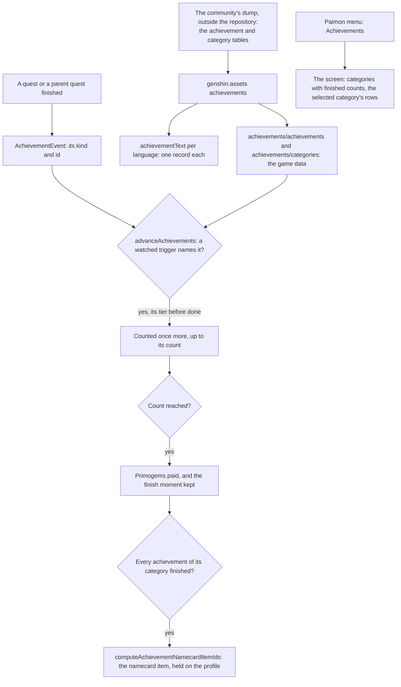

# Achievements

The game's achievements reward a player for what they have done anywhere in it. Each is a row of the game's own table: a category it is listed under, a trigger naming the doing that counts it, the count that finishes it and the Primogems it pays (`~/Esposter/genshin-parity/text/ExcelBinOutput/AchievementExcelConfigData.json`, where achievement 80001 holds its `goalId`, `triggerConfig`, `progress` and `finishRewardId`). The world holds them as the table does, by the game's own ids (`scripts/src/services/genshinAssets/achievements/toAchievement.ts`), and every title and description comes from the game's text (`~/Esposter/genshin-parity/text/TextMap/TextMap_MediumEN.json`, where hash `3553917084` reads "The Wind and The Star Traveler", achievement 80001's title).

## How it works

### The table

`pnpm -C scripts genshin:assets achievements` reads the game's achievement table and its category table from the dump, and publishes two records to the game data, `achievements/achievements` and `achievements/categories` (`scripts/src/services/genshinAssets/achievements/buildAchievements.ts`), and writes the count of the achievements it keeps into the world's data folder, which the save's achievement slice is bounded by ([save data](../save-data/design.md); `packages/genshin-world/src/data/achievements/achievementCount.json`, the dump's rows less its disused ones). A disused achievement is left out (`scripts/src/services/genshinAssets/achievements/toAchievement.ts`); the rest are kept whole, with every trigger, since the screen lists all of a category and a category's end waits on every one of its achievements. Each row is validated against the world's schema before it is published (`scripts/src/services/genshinAssets/achievements/buildAchievements.ts`). The records are published compact (`scripts/src/services/gameData/getGameDataHash.ts`), and the world fetches them by their keys the first time the screen opens (`packages/genshin-world/src/services/achievement/readAchievements.ts`).

An achievement keeps its id, its category, its order there, its trigger type and the ids that trigger names, its count, the tier before it, whether it is hidden until it is done, its Primogems and its two text ids (`scripts/src/services/genshinAssets/achievements/toAchievement.ts`). A category keeps its name's text id, its order, and the namecard item its completion pays, which is zero for a category with no end (`scripts/src/services/genshinAssets/achievements/toAchievementCategory.ts`).

### The words

The same run publishes every title and description of a kept achievement, and every category's name, in the fifteen languages, one record a language under `achievementText`, keyed by the same text ids, as the [names](../game-text/design.md) and the [quests](../quests/design.md) are (`scripts/src/services/genshinAssets/achievements/buildAchievementText.ts`; the fifteen languages are the `TextMap_Medium*.json` parts of `~/Esposter/genshin-parity/text/TextMap/`). A language missing a text takes English's and says so (`scripts/src/services/genshinText/buildTextChunks.ts`). The screen fetches only the language it shows (`packages/genshin-world/src/services/achievement/AchievementTextLoaderMap.ts`).

### Counting a doing

`AchievementTriggerEventKindMap` names the trigger types the world watches, and the map is the list (`packages/genshin-world/src/services/achievement/AchievementTriggerEventKindMap.ts`). An AND trigger names one id and an OR trigger names a list, which the reader splits into one parameter each (`scripts/src/services/genshinAssets/achievements/toTriggerParameters.ts`). `advanceAchievements` takes an `AchievementEvent`, a kind and the id it finished, and each achievement that watches the kind and names the id is counted once more, up to its count. An achievement already finished never moves, and one whose tier before it is not finished does not count yet, so the tiers of a chain are done in order (`packages/genshin-world/src/services/achievement/advanceAchievements.ts`). `TRIGGER_OPEN_WORLD_CHEST` is the one trigger whose target is region-only, provisional, per the [chests spec](../chests/design.md).

When an achievement reaches its count it is finished, its moment is kept, and its Primogems are returned for the caller to pay into the wallet (`packages/genshin-world/src/services/achievement/advanceAchievements.ts`). Every reward row an achievement pays holds Primogems alone, so the Primogems are the whole of its reward (`~/Esposter/genshin-parity/text/ExcelBinOutput/RewardExcelConfigData.json`: across the 1855 kept achievements' rewards, the only item in a filled slot is 201, and reward 800001 is 5 of it; the table's other rows fill items such as 202 and 104003).

A trigger type the map does not name is not watched, and its achievements never move; the table keeps them so their categories count them (`packages/genshin-world/src/services/achievement/advanceAchievements.ts`).

### The screen

`ScreenKind.Achievements` opens from the Paimon menu (`packages/genshin-world/src/services/menu/constants.ts`; the game's Paimon menu grid in `~/Esposter/genshin-parity/references/paimon-menu.png` shows Achievements). The screen lists the categories down the left, each with how many of its achievements are finished over how many it has, and the selected category's achievements on the right in the table's order, each with its title, its description, its count when its count is more than one, and its Primogems. Q and E step between the categories, which the quest screen's tab keys are assumed to be and no capture has checked yet ([roadmap](../../../changes/genshin-roadmap/tasks.md)), and a hidden achievement reads "?" until it is finished (`packages/genshin-world/src/components/Achievement/Screen/Index.vue`). Its progress is what the world has counted from the doings the map watches (see Counting a doing and Notes).

## Notes

- **Each watched doing is emitted where it happens.** The [quests](../quests/design.md) page emits each finished sub-quest and each finished main quest (`packages/genshin-world/src/services/quest/getFinishedQuestEvents.ts`, `packages/genshin-world/src/composables/useWorldQuests.ts`), and the monster, statue, crafting, forging, bag, pickup, offering, chest and transformation-point doings are emitted by their composables and services (`packages/genshin-world/src/composables/useWorldCombat.ts`, `useWorldChests.ts`, `useWorldMap.ts`, `useWorldOfferings.ts`, `useWorldPickups.ts`, `packages/genshin-world/src/services/achievement/computeBagObtainEvents.ts`, `packages/genshin-world/src/services/statue/computeStatueLevelEvents.ts`, `packages/genshin-world/src/services/crafting/computeCraftAchievementEvent.ts`, `packages/genshin-world/src/components/Forge/Screen/Index.vue`).
- **A finished category's namecard is held, never stored.** `computeAchievementNamecardItemIds` lists the namecard item of every category whose completion is finished, read from the progress each time, and a category with no end lists none (`packages/genshin-world/src/services/achievement/computeAchievementNamecardItemIds.ts`). `computeProfileNamecardItemIds` joins it with each character's Friendship namecard into the profile's held namecards, so the held list reads from progress and stores nothing (`packages/genshin-world/src/services/profile/computeProfileNamecardItemIds.ts`).
- **The quest ids the table names are not all in the dump.** 334 of the 541 distinct sub-quest ids the 447 kept `TRIGGER_FINISH_QUEST_AND` and `_OR` achievements name across their trigger slots (comma lists split) are a `subId` in the dump's quest table (`~/Esposter/genshin-parity/text/ExcelBinOutput/QuestExcelConfigData.json`; 61.7%, counted over `~/Esposter/genshin-parity/text/ExcelBinOutput/AchievementExcelConfigData.json`). The rest name quests the dump does not carry, so their achievements stay at zero until that data is read (`scripts/src/services/genshinAssets/achievements/toTriggerParameters.ts` keeps each trigger's ids in their slots, and `packages/genshin-world/src/services/achievement/AchievementTriggerEventKindMap.ts` counts the slot a quest trigger watches).
- **The screen's look is provisional.** Its places follow the quest screen's grid, not the English client, and its category icons, its Primogem glyph and its tab shapes are not built (`packages/genshin-world/src/components/Achievement/Screen/Index.vue`, whose template names them as not yet built, and whose tab keys are the quest screen's).

## Parity

The Achievements screen has no parity measure yet. Its look waits on `achievements-screen.mkv`, listed as owed on the roadmap.

## Key files

| File                                                                                    | Role                                                                                               |
| :-------------------------------------------------------------------------------------- | :------------------------------------------------------------------------------------------------- |
| `packages/genshin-world/src/models/achievement/Achievement.ts`                          | One achievement as the table holds it, with its schema                                             |
| `packages/genshin-world/src/models/achievement/AchievementCategory.ts`                  | One category, with the namecard its completion pays                                                |
| `packages/genshin-world/src/models/achievement/AchievementEvent.ts`                     | The doing an achievement's trigger may be waiting on                                               |
| `packages/genshin-world/src/models/achievement/AchievementProgress.ts`                  | How far an achievement has come and when it was finished                                           |
| `packages/genshin-world/src/services/achievement/advanceAchievements.ts`                | Counts a doing against the watched achievements, paying the finished                               |
| `packages/genshin-world/src/services/achievement/AchievementTriggerEventKindMap.ts`     | The trigger types watched and the kind of doing each counts                                        |
| `packages/genshin-world/src/services/achievement/checkIsAchievementCategoryComplete.ts` | Whether every achievement of a category is finished                                                |
| `packages/genshin-world/src/services/achievement/computeAchievementNamecardItemIds.ts`  | The namecard item of each finished category that pays one                                          |
| `packages/genshin-world/src/services/profile/computeProfileNamecardItemIds.ts`          | The profile's held namecards: each character's at Friendship Level 10 and each finished category's |
| `packages/genshin-world/src/services/achievement/readAchievements.ts`                   | The slices fetched by their keys, checked against their schemas                                    |
| `packages/genshin-world/src/services/achievement/AchievementTextLoaderMap.ts`           | The words in each language, fetched by their key                                                   |
| `packages/genshin-world/src/components/Achievement/Screen/Index.vue`                    | The Achievements screen the Paimon menu opens                                                      |
| `packages/genshin-world/src/components/World/Session/Index.vue`                         | Loads the slices and words when the screen opens, and shows it                                     |
| `packages/genshin-world/src/data/achievements/achievementCount.json`                    | The count of the achievements kept, which the save's achievement slice is bounded by               |
| `scripts/src/services/genshinAssets/achievements/buildAchievements.ts`                  | The builder: the table's rows, mapped and checked, into the two records, and the count             |
| `scripts/src/services/genshinAssets/achievements/buildAchievementText.ts`               | The builder of every title and description in each language                                        |
| `scripts/src/services/genshinAssets/achievements/toAchievement.ts`                      | One row mapped to an achievement, its trigger's ids split                                          |

## Sources

- [Achievements](https://genshin-impact.fandom.com/wiki/Achievements), Genshin Impact Wiki: the Primogems each pays, a namecard for a category done, open-ended categories, and tiers shown as stars.
- [AnimeGameData](https://github.com/DimbreathBot/AnimeGameData), the community's per-patch dump: the achievement table with each one's category, trigger, count, reward and tier, the category table, and the quest table whose sub-quest ids the quest triggers name.

## Open

- [ ] **An achievement's tiers are shown as stars in the game** — no source yet: the cached Achievements wiki page is not on disk, and the Sources line cites it for this.
