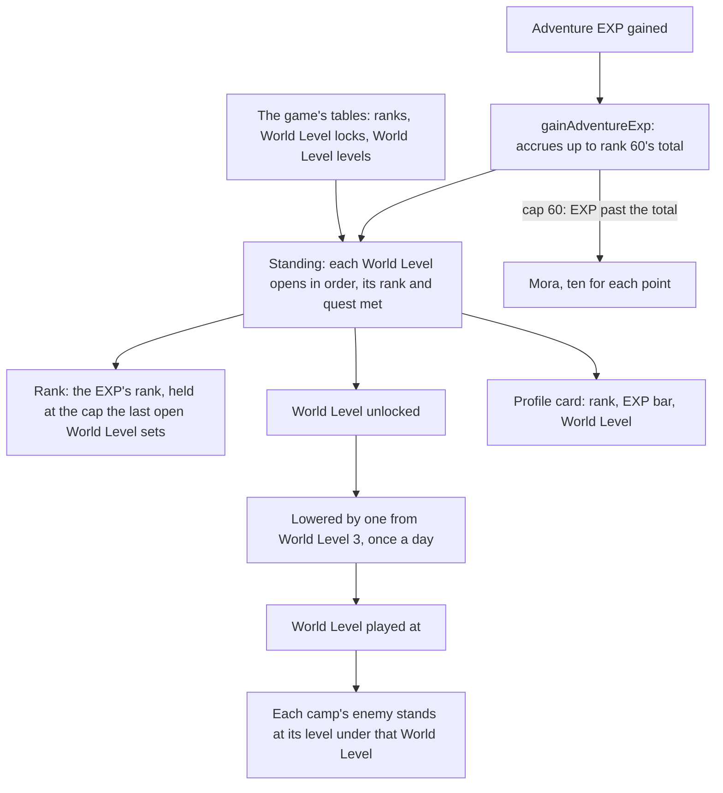

# Adventure Rank

The player's rank on the game's table, the World Level that follows it, and the enemies raised by that World Level. Adventure EXP accrues toward rank 60's total even while an ascension quest holds the rank lower, the rank catches up the moment that quest is done, and EXP past rank 60 is paid in Mora (`packages/genshin-world/src/services/adventureRank/gainAdventureExp.ts`). The rank, its EXP and the World Level are pure services in `genshin-world` over the game's tables, which `genshin:assets rank` publishes from the dump to the [hosted game data](../hosted-game-data/design.md). The world reads them as it opens (`readAdventureRankTables`), and each rule takes them as an argument. The session holds the EXP live from the save: a statue's first unlock adds its transport point's Adventure EXP, and the other sources add theirs as their pages land. Until a main quest is completed, the World Level stays at 0.

## How it works

## The rank and its holds

A rank is reached at the Adventure EXP of every rank below it: rank 1 at none, rank 2 at 375, rank 25 at 46,400 and rank 60 at 1,880,200 (`computeAdventureExpAtRank`, summing the EXP column of `~/Esposter.noindex/genshin-parity/text/ExcelBinOutput/PlayerLevelExcelConfigData.json`). The World Levels open in order, each needing the rank the one before it capped and, where the lock table names one, its main quest done. An open World Level's cap is the rank the player may reach (`~/Esposter.noindex/genshin-parity/text/ExcelBinOutput/PlayerLevelLockExcelConfigData.json`; the game's text at 2955635938 in `~/Esposter.noindex/genshin-parity/text/TextMap/TextMap_MediumEN.json` gives the same ranks and quests):

| World Level | Opens at | Needs                       | Rank capped at |
| :---------- | :------- | :-------------------------- | :------------- |
| 0           | rank 1   | none                        | 20             |
| 1           | rank 20  | none                        | 25             |
| 2           | rank 25  | Ascension quest 1           | 30             |
| 3           | rank 30  | none                        | 35             |
| 4           | rank 35  | Ascension quest 2           | 40             |
| 5           | rank 40  | none                        | 45             |
| 6           | rank 45  | Ascension quest 3           | 50             |
| 7           | rank 50  | Ascension quest 4           | 55             |
| 8           | rank 55  | none                        | 60             |
| 9           | rank 58  | World Level Ascension quest | 60             |

The rank is the EXP's own, held at the cap of the last World Level open. So a player whose quest is not done stays at 25, 35, 45 or 50, and their EXP keeps accruing toward rank 60's total; once the quest is done the rank rises to whatever the EXP reaches under the new cap (`computeAdventureRankStanding`).

## Systems a rank opens

The wiki's table of Game System Unlocks gives the rank each system opens at. Two of the Paimon menu's entries are in it: Co-Op Mode at rank 16 and the Battle Pass at rank 20 (`ScreenKindOpenRankMap`; Co-Op's rank 16 is row 49 of `~/Esposter.noindex/genshin-parity/text/ExcelBinOutput/OpenStateConfigData.json`, with a quest 35001 beside it, on the MultiPlayer icon of `~/Esposter.noindex/genshin-parity/text/ExcelBinOutput/SystemOpenUIConfigData.json` id 9, and the Battle Pass's 20 is row 1301 on id 10). Friends' rank 2 in the same map has no source yet (see Still open). An entry for one of them stays disabled below its rank (`checkIsSystemOpen`), as an entry not yet built does; the menu's other entries are open from the start. The table's other systems are not entries of the menu, so each is gated on its own screen.

## EXP past the total and past rank 60

`gainAdventureExp` adds EXP up to rank 60's total, 1,880,200. Where the cap is below 60, EXP past that total is not gained, as the game does while a quest holds the rank. Once the cap is 60, EXP past the total is paid in Mora at ten for each point (a rate with no source yet, see Still open), returned as `moraPaid` for the wallet to take (`packages/genshin-world/src/services/adventureRank/gainAdventureExp.ts`, the rate in `constants.ts`).

## Lowering the World Level

From World Level 3 the player may lower it by one, and restore it by one (`toggleWorldLevelLowering`). Either change waits 24 hours after the last, so a lowering cannot be undone at once and a restore cannot be lowered again at once. The World Level played at is the unlocked one less that single step (`computeWorldLevel`). The game's text gives the same rule, from World Level 3 and 24 hours, at 2955635938 and 2310679825 in `~/Esposter.noindex/genshin-parity/text/TextMap/TextMap_MediumEN.json`.

The info icon beside the World Level on the profile card opens the World Level dialog on a click (`Menu/WorldLevelDialog`, `packages/genshin-world/src/components/Menu/WorldLevelDialog/Index.vue`; the 2024 and 2025 recordings `~/Esposter.noindex/genshin-parity/captures/yt-P13s7kSmVOE-world-level-dialog-2024.mp4` and `~/Esposter.noindex/genshin-parity/captures/yt-ZGsragloQxU-world-level-dialog-2025-4k.mp4` show the dialog over the dimmed menu), over the menu dimmed behind it. The dialog shows the game's own help text for the World Level by its text id, its headings and numbers in the colours its tags give them (`splitGameTextColors`), opened at its end where the change is told, and under it the button that lowers the World Level by one, or restores it once lowered. The button opens the Change World Level prompt over the dialog: its Confirm makes the change through `toggleWorldLevel`, and its Cancel closes the prompt back to the dialog. The button is drawn only while the World Level can be changed at all, and waits while the last change's cooldown runs (`computeWorldLevelCooldown`, `WORLD_LEVEL_COOLDOWN_CLOCK_INTERVAL_MS` in `packages/genshin-world/src/services/adventureRank/constants.ts`; the 2024 recording's prompt shows "Can be readjusted after 23 hours 58 minutes" in `~/Esposter.noindex/genshin-parity/captures/yt-P13s7kSmVOE-world-level-dialog-2024.mp4`), read against the server's clock as the dialog opens, at each minute while it stays open, and as a change is made. While the prompt is open the dialog is inert and the prompt takes Escape, which closes the prompt alone; the cross or Escape then closes the dialog back to the menu, focus returning to the icon; Escape stops at the dialog, short of the input that closes the menu to the world, and the menu behind it is inert while it is open. The help text is a focusable region, so a keyboard scrolls back up from its end. How it is measured against the game is the [screens](../screens/design.md) page's.

## Enemies at a World Level

A camp's enemy stands at its camp level under World Level 0. From World Level 1 it stands at that World Level's monster level, which `WorldLevelExcelConfigData` gives from 26 at World Level 1 to 100 at World Level 9 (`~/Esposter.noindex/genshin-parity/text/ExcelBinOutput/WorldLevelExcelConfigData.json`), plus its camp level less `SPAWN_LEVEL_REFERENCE` (`computeSpawnLevel`, `packages/genshin-world/src/services/adventureRank/computeSpawnLevel.ts`). A camp at level 1 therefore stands at 9 at World Level 1. The reference is provisional: the wiki's enemy level ranges put each World Level's lowest enemy 14 to 17 under its monster level, which a camp at level 1 or 2 gives, and the enemies' name plates at World Levels 1, 5 and 9 measure it on the References sought list. Changing the World Level clears the camps and spawns them anew, so every enemy stands at the level the new World Level sets (`packages/genshin-world/src/components/World/Enemies/Index.vue`).

## Notes

- Only enemies are raised so far. Bosses, ley line outcrops and the World Level's rewards wait on their own pages.
- The World Level adjustment is the save's `worldLevelAdjustment` slice, so the 24 hour wait survives a reload. The EXP is read back through the save sync, so a gain moves the rank, the World Level and the bar at once.
- Katheryne hands out each reached rank's reward once, and the ranks given are kept with the save.

## Decisions

- **The dialog's title is `UI_WORLDLEVEL_TITLE`,** the World Level's own interface title, the word the card's row already shows. The 2024 recording's dialog reads "World Level" as its title (`~/Esposter.noindex/genshin-parity/captures/yt-P13s7kSmVOE-world-level-dialog-2024.mp4`). Several text ids read "World Level" exactly, and nothing on screen tells them apart.
- **The help text opens at its end.** Both public recordings show the dialog at its last lines, the scroll thumb at the track's foot, from the first frame it is open (`~/Esposter.noindex/genshin-parity/captures/yt-P13s7kSmVOE-world-level-dialog-2024.mp4` and `~/Esposter.noindex/genshin-parity/captures/yt-ZGsragloQxU-world-level-dialog-2025-4k.mp4`, with `packages/genshin-world/src/components/Menu/WorldLevelDialog/Index.vue`), so the body is laid out from its end as a column in reverse, which a later change of font or language keeps at the end too.
- **The button opens the Change World Level prompt.** The game shows the World Level now and the one the change sets, what the change does and, during a cooldown, the time left, over the dialog, as the [2024](https://www.youtube.com/watch?v=P13s7kSmVOE) and [2025](https://www.youtube.com/watch?v=ZGsragloQxU) tutorials show. The prompt is a plain dialog (`Menu/WorldLevelPrompt`, `packages/genshin-world/src/components/Menu/WorldLevelPrompt/Index.vue`, which the 2024 recording shows at "Current World Level 8" to "Lowered World Level 7") with labels from the game's text ids, and its rule is `computeWorldLevelAdjustPrompt`. Its layout is provisional: its frame and choices are the quit prompt's, measured from its 2026 recording, and its lines are placed by eye until the user's recording `world-level-dialog-2024.mkv` is measured.
- **The dialog stays open after a change,** its button turned to Revert World Level and held through the cooldown. Neither recording shows whether the game closes it.
- **The restoring button's arrow is the lowering's turned over,** provisionally, since no recording shows the restoring button.
- **The card's values stand right-aligned beside the info disc,** as the current client draws them. The menu's reference still is the 1.3 build's, its values redacted, so the move costs its score a little.

## Still open

- **Adventure EXP from the sources not built yet.** A source's page adds its EXP through `gainWorldAdventureExp`, the composable's gain, which takes the completed main quests along. Until a source's page calls it, its EXP is not gained.
- **The Paimon menu's rank gates for systems not built yet.** An entry whose system is not built stays disabled. A system the wiki gates by rank takes its rank in `ScreenKindOpenRankMap` as its page is built.
- [ ] **Friends opens at Adventure Rank 2** — no source yet for the system: the rank-2 open-state rows (ids 30, 37 and 2101 of `~/Esposter.noindex/genshin-parity/text/ExcelBinOutput/OpenStateConfigData.json`) gate player level 2 and name no system, so none is shown to name Friends.
- [ ] **EXP past rank 60 pays ten Mora for each point** — the code applies the rate (`packages/genshin-world/src/services/adventureRank/gainAdventureExp.ts`), but the game's text converts the EXP to Mora (text 365981086) with no rate, and the wiki's Adventure Rank page is not in the cache.
- [ ] **The lowest enemy at each World Level sits 14 to 17 under its monster level** — no source yet: the wiki's enemy level ranges are not in the cache, and the name-plate measurement is still on the References sought list.
- [ ] **The game has no tooltip on the World Level** — no source yet: the two recordings show the click and the dialog, not a hover over the info icon.
- [ ] **The prompt's frame and choices are the quit prompt's measured layout** — no source yet: the quit prompt's measurement is not checked against the 2026 recording here.

## Key files

| File                                                                                 | Its role                                                                                     |
| :----------------------------------------------------------------------------------- | :------------------------------------------------------------------------------------------- |
| `scripts/src/services/genshinAssets/adventureRank/buildAdventureRankTables.ts`       | builds the rank, lock and World Level records from the dump                                  |
| `packages/genshin-world/src/services/adventureRank/readAdventureRankTables.ts`       | the rank, lock and World Level tables, read as the world opens                               |
| `packages/genshin-world/src/models/adventureRank/AdventureRankTables.ts`             | each rank's EXP, each World Level's lock and its monster level                               |
| `packages/genshin-world/src/services/adventureRank/constants.ts`                     | the constants the rules read                                                                 |
| `packages/genshin-world/src/composables/useWorldAdventureRank.ts`                    | the live EXP, its standing and the gain a source adds                                        |
| `packages/genshin-world/src/services/adventureRank/computeAdventureRankStanding.ts`  | the rank, its cap and the World Level from EXP and quests                                    |
| `packages/genshin-world/src/services/adventureRank/gainAdventureExp.ts`              | the EXP gain, its cap and the Mora past rank 60                                              |
| `packages/genshin-world/src/services/adventureRank/toggleWorldLevelLowering.ts`      | the lowering and its 24 hour cooldown                                                        |
| `packages/genshin-world/src/services/adventureRank/computeAdventureRankProgress.ts`  | the EXP's share of the bar toward the next rank                                              |
| `packages/genshin-world/src/services/adventureRank/computeSpawnLevel.ts`             | a camp's enemy level at a World Level                                                        |
| `packages/genshin-world/src/services/adventureRank/computeWorldLevelCooldown.ts`     | the time left before the World Level can be changed again                                    |
| `packages/genshin-world/src/components/Menu/WorldLevelDialog/Index.vue`              | the World Level dialog: the game's help text and the button that opens the prompt            |
| `packages/genshin-world/src/components/Menu/Paimon/Index.vue`                        | the profile card's rank, EXP bar, World Level and its info icon                              |
| `packages/genshin-world/src/services/enemy/createEnemy.ts`                           | spawns an enemy at its World Level's level                                                   |
| `packages/genshin-world/src/components/World/Enemies/Index.vue`                      | spawns the camps, and respawns them when the World Level changes                             |
| `packages/genshin-world/src/components/World/Session/Index.vue`                      | the World Level the world plays at, handed down to its enemies                               |
| `packages/genshin-world/src/components/Menu/WorldLevelPrompt/Index.vue`              | The Change World Level prompt: the two levels, the question and the tips, Cancel and Confirm |
| `packages/genshin-world/src/services/adventureRank/computeWorldLevelAdjustPrompt.ts` | the levels the prompt shows and whether the change lowers                                    |
| `packages/genshin-world/src/services/adventureRank/checkIsSystemOpen.ts`             | whether a Paimon entry is open at the rank held                                              |
| `packages/genshin-world/src/services/adventureRank/ScreenKindOpenRankMap.ts`         | the rank each Paimon entry the wiki gates opens at                                           |

## Sources

- [Adventure Rank](https://genshin-impact.fandom.com/wiki/Adventure_Rank), Genshin Impact Wiki: not in the cache (see Still open), so nothing here cites it. The World Level table, the holds at 25, 35, 45 and 50 and lowering from World Level 3 are cited to the game's own text where they are stated above; the 1:10 Mora rate and the enemy level ranges have no source yet.
- [AnimeGameData](https://github.com/DimbreathBot/AnimeGameData), the community's per-patch dump: `PlayerLevelExcelConfigData`, `PlayerLevelLockExcelConfigData` and `WorldLevelExcelConfigData`, the tables the rank is read from. The dump at its revision lacked the three; they were taken from the same repository's files, which matched the dump's own tables byte for byte.
- World Level tutorials recorded on the English PC client, [2024](https://www.youtube.com/watch?v=P13s7kSmVOE) and [2025](https://www.youtube.com/watch?v=ZGsragloQxU): the dialog the info icon opens on a click, open at the end of its help text, and the Change World Level prompt its button opens.
