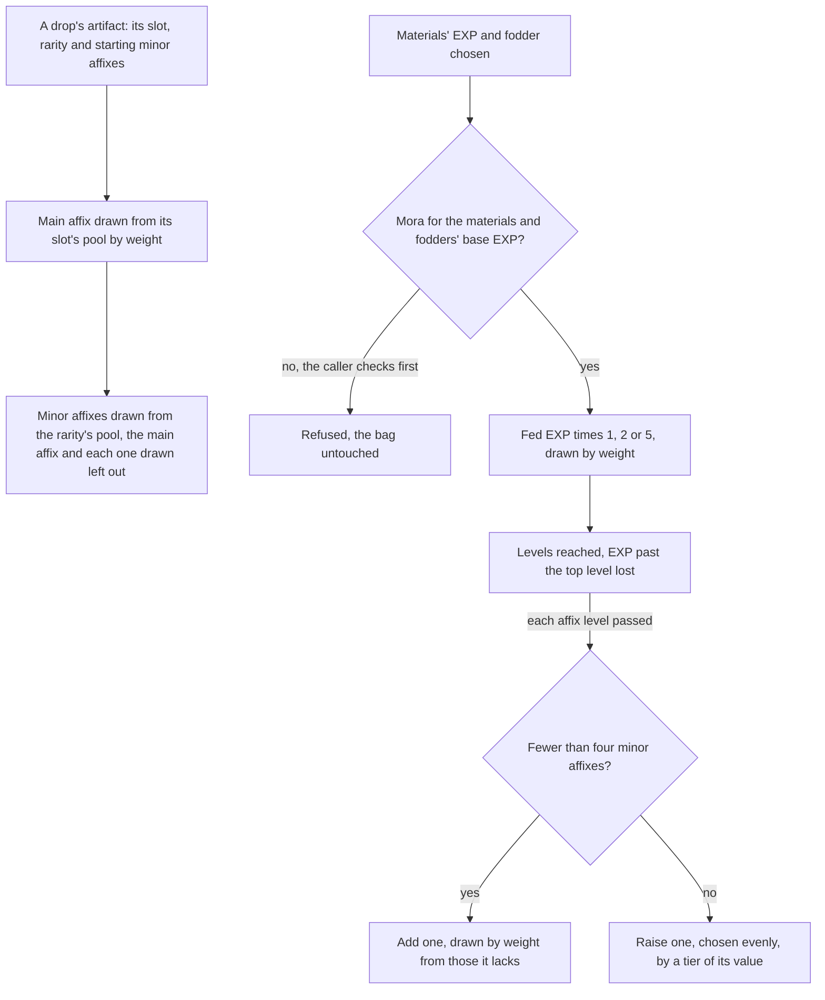
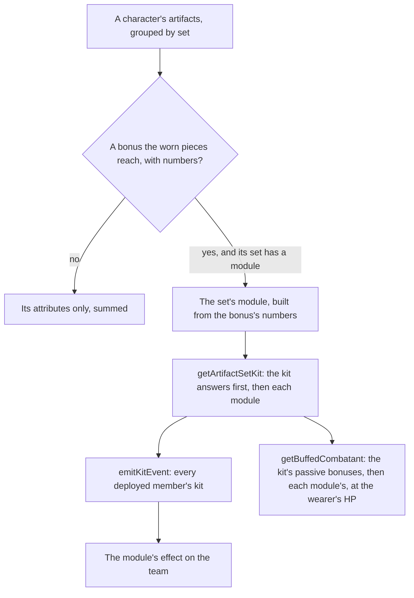

# Artifact enhancement

An artifact's attributes are summed by [character attributes](../character-attributes/design.md): its main affix at its rarity and level, its minor affixes and its set's unconditional bonuses. This page is how an artifact comes to have them, and what a set's bonus that waits on combat does. A drop is rolled by the game's pools, an enhancement feeds it EXP and Mora, and a lock keeps a piece from being fed away. A bonus that waits on combat, such as a four-piece effect a reaction sets off, is a module of its set's answering the [character kits](../kits/README.md)' events. Instructor's, The Exile's, Traveling Doctor's, Berserker's, Lucky Dog's and Adventurer's are built, Adventurer's answering a chest opened in the world.

## How it works

## The rules

- **A new artifact's main affix is drawn from its slot's pool.** The table gives each slot the attributes it may be, the circlet's flat ATK and HP among them, and the wiki's weights decide which of them roll: an attribute with no weight is never drawn. A Plume of Death is always flat ATK, and a Sands of Eon is one of its five percentages.
- **Its minor affixes are drawn from the rarity's pool.** Each draw takes an attribute the artifact does not hold yet and is not its main affix, by weight, so a Plume may roll ATK% but never flat ATK. A minor affix's value is one of its tiers, every tier as likely as the next.
- **A drop's starting minor affixes come from the drop.** The game's reliquary table gives each piece a variant for each starting count, and the drop that gives the piece chooses the variant. This page takes the count as its input and does not choose it.
- **Enhancing costs a Mora a point, and the fodder's share costs none.** The Mora is the materials' EXP and each fodder's base EXP. A fodder gives its rarity's base EXP and 80% of what it was levelled with, rounded down, and that recovered share is free. `getEnhancementMoraCost` gives the Mora and the caller refuses the enhancement when the wallet holds less, leaving the bag as it was.
- **The EXP is multiplied by a bonus drawn on each enhancement.** One time in a hundred it is multiplied by five, nine times in a hundred by two, and otherwise it stands. The draw comes from the world's seeded random source.
- **Levels follow the table's costs, and EXP past the top is lost.** A level's cost is the table's EXP for it, the artifact levels as far as its total EXP reaches, and EXP beyond its highest level is wasted.
- **Every fourth level adds or raises a minor affix.** At each affix level it passes, an artifact holding fewer than four minor affixes gains one from the rarity's pool, by weight from those it lacks. One holding four raises one of them, chosen evenly, by a tier of its value.
- **A locked artifact is never fodder.** A fodder's lock is refused by `getFodderEnhancement`, and an artifact worn by a character is not a bag entry, so the bag's fodder list never holds one.
- **A character wears one piece of each slot.** Equipping a piece returns the piece it replaces, and unequipping a slot with no piece in it is refused. Both are services over the character alone, so the bag is the caller's to write ([artifact screen](../../../changes/genshin-artifact-screen/design.md)).

## Decisions

- **A set's conditional bonus is a module.** A two or four-piece bonus that waits on combat is a small module of its own over the shared effects the kits use, its numbers the set table's, as a weapon's passive is. Its unconditional attributes stay what the sum already reads ([character attributes](../character-attributes/design.md)).
- **A module is carried with its set.** No set's conditional bonus is written before the set is carried, so no module waits on an effect the kits do not yet have.
- **A chest opened during the restoration restarts it.** A chest opened while the restoration runs restarts its five seconds, so a second chest does not run a second restoration beside the first.

## Set bonuses in combat

A set's bonus that is only attributes is summed with the rest of a character's lines. A bonus that waits on combat adds no line: it is a module of its set's, a `PassiveModule` (the type a weapon's passive shares), which adds bonuses to its wearer's pricing, multiplies its wearer's charged attack stamina by its factor, and answers the events of combat as a kit's passive does, read as its wearer's own. `getPassiveKit` composes each factor by product, so two passives that each lower a stamina cost multiply, and a kit with none keeps a factor of one. A bonus that is only attributes is never a module, even where its params repeat its value (the eleven two-piece bonuses that carry both): the attribute pipeline counts it alone.

- **A combatant's kit carries its sets' modules.** `createCombatant` builds each character's kit through `getArtifactSetKit`. Each set the character wears that `ArtifactSetIdCreateModuleMap` names, and each of its bonuses the worn pieces reach whose numbers the set table fills, becomes a module built from that bonus. The kit answers each event first and each module after it, its passive bonuses are the kit's followed by each module's, and a character whose sets build none keeps its kit as it is.
- **A module reads its numbers from the set table.** Each bonus carries its affix's numbers as `params`, in the table's order, so a module reads its seconds and amounts from the row rather than restating them.
- **Instructor's four-piece gives the team Elemental Mastery on a reaction.** A reaction its wearer triggers while on the field gives every member of the deployed team the bonus's Elemental Mastery for its seconds, as a buff another restarts rather than stacks. A reaction its wearer's summon triggers once the wearer has left the field gives none, as the wiki notes.
- **The Exile's four-piece regenerates the others' energy after a burst.** A burst its wearer uses sets a field with no edge that ticks every 2 seconds for the bonus's 6 seconds, the first tick 2 seconds on, as the wiki's gameplay notes give it, and each tick gives every other member of the deployed team the bonus's 2 energy, flat and unraised by Energy Recharge. A burst while the field still ticks, the wearer's or another wearer's, starts no second one, as gcsim (MIT) `exile.go` rejects it.
- **Traveling Doctor's four-piece heals its wearer as its burst is used.** The burst-used event its wearer's burst sends restores the bonus's 20% of its Max HP to it, ahead of the burst's own start, raised by the Healing Bonuses as every heal is (`changeKitMemberHealth`), so its two-piece's Incoming Healing Bonus raises it.
- **Lucky Dog's four-piece heals its wearer as it picks up Mora.** A pick up of Mora lying in the world is a world event (`pickUpMora`) that the combat queues on the outbox as a Mora-picked-up kit event of the character on the field, sent at the next step, and a wearer that picked it up is restored the bonus's 300 HP, the table's `Relic_CoinHealSelf`, raised by the Healing Bonuses as every heal is (`changeKitMemberHealth`).
- **Adventurer's four-piece restores HP as a chest opens in the world.** Opening a chest in the world is a world event (`chestOpened`) that the combat queues on the outbox as a `ChestOpened` kit event of the character on the field, sent at the next step as Mora picked up is. The module answers it with a field that has no edge, ticking each second for the bonus's five seconds, and each tick restores its wearer the bonus's 6% of its Max HP, raised by the Healing Bonuses as every heal is (`changeKitMemberHealth`). Only a wearer's kit carries the module, so a chest restores no other member.
- **Berserker's four-piece raises CRIT Rate at low HP.** Its module's passive bonus gives the bonus's 24% CRIT Rate while its wearer's HP is below the bonus's 70% of its Max HP, read as each of its hits is priced. A passive's bonuses are handed the character's HP as a share of its Max HP from the party beside the character (`getBuffedCombatant`), its current HP that share of its Max HP, so a kit's passive at low or high HP reads it the same way.
- **Defender's Will's four-piece gives its wearer the Elemental RES of each element the deployed team holds.** Its module's passive bonus gives the bonus's RES to each different element among the deployed members' elements, so an element two members hold counts once.
- **Martial Artist's two-piece raises Normal and Charged Attack DMG, and its four-piece adds them for a time after the Elemental Skill.** The two-piece is an attribute passive at the bonus's first param; the four-piece gives the same two for the seconds in the first param after its wearer uses the Elemental Skill, at the amount in the third, and a use restarts it. The second param is left unread.
- **Maiden Beloved's four-piece raises the team's Incoming Healing Bonus after a skill or a burst.** A skill or a burst its wearer uses gives every deployed member the bonus's Incoming Healing Bonus for the seconds in the second param, a use restarting it.
- **Gladiator's Finale's four-piece raises Normal Attack DMG while its wearer wields a Sword, a Claymore or a Polearm.** A passive of the bonus's amount, read from the wearer's weapon type as each hit is priced.
- **Wanderer's Troupe's four-piece raises Charged Attack DMG while its wearer wields a Bow or a Catalyst.** A passive of the bonus's amount, read from the wearer's weapon type as each hit is priced.
- **Noblesse Oblige's two-piece raises Elemental Burst DMG, and its four-piece gives the team ATK after its wearer's burst.** A burst its wearer uses gives every deployed member the bonus's ATK for the seconds in the second param, a use restarting it. Its two-piece raises the Elemental Burst DMG of each strike its wearer's burst lands by the bonus's 20%, as a weapon's skill and burst passive does, through its module's strike hook.
- **Retracing Bolide's four-piece raises Normal and Charged Attack DMG while a shield protects its wearer.** Its module's passive bonus gives the bonus's amount of each while its wearer is on the field and a live shield is among the effects, as a shield protects the character on the field whoever cast it.
- **Heart of Depth's four-piece raises Normal and Charged Attack DMG after its wearer's Elemental Skill.** The skill gives the bonus's amount of each for the seconds in the third param, a use restarting it; the second param is left unread.
- **Thundersoother's four-piece raises DMG against an enemy under Electro, and Lavawalker's four-piece the same under Pyro.** Each is the shared aura shape: the bonus's amount is added to the DMG of each strike its wearer deals to an enemy under that element's aura, read as each hit is priced. Bane of Elements reads the same aura through `checkIsEnemyAffectedByElement`.
- **Brave Heart's four-piece raises DMG against an enemy with more than half its Max HP.** The bonus's first param is added to each strike its wearer deals to an enemy whose health is above the second param of its Max HP.
- **Resolution of Sojourner's four-piece raises Charged Attack CRIT Rate.** A CRIT Rate bonus of the bonus's amount on each Charged Attack its wearer deals.
- **Emblem of Severed Fate's four-piece raises Elemental Burst DMG by a share of Energy Recharge, up to a cap.** Each burst strike its wearer deals is raised by the first param times the wearer's Energy Recharge, never past the second param.
- **Gambler's two-piece raises Elemental Skill DMG, and its four-piece ends the skill cooldown when its wearer defeats an opponent.** The end is held for the first param's seconds, so it happens once in that time; the table's second param is a whole chance, so it is not rolled.
- **Obsidian Codex's two-piece raises DMG in Nightsoul's Blessing on the field, and its four-piece raises CRIT Rate after a Nightsoul point is consumed.** The two-piece reads the blessing and the active character at each strike. The four-piece holds a CRIT Rate status for the third param's seconds when its wearer consumes a point on the field, once per the fourth param's seconds.
- **Marechaussee Hunter's two-piece raises Normal and Charged Attack DMG, and its four-piece raises CRIT Rate on each change to its wearer's HP.** Each change adds a CRIT Rate hold of the first param's share for the second param's seconds, up to the third param's count, as Focus's holds do.
- **Blizzard Strayer's four-piece raises CRIT Rate against an enemy under Cryo, and more against a Frozen one.** The bonus's first param is added to the CRIT Rate of each strike its wearer deals to an enemy under the Cryo aura, and its second param more when the enemy holds the Freeze aura; the two are read as each hit is priced.
- **Desert Pavilion Chronicle's four-piece raises Normal Attack SPD and the Normal, Charged and Plunging Attack DMG of its wearer after a Charged Attack hits.** The Charged Attack's damage event starts the status for the third param's seconds, a later hit restarting it; the Normal Attack SPD is a passive's attribute, the damage a strike's.
- **Finale of the Deep Galleries' four-piece raises the Normal Attack and Elemental Burst DMG of its wearer while it has no Elemental Energy, and each stops the other.** A Normal Attack that deals DMG stops the burst's bonus for the third param's seconds, and a burst that deals DMG stops the Normal Attack's; the energy is the wearer's in the party. The second param is left unread.
- **Golden Troupe's two-piece raises Elemental Skill DMG, and its four-piece raises it again off the field and for two seconds after its wearer takes the field.** The four-piece's bonus is read as each skill strike is priced; taking the field starts the linger status for the third param's seconds. The second param is left unread.
- **Tenacity of the Millelith's four-piece gives every deployed member ATK and Shield Strength after its wearer's Elemental Skill hits.** Each trigger gives the first and second params for the third param's seconds, and a later hit inside the fourth param's seconds triggers nothing; a skill hit triggers it whether or not its wearer is on the field.
- **Scholar's four-piece gives each member with a bow or a catalyst Energy when particles are gathered.** The four-piece gives the table's first param of Energy to each standing member wielding a bow or a catalyst, once every three seconds, the three being the text's and not the parameter list's.
- **Deepwood Memories' four-piece lowers the Dendro RES of an enemy its wearer's Elemental Skill or Burst hits.** The hit gives the enemy a Dendro RES reduction of the first param for the second param's seconds, a later hit restarting it; it triggers whether or not its wearer is on the field.
- **Bloodstained Chivalry's four-piece raises its wearer's Charged Attack DMG and empties their stamina cost after the wearer defeats an opponent.** A defeat its wearer deals while it is the active character starts the status for the first param's seconds. The wiki counts a defeat by wildlife its hit felled, the one set whose module hears a wildlife event (`WILDLIFE_ANSWERING_ARTIFACT_SET_IDS`), and says a swap off the field does not end the status. While it stands, Charged Attack DMG rises by the second param, and `getChargedAttackStaminaMultiplier` multiplies the Charged Attack's stamina cost by zero. The wiki's clause that a Charged Attack still needs the minimum stamina is not modelled: `startNextKitAction` checks the reduced cost, as every kit's check does, so a ruling is needed to change it. The third and fourth params are not read, as the text names neither.

## Where the tables come from

`pnpm -C scripts genshin:assets stats` publishes four of the tables this page reads from the dump the [game text](../game-text/design.md) is read from, each checked against the world's schema as it is built:

- `stats/artifactRarities`: per rarity, its highest level (the reliquary table's highest row less one), its base EXP as fodder, each level's cost from `ReliquaryLevelExcelConfigData`, the levels a minor affix is due at, and the minor affix groups of its standard minor affix depot from `ReliquaryAffixExcelConfigData`, each group's tiers sorted lowest first.
- `stats/artifactMainAffixPools`: per slot, the attributes of its standard main affix depot in `ReliquaryMainPropExcelConfigData`.
- `stats/artifactExpMaterials`: each item whose use adds artifact EXP, with the EXP one adds, from `MaterialExcelConfigData`.
- `stats/artifactSets`: per set in `ReliquarySetExcelConfigData`, each bonus's piece count, the attributes its affix adds, and the numbers its effect reads, the affix's `paramList` in `EquipAffixExcelConfigData` with its trailing zeros cut.

The set table is read with the world's stat tables, since a worn set's bonuses are summed into its wearer. The rarity and EXP tables are read by the same stat tables for a worn artifact's enhancement, and the main affix pools wait on the drop that rolls an artifact, whose change reads them ([artifact screen](../../../changes/genshin-artifact-screen/design.md)).

The weights are not in the tables. They are the wiki's: each slot's main affix chances and the minor affixes' weights from its [Artifact/Distribution](https://genshin-impact.fandom.com/wiki/Artifact/Distribution) page, and the EXP bonus from its [Artifact EXP](https://genshin-impact.fandom.com/wiki/Artifact_EXP) page, kept as constants beside the functions that draw by them, each naming the page it is read from.

## Key files

| File                                                                                           | Role                                                                                                       |
| :--------------------------------------------------------------------------------------------- | :--------------------------------------------------------------------------------------------------------- |
| `packages/genshin-world/src/models/artifact/Artifact.ts`                                       | Gains its EXP and its lock                                                                                 |
| `packages/genshin-world/src/models/artifact/ArtifactRarityData.ts`                             | A rarity's levels, costs, fodder base, affix levels and groups                                             |
| `packages/genshin-world/src/models/artifact/ArtifactMainAffixPool.ts`                          | A slot's main affix pool                                                                                   |
| `packages/genshin-world/src/models/artifact/ArtifactExpMaterial.ts`                            | An item's EXP                                                                                              |
| `packages/genshin-world/src/services/artifact/constants.ts`                                    | The recovery rate, the EXP bonus and the wiki's weights                                                    |
| `packages/genshin-world/src/services/artifact/rollArtifact.ts`                                 | A drop's artifact: main affix and minor affixes                                                            |
| `packages/genshin-world/src/services/artifact/enhanceArtifact.ts`                              | Feeding EXP, the bonus, levels and the affix levels passed                                                 |
| `packages/genshin-world/src/services/artifact/enhanceMinorAffixes.ts`                          | The minor affix added or raised at an affix level                                                          |
| `packages/genshin-world/src/services/artifact/getFodderEnhancement.ts`                         | A fodder's EXP and Mora, refusing a locked artifact                                                        |
| `packages/genshin-world/src/services/artifact/enhanceCharacterArtifact.ts`                     | A worn piece enhanced with materials and fodders, refused when the wallet lacks the Mora                   |
| `packages/genshin-world/src/services/artifact/equipCharacterArtifact.ts`                       | A worn piece replaced in its slot, the piece it replaced returned                                          |
| `packages/genshin-world/src/services/artifact/unequipCharacterArtifact.ts`                     | A worn piece taken off its slot, refusing an empty slot                                                    |
| `packages/genshin-world/src/services/artifact/getActiveArtifactSetBonuses.ts`                  | Each set bonus the worn pieces reach by piece count, read by the attribute sum and the set block           |
| `packages/genshin-world/src/models/artifact/ActiveArtifactSetBonus.ts`                         | A set bonus a character's artifacts reach, named by its set                                                |
| `packages/genshin-world/src/services/artifact/getEnhancementMoraCost.ts`                       | The Mora an enhancement costs                                                                              |
| `packages/genshin-world/src/models/artifact/ArtifactSetBonus.ts`                               | A set's bonus: its attributes, its numbers and its piece count                                             |
| `packages/genshin-world/src/models/kit/PassiveModule.ts`                                       | What a passive, a weapon's or a set's, adds to its wielder's or wearer's pricing and the events it answers |
| `packages/genshin-world/src/services/artifact/ArtifactSetIdCreateModuleMap.ts`                 | Each set with a module, by its id                                                                          |
| `packages/genshin-world/src/services/artifact/getArtifactSetKit.ts`                            | A character's kit with its sets' modules answering after it                                                |
| `packages/genshin-world/src/services/kit/getPassiveKit.ts`                                     | A kit with passive modules composed beside it, each hook, and the events the modules hear                  |
| `packages/genshin-world/src/services/artifact/sets/createInstructorSetModule.ts`               | Instructor's four-piece                                                                                    |
| `packages/genshin-world/src/services/artifact/sets/createBerserkerSetModule.ts`                | Berserker's four-piece                                                                                     |
| `packages/genshin-world/src/services/artifact/sets/createExileSetModule.ts`                    | The Exile's four-piece                                                                                     |
| `packages/genshin-world/src/services/artifact/sets/createTravelingDoctorSetModule.ts`          | Traveling Doctor's four-piece                                                                              |
| `packages/genshin-world/src/services/artifact/sets/createLuckyDogSetModule.ts`                 | Lucky Dog's four-piece                                                                                     |
| `packages/genshin-world/src/services/artifact/sets/createAdventurerSetModule.ts`               | Adventurer's four-piece                                                                                    |
| `packages/genshin-world/src/services/artifact/sets/createDefendersWillSetModule.ts`            | Defender's Will's four-piece                                                                               |
| `packages/genshin-world/src/services/artifact/sets/createMartialArtistSetModule.ts`            | Martial Artist's two- and four-piece                                                                       |
| `packages/genshin-world/src/services/artifact/sets/createMaidenBelovedSetModule.ts`            | Maiden Beloved's four-piece                                                                                |
| `packages/genshin-world/src/services/artifact/sets/createGladiatorsFinaleSetModule.ts`         | Gladiator's Finale's four-piece                                                                            |
| `packages/genshin-world/src/services/artifact/sets/createWanderersTroupeSetModule.ts`          | Wanderer's Troupe's four-piece                                                                             |
| `packages/genshin-world/src/services/artifact/sets/createNoblesseObligeSetModule.ts`           | Noblesse Oblige's two- and four-piece                                                                      |
| `packages/genshin-world/src/services/artifact/sets/createRetracingBolideSetModule.ts`          | Retracing Bolide's four-piece                                                                              |
| `packages/genshin-world/src/services/artifact/sets/createHeartOfDepthSetModule.ts`             | Heart of Depth's four-piece                                                                                |
| `packages/genshin-world/src/services/artifact/sets/createAuraDamageSetModule.ts`               | The shared shape: a DMG bonus against an enemy under an element's aura                                     |
| `packages/genshin-world/src/services/artifact/sets/createThundersooterSetModule.ts`            | Thundersoother's four-piece                                                                                |
| `packages/genshin-world/src/services/artifact/sets/createLavawalkerSetModule.ts`               | Lavawalker's four-piece                                                                                    |
| `packages/genshin-world/src/services/artifact/sets/createBraveHeartSetModule.ts`               | Brave Heart's four-piece                                                                                   |
| `packages/genshin-world/src/services/artifact/sets/createResolutionOfSojournerSetModule.ts`    | Resolution of Sojourner's four-piece                                                                       |
| `packages/genshin-world/src/services/artifact/sets/createEmblemOfSeveredFateSetModule.ts`      | Emblem of Severed Fate's four-piece                                                                        |
| `packages/genshin-world/src/services/artifact/sets/createGamblerSetModule.ts`                  | Gambler's two- and four-piece                                                                              |
| `packages/genshin-world/src/services/artifact/sets/createObsidianCodexSetModule.ts`            | Obsidian Codex's two- and four-piece                                                                       |
| `packages/genshin-world/src/services/artifact/sets/createMarechausseeHunterSetModule.ts`       | Marechaussee Hunter's two- and four-piece                                                                  |
| `packages/genshin-world/src/services/artifact/sets/createBlizzardStrayerSetModule.ts`          | Blizzard Strayer's four-piece                                                                              |
| `packages/genshin-world/src/services/artifact/sets/createDesertPavilionChronicleSetModule.ts`  | Desert Pavilion Chronicle's four-piece                                                                     |
| `packages/genshin-world/src/services/artifact/sets/createFinaleOfTheDeepGalleriesSetModule.ts` | Finale of the Deep Galleries' four-piece                                                                   |
| `packages/genshin-world/src/services/artifact/sets/createGoldenTroupeSetModule.ts`             | Golden Troupe's two- and four-piece                                                                        |
| `packages/genshin-world/src/services/artifact/sets/createTenacityOfTheMillelithSetModule.ts`   | Tenacity of the Millelith's four-piece                                                                     |
| `packages/genshin-world/src/services/artifact/sets/createScholarSetModule.ts`                  | Scholar's four-piece                                                                                       |
| `packages/genshin-world/src/services/artifact/sets/createDeepwoodMemoriesSetModule.ts`         | Deepwood Memories' four-piece                                                                              |
| `packages/genshin-world/src/services/artifact/sets/createBloodstainedChivalrySetModule.ts`     | Bloodstained Chivalry's four-piece                                                                         |
| `packages/genshin-world/src/services/combat/aura/checkIsEnemyAffectedByElement.ts`             | The shared read: whether an enemy is under an element's aura, for Bane of Elements and the aura set        |
| `packages/genshin-world/src/services/artifact/sets/createAfterSkillAttackDamageSetModule.ts`   | The shared shape: an attack DMG bonus after the Elemental Skill                                            |
| `packages/genshin-world/src/services/artifact/sets/createAttributePassiveSetModule.ts`         | The shared shape: attributes given on every attack                                                         |
| `packages/genshin-world/src/services/artifact/sets/createWeaponTypeAttackDamageSetModule.ts`   | The shared shape: an attack DMG bonus while a weapon type is wielded                                       |
| `packages/genshin-world/src/services/artifact/sets/createUsedActionTeamBuffSetModule.ts`       | The shared shape: a team buff after the wearer's skill or burst                                            |
| `packages/genshin-world/src/models/kit/KitMoraPickedUpEvent.ts`                                | The character on the field picked up Mora, the event Lucky Dog's four-piece answers                        |
| `packages/genshin-world/src/models/kit/KitChestOpenedEvent.ts`                                 | The character on the field opened a chest in the world, the event Adventurer's four-piece answers          |
| `packages/genshin-world/src/composables/useWorldCombat.ts`                                     | Queues each Mora picked up and each chest opened as a kit event for the next step                          |
| `packages/genshin-world/src/composables/useWorldChests.ts`                                     | Opens a chest in the world and tells the combat once it opens                                              |
| `packages/genshin-world/src/services/shared/drawWeightedValue.ts`                              | One draw in proportion to weights, from a seeded random source                                             |
| `scripts/src/services/genshinAssets/stats/getArtifactRarityDatas.ts`                           | Writes the rarity tables from the reliquary, level and affix rows                                          |
| `scripts/src/services/genshinAssets/stats/getArtifactMainAffixPools.ts`                        | Writes the main affix pools                                                                                |
| `scripts/src/services/genshinAssets/stats/getArtifactExpMaterials.ts`                          | Writes the EXP items                                                                                       |
| `scripts/src/services/genshinAssets/stats/getArtifactSetDatas.ts`                              | Writes each set's bonuses and their numbers                                                                |

## Notes

- **A drop's starting count is the drop's.** A piece's variant row says how many minor affixes it starts with, and the drop tables that choose a variant are the domains', bosses' and chests' pages. The wiki's drop distribution gives each source's split: a domain's five-star starts with three at 80% and four at 20%, and a boss's at 66% and 34%.
- **The reaction that sets a bonus off is priced without it.** A module answers an event only after the hit that sent it is priced, so Instructor's Elemental Mastery reaches the reactions after the one that gave it, as the wiki notes the game does.
- **Mora is charged before the bonus.** The Mora counts the EXP the player feeds, so a bonus of five multiplies the EXP the artifact gains by five, not the Mora it costs.

## Sources

- [AnimeGameData](https://github.com/DimbreathBot/AnimeGameData), the community's per-patch dump: `ReliquaryExcelConfigData`, `ReliquaryMainPropExcelConfigData`, `ReliquaryAffixExcelConfigData`, `ReliquaryLevelExcelConfigData` and `MaterialExcelConfigData`, the tables this page reads.
- [Artifact](https://genshin-impact.fandom.com/wiki/Artifact), Genshin Impact Wiki: a main affix and up to four minor affixes, enhancing with Artifact EXP and Mora, and the next tier every fourth level.
- [Artifact: Distribution](https://genshin-impact.fandom.com/wiki/Artifact/Distribution), Genshin Impact Wiki: each slot's main affix chances and the minor affixes' weights, the pool without the main affix and those drawn, and values drawn evenly.
- [Artifact EXP](https://genshin-impact.fandom.com/wiki/Artifact_EXP), Genshin Impact Wiki: a Mora a point, a fodder's base plus 80% of its own, and the bonus of two or five times.
- [gcsim](https://github.com/genshinsim/gcsim) (MIT), `internal/artifacts/berserker/berserker.go`: Berserker's CRIT Rate read at each attack from the wearer's current HP ratio.
- [gcsim](https://github.com/genshinsim/gcsim) (MIT), `internal/artifacts/exile/exile.go`: The Exile's three ticks of energy for every member but the wearer, and its rejection of a second burst while any member still ticks.
- [Berserker](https://genshin-impact.fandom.com/wiki/Berserker), Genshin Impact Wiki: the four-piece bonus, 24% more CRIT Rate while the wearer's HP is below 70%.
- [Instructor](https://genshin-impact.fandom.com/wiki/Instructor), Genshin Impact Wiki: the four-piece bonus, and its gameplay notes that the wearer triggers the reaction on the field and that the bonus refreshes rather than stacks.
- [The Exile](https://genshin-impact.fandom.com/wiki/The_Exile), Genshin Impact Wiki: the four-piece bonus, and its gameplay notes that Energy Recharge does not raise it and that it ticks three times every 2 seconds, the first 2 seconds on.
- [Traveling Doctor](https://genshin-impact.fandom.com/wiki/Traveling_Doctor), Genshin Impact Wiki: the four-piece bonus, 20% of the wearer's HP restored as its burst is used.
- [Lucky Dog](https://genshin-impact.fandom.com/wiki/Lucky_Dog), Genshin Impact Wiki: the four-piece bonus, 300 HP restored as Mora is picked up.
- [Loot System: Artifact Drop Distribution](https://genshin-impact.fandom.com/wiki/Loot_System/Artifact_Drop_Distribution), Genshin Impact Wiki: how many minor affixes a drop starts with, by its source and rarity.
