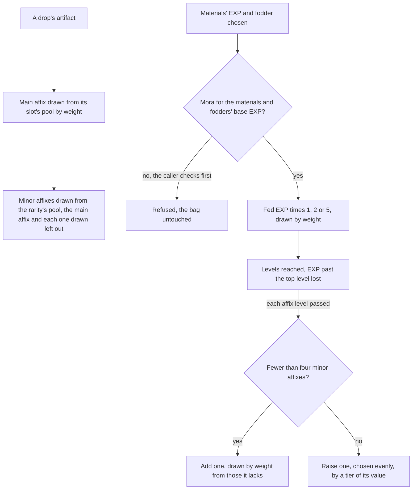
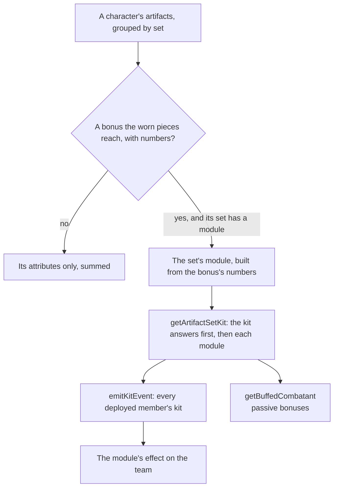

# Artifact enhancement

An artifact's attributes are summed by [character attributes](../character-attributes/design.md): its main affix at its rarity and level, its minor affixes and its set's unconditional bonuses. This page is how an artifact comes to have them, and what a set's bonus that waits on combat does. A drop is rolled by the game's pools, an enhancement feeds it EXP and Mora, and a lock keeps a piece from being fed away. A bonus that waits on combat, such as a four-piece effect a reaction sets off, is a module of its set's answering the [character kits](../kits/README.md)' events. Instructor's, The Exile's, Traveling Doctor's, Berserker's, Lucky Dog's and Adventurer's are built, Adventurer's answering a chest opened in the world (`packages/genshin-world/src/services/artifact/sets/createInstructorSetModule.ts`, `packages/genshin-world/src/services/artifact/sets/createExileSetModule.ts`, `packages/genshin-world/src/services/artifact/sets/createTravelingDoctorSetModule.ts`, `packages/genshin-world/src/services/artifact/sets/createBerserkerSetModule.ts`, `packages/genshin-world/src/services/artifact/sets/createLuckyDogSetModule.ts`, `packages/genshin-world/src/services/artifact/sets/createAdventurerSetModule.ts`).

## How it works

## The rules

- **A new artifact's main affix is drawn from its slot's pool.** The table gives each slot the attributes it may be, the circlet's flat ATK and HP among them, and the wiki's weights decide which of them roll: an attribute with no weight is never drawn. A Plume of Death is always flat ATK, and a Sands of Eon's depot lists its five percentages beside flat HP, ATK and DEF, so the weights decide which roll. (depot 2000 holds only `ATTACK` for the Plume, depot 3000 holds flat HP and `ATTACK` for the circlet, and depot 1000, the Sands', holds the flat three beside its percentages, in `{data-root}/genshin-parity/text/ExcelBinOutput/ReliquaryMainPropExcelConfigData.json`).
- **Its minor affixes are drawn from the rarity's pool.** Each draw takes an attribute the artifact does not hold yet and is not its main affix, by weight, so a Plume may roll ATK% but never flat ATK. A minor affix's value is one of its tiers, every tier as likely as the next. (a minor affix's tiers, e.g. HP from 23.9, in `{data-root}/genshin-parity/text/ExcelBinOutput/ReliquaryAffixExcelConfigData.json`).
- **A drop's starting minor affixes come from the drop.** The game's reliquary table gives each piece of a set a variant for each starting count, each with its own item id, and the drop that gives the piece chooses the variant. The artifact keeps that item id, so a worn one goes back to the bag as the same variant. This page takes the count as its input and does not choose it. (the five variant ids 55110 to 55114 of one piece at one star, in `{data-root}/genshin-parity/text/ExcelBinOutput/ReliquaryExcelConfigData.json`).
- **Enhancing costs a Mora a point, and the fodder's share costs none.** The Mora is the materials' EXP and each fodder's base EXP. A fodder gives its rarity's base EXP and 80% of what it was levelled with, rounded down, and that recovered share is free. `getEnhancementMoraCost` gives the Mora and the caller refuses the enhancement when the wallet holds less, leaving the bag as it was. (a fodder's `baseConvExp`: 420 at one star and 3780 at five, in `{data-root}/genshin-parity/text/ExcelBinOutput/ReliquaryExcelConfigData.json`).
- **The EXP is multiplied by a bonus drawn on each enhancement.** One time in a hundred it is multiplied by five, nine times in a hundred by two, and otherwise it stands. The draw comes from the world's seeded random source.
- **Levels follow the table's costs, and EXP past the top is lost.** A level's cost is the table's EXP for it, the artifact levels as far as its total EXP reaches, and EXP beyond its highest level is wasted. (each level's `exp`: 600 at level 1, in `{data-root}/genshin-parity/text/ExcelBinOutput/ReliquaryLevelExcelConfigData.json`).
- **Every fourth level adds or raises a minor affix.** At each affix level it passes, an artifact holding fewer than four minor affixes gains one from the rarity's pool, by weight from those it lacks. One holding four raises one of them, chosen evenly, by a tier of its value. An artifact holds at most four minor affixes (`MAX_MINOR_AFFIX_COUNT` in `packages/genshin-world/src/services/artifact/constants.ts`). (`addPropLevels` 5, 9, 13, 17 and 21 in `{data-root}/genshin-parity/text/ExcelBinOutput/ReliquaryExcelConfigData.json`).
- **A locked artifact is never fodder.** A fodder's lock is refused by `getFodderEnhancement`, and an artifact worn by a character is not a bag entry, so the bag's fodder list never holds one.
- **A character wears one piece of each slot.** Equipping a piece returns the piece it replaces, and unequipping a slot with no piece in it is refused. Both are services over the character alone, so the bag is the caller's to write. The character screen's artifacts tab already calls these services to equip from the bag, unequip and enhance, and the dedicated artifact screen is designed in [its change](../../../changes/genshin-artifact-screen/design.md).

## Decisions

- **A set's conditional bonus is a module.** A two or four-piece bonus that waits on combat is a small module of its own over the shared effects the kits use, its numbers the set table's, as a weapon's passive is. Its unconditional attributes stay what the sum already reads ([character attributes](../character-attributes/design.md)).
- **A module is carried with its set.** No set's conditional bonus is written before the set is carried, so no module waits on an effect the kits do not yet have.
- **A chest opened during the restoration restarts it.** A chest opened while the restoration runs restarts its five seconds, so a second chest does not run a second restoration beside the first.

## Set bonuses in combat

A set's bonus that is only attributes is summed with the rest of a character's lines. A bonus that waits on combat adds no line: it is a module of its set's, a `PassiveModule` (the type a weapon's passive shares), which adds bonuses to its wearer's pricing, multiplies its wearer's charged attack stamina by its factor, and answers the events of combat as a kit's passive does, read as its wearer's own, and may keep a clock of its own on each step (`onStep`), the kit's own step run first, as a weapon's passive that pauses its status off the field does. `getPassiveKit` composes each factor by product, so two passives that each lower a stamina cost multiply, and a kit with none keeps a factor of one. A bonus that is only attributes is never a module, even where its params repeat its value (the two-piece bonuses that carry both): the attribute pipeline counts it alone.

- **A combatant's kit carries its sets' modules.** `createCombatant` builds each character's kit through `getArtifactSetKit`. Each set the character wears that `ArtifactSetIdCreateModuleMap` names, and each of its bonuses the worn pieces reach whose numbers the set table fills, becomes a module built from that bonus. The kit answers each event first and each module after it, its passive bonuses are the kit's followed by each module's, and a character whose sets build none keeps its kit as it is.
- **A module reads its numbers from the set table.** Each bonus carries its affix's numbers as `params`, in the table's order, so a module reads its seconds and amounts from the row rather than restating them.
- **Instructor's four-piece gives the team Elemental Mastery on a reaction.** A reaction its wearer triggers while on the field gives every member of the deployed team the bonus's Elemental Mastery for its seconds, as a buff another restarts rather than stacks. A reaction its wearer's summon triggers once the wearer has left the field gives none. (`{data-root}/genshin-parity/text/TextMap/TextMap_MediumEN.json`, affix 2100071: EM 120 for 8s).
- **The Exile's four-piece regenerates the others' energy after a burst.** A burst its wearer uses sets a field with no edge that ticks every 2 seconds for the bonus's 6 seconds, the first tick 2 seconds on, as the wiki's gameplay notes give it and `{data-root}/cache/gcsim-v2.47.2/internal/artifacts/exile/exile.go`, lines 64 to 69 queue (120, 240 and 360 frames), and each tick gives every other member of the deployed team the bonus's 2 energy, flat and unraised by Energy Recharge. A burst while the field still ticks, the wearer's or another wearer's, starts no second one, as gcsim (MIT) `exile.go` rejects it. (`{data-root}/genshin-parity/text/TextMap/TextMap_MediumEN.json`, affix 2100091: 2 Energy every 2s for 6s; the gcsim check is `{data-root}/cache/gcsim-v2.47.2/internal/artifacts/exile/exile.go`, lines 50 to 54).
- **Traveling Doctor's four-piece heals its wearer as its burst is used.** The burst-used event its wearer's burst sends restores the bonus's 20% of its Max HP to it, ahead of the burst's own start (`changeKitMemberHealth`; gcsim's `{data-root}/cache/gcsim-v2.47.2/internal/template/character/heal.go`, line 17, gives a heal `1 + HealBonus + bonus`), so its two-piece's Incoming Healing Bonus raises it. (`{data-root}/genshin-parity/text/TextMap/TextMap_MediumEN.json`, affix 2100131: 20%).
- **Lucky Dog's four-piece heals its wearer as it picks up Mora.** A pick up of Mora lying in the world is a world event (`pickUpMora`) that the combat queues on the outbox as a Mora-picked-up kit event of the character on the field, sent at the next step, and a wearer that picked it up is restored the bonus's 300 HP, the table's `Relic_CoinHealSelf` (`changeKitMemberHealth`). (`{data-root}/genshin-parity/text/TextMap/TextMap_MediumEN.json`, affix 2100111: 300 HP).
- **Adventurer's four-piece restores HP as a chest opens in the world.** Opening a chest in the world is a world event (`chestOpened`) that the combat queues on the outbox as a `ChestOpened` kit event of the character on the field, sent at the next step as Mora picked up is. The module answers it with a field that has no edge, ticking each second for the bonus's five seconds, and each tick restores its wearer the bonus's 6% of its Max HP (`changeKitMemberHealth`). Only a wearer's kit carries the module, so a chest restores no other member. (`{data-root}/genshin-parity/text/TextMap/TextMap_MediumEN.json`, affix 2100101: 30% over 5s, and `{data-root}/genshin-parity/text/ExcelBinOutput/EquipAffixExcelConfigData.json` holds 0.06 a second for 5s).
- **Berserker's four-piece raises CRIT Rate at low HP.** Its module's passive bonus gives the bonus's 24% CRIT Rate while its wearer's HP is below the bonus's 70% of its Max HP, read as each of its hits is priced. A passive's bonuses are handed the character's HP as a share of its Max HP from the party beside the character (`getBuffedCombatant`), its current HP that share of its Max HP, so a kit's passive at low or high HP reads it the same way. (`{data-root}/genshin-parity/text/TextMap/TextMap_MediumEN.json`, affix 2100051: below 70% HP, +24% CRIT Rate).
- **Defender's Will's four-piece gives its wearer the Elemental RES of each element the deployed team holds.** Its module's passive bonus gives the bonus's RES to each different element among the deployed members' elements, so an element two members hold counts once. (`{data-root}/genshin-parity/text/TextMap/TextMap_MediumEN.json`, affix 2100031: 30% for each element in the party).
- **Martial Artist's two-piece raises Normal and Charged Attack DMG, and its four-piece adds them for a time after the Elemental Skill.** The two-piece is an attribute passive at the bonus's first param; the four-piece gives the same two for the seconds in the first param after its wearer uses the Elemental Skill, at the amount in the third, and a use restarts it. The second param is left unread. (`{data-root}/genshin-parity/text/TextMap/TextMap_MediumEN.json`, affixes 2100060 and 2100061: 15%, then 25% for 8s).
- **Maiden Beloved's four-piece raises the team's Incoming Healing Bonus after a skill or a burst.** A skill or a burst its wearer uses gives every deployed member the bonus's Incoming Healing Bonus for the seconds in the second param, a use restarting it. (`{data-root}/genshin-parity/text/TextMap/TextMap_MediumEN.json`, affix 2140041: 20% for 10s).
- **Gladiator's Finale's four-piece raises Normal Attack DMG while its wearer wields a Sword, a Claymore or a Polearm.** A passive of the bonus's amount, read from the wearer's weapon type as each hit is priced. (`{data-root}/genshin-parity/text/TextMap/TextMap_MediumEN.json`, affix 2150011: 35%).
- **Wanderer's Troupe's four-piece raises Charged Attack DMG while its wearer wields a Bow or a Catalyst.** A passive of the bonus's amount, read from the wearer's weapon type as each hit is priced. (`{data-root}/genshin-parity/text/TextMap/TextMap_MediumEN.json`, affix 2150031: 35%).
- **Noblesse Oblige's two-piece raises Elemental Burst DMG, and its four-piece gives the team ATK after its wearer's burst.** A burst its wearer uses gives every deployed member the bonus's ATK for the seconds in the second param, a use restarting it. Its two-piece raises the Elemental Burst DMG of each strike its wearer's burst lands by the bonus's 20%, as a weapon's skill and burst passive does, through its module's strike hook. (`{data-root}/genshin-parity/text/TextMap/TextMap_MediumEN.json`, affixes 2150070 and 2150071: 20% burst DMG, then ATK 20% for 12s).
- **Retracing Bolide's four-piece raises Normal and Charged Attack DMG while a shield protects its wearer.** Its module's passive bonus gives the bonus's amount of each while its wearer is on the field and a live shield is among the effects, as a shield protects the character on the field whoever cast it, read through `checkIsKitShielded`, the shared check Calamity of Eshu reads too. (`{data-root}/genshin-parity/text/TextMap/TextMap_MediumEN.json`, affix 2150151: 40% while shielded).
- **Heart of Depth's four-piece raises Normal and Charged Attack DMG after its wearer's Elemental Skill.** The skill gives the bonus's amount of each for the seconds in the third param, a use restarting it; the second param is left unread. (`{data-root}/genshin-parity/text/TextMap/TextMap_MediumEN.json`, affix 2150161: 30% for 15s).
- **Thundersoother's four-piece raises DMG against an enemy under Electro, and Lavawalker's four-piece the same under Pyro.** Each is the shared aura shape: the bonus's amount is added to the DMG of each strike its wearer deals to an enemy under that element's aura, read as each hit is priced. Bane of Elements reads the same aura through `checkIsEnemyAffectedByElement`. (`{data-root}/genshin-parity/text/TextMap/TextMap_MediumEN.json`, affixes 2140021 and 2140031: 35% against Electro and Pyro).
- **Brave Heart's four-piece raises DMG against an enemy with more than half its Max HP.** The bonus's first param is added to each strike its wearer deals to an enemy whose health is above the second param of its Max HP. (`{data-root}/genshin-parity/text/TextMap/TextMap_MediumEN.json`, affix 2100021: 30% against opponents above 50% HP).
- **Resolution of Sojourner's four-piece raises Charged Attack CRIT Rate.** A CRIT Rate bonus of the bonus's amount on each Charged Attack its wearer deals. (`{data-root}/genshin-parity/text/TextMap/TextMap_MediumEN.json`, affix 2100011: Charged Attack CRIT Rate 30%).
- **Emblem of Severed Fate's four-piece raises Elemental Burst DMG by a share of Energy Recharge, up to a cap.** Each burst strike its wearer deals is raised by the first param times the wearer's Energy Recharge, never past the second param. (`{data-root}/genshin-parity/text/TextMap/TextMap_MediumEN.json`, affix 2150201: 25% of Energy Recharge, to 75%).
- **Gambler's two-piece raises Elemental Skill DMG, and its four-piece ends the skill cooldown when its wearer defeats an opponent.** The end is held for the first param's seconds, so it happens once in that time; the table's second param is a whole chance, so it is not rolled. (`{data-root}/genshin-parity/text/TextMap/TextMap_MediumEN.json`, affixes 2100080 and 2100081: 20%, then a 100% chance every 15s).
- **Obsidian Codex's two-piece raises DMG in Nightsoul's Blessing on the field, and its four-piece raises CRIT Rate after a Nightsoul point is consumed.** The two-piece reads the blessing and the active character at each strike. The four-piece holds a CRIT Rate status for the third param's seconds when its wearer consumes a point on the field, once per the fourth param's seconds. (`{data-root}/genshin-parity/text/TextMap/TextMap_MediumEN.json`, affixes 2150380 and 2150381: 15%, then CRIT 40% for 6s).
- **Marechaussee Hunter's two-piece raises Normal and Charged Attack DMG, and its four-piece raises CRIT Rate on each change to its wearer's HP.** Each change adds a CRIT Rate hold of the first param's share for the second param's seconds, up to the third param's count, as Focus's holds do. (`{data-root}/genshin-parity/text/TextMap/TextMap_MediumEN.json`, affixes 2150310 and 2150311: 15%, then CRIT 12% for 5s, 3 stacks).
- **Blizzard Strayer's four-piece raises CRIT Rate against an enemy under Cryo, and more against a Frozen one.** The bonus's first param is added to the CRIT Rate of each strike its wearer deals to an enemy under the Cryo aura, and its second param more when the enemy holds the Freeze aura; the two are read as each hit is priced. (`{data-root}/genshin-parity/text/TextMap/TextMap_MediumEN.json`, affix 2140011: 20%, and 20% more on a Frozen enemy).
- **Desert Pavilion Chronicle's four-piece raises Normal Attack SPD and the Normal, Charged and Plunging Attack DMG of its wearer after a Charged Attack hits.** The Charged Attack's damage event starts the status for the third param's seconds, a later hit restarting it; the Normal Attack SPD is a passive's attribute, the damage a strike's. (`{data-root}/genshin-parity/text/TextMap/TextMap_MediumEN.json`, affix 2150271: Normal Attack SPD 10%, and 40% DMG for 15s).
- **Finale of the Deep Galleries' four-piece raises the Normal Attack and Elemental Burst DMG of its wearer while it has no Elemental Energy, and each stops the other.** A Normal Attack that deals DMG stops the burst's bonus for the third param's seconds, and a burst that deals DMG stops the Normal Attack's; the energy is the wearer's in the party. The second param is left unread. (`{data-root}/genshin-parity/text/TextMap/TextMap_MediumEN.json`, affix 2150401: 60% at zero Energy, 6s).
- **Golden Troupe's two-piece raises Elemental Skill DMG, and its four-piece raises it again off the field and for two seconds after its wearer takes the field.** The four-piece's bonus is read as each skill strike is priced; taking the field starts the linger status for the third param's seconds. The second param is left unread. (`{data-root}/genshin-parity/text/TextMap/TextMap_MediumEN.json`, affixes 2150320 and 2150321: 20%, then 25% and 25% off the field, cleared 2s after taking the field).
- **Tenacity of the Millelith's four-piece gives every deployed member ATK and Shield Strength after its wearer's Elemental Skill hits.** Each trigger gives the first and second params for the third param's seconds, and a later hit inside the fourth param's seconds triggers nothing; a skill hit triggers it whether or not its wearer is on the field. (`{data-root}/genshin-parity/text/TextMap/TextMap_MediumEN.json`, affix 2150171: ATK 20% and Shield Strength 30% for 3s, once every 0.5s).
- **Scholar's four-piece gives each member with a bow or a catalyst Energy when particles are gathered.** The four-piece gives the table's first param of Energy to each standing member wielding a bow or a catalyst, once every three seconds, the three being the text's and not the parameter list's. (`{data-root}/genshin-parity/text/TextMap/TextMap_MediumEN.json`, affix 2100121: 3 Energy once every 3s).
- **Deepwood Memories' four-piece lowers the Dendro RES of an enemy its wearer's Elemental Skill or Burst hits.** The hit gives the enemy a Dendro RES reduction of the first param for the second param's seconds, a later hit restarting it; it triggers whether or not its wearer is on the field. (`{data-root}/genshin-parity/text/TextMap/TextMap_MediumEN.json`, affix 2150251: 30% for 8s).
- **Bloodstained Chivalry's four-piece raises its wearer's Charged Attack DMG and empties their stamina cost after the wearer defeats an opponent.** A defeat its wearer deals while it is the active character starts the status for the first param's seconds. The wiki counts a defeat by wildlife its hit felled, the one set whose module hears a wildlife event (`WILDLIFE_ANSWERING_ARTIFACT_SET_IDS`), and says a swap off the field does not end the status. While it stands, Charged Attack DMG rises by the second param, and `getChargedAttackStaminaMultiplier` multiplies only its wearer's Charged Attack stamina cost by zero: the hook reads the status on the active combatant, so a teammate's Charged Attack keeps its cost. gcsim's AddStamPercentMod has no character filter and cuts every character's charged attack; the wiki gives the cut to the wearer alone, so that team-wide reading is not taken here. The wiki's note that a Charged Attack still requires the minimum amount of stamina is built into `startNextKitAction` for any zero-cost Charged Attack: it starts only while the pool holds some stamina. gcsim models no minimum (its gate is `Stam >= req` on the cut cost), and the wiki gives no magnitude. The third and fourth params are not read, as the text names neither. (`{data-root}/genshin-parity/text/TextMap/TextMap_MediumEN.json`, affix 2150081: Charged Attack DMG 50%, stamina cost 0 for 10s).
- **Shimenawa's Reminiscence's four-piece spends the wearer's Energy on an Elemental Skill and raises its Normal, Charged and Plunging Attack DMG.** When its wearer casts an Elemental Skill with the first param's Energy or more, `spendPartyMemberEnergy` takes that Energy, and the Normal, Charged and Plunging Attack DMG rise by the second param for the third param's seconds. The status is the cooldown too, so it does not trigger again while it runs, as the text says. (`{data-root}/genshin-parity/text/TextMap/TextMap_MediumEN.json`, affix 2150191: 15 Energy spent, 50% for 10s).
- **Ocean-Hued Clam's four-piece builds a Sea-Dyed Foam on its wearer's heal, which bursts three seconds on for 90% of the HP its wearer healed as Physical DMG.** A heal the wearer gives (`sourceCharacterId` is the wearer, so a Bond of Life's share and the overflow past full HP count, `getKitHealedHp`) gathers on the wearer's `oceanHuedClamGatheredHp` status, up to 30,000 HP, whether or not a foam stands, as gcsim's `ohc` accumulation does (gcsim [oceanhuedclam.go](https://github.com/genshinsim/gcsim/blob/v2.47.2/internal/artifacts/oceanhuedclam/oceanhuedclam.go) lines 66 to 82 and 85). A heal that finds no foam and no cooldown also builds one, which starts the 3.5 s cooldown and bursts three seconds on, taking whatever the status holds at the burst and emptying it. While a foam of another wearer stands, the heal gathers for nobody (line 75). The burst strikes each standing enemy within a radius of six of the active character where the foam pops, three seconds on, as gcsim's pop task draws its circle about the player when it runs ([oceanhuedclam.go](https://github.com/genshinsim/gcsim/blob/v2.47.2/internal/artifacts/oceanhuedclam/oceanhuedclam.go) lines 121 and 126). The burst deals its damage through `strikeReactionDamage`, so RES applies and DEF and Physical DMG do not. The third param is zero and unread. (`{data-root}/genshin-parity/text/TextMap/TextMap_MediumEN.json`, affix 2150221: 3s, 90%, 3.5s cooldown, 30,000 HP cap).
- **Vermillion Hereafter's four-piece gives Nascent Light on a burst, and each HP decrease while it stands adds ATK, up to four times.** A burst the wearer casts gives Nascent Light, ATK +8% for 16 s, and dispels any Nascent Light before it. While it stands, each HP decrease of the wearer's (a negative `healthShare`) adds a hold of +10% ATK, at most four, and no more often than once every 0.8 s. The holds stand until Nascent Light ends, which releases them on its `EffectExpired`, and a swap off the field clears the light and its holds with no expiry. The ATK share is read from the effects by `getPassiveBonuses`, so it reads as the holds stand. (`{data-root}/genshin-parity/text/TextMap/TextMap_MediumEN.json`, affix 2150231: ATK 8% for 16s, 10% a HP decrease, up to 4, once every 0.8s).
- **Echoes of an Offering's four-piece gives a Normal Attack that lands a chance to add 70% of ATK to its DMG.** Each landed Normal Attack of the wearer's, on `NormalAttackLanded`, is checked against 36% (`context.random`), with at most one check every 0.2 s. A pass gives the Valley Rite, an Additive Base DMG Bonus of 70% of ATK on the Normal Attack's own strikes, cleared 0.05 s after it lands. A failed check raises the next chance by 20%, but only while the wearer is on the field, as the wiki's off-field note says. The sixth param is unread. (`{data-root}/genshin-parity/text/TextMap/TextMap_MediumEN.json`, affix 2150241: 36% chance, 70% of ATK, 0.05s, +20% per failed check, once every 0.2s).
- **Nymph's Dream's four-piece keeps a stack per kind of attack, refreshed by each hit of its kind, and the stacks raise ATK and Hydro DMG by tier.** While its wearer is the active character, a `DamageTaken` the wearer strikes with its Normal, Charged or Plunging Attack, Elemental Skill or Elemental Burst restarts the 8 s status of that kind (`nymphsDream${ID_SEPARATOR}${attackTag}`), so two hits of one kind count once. The five kinds' stacks count separately, and the tier reads the count of kinds that stand, capped at three: one, two and three or more give ATK 7%, 16% and 25% and Hydro DMG 4%, 9% and 15%. This is gcsim's `nymphsdream` (`{data-root}/cache/gcsim-v2.47.2/internal/artifacts/nymphsdream/nymphsdream.go` lines 57 to 98), which has one status per kind, refreshed on each hit with the active-character check at line 92, and not the per-hit reading the text's "after hitting an enemy" could suggest. (`{data-root}/genshin-parity/text/TextMap/TextMap_MediumEN.json`, affix 2150291: 8s, ATK 7/16/25% and Hydro DMG 4/9/15%).
- **Long Night's Oath's two-piece raises Plunging Attack DMG, and its four-piece stacks Radiance Everlasting on Plunging, Charged and Elemental Skill hits.** The two-piece is a plain Plunging Attack DMG bonus of 25%. The four-piece gives the wearer, while it is the active character, one stack of Radiance Everlasting for a Plunging Attack hit on an enemy, and two for a Charged Attack or Elemental Skill hit, each attack type once every 1 s (gcsim [longnightsoath.go](https://github.com/genshinsim/gcsim/blob/v2.47.2/internal/artifacts/longnightsoath/longnightsoath.go) lines 85 to 101, where Elemental Skill and its hold share one ICD). Each stack lasts 6 s on its own, up to five, and a stack past five replaces the one that runs out first (`addKitHold` with `replacesOldest`, as gcsim's MultipleRefreshNoRemove does, line 47 and `{data-root}/cache/gcsim-v2.47.2/pkg/core/stacks/refresh.go`). Each adds 15% to the wearer's Plunging Attack DMG, read from the live stacks as holds. (`{data-root}/genshin-parity/text/TextMap/TextMap_MediumEN.json`, affixes 2150390 and 2150391: 25%, then 1/2/2 stacks, 15% each, 6s, up to 5).
- **Pale Flame's four-piece stacks its wearer's ATK on Elemental Skill hits, and two stacks add Physical DMG.** While its wearer is the active character, each Elemental Skill hit the wearer lands on an enemy adds a stack, no more than once every 0.3 seconds, up to two stacks at 9% ATK each (`createPaleFlameSetModule`). Two stacks add the fourth param's Physical DMG on top of the two-piece's. The stacks share one seven-second timer, which each stack gained restarts and which ends them together, as gcsim's stat mod does; the text's per-stack reading is not taken. The two-piece bonus is attributes only. (`{data-root}/genshin-parity/text/TextMap/TextMap_MediumEN.json`, affix 2150181: 9% for 7s, 2 stacks, once every 0.3s).
- **Husk of Opulent Dreams' four-piece stacks Curiosity on its wearer, up to four, each raising DEF and Geo DMG by 6%.** A Geo hit the wearer lands while it is the active character gains a stack, no more than once every 0.3 seconds, and each three seconds the wearer spends off the field gains one, counted from its swap off (`createHuskOfOpulentDreamsSetModule`). A stack gained restarts a six-second loss timer, and when it runs out one stack is lost and the timer restarts while stacks remain, so the count falls one each six seconds after the last gain. The clock is the `CharacterSwapped` event, and the timers are the `EffectExpired` event. A battle that opens on another character starts the off-field clock, as gcsim's init does. The two-piece bonus is attributes only. (`{data-root}/genshin-parity/text/TextMap/TextMap_MediumEN.json`, affix 2150211: 6% DEF and Geo DMG a stack, up to 4).
- **Vourukasha's Glow's four-piece raises its wearer's Elemental Skill and Burst DMG by 10%, and each enemy strike that takes HP from the wearer adds a stack of 8% more for five seconds, up to five.** The base 10% is a strike bonus on the wearer's own Elemental Skill and Burst (`getStrikeDamageBonus`, `createVourukashasGlowSetModule`); each stack is 80% of it, as gcsim's pool of five slots and the text's "increased by 80%" both give. A stack comes from a `HealthChanged` for the wearer with a negative share and no source, which is an enemy strike or a drown after the team's shields have taken their part; a drain the wearer's own kit made carries a source and adds none. The stacks are `addKitHold` holds with `replacesOldest`, so each runs its own five seconds and a sixth replaces the one that runs out first, as gcsim's round-robin slots do. The text's clause about triggering off the field is not modelled, as the strike path lands only on the member on the field. The two-piece bonus is attributes only. (`{data-root}/genshin-parity/text/TextMap/TextMap_MediumEN.json`, affix 2150301: 10%, and 80% of it for 5s, 5 stacks).
- **Song of Days Past's four-piece records the HP its wearers' heals restore to the team in a six-second Yearning, up to 15,000 HP, and when the Yearning runs out the record becomes a Waves stage of five charges for ten seconds: each Normal, Charged or Plunging attack, Elemental Skill or Burst the active character lands adds 8% of the record as DMG, and spends a charge.** Only the wearer's own heals count, as gcsim's OnHeal checks the caller ([songofdayspast.go](https://github.com/genshinsim/gcsim/blob/v2.47.2/internal/artifacts/songofdayspast/songofdayspast.go), line 65). The wearer whose heal opened the Yearning owns the stage, so the team's hits are priced and spent once, through `getPartyStrikeBonus` and the own-strike `getStrikeAdditiveBaseDamageBonus` of `createSongOfDaysPastSetModule`. A charge is spent per enemy hit, as gcsim's `OnEnemyHit` fires per enemy (`{data-root}/cache/gcsim-v2.47.2/pkg/enemy/attack.go`, line 32). The one divergence: gcsim keeps the stage team-level, while here a starter swapped off the field stops its pricing and expiry, since `emitKitEvent` sends events only to deployed kits. The two-piece bonus is attributes only. (`{data-root}/genshin-parity/text/TextMap/TextMap_MediumEN.json`, affix 2150331: 6s, 15,000 HP, 8%, 5 charges for 10s).
- **Viridescent Venerer's four-piece raises the DMG its wearer's own Swirl reactions deal by 60%, and each Swirl the wearer triggers while it is the active character lowers the RES of the element it swirls by 40% for 10 seconds.** The 60% is a `getPartyReactionBonus` damage bonus on the transformative price, and the debuff is one enemy status per element, refreshed rather than stacked, as gcsim's `vvfunc` keys its debuff by element (`{data-root}/cache/gcsim-v2.47.2/internal/artifacts/viridescent/viridescent.go`). A Stellar Swirl lowers Cryo RES by the same 40%. The Stellar Swirl's own 20% DMG is a `getPartyReactionBonus` read on the Stellar Swirl, which `strikeStellarReaction` takes into its Glimmer term, wearer only, as gcsim's `{data-root}/cache/gcsim-v2.47.2/internal/artifacts/viridescent/viridescent.go` ReactBonus does for `DirectStellarSwirl` and for the reaction Stellar Swirl. The two-piece bonus is attributes only. (`{data-root}/genshin-parity/text/TextMap/TextMap_MediumEN.json`, affix 2150021: Swirl DMG 60%, RES -40% for 10s).
- **Disenchantment in Deep Shadow's four-piece raises the DMG its wearer's own Superconduct reactions deal by 80%, and the wearer's attacks on an enemy under Superconduct gain 16% CRIT Rate.** The 80% is a reaction damage bonus on the transformative price (gcsim's react bonus modifier, own only), and the CRIT Rate reads the enemy's Superconduct status, as gcsim reads its shred ([disenchantmentindeepshadow.go](https://github.com/genshinsim/gcsim/blob/v2.47.2/internal/artifacts/disenchantmentindeepshadow/disenchantmentindeepshadow.go)). The Stellar-Conduct DMG and the CRIT Rate against an enemy under a Stellar-Conduct shred are not modelled: a Stellar-Conduct deals no damage and nothing here sets a shred, so the blocker is the Stellar-Conduct's own damage (the `genshin-combat` change's waiting list), not a pricing path the set can name. The two-piece bonus is attributes only. (`{data-root}/genshin-parity/text/TextMap/TextMap_MediumEN.json`, affix 2150461: Superconduct DMG 80%, CRIT 16%).
- **Nighttime Whispers in the Echoing Woods' four-piece gives its wearer's skill a 20% Geo DMG Bonus for 10 seconds, raised by 150% while the wearer on the field is under the team's Crystallize shield or near a Moondrift, and for 1 second after the shield is lost or the wearer leaves the field under it.** The raise is a status `holdIncrease` moves to the later end, as gcsim moves its lastF: a Crystallize shield picked up with the wearer on the field holds it for the shield's seconds (`nighttimewhispersintheechoingwoods.go:65`), the shield's end with the wearer on the field for one more (`:80`, from the `EffectExpired` a spent or lapsed shield sends, both gcsim's OnShieldBreak), a swap in under the shield for its seconds and a swap out under it for exactly one (`:97`, `:99`). A Moondrift within 20 m of the wearer on the field holds it two seconds at each check, every two seconds from the skill while its bonus lasts, as gcsim's ticker polls (`:141`, `:153`). Two divergences, each the text's reading over a gcsim defect: gcsim's first check runs before its bonus is added and returns without rescheduling (`:111`, `:134`), so its Moondrift clause works only for a skill recast within the bonus, where here every skill starts the check; and gcsim's Moondrift check overwrites the shield's later end (`:148`), where here the later end holds. The two-piece bonus is attributes only. (`{data-root}/genshin-parity/text/TextMap/TextMap_MediumEN.json`, affix 2150341: 20% for 10s, 150% more near a shield or Moondrift, 1s after).
- **Thundering Fury's four-piece raises the DMG its wearer's own Overloaded, Electro-Charged, Superconduct and Hyperbloom deal by 40%, its Aggravate by 20%, and its Lunar-Charged by 20%, and while the wearer is the active character a Quicken or one of those reactions the wearer triggers cuts its Elemental Skill cooldown by 1 second, once per 0.8 seconds.** The 40%, 20% and 20% are `getPartyReactionBonus` damage bonuses keyed on the reaction type and read for the wearer alone, as gcsim's `{data-root}/cache/gcsim-v2.47.2/internal/artifacts/thunderingfury/thunderingfury.go` ReactBonus does: the Aggravate one on the catalyze price, the Lunar-Charged one on the Lunar contributors. The cut is a `changeKitSkillCooldown` on the `ReactionTriggered` event, guarded by a kit status for the 0.8 seconds (gcsim's `reduce`, with its 48-frame ICD and 60-frame cut). A summon's hit is marked on its strike (`isGadget`, set in `stepKitSummon`) and carries that mark onto the `ReactionTriggered` event, so a summon's reaction cuts only by a Hyperbloom, as gcsim's `reduceNoGadget` takes the rest from an enemy's event alone while its `reduce` takes Hyperbloom from any source. One gap: the Stellar-Conduct's 20% DMG waits on the Stellar-Conduct's own damage, though a Stellar-Conduct does trigger the cut. The two-piece bonus is attributes only. (`{data-root}/genshin-parity/text/TextMap/TextMap_MediumEN.json`, affix 2150051: 40%, 20% and 20%, and a skill cooldown cut once every 0.8s).
- **Crimson Witch of Flames' four-piece raises the DMG its wearer's own Overloaded, Burning and Burgeon deal by 40%, and its Vaporize and Melt by 15%, and each Elemental Skill the wearer uses while it is the active character adds a stack, up to three, that raises the wearer's Pyro DMG Bonus by 7.5% a stack for 10 seconds from that skill.** The 40% and 15% are `getPartyReactionBonus` damage bonuses read for the wearer alone, as gcsim's `{data-root}/cache/gcsim-v2.47.2/internal/artifacts/crimson/crimson.go` ReactBonus does; a Burning tick takes them through the party bonus of the member that created it. The stacks are a kit status a skill restarts and that is dropped when it runs out, so a count that lapses starts again from one, as gcsim's `cw4pc` status does, and the Pyro buff is one `buffKitMember` the next stack replaces. The two-piece bonus is attributes only. (`{data-root}/genshin-parity/text/TextMap/TextMap_MediumEN.json`, affix 2150061: 40% and 15%, and a stack of 50% of the 2-piece for 10s, max 3).
- **Scarletproof's four-piece raises its wearer's CRIT Rate by 16%, and its Stellar Swirl DMG by 40%, for 10 seconds after the wearer triggers a Stellar Swirl from any source of the wearer's, summons' among them.** The CRIT Rate is one `buffKitMember` the next swirl restarts, and the DMG is a kit status the Stellar Swirl's party hook reads, as gcsim's `{data-root}/cache/gcsim-v2.47.2/internal/artifacts/scarletproof/scarletproof.go` does on `OnStellarSwirl` for every attack of the wearer's. The swirl that sets them off is priced without them. (`{data-root}/genshin-parity/text/TextMap/TextMap_MediumEN.json`, affix 2150471: CRIT 16% and Stellar Swirl DMG 40% for 10s).
- **Night of the Sky's Unveiling's four-piece gives its wearer 15% CRIT Rate at Nascent Gleam or 30% at Ascendant Gleam for 4 seconds, while it is the active character, after any party member's Lunar Reaction, and raises every party member's Lunar Reaction DMG by 10% while that holds.** The CRIT Rate is a buff the next reaction restarts, read from the Moonsign level at the reaction, and the 10% is `getGleamingMoonLunarBonus`, which gives it once per effect the team holds, as the text's "for each different Gleaming Moon effect" and "cannot stack" say. gcsim's `{data-root}/cache/gcsim-v2.47.2/internal/artifacts/nightoftheskysunveiling/nightoftheskysunveiling.go` reads the same reactions with the same active check, and gives its 10% once per effect too. (`{data-root}/genshin-parity/text/TextMap/TextMap_MediumEN.json`, affix 2150411: CRIT 15% or 30% for 4s, and Lunar Reaction DMG 10% per effect).
- **Silken Moon's Serenade's four-piece gives every party member 60 Elemental Mastery at Nascent Gleam or 120 at Ascendant Gleam for 8 seconds after an Elemental DMG hit its wearer deals, off the field as on it, and raises every party member's Lunar Reaction DMG by 10% while that holds, with or without a Moonsign.** The Elemental Mastery is one `buffKitTeam` the next hit restarts, and the Lunar 10% is the same shared helper. gcsim's `{data-root}/cache/gcsim-v2.47.2/internal/artifacts/silkenmoonsserenade/silkenmoonsserenade.go` returns before the Lunar bonus at Moonsign level zero; the text gives it with no Moonsign, and this follows the text. (`{data-root}/genshin-parity/text/TextMap/TextMap_MediumEN.json`, affix 2150421: EM 60 or 120 for 8s, and Lunar Reaction DMG 10% per effect).
- **Flower of Paradise Lost's four-piece raises its wearer's own Bloom, Hyperbloom and Burgeon DMG by 40%, and its Lunar-Bloom DMG by 10%, and each of those reactions the wearer triggers adds a stack, up to four, that raises the same bonuses by a quarter of their base more a stack for 10 seconds from the last.** A stack is gained at most once a second, and a Bloom a gadget of the wearer's triggers gains none, as gcsim's `{data-root}/cache/gcsim-v2.47.2/internal/artifacts/flowerofparadiselost/flowerofparadiselost.go` takes Bloom alone through `noGadget`. The base bonuses are `getPartyReactionBonus` damage bonuses read for the wearer alone, and the stacks are a kit status that a stack restarts and that is dropped when it runs out, so a count that lapses starts again from one. The Lunar-Bloom 10% is read for the reaction and the direct Lunar-Bloom alike, as the text says of the reaction and gcsim's direct damage. The stacks count off the field, and two-piece is attributes only. (`{data-root}/genshin-parity/text/TextMap/TextMap_MediumEN.json`, affix 2150281: 40%, 10% Lunar-Bloom, up to 4 stacks of 25% each for 10s).
- **Aubade of Morningstar and Moon's four-piece gives its wearer's own Lunar Reactions 20% DMG while the wearer is off the field, and 40% more at Ascendant Gleam.** A swap that brings the wearer on keeps the bonus for three seconds, and it lapses until the wearer is off the field again; a battle that opens on the wearer raises no window, as gcsim's `{data-root}/cache/gcsim-v2.47.2/internal/artifacts/aubade/aubade.go` does not. The text does not say whose Lunar Reactions the 20% covers, and gcsim reads it from the wearer's own react bonus, which a Lunar reaction takes from the character that triggers it, so the module gives it to the wearer alone. Two-piece is Elemental Mastery +80. (`{data-root}/genshin-parity/text/TextMap/TextMap_MediumEN.json`, affix 2150431: Lunar Reaction DMG 20%, and 40% more at Ascendant Gleam, for 3s).
- **Heart of the Furnace's four-piece gives its wearer 12% ATK for 12 seconds when the wearer triggers a Stellar-Conduct or a Stellar Swirl, and raises every party member's Stellar-Conduct or Stellar Swirl DMG by 50% for the same 12 seconds.** Both come whether or not the wearer is on the field, and a Stellar Swirl another member triggers gives nothing, as gcsim's `{data-root}/cache/gcsim-v2.47.2/internal/artifacts/heartofthefurnace/heartofthefurnace.go` reads the wearer's own events. A Stellar-Conduct does the same, since the wiki's four-piece text names Stellar Glimmer reactions, which the wiki's Stellar Glimmer Reaction page lists as Stellar-Conduct and Stellar Swirl, and its DMG Bonus lands on the direct Stellar-Conduct hits a kit deals. Same-named sets' DMG Bonuses do not stack, so the party's 50% is given once over the party by its first deployed holder: two wearers give one 50%, not one each (`getFirstHolderDamageBonus`, the helper the Gleaming Moon Lunar bonus shares). Two-piece is ATK +18%, attributes only. (`{data-root}/genshin-parity/text/TextMap/TextMap_MediumEN.json`, affix 2150481: ATK 12% for 12s, and Stellar Glimmer DMG 50% for the party).
- **Gilded Dreams' four-piece buffs its wearer by the party's elements for 8 s after the wearer's Elemental Reaction.** A reaction whose striker is the wearer (`ReactionTriggered`, checked against `striker.characterId`, so another member's reaction gives nothing and starts no cooldown) starts an 8 s cooldown and gives the wearer ATK +14% for each other deployed member of its element, and Elemental Mastery +50 for each of another element, each counting up to three. The buffs run 8 s and are set with `buffKitMember`, which restarts them rather than stacking, and the wearer carries them off the field. The text says "the strike that triggers it is not buffed", which follows from the buff being set on the event after the strike is priced. (`{data-root}/genshin-parity/text/TextMap/TextMap_MediumEN.json`, affix 2150261: ATK 14% and EM 50 for 8s, each counting up to 3).

## Where the tables come from

`pnpm -C scripts genshin:assets stats` publishes four of the tables this page reads from the dump the [game text](../game-text/design.md) is read from, each checked against the world's schema as it is built:

- `stats/artifactRarities`: per rarity, its highest level (the reliquary table's highest row less one), its base EXP as fodder, each level's cost from `ReliquaryLevelExcelConfigData`, the levels a minor affix is due at, and the minor affix groups of its standard minor affix depot from `ReliquaryAffixExcelConfigData`, each group's tiers sorted lowest first.
- `stats/artifactMainAffixPools`: per slot, the attributes of its standard main affix depot in `ReliquaryMainPropExcelConfigData` that `ArtifactMainAffixWeightMap` weighs for the slot.
- `stats/artifactExpMaterials`: each item whose use adds artifact EXP, with the EXP one adds, from `MaterialExcelConfigData`.
- `stats/artifactSets`: per set in `ReliquarySetExcelConfigData`, each bonus's piece count, the attributes its affix adds, and the numbers its effect reads, the affix's `paramList` in `EquipAffixExcelConfigData` with its trailing zeros cut.

The set table is read with the world's stat tables, since a worn set's bonuses are summed into its wearer. The rarity and EXP tables are read by the same stat tables for a worn artifact's enhancement, and the main affix pools wait on the drop that rolls an artifact, whose change reads them ([artifact screen](../../../changes/genshin-artifact-screen/design.md)).

The weights are not in the tables. They are cited as the wiki's: each slot's main affix chances and the minor affixes' weights from its [Artifact: Distribution](https://genshin-impact.fandom.com/wiki/Artifact/Distribution) page, which is not on disk, so the cited figures are unchecked (see Open), and the EXP bonus from its [Artifact EXP](https://genshin-impact.fandom.com/wiki/Artifact_EXP) page, kept as constants beside the functions that draw by them, each naming the page it is read from.

## Key files

| File                                                                                                     | Role                                                                                                                                                   |
| :------------------------------------------------------------------------------------------------------- | :----------------------------------------------------------------------------------------------------------------------------------------------------- |
| `packages/genshin-world/src/models/artifact/Artifact.ts`                                                 | Gains its EXP, its lock and its piece's item id                                                                                                        |
| `packages/genshin-world/src/models/artifact/ArtifactRarityData.ts`                                       | A rarity's levels, costs, fodder base, affix levels and groups                                                                                         |
| `packages/genshin-world/src/models/artifact/ArtifactMainAffixPool.ts`                                    | A slot's main affix pool                                                                                                                               |
| `packages/genshin-world/src/models/artifact/ArtifactExpMaterial.ts`                                      | An item's EXP                                                                                                                                          |
| `packages/genshin-world/src/services/artifact/constants.ts`                                              | The recovery rate, the EXP bonus and the wiki's weights                                                                                                |
| `packages/genshin-world/src/services/artifact/rollArtifact.ts`                                           | A drop's artifact: its item id, main affix and minor affixes                                                                                           |
| `packages/genshin-world/src/services/artifact/enhanceArtifact.ts`                                        | Feeding EXP, the bonus, levels and the affix levels passed                                                                                             |
| `packages/genshin-world/src/services/artifact/enhanceMinorAffixes.ts`                                    | The minor affix added or raised at an affix level                                                                                                      |
| `packages/genshin-world/src/services/artifact/getFodderEnhancement.ts`                                   | A fodder's EXP and Mora, refusing a locked artifact                                                                                                    |
| `packages/genshin-world/src/services/artifact/enhanceCharacterArtifact.ts`                               | A worn piece enhanced with materials and fodders, refused when the wallet lacks the Mora                                                               |
| `packages/genshin-world/src/services/artifact/equipCharacterArtifact.ts`                                 | A worn piece replaced in its slot, the piece it replaced returned                                                                                      |
| `packages/genshin-world/src/services/artifact/unequipCharacterArtifact.ts`                               | A worn piece taken off its slot, refusing an empty slot                                                                                                |
| `packages/genshin-world/src/services/artifact/getActiveArtifactSetBonuses.ts`                            | Each set bonus the worn pieces reach by piece count, read by the attribute sum and the set block                                                       |
| `packages/genshin-world/src/models/artifact/ActiveArtifactSetBonus.ts`                                   | A set bonus a character's artifacts reach, named by its set                                                                                            |
| `packages/genshin-world/src/services/artifact/getEnhancementMoraCost.ts`                                 | The Mora an enhancement costs                                                                                                                          |
| `packages/genshin-world/src/models/artifact/ArtifactSetBonus.ts`                                         | A set's bonus: its attributes, its numbers and its piece count                                                                                         |
| `packages/genshin-world/src/models/kit/PassiveModule.ts`                                                 | What a passive, a weapon's or a set's, adds to its wielder's or wearer's pricing, the events it answers and the clock it steps                         |
| `packages/genshin-world/src/services/artifact/ArtifactSetIdCreateModuleMap.ts`                           | Each set with a module, by its id                                                                                                                      |
| `packages/genshin-world/src/services/artifact/getArtifactSetKit.ts`                                      | A character's kit with its sets' modules answering after it                                                                                            |
| `packages/genshin-world/src/services/kit/getPassiveKit.ts`                                               | A kit with passive modules composed beside it, each hook, and the events the modules hear                                                              |
| `packages/genshin-world/src/services/artifact/sets/createInstructorSetModule.ts`                         | Instructor's four-piece                                                                                                                                |
| `packages/genshin-world/src/services/artifact/sets/createBerserkerSetModule.ts`                          | Berserker's four-piece                                                                                                                                 |
| `packages/genshin-world/src/services/artifact/sets/createExileSetModule.ts`                              | The Exile's four-piece                                                                                                                                 |
| `packages/genshin-world/src/services/artifact/sets/createTravelingDoctorSetModule.ts`                    | Traveling Doctor's four-piece                                                                                                                          |
| `packages/genshin-world/src/services/artifact/sets/createLuckyDogSetModule.ts`                           | Lucky Dog's four-piece                                                                                                                                 |
| `packages/genshin-world/src/services/artifact/sets/createAdventurerSetModule.ts`                         | Adventurer's four-piece                                                                                                                                |
| `packages/genshin-world/src/services/artifact/sets/createDefendersWillSetModule.ts`                      | Defender's Will's four-piece                                                                                                                           |
| `packages/genshin-world/src/services/artifact/sets/createMartialArtistSetModule.ts`                      | Martial Artist's two- and four-piece                                                                                                                   |
| `packages/genshin-world/src/services/artifact/sets/createMaidenBelovedSetModule.ts`                      | Maiden Beloved's four-piece                                                                                                                            |
| `packages/genshin-world/src/services/artifact/sets/createGladiatorsFinaleSetModule.ts`                   | Gladiator's Finale's four-piece                                                                                                                        |
| `packages/genshin-world/src/services/artifact/sets/createWanderersTroupeSetModule.ts`                    | Wanderer's Troupe's four-piece                                                                                                                         |
| `packages/genshin-world/src/services/artifact/sets/createNoblesseObligeSetModule.ts`                     | Noblesse Oblige's two- and four-piece                                                                                                                  |
| `packages/genshin-world/src/services/artifact/sets/createRetracingBolideSetModule.ts`                    | Retracing Bolide's four-piece                                                                                                                          |
| `packages/genshin-world/src/services/artifact/sets/createHeartOfDepthSetModule.ts`                       | Heart of Depth's four-piece                                                                                                                            |
| `packages/genshin-world/src/services/artifact/sets/createAuraDamageSetModule.ts`                         | The shared shape: a DMG bonus against an enemy under an element's aura                                                                                 |
| `packages/genshin-world/src/services/artifact/sets/createAttackTagDamageSetModule.ts`                    | The shared shape: a DMG bonus on the strikes of one attack tag, the two-piece bonuses of Gambler, Noblesse Oblige, Golden Troupe and Long Night's Oath |
| `packages/genshin-world/src/services/artifact/sets/createThundersootherSetModule.ts`                     | Thundersoother's four-piece                                                                                                                            |
| `packages/genshin-world/src/services/artifact/sets/createLavawalkerSetModule.ts`                         | Lavawalker's four-piece                                                                                                                                |
| `packages/genshin-world/src/services/artifact/sets/createBraveHeartSetModule.ts`                         | Brave Heart's four-piece                                                                                                                               |
| `packages/genshin-world/src/services/artifact/sets/createResolutionOfSojournerSetModule.ts`              | Resolution of Sojourner's four-piece                                                                                                                   |
| `packages/genshin-world/src/services/artifact/sets/createEmblemOfSeveredFateSetModule.ts`                | Emblem of Severed Fate's four-piece                                                                                                                    |
| `packages/genshin-world/src/services/artifact/sets/createGamblerSetModule.ts`                            | Gambler's two- and four-piece                                                                                                                          |
| `packages/genshin-world/src/services/artifact/sets/createObsidianCodexSetModule.ts`                      | Obsidian Codex's two- and four-piece                                                                                                                   |
| `packages/genshin-world/src/services/artifact/sets/createMarechausseeHunterSetModule.ts`                 | Marechaussee Hunter's two- and four-piece                                                                                                              |
| `packages/genshin-world/src/services/artifact/sets/createBlizzardStrayerSetModule.ts`                    | Blizzard Strayer's four-piece                                                                                                                          |
| `packages/genshin-world/src/services/artifact/sets/createDesertPavilionChronicleSetModule.ts`            | Desert Pavilion Chronicle's four-piece                                                                                                                 |
| `packages/genshin-world/src/services/artifact/sets/createFinaleOfTheDeepGalleriesSetModule.ts`           | Finale of the Deep Galleries' four-piece                                                                                                               |
| `packages/genshin-world/src/services/artifact/sets/createGoldenTroupeSetModule.ts`                       | Golden Troupe's two- and four-piece                                                                                                                    |
| `packages/genshin-world/src/services/artifact/sets/createTenacityOfTheMillelithSetModule.ts`             | Tenacity of the Millelith's four-piece                                                                                                                 |
| `packages/genshin-world/src/services/artifact/sets/createScholarSetModule.ts`                            | Scholar's four-piece                                                                                                                                   |
| `packages/genshin-world/src/services/artifact/sets/createDeepwoodMemoriesSetModule.ts`                   | Deepwood Memories' four-piece                                                                                                                          |
| `packages/genshin-world/src/services/artifact/sets/createBloodstainedChivalrySetModule.ts`               | Bloodstained Chivalry's four-piece                                                                                                                     |
| `packages/genshin-world/src/services/artifact/sets/createShimenawasReminiscenceSetModule.ts`             | Shimenawa's Reminiscence's four-piece                                                                                                                  |
| `packages/genshin-world/src/services/party/spendPartyMemberEnergy.ts`                                    | The shared spend: a member's Energy taken for a passive's cost, if it holds that much                                                                  |
| `packages/genshin-world/src/services/artifact/sets/createOceanHuedClamSetModule.ts`                      | Ocean-Hued Clam's four-piece                                                                                                                           |
| `packages/genshin-world/src/services/artifact/sets/createVermillionHereafterSetModule.ts`                | Vermillion Hereafter's four-piece                                                                                                                      |
| `packages/genshin-world/src/services/artifact/sets/createEchoesOfAnOfferingSetModule.ts`                 | Echoes of an Offering's four-piece                                                                                                                     |
| `packages/genshin-world/src/services/artifact/sets/createNymphsDreamSetModule.ts`                        | Nymph's Dream's four-piece                                                                                                                             |
| `packages/genshin-world/src/services/artifact/sets/createLongNightsOathSetModule.ts`                     | Long Night's Oath's two-piece and four-piece                                                                                                           |
| `packages/genshin-world/src/services/artifact/sets/createGildedDreamsSetModule.ts`                       | Gilded Dreams' four-piece                                                                                                                              |
| `packages/genshin-world/src/services/artifact/sets/createPaleFlameSetModule.ts`                          | Pale Flame's four-piece                                                                                                                                |
| `packages/genshin-world/src/services/artifact/sets/createHuskOfOpulentDreamsSetModule.ts`                | Husk of Opulent Dreams' four-piece                                                                                                                     |
| `packages/genshin-world/src/services/artifact/sets/createVourukashasGlowSetModule.ts`                    | Vourukasha's Glow's four-piece                                                                                                                         |
| `packages/genshin-world/src/services/artifact/sets/createSongOfDaysPastSetModule.ts`                     | Song of Days Past's four-piece                                                                                                                         |
| `packages/genshin-world/src/services/artifact/sets/createViridescentVenererSetModule.ts`                 | Viridescent Venerer's four-piece                                                                                                                       |
| `packages/genshin-world/src/services/artifact/sets/createDisenchantmentInDeepShadowSetModule.ts`         | Disenchantment in Deep Shadow's four-piece                                                                                                             |
| `packages/genshin-world/src/services/artifact/sets/createNighttimeWhispersInTheEchoingWoodsSetModule.ts` | Nighttime Whispers in the Echoing Woods' four-piece                                                                                                    |
| `packages/genshin-world/src/services/artifact/sets/createThunderingFurySetModule.ts`                     | Thundering Fury's four-piece                                                                                                                           |
| `packages/genshin-world/src/services/artifact/sets/createCrimsonWitchSetModule.ts`                       | Crimson Witch of Flames' four-piece                                                                                                                    |
| `packages/genshin-world/src/services/artifact/sets/createScarletproofSetModule.ts`                       | Scarletproof's four-piece                                                                                                                              |
| `packages/genshin-world/src/services/artifact/sets/createNightOfTheSkysUnveilingSetModule.ts`            | Night of the Sky's Unveiling's four-piece                                                                                                              |
| `packages/genshin-world/src/services/artifact/sets/createSilkenMoonsSerenadeSetModule.ts`                | Silken Moon's Serenade's four-piece                                                                                                                    |
| `packages/genshin-world/src/services/artifact/sets/getGleamingMoonLunarBonus.ts`                         | The Lunar DMG the Gleaming Moon effects give, once per effect the team holds                                                                           |
| `packages/genshin-world/src/services/artifact/sets/getFirstHolderDamageBonus.ts`                         | The DMG a set's status gives the party once, from its first deployed holder                                                                            |
| `packages/genshin-world/src/services/artifact/sets/createFlowerOfParadiseLostSetModule.ts`               | Flower of Paradise Lost's four-piece                                                                                                                   |
| `packages/genshin-world/src/services/artifact/sets/createAubadeOfMorningstarAndMoonSetModule.ts`         | Aubade of Morningstar and Moon's four-piece                                                                                                            |
| `packages/genshin-world/src/services/artifact/sets/createHeartOfTheFurnaceSetModule.ts`                  | Heart of the Furnace's four-piece                                                                                                                      |
| `packages/genshin-world/src/services/kit/getKitHealedHp.ts`                                              | The HP a heal a kit hears of restores to the member it heals, its overflow and a Bond of Life's share included                                         |
| `packages/genshin-world/src/services/combat/aura/checkIsEnemyAffectedByElement.ts`                       | The shared read: whether an enemy is under an element's aura, for Bane of Elements and the aura set                                                    |
| `packages/genshin-world/src/services/artifact/sets/createAfterSkillAttackDamageSetModule.ts`             | The shared shape: an attack DMG bonus after the Elemental Skill                                                                                        |
| `packages/genshin-world/src/services/artifact/sets/createAttributePassiveSetModule.ts`                   | The shared shape: attributes given on every attack                                                                                                     |
| `packages/genshin-world/src/services/artifact/sets/createWeaponTypeAttackDamageSetModule.ts`             | The shared shape: an attack DMG bonus while a weapon type is wielded                                                                                   |
| `packages/genshin-world/src/services/artifact/sets/createUsedActionTeamBuffSetModule.ts`                 | The shared shape: a team buff after the wearer's skill or burst                                                                                        |
| `packages/genshin-world/src/models/kit/KitMoraPickedUpEvent.ts`                                          | The character on the field picked up Mora, the event Lucky Dog's four-piece answers                                                                    |
| `packages/genshin-world/src/models/kit/KitChestOpenedEvent.ts`                                           | The character on the field opened a chest in the world, the event Adventurer's four-piece answers                                                      |
| `packages/genshin-world/src/composables/useWorldCombat.ts`                                               | Queues each Mora picked up and each chest opened as a kit event for the next step                                                                      |
| `packages/genshin-world/src/composables/useWorldChests.ts`                                               | Opens a chest in the world and tells the combat once it opens                                                                                          |
| `packages/genshin-world/src/services/shared/drawWeightedValue.ts`                                        | One draw in proportion to weights, from a seeded random source                                                                                         |
| `scripts/src/services/genshinAssets/stats/getArtifactRarityDatas.ts`                                     | Writes the rarity tables from the reliquary, level and affix rows                                                                                      |
| `scripts/src/services/genshinAssets/stats/getArtifactMainAffixPools.ts`                                  | Writes the main affix pools                                                                                                                            |
| `scripts/src/services/genshinAssets/stats/getArtifactExpMaterials.ts`                                    | Writes the EXP items                                                                                                                                   |
| `scripts/src/services/genshinAssets/stats/getArtifactSetDatas.ts`                                        | Writes each set's bonuses and their numbers                                                                                                            |

## Notes

- **The reaction that sets a bonus off is priced without it.** A module answers an event only after the hit that sent it is priced, so Instructor's Elemental Mastery reaches the reactions after the one that gave it.
- **Mora is charged before the bonus.** A bonus of five multiplies the EXP the artifact gains by five, not the Mora it costs.
- **Set 15004 is not in the released game.** Its bonus (Superconduct DMG +100%, Melt +15%, a Burst that raises Cryo DMG Bonus by 30% for 10 seconds) has a name in no TextMap (its name hashes 3786709734 and 3239325531 are in no file under `{data-root}/genshin-parity/text/TextMap/`) and on no wiki page, so it has no module; no gcsim file exists for it either. Its four-piece bonus is affix 2150041 of row 215004 in `{data-root}/genshin-parity/text/ExcelBinOutput/EquipAffixExcelConfigData.json`.

## Sources

- [AnimeGameData](https://github.com/DimbreathBot/AnimeGameData), the community's per-patch dump: `ReliquaryExcelConfigData`, `ReliquaryMainPropExcelConfigData`, `ReliquaryAffixExcelConfigData`, `ReliquaryLevelExcelConfigData` and `MaterialExcelConfigData`, the tables this page reads.
- [Artifact](https://genshin-impact.fandom.com/wiki/Artifact), Genshin Impact Wiki: a main affix and up to four minor affixes, enhancing with Artifact EXP and Mora, and the next tier every fourth level.
- [Artifact: Distribution](https://genshin-impact.fandom.com/wiki/Artifact/Distribution), Genshin Impact Wiki: each slot's main affix chances and the minor affixes' weights, the pool without the main affix and those drawn, and values drawn evenly.
- [Artifact EXP](https://genshin-impact.fandom.com/wiki/Artifact_EXP), Genshin Impact Wiki: a Mora a point, a fodder's base plus 80% of its own, and the bonus of two or five times.
- [gcsim](https://github.com/genshinsim/gcsim) (MIT), `{data-root}/cache/gcsim-v2.47.2/internal/artifacts/berserker/berserker.go`: Berserker's CRIT Rate read at each attack from the wearer's current HP ratio.
- [gcsim](https://github.com/genshinsim/gcsim) (MIT), `{data-root}/cache/gcsim-v2.47.2/internal/artifacts/exile/exile.go`: The Exile's three ticks of energy for every member but the wearer, and its rejection of a second burst while any member still ticks.
- [Berserker](https://genshin-impact.fandom.com/wiki/Berserker), Genshin Impact Wiki: the four-piece bonus, 24% more CRIT Rate while the wearer's HP is below 70%.
- [Instructor](https://genshin-impact.fandom.com/wiki/Instructor), Genshin Impact Wiki: the four-piece bonus, and its gameplay notes that the wearer triggers the reaction on the field and that the bonus refreshes rather than stacks.
- [The Exile](https://genshin-impact.fandom.com/wiki/The_Exile), Genshin Impact Wiki: the four-piece bonus, and its gameplay notes that Energy Recharge does not raise it and that it ticks three times every 2 seconds, the first 2 seconds on.
- [Traveling Doctor](https://genshin-impact.fandom.com/wiki/Traveling_Doctor), Genshin Impact Wiki: the four-piece bonus, 20% of the wearer's HP restored as its burst is used.
- [Lucky Dog](https://genshin-impact.fandom.com/wiki/Lucky_Dog), Genshin Impact Wiki: the four-piece bonus, 300 HP restored as Mora is picked up.
- [Loot System: Artifact Drop Distribution](https://genshin-impact.fandom.com/wiki/Loot_System/Artifact_Drop_Distribution), Genshin Impact Wiki: how many minor affixes a drop starts with, by its source and rarity.
- A Plume's depot 2000 holds only flat ATK, in `{data-root}/genshin-parity/text/ExcelBinOutput/ReliquaryMainPropExcelConfigData.json`, grounding "A new artifact's main affix comes from its slot".
- The multiples two and five are in `{data-root}/genshin-parity/text/ExcelBinOutput/ReliquaryPowerupExcelConfigData.json`, grounding "Each enhancement's EXP has a chance of a bonus".
- Each level's `exp` in `{data-root}/genshin-parity/text/ExcelBinOutput/ReliquaryLevelExcelConfigData.json`, grounding "Levels follow the table and EXP past the top is lost".
- `addPropLevels` 5, 9, 13, 17 and 21 in `{data-root}/genshin-parity/text/ExcelBinOutput/ReliquaryExcelConfigData.json`, grounding "Every fourth level adds a minor affix to an artifact holding fewer than four" and "Every fourth level raises a minor affix of an artifact holding four".
- `{data-root}/genshin-parity/text/TextMap/TextMap_MediumEN.json`, affix 2100071: EM 120 for 8s, grounding "Instructor's four-piece gives the team Elemental Mastery on a reaction" and "Instructor's four-piece buff is restarted rather than stacked".
- `{data-root}/genshin-parity/text/TextMap/TextMap_MediumEN.json`, affix 2100091: 2 Energy every 2s for 6s, grounding "The Exile's four-piece regenerates the others' energy after a burst".
- `{data-root}/genshin-parity/text/TextMap/TextMap_MediumEN.json`, affix 2100131: 20% of Max HP, grounding "Traveling Doctor's four-piece heals its wearer as its burst is used" and "Traveling Doctor's restore is raised by the wearer's Healing Bonus".
- `{data-root}/genshin-parity/text/TextMap/TextMap_MediumEN.json`, affix 2100051, grounding "Berserker's four-piece raises CRIT Rate at low HP".
- `{data-root}/genshin-parity/text/TextMap/TextMap_MediumEN.json`, affix 2100101: 30% over 5s, 6% of Max HP a second, grounding "Adventurer's four-piece restoration".
- [gcsim](https://github.com/genshinsim/gcsim) (MIT), `{data-root}/cache/gcsim-v2.47.2/internal/artifacts/exile/exile.go`, lines 50 to 54, grounding scenario 'A running field starts no second one'.

## Open

- [ ] **An artifact holds at most four minor affixes** — no source yet: the wiki's Artifact page is not in the cache.
- [ ] **The main and minor affix weights, and each tier being as likely as the next** — no source yet: the Artifact/Distribution page is not in the cache, so the constants in `packages/genshin-world/src/services/artifact/constants.ts` cannot be checked against it.
- [ ] **A drop starts with three minor affixes at 80% and four at 20% for a domain's five-star, and at 66% and 34% for a boss's** — no source yet: the wiki's Loot System page is not in the cache.
- [ ] **A character wears one piece of each slot** — no source yet: the wiki's Artifact page is not in the cache.
- [ ] **Enhancing costs a Mora a point, and a fodder returns 80% of what it was levelled with** — no source yet: the wiki's Artifact EXP page is not in the cache.
- [ ] **The EXP is multiplied by five one time in a hundred, and by two nine times in a hundred** — no source yet: the wiki's Artifact EXP page is not in the cache.
- [ ] **A Stellar-Conduct counts as a Stellar Glimmer reaction for Heart of the Furnace's four-piece** — no source yet: the wiki's Stellar Glimmer Reaction page is not in the cache.
- [ ] **Instructor's Elemental Mastery reaches the reactions after the one that gave it, as the game does** — no source yet: the wiki's Instructor page is not in the cache.
- [ ] **Set 15004 is named on no wiki page** — no source yet: no wiki page for set 15004 is on disk.
- [ ] **Instructor's gives no Elemental Mastery for a summon's reaction after the wearer leaves** — no source yet: the wiki's Instructor page is not in the cache.
- [ ] **The heals of Traveling Doctor and the other sets are raised by the Healing Bonuses** — no source yet: the wiki's Healing Bonus page is not in the cache, and gcsim has no Traveling Doctor module.
- [ ] **A failed Valley Rite check raises the next chance only while the wearer is on the field** — no source yet: the wiki's off-field note is not in the cache, and the game's text states no such limit.
- [ ] **A defeat by wildlife counts for Bloodstained Chivalry, and a swap off the field does not end its status** — no source yet: the wiki's Bloodstained Chivalry page is not in the cache.
- [ ] **A zero-cost Charged Attack needs some stamina to start** — no source yet: the wiki's note is not in the cache, and it gives no magnitude.
