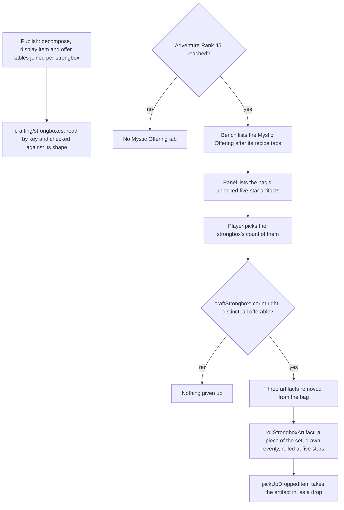

# Artifact Strongbox

The Crafting Bench's Mystic Offering turns three five-star artifacts from the bag into an Artifact Strongbox (`~/Esposter/genshin-parity/text/ExcelBinOutput/ReliquaryDecomposeExcelConfigData.json`, whose rows all give `needReliquaryCount` 3 at `needReliquaryRankLevel` 5), which holds one random piece of a set the player chooses. The strongbox's record is built from the game's own tables by `genshin:assets crafting` (`scripts/src/services/genshinAssets/crafting/buildCraftingStrongboxes.ts`) and read from the hosted game data. The offering opens from Adventure Rank 45 and is the bench's last tab (`packages/genshin-world/src/services/crafting/computeCraftingTabCells.ts`). The strongbox is rolled as a chest's artifact drop is, through the same piece-to-artifact step (`packages/genshin-world/src/services/artifact/drawSetArtifact.ts`, `packages/genshin-world/src/services/crafting/rollStrongboxArtifact.ts`), and the rolled artifact is taken into the bag as a drop pickup (`packages/genshin-world/src/services/crafting/craftStrongbox.ts`).

## How it works

- **The record is built by the scripts, not the page.** `toCraftingStrongboxes` joins the decompose table's reward preview to its display item, which names the set, and to the offer row of that set, whose five slot lists of five-star pieces give the strongbox's pool (`~/Esposter/genshin-parity/text/ExcelBinOutput/ReliquaryOfferPurchaseExcelConfigData.json`, and the five-star piece `75543` of set `15001` in `~/Esposter/genshin-parity/text/ExcelBinOutput/ReliquaryExcelConfigData.json`). Each strongbox's record holds its set, its name's text id, its rarity, its count and its pieces (`CraftingStrongboxData`, built in `scripts/src/services/genshinAssets/crafting/toCraftingStrongboxes.ts`). `buildCraftingStrongboxes` returns the records under the `crafting/strongboxes` key that `craftingCommand` publishes with the recipes, and `readCraftingStrongboxes` reads that key back, refusing a record that does not match its shape.
- **The gate and the tab.** `MYSTIC_OFFERING_ADVENTURE_RANK` is 45. `computeCraftingTabCells` adds the offering's tab after the recipe and conversion tabs, under its own tab id, once the gate is reached. `packages/genshin-world/src/components/Crafting/Screen/Index.vue` takes the Mystic Offering panel while its tab is picked, and the panel's Back returns to the bench.
- **The panel offers what the bag holds.** `Crafting/Strongbox` lists only the artifacts `checkIsOfferableForStrongbox` accepts: an artifact of five stars that is not locked. An artifact worn by a character is not in the bag, so it is never listed (`packages/genshin-world/src/services/crafting/checkIsOfferableForStrongbox.ts`).
- **The craft is all or nothing.** `craftStrongbox` requires exactly the strongbox's count of different offerable artifacts. Any other choice returns no result and gives up nothing. A valid choice removes the three from the bag, then rolls the strongbox's piece and takes it in through `pickUpDroppedItem`, so a full bag refuses the artifact the way it refuses any drop (`packages/genshin-world/src/services/interaction/pickUpDroppedItem.ts`, which leaves what the bag has no room for as overflow).
- **The piece is a chest's roll.** `rollStrongboxArtifact` takes the strongbox's pieces at its rarity, draws one evenly, and rolls it through `rollPieceArtifact`, the step the chest drop shares (`packages/genshin-world/src/services/crafting/rollStrongboxArtifact.ts`). The chest reaches the same step through `drawSetArtifact` (`packages/genshin-world/src/services/artifact/drawSetArtifact.ts`).

## Notes

- Piece odds are not known. The wiki gives none for the piece within the set, so the draw is even among the offer row's pieces (`packages/genshin-world/src/services/crafting/rollStrongboxArtifact.ts`), and the offer row is taken as the pool the game uses.
- One strongbox per offering. The game's batch of up to 39 artifacts (`maxReliquaryNum` is 39 in every row of `~/Esposter/genshin-parity/text/ExcelBinOutput/ReliquaryDecomposeExcelConfigData.json`), which makes up to thirteen strongboxes at once, is not built.
- The gate is the wiki's rank, not a value the dump's tables hold. It stays provisional until the unlock is found in the game's data.
- The tab's place after the recipe tabs, and the panel taking the screen over the bench, are not measured against the game. Both wait on a recording.
- The locked check reads the artifact's saved `isLocked` flag. The lock toggle belongs to the artifact screen, not to this capability.

## Key files

| File                                                                           | Its role                                                                 |
| :----------------------------------------------------------------------------- | :----------------------------------------------------------------------- |
| `scripts/src/services/genshinAssets/crafting/toCraftingStrongboxes.ts`         | joins the four tables into one record per strongbox                      |
| `scripts/src/services/genshinAssets/crafting/buildCraftingStrongboxes.ts`      | reads the tables and returns the records under `crafting/strongboxes`    |
| `scripts/src/services/genshinAssets/commands/craftingCommand.ts`               | publishes the strongbox records with the recipes                         |
| `packages/genshin-world/src/models/crafting/CraftingStrongboxData.ts`          | the record and its schema                                                |
| `packages/genshin-world/src/services/crafting/readCraftingStrongboxes.ts`      | reads the record by its key, checked against its shape                   |
| `packages/genshin-world/src/services/crafting/constants.ts`                    | `MYSTIC_OFFERING_ADVENTURE_RANK` and the offering's tab id               |
| `packages/genshin-world/src/services/crafting/computeCraftingTabCells.ts`      | the bench's tab list, with the offering's tab after the recipe tabs      |
| `packages/genshin-world/src/services/crafting/checkIsOfferableForStrongbox.ts` | whether a bag entry is an unlocked artifact of the strongbox's rarity    |
| `packages/genshin-world/src/services/crafting/rollStrongboxArtifact.ts`        | picks the set's piece and rolls it at the strongbox's rarity             |
| `packages/genshin-world/src/services/crafting/craftStrongbox.ts`               | removes the three artifacts and takes in the rolled one                  |
| `packages/genshin-world/src/services/artifact/rollPieceArtifact.ts`            | the piece-to-artifact step, shared with the chest drop                   |
| `packages/genshin-world/src/services/chest/rollChestDrops.ts`                  | the chest's artifact roll, which calls the shared step                   |
| `packages/genshin-world/src/components/Crafting/Screen/Index.vue`              | the bench's screen, which takes the offering's panel while its tab is up |
| `packages/genshin-world/src/components/Crafting/Strongbox/Index.vue`           | the Mystic Offering panel                                                |
| `packages/genshin-text/src/models/GameTextKey.ts`                              | the panel's words, by their text ids                                     |

## Sources

- [Mystic Offering](https://genshin-impact.fandom.com/wiki/Mystic_Offering), Genshin Impact Wiki: the offering is a Crafting Bench method open from Adventure Rank 45, and three five-star artifacts give one Artifact Strongbox. The Adventure Rank 45 gate is unverified, as its page is not in the cache (see Open).
- [Artifact Strongbox](https://genshin-impact.fandom.com/wiki/Artifact_Strongbox), Genshin Impact Wiki: a strongbox holds a random artifact of the selected set, and at most 39 artifacts are offered at once. Not yet read: the page is not in the cache, so these claims, the roll included, are unverified (see Open).
- [AnimeGameData](https://github.com/DimbreathBot/AnimeGameData), the community's per-patch dump: the decompose, display item and offer tables the record is joined from.

## Open

- [ ] **the Mystic Offering opens at Adventure Rank 45** — no source yet: the cached Mystic Offering wiki page is not on disk, and the dump's tables do not hold the gate.
- [ ] **a strongbox holds one random piece of the chosen set** — no source yet: the cached Artifact Strongbox wiki page is not on disk, and no recording shows a roll.
- [ ] **the game draws a strongbox's piece evenly from the offer row's pieces** — no source yet: the cached Artifact Strongbox wiki page is not on disk, and no recording shows a roll.
