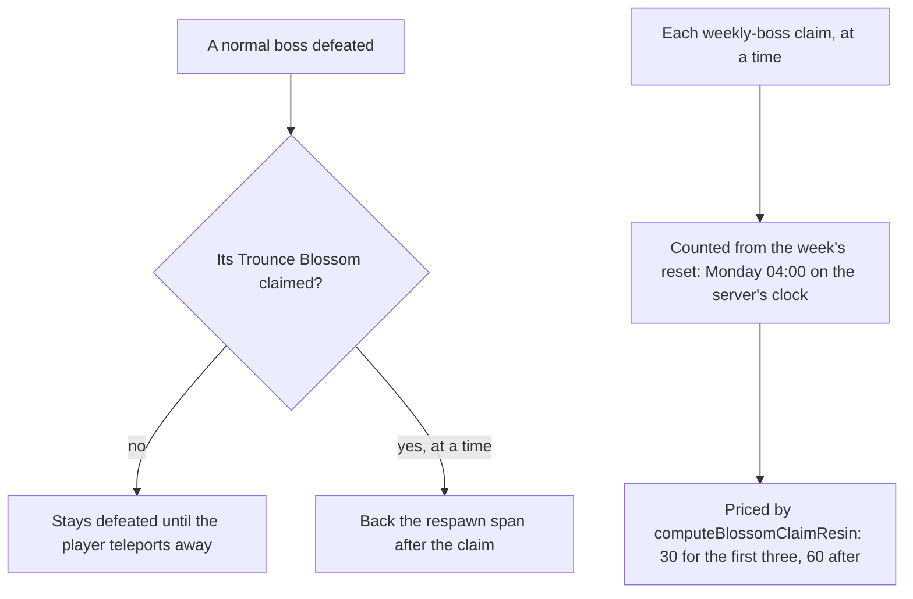

# Bosses

Bosses are the enemies whose reward is claimed rather than dropped, so their rules are a service of their own rather than the enemies' drops. Two rules are built as pure services in `genshin-world`: when a normal boss comes back after its Trounce Blossom's claim, and where a week's weekly-boss claims are counted from (`packages/genshin-world/src/services/bosses/computeBossRespawnTime.ts`, `packages/genshin-world/src/services/weekly/countWeeklyClaims.ts`). The world reads both now: the [enemies](../enemies/design.md)' respawn check gives a normal boss its claimed time or its first teleport (`packages/genshin-world/src/services/enemy/checkIsEnemyRespawned.ts`), and the claim composable reads the weekly claims that the price, built on the [Original Resin](../original-resin/design.md) page, is counted from (`packages/genshin-world/src/composables/useWorldTrounceBlossoms.ts`). The rules are the [proposal](../../../changes/genshin-bosses/design.md)'s, read off the wiki.

## How it works

## Decisions

- **An unclaimed boss has no respawn time.** `computeBossRespawnTime` returns undefined for a boss with no claim, since it stays defeated until the player teleports away, which the world will take as the claim's absence (`packages/genshin-world/src/services/bosses/computeBossRespawnTime.ts`).
- **A claimed boss is back a fixed span later.** `BOSS_RESPAWN_AFTER_CLAIM_DURATION` holds the five seconds the wiki's Normal Bosses page gives, a figure that page is not in the cache to settle (see Open), and a claim at any time brings the boss back that span after it. The span's value lives in `packages/genshin-world/src/services/bosses/constants.ts`, and the return is `packages/genshin-world/src/services/bosses/computeBossRespawnTime.ts`.
- **The week resets on Monday at 04:00 on the server's clock.** `computeLastWeeklyReset`, in the [reset clock](../reset-clock/design.md), finds the most recent Monday at the server's 04:00 at or before the moment read, the one clock every reset is read on, which `packages/genshin-world/src/services/time/constants.ts` names `GAME_TIME_ZONE`, `Asia/Shanghai`. A moment before that week's reset belongs to the week before. The Monday 04:00 is the weekly refresh row `REFRESH_WEEKlY`, id 800001, `14400;360000`, in `~/Esposter/genshin-parity/text/ExcelBinOutput/RefreshPolicyExcelConfigData.json` (14400 is the 4:00 hour, and 360000 seconds past the epoch's Thursday is Monday 04:00); the function is `packages/genshin-world/src/services/time/computeLastWeeklyReset.ts`.
- **A claim at the reset counts toward the new week.** `countWeeklyClaims` counts a claim made at or after the reset and no later than the moment read, so the claim at exactly 04:00 Monday is this week's first and a claim after the moment is not yet counted (`packages/genshin-world/src/services/weekly/countWeeklyClaims.ts`).
- **One count across every weekly boss.** `countWeeklyClaims` counts the claims of all weekly bosses together, since the cheap price is for the first three claims in the week, whichever boss they are for (`packages/genshin-world/src/services/weekly/countWeeklyClaims.ts`).
- **A weekly boss's claim costs 30 resin for the first three of a week and 60 after.** The wiki's Weekly Bosses page, named in Sources, would give the same two prices, but it is not in the cache, so the prices are open (see Open). The code's constants hold them (`packages/genshin-world/src/services/originalResin/constants.ts`), and the export's discount row gives three claims at 0.5 (`CONST_VALUE_WEEKLY_BOSS_RESIN_DISCOUNT_PARAM` in `~/Esposter/genshin-parity/text/ExcelBinOutput/ConstValueExcelConfigData.json`).

## Scope and order

**Built:** the respawn rule after a claim and the weekly reset and count, as pure services with tests (`packages/genshin-world/src/services/bosses/computeBossRespawnTime.ts` with its `.test.ts`, `packages/genshin-world/src/services/time/computeLastWeeklyReset.ts` with its `.test.ts`, and `packages/genshin-world/src/services/weekly/countWeeklyClaims.ts` with its `.test.ts`).

Not built, and in the [proposal](../../../changes/genshin-bosses/design.md): the Trounce Blossom's offer and claim, which wait on the enemies' defeat map and the interaction prompts; the bosses' rewards, which need the reward table fetched since the dump's blossom tables hold no normal boss's row (`~/Esposter/genshin-parity/text/ExcelBinOutput/BlossomRefreshExcelConfigData.json`, whose 55 rows name no boss refresh type); each boss's moves, phases and shields; the weekly bosses' domains and quests; and the handbook's quick challenge rewards.

## Key files

| File                                                                   | Role                                                                                      |
| :--------------------------------------------------------------------- | :---------------------------------------------------------------------------------------- |
| `packages/genshin-world/src/services/bosses/constants.ts`              | The five-second respawn after a claim                                                     |
| `packages/genshin-world/src/services/bosses/computeBossRespawnTime.ts` | A claimed boss's time back, and none while it is unclaimed                                |
| `packages/genshin-world/src/services/time/computeLastWeeklyReset.ts`   | The Monday 04:00 server reset at or before a moment                                       |
| `packages/genshin-world/src/services/weekly/countWeeklyClaims.ts`      | The claims made since the week's reset, the count that prices the next claim              |
| `packages/genshin-world/src/services/enemy/computeEnemyRespawnTime.ts` | A normal boss back five seconds after its claim, or at the first teleport while unclaimed |

## Sources

- [Normal Bosses](https://genshin-impact.fandom.com/wiki/Normal_Bosses), Genshin Impact Wiki: the Trounce Blossom's claim, and the respawn five seconds after a claim or only on teleporting away.
- [Weekly Bosses](https://genshin-impact.fandom.com/wiki/Weekly_Bosses), Genshin Impact Wiki: the weekly claims and their prices.
- [Domains](https://genshin-impact.fandom.com/wiki/Domains), Genshin Impact Wiki: a weekly reward once a week, 30 resin for the first three and 60 after, refreshed at the weekly reset.
- The weekly reset on Monday at 04:00, as the [reset clock](../reset-clock/design.md) gives it.

## Open

- [ ] **A normal boss stays defeated until the player teleports away** — no source yet: the wiki's Normal Bosses page, named in Sources, is not in the wiki cache.
- [ ] **A claimed normal boss returns five seconds after its claim** — no source yet: the wiki's Normal Bosses page, named in Sources, is not in the wiki cache, and no respawn row in the game's exports holds the five seconds.
- [ ] **The weekly reset is read on the server's UTC+8 clock** — no source yet: no row of the game's exports names the zone, and the wiki's Domains page, named in Sources, is not in the wiki cache.
- [ ] **A weekly boss's claim costs 30 resin for the first three of a week and 60 after** — no source yet: the export's weekly discount row gives three claims at 0.5 but no base price of 60, and the wiki's Weekly Bosses page is not in the wiki cache.
- [ ] **The first three weekly claims count across every weekly boss together** — no source yet: the export's weekly discount row does not say the cheap claims are counted across bosses, and the wiki's Weekly Bosses page is not in the wiki cache.
