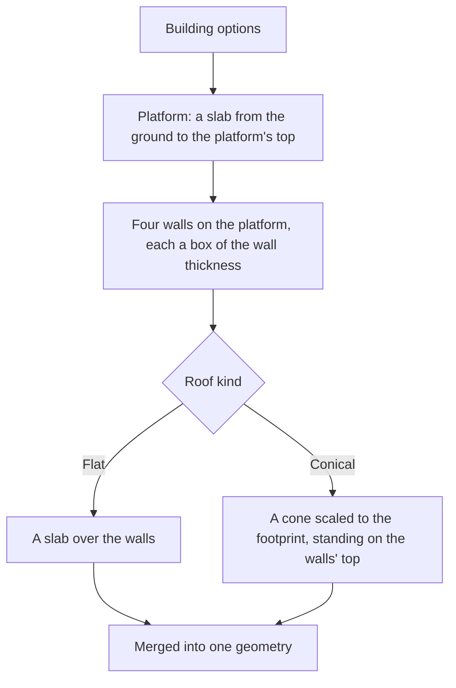

# Buildings

A region's settlements are built from a small set of pieces that repeat, so the kit builds a building from its dimensions rather than from a stored mesh (`packages/genshin-world/src/services/world/BuildingKitPartsMap.ts`, `packages/genshin-engine/src/kits/architecture/createBuildingGeometry.ts`). One building is a platform the walls stand on, four walls and a roof, each given in metres from the ground. Its geometry is one mesh, so a building is one draw for its material (`packages/genshin-engine/src/kits/mergeGeometryParts.ts`).

## How it works

- **The pieces are boxes, and the walls are the boxes' inner ring.** The platform spans the whole footprint. Each wall is a box along one edge, the two long walls running the full width and the two short walls fitting between them, so the four boxes meet at the corners without overlapping (`createBoxesGeometry`).
- **A flat roof is one more box** over the walls, its thickness its roof height.
- **A conical roof is a cone scaled to the footprint.** A unit cone is stretched to half the footprint's width and depth, so its base lies over the walls' outside edge on any rectangle, not only a square. Its apex stands the roof height above the walls.
- **The result is merged** into one geometry, the parts freed once merged (`mergeGeometryParts`).

The building is centred on the origin and stands on it, so a caller places it on the ground with its position (`packages/genshin-engine/src/kits/architecture/createBuildingGeometry.ts`). Natlan's tribes build with it (`packages/genshin-world/src/services/world/BuildingKitPartsMap.ts`), the People of the Springs' first building standing as a [building landmark](../region-buildings/design.md) (`packages/genshin-world/src/data/regions/natlan.json`).

## Key files

| File                                                                      | Role                                                         |
| :------------------------------------------------------------------------ | :----------------------------------------------------------- |
| `packages/genshin-engine/src/kits/architecture/createBuildingGeometry.ts` | Builds a building's platform, walls and roof as one geometry |
| `packages/genshin-engine/src/models/kits/architecture/BuildingOptions.ts` | The dimensions a building is built from, in metres           |
| `packages/genshin-engine/src/models/kits/architecture/RoofKind.ts`        | The roof a building is capped with: flat or conical          |
| `packages/genshin-engine/src/kits/architecture/createBoxesGeometry.ts`    | The box builder the walls and platform are made from         |

## Open

- [ ] **Natlan's tribes build with the kit** — no source yet: a measurement of the Natlan building meshes under `{data-root}/genshin-parity/extracted/natlan/assets/Mesh/` (`Area_Nt_Build_*.obj`) against the kit's box-and-cone form.
- [ ] **The People of the Springs' first building stands as a building landmark** — no source yet: a game record that places that building as a landmark, since the repo's own region data settles no game claim.
