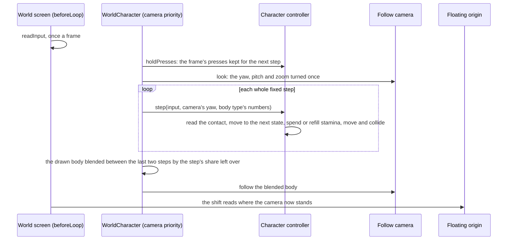
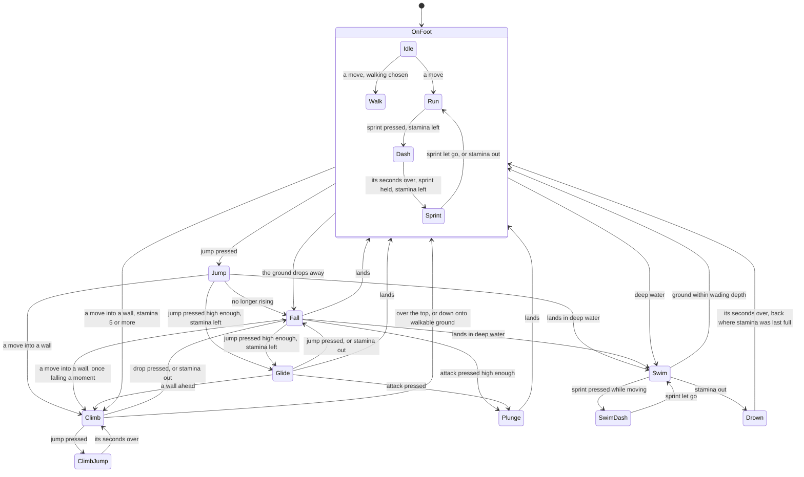

# Character controller

The world is walked, as the game's is. A body stands where the character does, and the player moves it through the game's movement states with the game's keys: it walks, runs, sprints and dashes on the ground, jumps and falls, opens a glider high enough up and plunges from it, climbs any surface too steep to walk, and swims in deep water. The states that take effort spend one stamina pool, and running out of it stops them as the game does. The [follow camera](../follow-camera/design.md) stands behind the body.

The mechanism is `genshin-engine`'s `locomotion` module, which knows no place and no character: `createCharacterController` moves a capsule against a ground query and the landmark collider (`collision`), and `computeLocomotionState` and `createStamina` hold the rules. The world's `WorldCharacter` wires it to Windrise's ground and to the party's character on the field, whose body type gives the body its numbers.

## A frame and its steps

- **Fixed steps, a press kept until one reads it.** The body moves in steps of a sixtieth of a second, so a run covers the same ground at any frame rate. A frame's presses (jump, dash, drop, attack, the walk switch) are held by the controller until the next step reads them, so a press in a frame that runs no step, on a display faster than the step, is never lost; the step that reads them lets them go.
- **A kit reads the presses before the step spends them.** `heldPresses` is the frame's presses as the next step will read them, so the character's kit takes its attack, skill and burst presses from it before the step clears them. While a kit's action plays, the step is given the same presses with no move, so the body holds where it stands and the presses still reach the controller.
- **The move is relative to the camera.** `W` moves along the camera's yaw over the ground and `A` and `D` across it, as the game's controls bind them ([controls](../controls/design.md)). On a wall `W` climbs up and `A` and `D` climb across, whatever the camera faces.
- **The body moves in the world's own coordinates.** It reads the terrain's height function directly, so the [floating origin](../terrain/design.md) never has to move it: what is drawn on it is placed in the world group, which the origin offsets, at the body's place, and the camera is placed in the scene's coordinates by the origin. Its frame callback runs at `CAMERA_FRAME_PRIORITY`, ahead of the origin's shift whatever order it mounts in.

## The states

`computeLocomotionState` is these gates as a pure function of the body's phase (its state and the seconds it has been in it), the step's input, what the world says of the body and the stamina left. What the world says is a `LocomotionContact`: whether the body stands on walkable ground, still rises from a jump, is high enough above the ground to open its glider or plunge, is in water deeper than it wades, and faces a surface too steep to walk. A dash, a climb's jump and drowning last their own seconds. A fall catches a wall only once it has fallen a moment, so a drop is not caught at once by the move still pushing into the wall. Walking is the left Control's switch, or a stick pushed only part way, as a light push walks in the game.

## The body

The body is a kinematic capsule, moved by queries rather than a physics solver, since the game drives its movement directly and nothing in the world is a stack of falling boxes.

- **On foot** it follows the terrain up and down anything within its step, and stops at a rise steeper than it can walk, which it then faces as a wall. A drop past its step leaves it in the air.
- **In the air** it falls under gravity up to its fall's top speed, steered at the speed it left the ground at. A jump leaves at the speed that reaches its jump's height. Landing on ground too steep to stand on slides it down.
- **On a wall** it moves in the wall's plane. A terrain cliff holds it to the terrain's own surface, read through the height function; a landmark's wall holds it by pressing it into the wall each step, so the push back out reports the wall again. Past a wall's top the body falls onto what stands above, or climbs over onto walkable ground.
- **In water** it floats with its feet its wading depth under the surface, and stands once the ground rises to meet them.
- **Turned on the spot.** `face` turns the body to a facing without moving it, which a kit's action does to aim at the enemy it targets. The body's facing is the one the camera follows and the hits are drawn from.

After each move the capsule is pushed out of the landmarks it overlaps. A push mostly upward stands it on a landmark's floor, one mostly sideways holds it against a wall it may climb, and one downward stops a jump under a ceiling.

## The landmarks

`createLandmarkCollider` holds each landmark's triangles in a bounding volume hierarchy, `three-mesh-bvh`'s, built once as the landmark arrives in the frame of the group the landmarks stand in, which is the world's own coordinates; the floating origin moves the group without moving that frame. Each landmark's meshes are merged into one geometry in that frame, their positions transformed once into one typed array and their indices into another, with no object made per triangle, and the hierarchy is built over it. `WorldLandmarks` gives the collider its group once the scene holds the meshes and again whenever the regions in reach change, and the collider builds what is new and lets go of what has gone. Everything a landmark draws collides, its crown's leaves too. A query walks only the landmarks whose bounds it reaches, and down each only the nodes it reaches, testing each triangle there with three's octree's own capsule and sphere tests: the capsule's push and the [follow camera](../follow-camera/design.md)'s sphere cast along its arm.

## Stamina

One pool, shared by the party, starts at 100 and refills at 25 a second once a second and a half passes with no action that costs it, as the game's wiki gives it. A dash costs 18 as it starts, a sprint 18 a second, a climb's jump 25, and a swim's dash 2 to start and 10.2 a second while it moves. A swim costs 4 a stroke, one as it starts and one each stroke on, a stroke to each cycle of the swim clip, whether the body moves or treads water. A glide costs 3 a second, the wiki's approximation, which a published study timing a full pool's drain confirms. A climb costs by the second while the body moves on the wall, which the wiki leaves unknown: the same study counts one stamina a climbing action, and a body's climb clip makes two actions a cycle; a climb needs 5 to start. The pool refills on foot and in the air outside the glider, and never on a wall, in water or under the glider.

A kit's action spends its own stamina as it starts, through `spend`, which takes the amount at once and restarts the refill's rest, so the pool refills only once the delay has passed from that spend. A sword's charged attack spends 20. Every spend is multiplied by the controller's `getStaminaConsumptionMultiplier` option, read at each spend and 1 when none is given, which is how the party's Impetuous Winds cuts the stamina it takes ([party](../party/design.md)); a charged attack is gated by `checkCanSpend` at that same multiplied cost, so the gate and the spend agree.

Running out stops what costs: a sprint drops to a run, a climb lets go and falls, a glide closes, and a swim drowns. A drowned body comes back where its stamina was last full on foot, refilled, as the game returns its party. The pool's most is the controller's `staminaMaximum` option, held at 100 by the character component, since no statue's level is reached in the world yet ([Statues of The Seven](../statues-of-the-seven/design.md)).

## The numbers

Every speed, height and threshold is a body type's, since how far a character sprints and jumps differs by its body. `BodyTypeLocomotionMap` holds one `Locomotion` for each of the game's body types, and `getCharacterLocomotion` reads the party's character on the field into its body type's. Each type's entry is its own and never lent to another; what nothing of the game holds yet, every type takes from `PROVISIONAL_LOCOMOTION`. Each number is traced to its source by the [parity](../parity/passes/design.md) passes rule, which takes the exact source first, and every reading is kept in the character's reference topics, `Locomotion.reference.ts` and `Stamina.reference.ts`:

- **The game's own clips** for the speeds: `pnpm -C scripts genshin:assets locomotion <body>` exports a body type's walk, run, sprint, dash, jump, climb, climb jump, swim, swim dash, drowning and glide clips from the asset index and reads each one's root motion, its seconds, the ground it covers and its rise beside the average speed it records. The clips are humanoid, so their root moves in Mecanim's normalised space, and the game moves a body by it times its avatar's human scale, the height of the body's centre in its T-pose: the command exports a character's avatar of the body and reads every clip in metres at its scale. Read so, the tall male sprints and dashes farthest, then the tall female and the medium male, the medium female and the short female, the order the wiki gives; unscaled, the order is reversed. Every body type's walk, run and sprint, their dash, their climb and climb jump, their swim and swim dash and their drowning are its own clips' root motion, each speed within a fraction of a percent of the average its clip records but the short female's dash, about a percent under it.
- **The jump clip's root curve** for the jump and the fall. The command reads a clip's root only where it starts and stops, which for the jump is a long fall; the curve between is read by decoding the clip's compressed tracks with ACL's own decompressor, given the clip's database as its streamer, which AnimeStudio's export does not pass. The root rises to an apex and falls back through its take-off height about half a second in: the apex is the body's jump height, and its gravity is the one that returns the body to the ground when the clip's root does, since the clip's rise and fall each stray from one parabola. Its fall then settles at a steady speed, which is where the body's fall tops out.
- **The game's data** for the capsule: the community's dump of each character's configuration holds the character's height, a field whose name is obfuscated but which stands a head's height over the head bone of every body's avatar. A body's capsule stands as tall as the character whose avatar gives its scale, and it swims where water reaches seven tenths of that height, since the wiki gives deep water's threshold varying with the character's height; the share is a best estimate.
- **Best estimates** for what none of these hold: the glide's forward speed and its sink, the height the glider opens at, the plunge's speed, the capsule's radius, the step, the steepest walkable slope and the slide down ground too steep to stand on. A published clip timing a glide against a tall male's sprint along one street shows the glide the slower, without a distance to measure it by, so the glide's forward speed is set under the sprint's. Each is asked of the user as a yes-or-no question on the [roadmap](../../../changes/genshin-roadmap/tasks.md)'s Manual verification list, and is replaced when a recording's motion pass reads it.

## Decisions

- **A kinematic capsule on queries, no physics engine.** The game's movement is kinematic: the controller asks the world where the body may go and slides it along what it meets. A rigid-body engine's solver would fight the movement the game's feel depends on, and nothing in the world is a stack of falling boxes.
- **The game's states, and each of its distinct moves a state of its own.** A dash, a climb's jump and a swim's dash move and cost apart from what they start from, so each is a state, and the plunge is the fall the attack starts; the plunge's attack is combat's.
- **The landmarks collide through a bounding volume hierarchy, `three-mesh-bvh`'s, and three's octree keeps only its triangle tests.** Three's own octree, from its examples, was the first structure, chosen to take on no dependency, and its build was most of the world's load: a `Triangle` and three `Vector3`s per triangle, then a split that tests every triangle against every child's box, about 10 and 5 s on the main thread for the great oak's and the statue's tens of thousands of triangles. The hierarchy builds each over typed arrays in tens of milliseconds ([load budget](../load-budget/design.md)). Its `shapecast` walks only the nodes a capsule or a sphere reaches, and each triangle there is tested by the octree's `triangleCapsuleIntersect` and `triangleSphereIntersect`, so a touch, its normal and its depth are what they were; only the order a capsule meets several triangles in follows the hierarchy's nodes rather than the octree's cells. The package is an engine, kept rather than absorbed ([dependency admission](../../architecture/dependency-admission/design.md)).
- **The medium female body is measured first.** The world plays the Traveler, whose body it is, so that body type is the one walked.
- **Swimming strokes cost while treading water.** The wiki gives a stroke's cost and not whether a still body strokes; treading is charged as stroking until a recording of the meter in still water says otherwise.
- **The costs are the party's, not a body's.** The stamina pool is shared, so each action costs every body the same. The study counts the short female's climbing actions cheaper and faster than the other bodies', which comes to a third more a second; the shared cost is the other four bodies'.
- **The wiki's costs stand over the study's.** Where the wiki and the study both give a cost, the study's sprint, climb jump, slow stroke and refill each differ from the wiki's by a point or less, and the wiki's stands, being the first source in the order [parity](../parity/README.md) ranks.
- **The best estimates are the numbers in `PROVISIONAL_LOCOMOTION`, and the engine's `STEEP_SLIDE_SPEED` and `SWIM_STROKE_STAMINA_COST`.** Every body type shares them: a glide covers about 6 metres a second over level ground (the published clip `captures/yt-kyXg-Hx3Xlo-glide-compare.mp4` times a glide along Mondstadt's street at 15.0 seconds against a tall male's sprint at 11.9, with no distance) and sinks about 2.5 metres a second, the glider opens only 3 metres or more above the ground, a plunge falls about 30 metres a second, the body walks up a 0.4 metre step and a slope of about 50 degrees, its capsule is about 0.3 metres in radius, it swims where the water reaches about seven tenths of its height, slides down too-steep ground at about 4 metres a second, and a body treading still water spends a stroke's stamina at a time. A recording of the Traveler showing otherwise gives the number the constant then takes.

## Key files

| File                                                                            | Its role                                                                                        |
| :------------------------------------------------------------------------------ | :---------------------------------------------------------------------------------------------- |
| `packages/genshin-engine/src/locomotion/createCharacterController.ts`           | the body: contact, state, stamina, motion and collision, a step at a time                       |
| `packages/genshin-engine/src/locomotion/computeLocomotionState.ts`              | the states' gates, a pure function                                                              |
| `packages/genshin-engine/src/locomotion/createStamina.ts`                       | the pool: what each state costs, and when it refills                                            |
| `packages/genshin-engine/src/locomotion/constants.ts`                           | the pool's numbers and the body's own thresholds                                                |
| `packages/genshin-engine/src/collision/createLandmarkCollider.ts`               | each landmark's hierarchy, the capsule's push and the sphere's cast                             |
| `packages/genshin-engine/src/simulation/createFixedStepLoop.ts`                 | the steps, and the share of a step a frame has come into                                        |
| `packages/genshin-world/src/components/World/Character/Index.vue`               | the wiring: steps, the kit's presses, the drawn body's blend, the follow camera, a jump's place |
| `packages/genshin-world/src/services/kit/stepActiveKit.ts`                      | the kit's step: the body turned to its target, and its strikes                                  |
| `packages/genshin-world/src/components/World/CharacterPlaceholder/Index.vue`    | the body's capsule, drawn where no character's model is                                         |
| `packages/genshin-world/src/services/world/locomotion/BodyTypeLocomotionMap.ts` | each body type's numbers                                                                        |
| `packages/genshin-world/src/services/world/locomotion/constants.ts`             | the best estimates every type shares, where nothing of the game holds the number                |
| `packages/genshin-world/src/components/World/Character/Locomotion.reference.ts` | each reading of the body's numbers, with its source and outcome                                 |
| `packages/genshin-world/src/components/World/Character/Stamina.reference.ts`    | each reading of the pool's costs                                                                |
| `packages/genshin-world/src/components/World/Landmarks/Index.vue`               | gives the collider the landmarks as they arrive                                                 |
| `scripts/src/services/genshinAssets/locomotion/readLocomotionClips.ts`          | a body type's clips exported and read for their root motion                                     |
| `scripts/src/services/genshinAssets/locomotion/readBodyHumanScale.ts`           | a body type's human scale, off a character's avatar of the body                                 |

## Notes

- **A jump from the map places the body**, standing it on the ground at the jump's point facing its yaw, with the follow camera level behind it, and makes that point where a drowning brings it back to until its stamina is next full on foot. A place ends a kit's action in progress, since the body no longer stands where it played it.
- **A party switch changes the body type the next step moves by** and the model drawn on the body, never the body's place or its stamina, which the party shares.

## Sources

- [Stamina](https://genshin-impact.fandom.com/wiki/Stamina), Genshin Impact Wiki: the shared pool of 100, its refill of 25 a second after 1.5 seconds, each action's cost, the climb's marked unknown and its 5 to start.
- [Sprinting](https://genshin-impact.fandom.com/wiki/Sprint), Genshin Impact Wiki: a dash on the press and a sprint on the hold, and the distance differing by model type.
- [Climbing](https://genshin-impact.fandom.com/wiki/Climbing), Genshin Impact Wiki: any surface short of upside down, the climb jump, and the fall when stamina runs out.
- [Gliding](https://genshin-impact.fandom.com/wiki/Gliding), Genshin Impact Wiki: the glider opened by a jump in mid-air high enough, closed by another, a plunge from it, and its cost approximated from player testing.
- [Swimming](https://genshin-impact.fandom.com/wiki/Swimming), Genshin Impact Wiki: deep water's threshold varying with the character's height.
- [Model Type](https://genshin-impact.fandom.com/wiki/Model_Type), Genshin Impact Wiki: the five playable model types, and movement differing between them.
- [AnimeGameData](https://github.com/DimbreathBot/AnimeGameData), the community's dump of the game's data: the characters' configurations under `BinOutput/Avatar`, their field names obfuscated, among them each character's height.
- [ACL](https://github.com/nfrechette/acl), Nicholas Frechette: the animation compression the game's clips are stored in, and the decompressor that reads a clip's tracks given its database.
- [体力回复与体力消耗（大型实测攻略）](https://www.bilibili.com/video/av251752644), 是水寒啊, Bilibili: every action's stamina timed or counted against a full pool, the glide's and the climb's among them.
- [Is Gliding Really Faster?](https://www.youtube.com/watch?v=kyXg-Hx3Xlo), YouTube: a glide, a glide with the Red Feather Fan and a tall male's sprint timed along one Mondstadt street.
- [Fallen Character](https://genshin-impact.fandom.com/wiki/Fallen_Character), Genshin Impact Wiki: drowning when stamina runs out in water, and the return where stamina was last full.
- [Controls](https://genshin-impact.fandom.com/wiki/Controls), Genshin Impact Wiki: the walk switch, the sprint, the jump and the drop on a PC and a pad.
- [three-mesh-bvh](https://github.com/gkjohnson/three-mesh-bvh), Garrett Johnson: the bounding volume hierarchy each landmark is held in, its `shapecast`, and its character movement example, which pushes a capsule out of the triangles a shape cast reaches.
- [Octree](https://threejs.org/docs/#examples/en/math/Octree), three.js: the capsule and sphere tests against one triangle the landmark collider runs.
- [Fix your timestep!](https://gafferongames.com/post/fix_your_timestep/), Glenn Fiedler: the state drawn blended between the last two steps by the accumulator's remainder.
- [KinematicCharacterController](https://rapier.rs/javascript3d/classes/KinematicCharacterController.html), Rapier: a kinematic controller that hits and slides against obstacles, confirming that the movement the game needs is queries and sliding rather than a rigid-body solve; weighed and not taken.

## Reference

- `world-movement.mkv` — run, sprint, a jump, a glide off a height, a climb, a swim, the stamina meter in view. Partly found 2026-10-11: https://www.youtube.com/watch?v=kyXg-Hx3Xlo (`captures/yt-kyXg-Hx3Xlo-glide-compare.mp4`) times a glide against a sprint along one street, and https://www.bilibili.com/video/av251752644 (`captures/bili-av251752644-stamina.mp4`) times or counts every action's stamina against a full pool; the run, the jump and the fall are the body's own clips' ([character controller](design.md)); still sought: a glide off a known height over a known distance, a plunge, a step and a slope walked, and a body treading still water with the meter in view.
