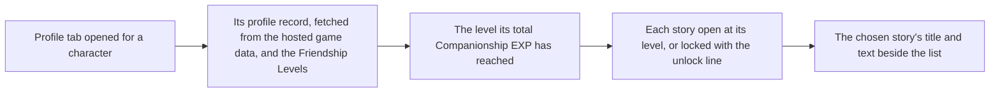

# Character profile

The character screen's Profile tab lists a character's stories down its left, `Character Details`, the five character stories, the pet's story and `Vision` in the game's order (`~/Esposter/genshin-parity/text/ExcelBinOutput/FetterStoryExcelConfigData.json`, Jean's rows 4201 to 4208, which give `Character Details`, `Character Story 1` to `5` and `Vision`), and then its voice-overs in the order the game lists them (`~/Esposter/genshin-parity/text/ExcelBinOutput/FettersExcelConfigData.json`). It shows the chosen entry's title and text down its right. A story or voice-over opens at the Friendship Level its fetter names (`~/Esposter/genshin-parity/text/ExcelBinOutput/FetterStoryExcelConfigData.json`, line 39: a `FETTER_COND_FETTER_LEVEL` of 2 on Jean's second story). One that waits on another condition, a quest for instance (`FETTER_COND_FINISH_QUEST` on 88 story rows of that file), stays locked whatever the level. The locked list shows the game's unlock line (`~/Esposter/genshin-parity/text/TextMap/TextMap_MediumEN.json`, line 168534) in place of a story's title, or its title alone when no level opens it.

## How it works

`pnpm -C scripts genshin:assets profile` builds each playable character's stories, voice-overs and namecard from the dump, in every language, and publishes them to the hosted game data as one index a language, each character keyed by its id ([hosted game data](../hosted-game-data/design.md)). The characters it covers are the ones in the `stats/characters` record that the stats step published. The panel reads the record of its character in the language the screen is in, so a reader downloads only that one record.

## Decisions

- **Stories are the fetter story table's rows, one each.** (`~/Esposter/genshin-parity/text/ExcelBinOutput/FetterStoryExcelConfigData.json`, 974 rows.) A character's rows are taken in the order the table gives them, by fetter id (`scripts/src/services/genshinAssets/profile/selectFetterStoryRows.ts`, lines 10 to 11), and each title and text is the game's own string by its text id, read from the language's text map and English where that map lacks one (`scripts/src/services/genshinAssets/profile/toProfileStory.ts`).
- **Voice-overs are the fetters table's rows, read as stories.** Each row's title is its voice title's text id and its text the line it speaks, so one conversion serves both. The rows the game hides are left out (123 of the file's 9,183 rows carry `isHiden`, `~/Esposter/genshin-parity/text/ExcelBinOutput/FettersExcelConfigData.json`; `scripts/src/services/genshinAssets/profile/buildProfilePublication.ts`, line 40), and the rest keep the table's order by fetter id after the stories (`scripts/src/services/genshinAssets/profile/selectFetterStoryRows.ts`, lines 10 to 11).
- **A story or voice-over opens at its Friendship Level.** Its open conditions name the level, and one with no open conditions opens at once. One whose conditions name anything besides a level, a quest for instance, stays locked whatever the level, with a level among them or none.
- **A locked story with a level to open at shows the game's unlock line,** `Lv. {0} unlocks: {1}`, with that level and its title, and no text. This is the game's own line by its text id (`~/Esposter/genshin-parity/text/TextMap/TextMap_MediumEN.json`, line 168534, text id 2616170868), so nothing is phrased here. A locked story with no Friendship Level among its conditions shows its title alone.
- **The tab sits in the character menu's panel**, widened from the characters' row's left edge so the list and the text share it. The reference is the game's separate Profile / Story page with its own header, and that page is not built; the tab's layout and colours are provisional until the user compares them.
- **The namecard is the avatar icon's name with the namecard prefix,** for every playable character but Xinyan, Yae Miko and Momoka, who have none (81 of the 86 avatars with ids 10000002 to 10000099 in `~/Esposter/genshin-parity/text/ExcelBinOutput/AvatarExcelConfigData.json` have their derived `UI_NameCardIcon_` name among the namecard icons of `~/Esposter/genshin-parity/text/ExcelBinOutput/MaterialExcelConfigData.json`; `scripts/src/services/genshinAssets/profile/getNamecardIconName.ts` holds the three as its exceptions). The writer stores it per character; the panel shows the namecard's name once the Friendship holds it (the level-10 rows of `~/Esposter/genshin-parity/text/ExcelBinOutput/FetterCharacterCardExcelConfigData.json`, 120 of its 124; `packages/genshin-world/src/services/profile/readCharacterProfile.test.ts`), and its art is not drawn yet.
- **The Friendship Level is read from the save's Companionship EXP,** through the [companionship](../companionship/design.md) level table (`~/Esposter/genshin-parity/text/ExcelBinOutput/AvatarFettersLevelExcelConfigData.json`, ten levels from 1,000 EXP to 6,325; `packages/genshin-world/src/services/profile/readCharacterProfile.ts`), once the screen is given the save's companionship slice.
- **The Profile tab's reference frame** is a frame of the English client's profile page; its sizes and colours in the character menu's panel stand until the user compares them.

## Notes

- **Not drawn yet.** The reference's `Voice:` line with the voice actor, the player's UID, and the character's model in the middle of the page. The model waits on [characters](../characters/README.md), the rest on their own pages.
- **The `Friendship` text** is written with the other game text, but no place in this frame shows it, so nothing draws it yet.

## Key files

| File                                                                       | Role                                                                                         |
| :------------------------------------------------------------------------- | :------------------------------------------------------------------------------------------- |
| `scripts/src/services/genshinAssets/profile/buildProfilePublication.ts`    | Builds each character's profile in every language from the dump, one index a language        |
| `scripts/src/services/genshinAssets/profile/toProfileStory.ts`             | A story row's open conditions and its text in one language                                   |
| `scripts/src/models/genshinAssets/profile/ExcelFetterVoiceRow.ts`          | A voice-over row of the fetters table, read as a story row                                   |
| `scripts/src/services/genshinAssets/profile/getNamecardIconName.ts`        | The namecard convention and the characters with none                                         |
| `packages/genshin-world/src/services/profile/readCharacterProfile.ts`      | Reads a character's profile record, its Friendship Level and its namecard's name text id     |
| `packages/genshin-world/src/services/profile/checkProfileStoryUnlocked.ts` | The unlock rule                                                                              |
| `packages/genshin-world/src/services/profile/toCharacterProfileEntries.ts` | Turns the stories and voice-overs into the panel's entries, locked ones with the unlock line |
| `packages/genshin-world/src/components/Character/Profile/Index.vue`        | The wrapper that loads the profile for the screen's character                                |
| `packages/genshin-world/src/components/Character/Screen/Index.vue`         | Opens the Profile tab for the chosen character                                               |
| `packages/genshin-interface/src/components/CharacterMenuProfile/Index.vue` | The list, the chosen story's text and the namecard's name plate                              |

## Open

- [ ] **The pet's story is one of the stories listed** — no source yet: no English story title in `~/Esposter/genshin-parity/text/ExcelBinOutput/FetterStoryExcelConfigData.json` names a pet, so the row the page means is unidentified, and Jean's rows hold a daily schedule the page does not name.
- [ ] **The Profile tab's reference frame is a frame of the English client's profile page** — no source yet: `references/character-profile/yt-2I_vWTyHqHg-profile-2s.png` is not under `~/Esposter/genshin-parity/references/`, and the cached clip `~/Esposter/genshin-parity/captures/yt-2IPBviDPFB8.mp4` carries another video id.
- [ ] **Xinyan, Yae Miko and Momoka have no namecard, and every other playable character has one** — no source yet: `~/Esposter/genshin-parity/text/ExcelBinOutput/MaterialExcelConfigData.json` holds a namecard named for Yae Miko (id 210112, `UI_NameCardIcon_Yae1`, "Kitsune Dreaming"), the Travellers' derived names (`UI_NameCardIcon_PlayerBoy` and `_PlayerGirl`) are absent, and the item each level-10 Friendship reward gives (rows 241024, 241046 and 241067 of `FetterCharacterCardExcelConfigData.json`) matches no material.
- [ ] **The profile step builds each character's profile in every language as one index a language** — no source yet: game data or a snapshot that holds this behaviour
- [ ] **The characters the profile covers are those in the stats characters record** — no source yet: game data or a snapshot that holds this behaviour
- [ ] **A story or voice-over opens at its Friendship Level, and one with no open conditions opens at once** — no source yet: game data or a snapshot that holds this behaviour
- [ ] **A story whose conditions name another condition stays locked whatever the level** — no source yet: game data or a snapshot that holds this behaviour
- [ ] **A locked story with no Friendship Level among its conditions shows its title alone** — no source yet: game data or a snapshot that holds this behaviour
- [ ] **The Profile tab sits in the character menu's panel, widened from the characters' row's left edge** — no source yet: game data or a snapshot that holds this behaviour
- [ ] **The Friendship text is written with the other game text** — no source yet: game data or a snapshot that holds this behaviour
