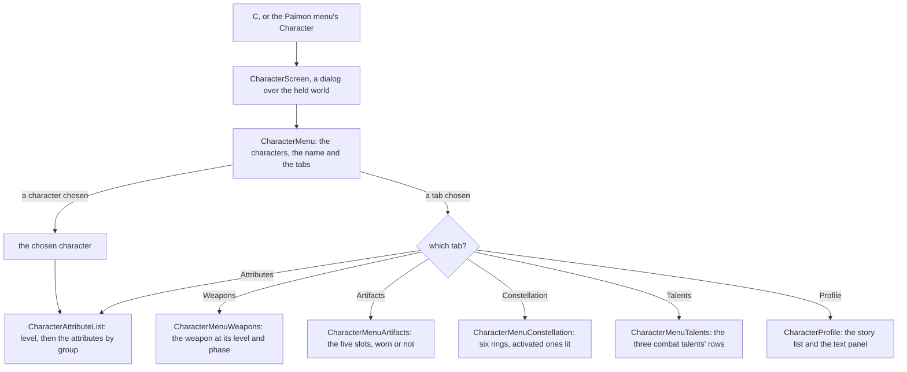

# Character screen

In the game, `C` opens the character screen: the player's characters across its top, one chosen, six tabs down its left, Attributes, Weapons, Artifacts, Constellation, Talents and Profile, and the open tab's panel down its right (`{data-root}/genshin-parity/comparisons/character-attributes.png`). The layout is measured off the English PC client's own frame (below). The look is provisional until the passes measure the colours, the portraits and the element's background. Each tab the recording shows is scored against its own frame of it, in the Notes.

## How it works

- **A frame with no words of its own.** `CharacterMenu`, in `genshin-interface`, draws the frame: the characters across the top, each a button naming the character, the chosen character's name at the top left, the six tabs down the left in the game's order (`CharacterMenuTabs`, as `{data-root}/genshin-parity/comparisons/character-constellation-tabs.png` shows it) with the open one lit, and the open tab's panel down the right as its slot. The chosen character and the open tab are its two models. Every word is a prop, so the interface package needs no game text and no world data.
- **The world's screen fills it.** `CharacterScreen`, in `genshin-world`, takes the player's characters, the one on the field, the game's words, the party's stamina and the stat tables the world screen has read before it opens ([character attributes](../character-attributes/design.md)). It opens on the character on the field and on Attributes, names each tab by the game's own text (`CharacterMenuTabGameTextKeyMap`; the six words are in `{data-root}/genshin-dump-backup-6.6/TextMap/TextMap_MediumEN.json`) and the Traveler by the game's own word for them, and draws the open tab's panel: the Attributes list, the Profile, or one of the four panels below. It is a dialog over the held world with a way back ([screens](../screens/design.md) sets how it closes).
- **The Attributes tab shows the character's sums.** `CharacterAttributeList` shows the character's name, its stars, its level over its phase's cap as the game's own level line (`CharacterLevelWithMax`, its cap in a dimmer colour), the experience bar, then its base five attributes: Max HP, ATK, DEF, Elemental Mastery and Max Stamina, whole. The advanced group (CRIT Rate, CRIT DMG, Healing Bonus and Energy Recharge) and each element's DMG Bonus with Physical's sit beneath Details once it is pressed, each a percentage to one place, under their titles. Every value comes from [character attributes](../character-attributes/design.md).
- **The four other panels are `genshin-interface` components, filled from the systems.** `CharacterMenuWeapons` takes the weapon's name, which the screen reads by its text id, its kind's word, its rarity, its base ATK and secondary attribute at its level and phase, each attribute's lines summed as the Attributes tab sums them (`getGrownAttributeLines`, `computeCharacterAttributes`), the secondary written whole or as a percentage by its kind, the level over its phase's cap, its refinement rank, its ascension phase and the Switch and Enhance words of its two buttons. `CharacterMenuArtifacts` takes the five slots' names in the game's order, each worn slot's stats, the attribute totals the worn artifacts add, and each active set's name above its own bonus lines, one group per set the worn pieces make. `CharacterMenuConstellation` takes which of the six are activated, from the character's count, and draws its Activate only while one is left. `CharacterMenuTalents` takes the three combat talents' levels as their `Lv. N` words, the normal attack, the Elemental Skill and the Burst, with each one's next phase, cost, the reason it cannot rise, whether its Upgrade is drawn and whether it is disabled, its Upgrade's label among them; a talent at its last level draws no Upgrade and names no reason. The Talents tab's rows are read by `getTalentRows` and its press raises a talent through `upgradeCharacterTalent` ([talents](../talents/design.md)). Each is a prop-only frame, and the game's words come in as props, since `genshin-interface` takes no game text of its own.
- **A slot for the host's own interface.** The screen lays its default slot over itself with the character it shows, outside the game's own screen, which its fixture never fills. The world fills it with the [official model's loader](../characters/README.md), our own control rather than the game's.

## Layout

Measured off the reference frame at 21:9, 3440 by 1440 pixels, in units: a pixel at 1440 high is 0.75 units, so the frame is 2580 units wide. Anchored pieces are placed from the edge they ride on, as the game places them.

| Piece                     | Place (units)                                                                                                                                         |
| :------------------------ | :---------------------------------------------------------------------------------------------------------------------------------------------------- |
| Characters across the top | 69-unit portraits on a 96-unit pitch, the first's centre 643 from the left, centre 47 from the top                                                    |
| Chosen character's name   | Left 216, centre 47 from the top                                                                                                                      |
| Tabs down the left        | Diamonds centred at 196.9, words at 225, 69.6-unit rows from 121 (first word centred 155.8); the open one's pill 165 from the left, 352 wide, 56 high |
| Panel                     | Left 2057, right margin 195 (its right edge is the frame's), 330 wide, top 124                                                                        |
| Way back                  | Centre 149 from the right, 49 from the top                                                                                                            |

## Decisions

- **The layout is the reference's.** The game draws the characters across the top and the tabs down the left. It was read off the user's own recording of the build at 21:9 (`{data-root}/genshin-parity/captures/session-2.mp4`, its English text, 49.9 frames a second), the character screen from about 154 seconds on, every tab in turn.
- **The panel is anchored to the right edge.** It moves with the window's width. Where the game anchors it at 16:9 is not measured yet: the reference is 21:9 only.
- **The name has its element before it.** The game writes the element before the name (`Geo / Xilonen`, `{data-root}/genshin-parity/comparisons/character-attributes.png`). The screen passes the element's own word as `elementName` (from `ElementNameGameTextKeyMap`), and the frame writes it before the name, so the breadcrumb reads `Geo / Xilonen`; `CharacterMenuEntry` still carries no element.
- **The open tab's pill slides.** At 158 seconds the pill is still moving from Constellation to Talents while Talents' text is already bold, and by 159 seconds the pill has faded out of its old place. The slide is not measured yet; it waits on the recording named in the roadmap.
- **Profile's red alert is not drawn.** The game marks Profile with a red alert when something waits there (`{data-root}/genshin-parity/comparisons/character-constellation-tabs.png`); its trigger is not built.
- **No heading over the panel.** The game draws the open tab's name nowhere on this frame (`{data-root}/genshin-parity/comparisons/character-attributes.png`); the lit row on the left says it.
- **Portraits are discs with their names on them.** The game's portraits are its own art, an asset the rules keep out of the repository; the discs, each the art's mean tone, stand in until a derived one is settled.
- **The background is one element's tint, per tab.** Each tab draws its own backdrop, a four-stop vertical gradient sampled from that tab's reference frame (numbers only, never the image) and held in `Character/Scene`'s style (`packages/genshin-world/src/components/Character/Scene/Index.vue`). Profile has no reference frame, so it keeps Geo's radial tint. Each element has its own tint in the game: `ElementNebulaMap` holds each one's radial tint, but only Geo's per-tab gradients are built.
- **The player's UID is not drawn.** The reference shows it under the panel; it is the player's own data.

## Notes

- **Five states are scored, each a frame of the same recording.** `packages/genshin-world/src/components/Character/Screen` fixes the roster, the Traveler among them, with Xilonen chosen at level 90 and phase six, and its stat tables read by `readStatTables` from the hosted game data's local mirror. `initialTab` opens the screen on the tab the reference shows, and the fixture's `variants` open it on the other four. Each reference is a frame of the user's recording (`session-2.mp4`) at 21:9, the tab settled, and it is scored over the whole frame and the tab column. The readings belong to the run's output.

The Artifacts and Constellation references are timed to where their tabs have settled, 157.5 and 158.3 seconds, since the tab is still fading in earlier. Their tab-column references are `character-artifacts-tabs` and `character-constellation-tabs`, timed the same way. The Constellation tab's node list is drawn in full at 158.3 seconds, and the Artifacts and Constellation references do not show their tabs at the frames their panels need, so their whole-frame scores cannot show the panels beyond that.

- **The Constellation panel is drawn.** Its six rings sit where the tab's list is at 158.3 seconds: 72 units across, their centres 111 units apart down the panel on an arc that bows right at the middle, all six lit, as the reference still shows (`{data-root}/genshin-parity/comparisons/character-constellation.png`, its left panel) and as Xilonen's record holds six constellations (`constellationCount` 6). The icons are the game's art, which the rules keep out of the repository, and the names wait on the game's text, so neither is drawn. With all six lit the Activate button is not drawn, as the reference shows none.
- **The backdrop samples the whole frame.** The middle is the held scene: the golden beams and particles and the character's model, which rises over 154.4 to 155.6 seconds and is the game's art, so the screen draws each tab's backdrop from its reference's scene and nothing more. The backdrop is sampled over the whole frame less its head band and its foot, as the median of six horizontal bands: the panels and the tab column are text over the scene, with no fill of their own in the reference. Sampling only the area the panels leave bare scores worse on every tab column but one.
- **Not drawn yet, for want of text or art.** The Friendship row's level, which the default panel shows beside its word under Details, and the character's description: the Friendship word (`GameTextKey.Friendship`) and its bar are drawn under Details, but the level is not, since the panel is not given it, and the description's words are not in the decoded English text yet. The element-coloured stars wait on the glyph pass or the text, the stars drawn white until then. The Weapons tab's passive name and description are not drawn: the reference sets them in the game's typeface, and ours drawn beside it scores worse than the frame's own text left bare (the id's mean rose by 0.26).
- **The Attributes tab's motion is owed.** The model's rise is read off the recording at 60 frames a second once `character-details.mkv` and the other owed clips land on the roadmap's References sought list.
- At 16:9 the panel stays right-anchored in the build, and the game's placement there is not measured yet: `character-attributes-1080.png` on the roadmap's References sought list is the reference that measures it.
- **Only the Traveler and the roster's names come from the game's text.** Every other character's name is read from the name text map (`nameText`), which the world screen loads for the banners as well (`{data-root}/genshin-dump-backup-6.6/TextMap/TextMap_MediumEN.json` holds "Xilonen" and "Traveler").

## Key files

| File                                                                              | Role                                                                                                     |
| :-------------------------------------------------------------------------------- | :------------------------------------------------------------------------------------------------------- |
| `packages/genshin-interface/src/components/CharacterMenu/Index.vue`               | The frame: the characters, the name, the tabs and the panel                                              |
| `packages/genshin-interface/src/components/CharacterMenu/Index.fixture.ts`        | Xilonen on Attributes, the reference's state                                                             |
| `packages/genshin-interface/src/models/CharacterMenuTab.ts`                       | The six tabs, and their order down the screen                                                            |
| `packages/genshin-interface/src/components/CharacterMenuWeapons/Index.vue`        | The Weapons panel: the weapon, its stats, level and refinement                                           |
| `packages/genshin-interface/src/components/CharacterMenuArtifacts/Index.vue`      | The Artifacts panel: the slots, the stats, the set bonus block and the actions (see the artifact screen) |
| `packages/genshin-interface/src/components/CharacterMenuConstellation/Index.vue`  | The Constellation panel: six rings, activated ones lit                                                   |
| `packages/genshin-interface/src/components/CharacterMenuTalents/Index.vue`        | The Talents panel: the three combat talents' rows and their Upgrade                                      |
| `packages/genshin-world/src/components/Character/Screen/Index.vue`                | The screen: the words, the characters and the way back                                                   |
| `packages/genshin-world/src/components/Character/AttributeList/Index.vue`         | The Attributes tab's level and attributes by group                                                       |
| `packages/genshin-world/src/services/character/CharacterMenuTabGameTextKeyMap.ts` | Each tab's name in the game's text                                                                       |
| `packages/genshin-world/src/services/character/constants.ts`                      | The Traveler's id and the advanced and elemental groups                                                  |
| `packages/genshin-world/src/services/character/readStatTables.ts`                 | The stat tables fetched by their keys and parsed against their schemas                                   |
| `packages/genshin-world/src/components/Character/Screen/Index.fixture.ts`         | The roster and Xilonen's tables, the parity page's state                                                 |

## Sources

- The English PC client's character screen, from the user's own recording of the build at 21:9 (`{data-root}/genshin-parity/captures/session-2.mp4`): Attributes at about 154 seconds, then Weapons, Artifacts, Constellation and Talents one second apart, the reference frame at 154 seconds.
- [Character Menu](https://genshin-impact.fandom.com/wiki/Character/Menu), Genshin Impact Wiki: `C`, the list of characters, the six tabs and what each shows, and the Attributes tab's summary and details. Its screenshots of this screen are phone-sized (`File:Traveler Pyro Character Details 1.png`, 700 by 1213), so they settle the phone's layout, not the PC's.
- The reference lays them out so: `{data-root}/genshin-parity/comparisons/character-attributes.png`; grounds "Characters are listed across the top and chosen by name", and the scenarios "Base five attributes shown whole" and "Level shown over its phase's cap".
- `{data-root}/genshin-parity/comparisons/character-constellation-tabs.png`; grounds "Six tabs down the left in the game's order".
- The words are in `{data-root}/genshin-dump-backup-6.6/TextMap/TextMap_MediumEN.json`; grounds "Six tabs down the left in the game's order".

## Open

- [ ] **In the game, `C` opens the character screen** — no source yet: no recording or wiki page of the key binding is in the parity folders, and the Character/Menu page is not in `{data-root}/cache/genshin-wiki/`.
- [ ] **The layout table's places** — no checked disagreement yet: `{data-root}/genshin-parity/comparisons/character-attributes.png` holds the Attributes reference as its left panel, a still, and no place in it is measured against the table.
- [ ] **The Attributes tab's sums** — contradicted by `{data-root}/genshin-parity/comparisons/character-attributes.png`: the reference's sums for Max HP, ATK, DEF and EM are well above the build's.
- [ ] **The level line in the game's `Lv.` wording** — contradicted by `{data-root}/genshin-parity/comparisons/character-attributes.png`: the game writes "Level 90 / 90", not "Lv. 90/90".
- [ ] **The advanced group's values and percentage format** — no source yet: the game holds this group behind Details, so no reference frame shows its values.
- [ ] **The parity scores of the five states the Notes name** — held by the snapshot's `character-attributes`, `character-artifacts`, `character-weapons`, `character-talents` and `character-constellation` rows (`scripts/src/services/genshinParity/shared/ParityReferenceMap.snapshot.md`).
